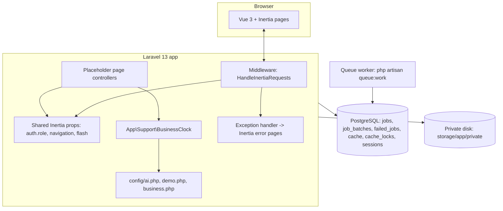
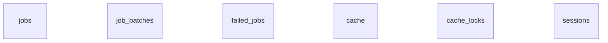

# Design Document

## Overview

S01 builds the technical base that every later spec (S02–S09) builds on: a Laravel 13 + Inertia/Vue 3 modular monolith, native local development against PostgreSQL, the design system tokens and reusable UI components, the application shell with a role-aware (but not yet authenticated) navigation scaffold, global error handling, toasts, environment configuration, the database queue/cache foundation, private storage, an AI configuration skeleton (no AI calls), the `BusinessClock` helper, and verified-version documentation.

This is a planning design for a single pass: there is no code in this document, no automated test suite is specified (per `.kiro/steering/verification.md`), and open points are resolved as documented assumptions rather than review questions, consistent with `.kiro/steering/scope-control.md` ("choose the simplest approach, document the assumption, flag for review").

S01 introduces no business logic, no authentication, and no Stage 2 feature, per Requirement 1 and Requirement 23.

## Selected Approach

Scaffold from the official Laravel Vue starter kit (Assumption A1 in requirements.md) rather than building the Inertia/Vue/Vite/Tailwind wiring by hand. Rationale:

- It already wires Laravel 13 + Inertia.js + Vue 3 (Composition API) + TypeScript + Vite + Tailwind, matching Requirement 1.1 and `docs/architecture.md` §2 exactly, so S01 effort goes into BusinessPulse-specific structure instead of re-deriving framework glue.
- Its bundled authentication screens and `User` model are **not extended**. They are kept only where removing them would break the build (Assumption A1); S02 owns their final shape. This avoids S01 quietly growing auth logic it does not own (scope-control.md).
- The starter kit's existing `tsconfig.json`, ESLint and Prettier configuration are tightened (`strict: true`, no unexplained `any`) rather than replaced, to minimize divergence from the Laravel-maintained template that later upgrades will track.

Alternative considered: hand-roll the Laravel+Inertia+Vite wiring from `laravel new` plus manual Inertia/Vue install. Rejected because it duplicates what the official starter kit already provides correctly and risks subtle Vite/Inertia SSR-less config drift; no identified benefit over the starter kit for Stage 1.

Everything else in S01 (design tokens, shell, components, config skeletons, `BusinessClock`) is additive on top of that scaffold, organized per `docs/architecture.md` §3–4 and `.kiro/steering/structure.md`.

## Architecture

S01 stands up the left/right edges of the architecture diagram in `docs/architecture.md` §1 (browser ↔ Laravel/Inertia ↔ PostgreSQL, plus the queue worker and private storage) without any of the business modules (Imports, Intelligence, Briefing, Meetings, Tasks, Outcomes) and without the AI HTTP client. The AI box in that diagram is represented only by configuration in S01.

### Affected / introduced modules

Per `docs/architecture.md` §3, S01 does not own any business module. It creates the cross-cutting scaffolding those modules will sit in:

| Area | S01 responsibility | Location |
|---|---|---|
| Support | `BusinessClock` | `app/Support/BusinessClock.php` |
| Configuration | AI/demo/business config skeletons | `config/ai.php`, `config/demo.php`, `config/business.php` |
| Shared Inertia contract | role/navigation/flash shared props | `app/Http/Middleware/HandleInertiaRequests.php` |
| Navigation definition | single source of nav items + visibility | `app/Support/Navigation.php` (or equivalent single server-side definition, Requirement 7.6) |
| Placeholder pages | routes + controllers for the 8 nav sections + Today redirect | `routes/web.php`, `app/Http/Controllers/*` |
| Error handling | exception rendering to Inertia error pages | `bootstrap/app.php` / `app/Exceptions` (Laravel 13 exception handling) |
| UI components | design system + component library | `resources/js/components`, `resources/js/components/ui` |
| Frontend types | shared prop + component prop types | `resources/js/types` |
| Tooling | verification scripts | `package.json`, `composer.json` |
| Docs | README, architecture §11 | `README.md`, `docs/architecture.md` |

No `app/Actions`, `app/Services/AI`, `app/Services/Imports`, `app/Services/Intelligence`, `app/Jobs`, or `app/Policies` classes are authored in S01 (Requirement 16.8, 18.5, 23.5); those folders exist empty or are created by later specs.

## Components and Interfaces

### Backend contracts

**`App\Support\BusinessClock`**
- `today(?string $timezone = null): CarbonImmutable` — date-only (time truncated), business timezone by default, overridable per Requirement 19.7.
- `now(?string $timezone = null): CarbonImmutable` — date-time, same timezone rule.
- Reads `config('business.timezone')` for the default, and `config('demo.mode')` / `config('demo.fixed_date')` for demo overrides.
- Throws `InvalidArgumentException` (descriptive message naming the offending variable) when `DEMO_MODE=true` and `DEMO_FIXED_DATE` is missing/invalid (19.6), and when an explicit timezone argument is not a valid identifier (19.8).
- Bound in the container as a singleton so later specs can resolve it via constructor injection or the `app(BusinessClock::class)` helper (19.11).

**`config/business.php`**: `timezone` (default `Asia/Kuala_Lumpur`, from `BUSINESS_TIMEZONE`).

**`config/demo.php`**: `mode` (`DEMO_MODE`, bool, default false), `fixed_date` (`DEMO_FIXED_DATE`, string|null).

**`config/ai.php`**: `base_url`, `api_key`, `text_model`, `transcription_model`, `speech_model`, `speech_voice`, `timeouts` (`text` 30, `transcription` 120, `speech` 60), `retry` (`tries` 3, `backoff` [10, 30, 60]). Every model/base-url/key value is read from env with no hardcoded default (Requirement 18.3); unset env values resolve to `null`. No class in `app/Services/AI` is created in S01 (18.5) and no network call is made (18.4).

**Shared Inertia props** (set in `HandleInertiaRequests::share()`):
- `auth.role`: `Role` (`'owner' | 'manager' | 'staff'`), sourced per Requirement 7.8–7.9 (env var only when `APP_ENV=local`, else fixed `staff`).
- `navigation`: ordered `NavItem[]` already filtered to what the current role may see — computed server-side from the single `Navigation` definition (Requirement 7.6), so Vue does nothing but render the list it is given.
- `flash`: `FlashMessage | null` (`type: 'success'|'error'|'info'|'warning'`, `message: string`), set by one server-side helper (Requirement 14.6), consumed once by the toast host and not re-shown on back/forward navigation without a new flash (14.7) — the frontend tracks the last-rendered flash id/hash in memory (e.g. an Inertia page-prop watcher keyed by a server-generated flash id) and skips re-toasting an unchanged id.

### Frontend contracts (`resources/js/types`)

- `Severity = 'high' | 'medium' | 'low'`
- `StatusTone = 'neutral' | 'info' | 'success' | 'warning' | 'danger'`
- `Role = 'owner' | 'manager' | 'staff'`
- `NavItem = { label: string; href: string; icon: string; active: boolean }`
- `FlashMessage = { id: string; type: 'success'|'error'|'info'|'warning'; message: string }`
- `TimelineEvent = { timestamp: string; title: string; description?: string }`
- Per-component prop interfaces (`KpiCardProps`, `SeverityBadgeProps`, `StatusBadgeProps`, `EmptyStateProps`, `ErrorStateProps`, `InsufficientDataNoticeProps`, `EChartProps`, `FileDropzoneProps`, `TimelineProps`) co-located in each component file or in `resources/js/types` (Requirement 9.11).

### Component library (Vue 3, `resources/js/components`)

| Component | Contract summary |
|---|---|
| `AppShell` | Sidebar (248px / icon-rail ≤1280px / off-canvas Sheet ≤768px), top bar (title, breadcrumbs, bell + user menu placeholders), landmarks, skip link. Consumes `navigation` and `auth.role` props only for rendering — no authorization decisions. |
| `PageHeader` | `title` (24px semibold), optional `description`, optional action slot. |
| `KpiCard` | `label`, `value` (28px semibold tabular-nums), optional `change` (`{ direction: 'up'|'down'|'flat'; text: string }` rendered as icon + signed text, never color alone), optional `caption`, `loading` → `Skeleton`. |
| `SeverityBadge` | `severity: Severity` → icon + label + matching `--severity-*` tokens. |
| `StatusBadge` | `label`, `tone: StatusTone` → pill with matching token. |
| `EmptyState` | `icon`, `message`, optional primary action slot/prop. |
| `ErrorState` | `icon`, `message`, emits `retry`. |
| `InsufficientDataNotice` | `items: string[]` → `--info` neutral style, never red. |
| `Timeline` | `events: TimelineEvent[]` in supplied order; renders `EmptyState` when empty. |
| `EChart` | Tree-shaken ECharts wrapper; props: `option`, `ariaLabel` (required), `tableData?`, `isEmpty?`; handles resize via `ResizeObserver`, disposes on unmount, disables animation under `prefers-reduced-motion: reduce`, defaults series colors to the chart palette, renders `EmptyState` when `isEmpty`. |
| `FileDropzone` | Props: `accept.extensions`, `accept.mimeTypes`, `maxSizeMb`; emits `selected(file)` / `cleared()`; drag highlight state; rejection messages name allowed types/size; code comment documents that server-side validation (owned by S03/S06) is authoritative. |
| Toast host (Sonner-based) | Renders `flash` and client `useToast()` calls; auto-dismiss 3–5s, manually dismissible, `aria-live`. |

### Placeholder pages and routing

Eight routes (Today, Issues, Data Imports, Briefs, Meetings, Tasks, Outcomes, Settings), each: Form Request-free simple `Route::get` → thin controller method → Inertia render with `PageHeader` + `EmptyState` naming the section (Requirement 8.1–8.2). Root `/` redirects to Today (8.4). A route whose item is not in the current role's visible set returns the 403 Inertia error page (8.3) — enforced by a simple route-level check against the same `Navigation` definition used for the shared prop, not a Policy (Policies are S02's domain).

### Error handling surface

Laravel 13 exception handling (`bootstrap/app.php` `->withExceptions()`) renders Inertia error pages for 403/404/419/500/503 inside the app layout, each showing status, plain-language title, one-sentence explanation, and a link to Today; 419 adds a reload button, 503 adds a maintenance message. `APP_DEBUG=false` strips stack traces/paths/SQL/env values. Unhandled exceptions log path + method only (no body/secrets). Non-Inertia (JSON/asset) requests get Laravel's standard JSON error shape at the same status. A Vue `ErrorBoundary`-equivalent (e.g. `onErrorCaptured` in `AppShell` or a wrapping component) swaps failed page content for `ErrorState` with `retry` while keeping the shell usable (13.8).

## Data Models

S01 adds no business entity. It is responsible only for the infrastructure tables already named in `docs/data-model.md` §1 as kept entities: `jobs`, `job_batches`, `failed_jobs`, `cache`, `cache_locks` (Laravel queue/cache, Requirement 16.3), and `sessions` (Laravel session auth, needed for the starter kit's auth scaffolding to function even though S01 does not author auth logic). These come from Laravel's own default migrations; S01's job is to confirm they are present and run cleanly against PostgreSQL, not to design new schema.

No `users`, `companies`, `departments`, or any business table (`imports`, `sales_records`, `issues`, etc. — all owned by S02+) is created, altered, or seeded by S01, per Requirement 23.5 and the "Dropped/Kept" ownership in `docs/data-model.md` §1.

No relationships exist between these tables in S01; they are independent infrastructure tables, each written to by the framework (queue worker, cache store, session middleware) rather than by application code.

## Correctness Properties

Per `.kiro/steering/verification.md`, Stage 1 has no unit or end-to-end test suites, and PBT is not part of the Stage 1 verification approach for this spec. S01 is infrastructure, configuration, and presentational scaffolding (starter-kit setup, config files, UI shell, placeholder pages) with no pure business-logic function whose input space benefits from property-based generation — the one genuinely rule-like behavior, `BusinessClock`, is covered below as a manual fixture check rather than an automated property test, consistent with the steering directive to verify "calculation verification against prepared fixtures" and "manual acceptance scenarios per spec."

This section is therefore limited to the handful of acceptance criteria that are stated as explicit round-trip/invariant rules and are cheap to check by hand against fixtures, so a reviewer has a concrete checklist rather than a vague "looks fine":

- **BusinessClock demo round-trip (validates Requirement 19.10)**: For a small fixture set of dates (e.g. `2024-01-01`, `2024-02-29`, `2025-12-31`), set `DEMO_MODE=true` and `DEMO_FIXED_DATE` to each value, then confirm `BusinessClock::today()->format('Y-m-d')` equals the fixture date. Checked manually with `php artisan tinker` or a scratch route during verification; not an automated property test.
- **BusinessClock demo-off ignores fixed date (validates Requirement 19.5)**: With `DEMO_MODE=false` and `DEMO_FIXED_DATE` set to a past fixture date, confirm `today()` returns the real current date, not the fixture — same manual check.
- **Role → navigation visibility invariant (validates Requirements 7.2–7.4)**: For each of the three fixture roles (`owner`, `manager`, `staff`), confirm the rendered `navigation` prop and the sidebar exactly match the required item set (8 items / 8 items / {Today, Tasks}) and that direct navigation to a hidden route returns 403 — checked manually across the three roles rather than generated, since the role space is a fixed enumeration of three values, not an unbounded input domain.

These are documented here so the verification pass in Phase 2 of the project (manual acceptance scenarios) has a traceable list; they are not implemented as `tries=100`-style generative tests.

## Error Handling

- **Database connection failure** (Requirement 2.3): caught by Laravel's own `QueryException` → non-debug 500 page; no credentials in the response body or logs.
- **Invalid env / missing config at boot** (e.g. malformed `DEMO_FIXED_DATE` with `DEMO_MODE=true`): `BusinessClock` throws a descriptive `InvalidArgumentException` naming the variable; since S01 makes no business call to `BusinessClock` yet, this surfaces only when later code or verification scripts invoke it, and is documented in the README as an expected failure mode of misconfiguration.
- **Frontend render error inside a page**: `ErrorState` + `retry` swapped in for the broken page region; `AppShell` (sidebar, top bar) remains interactive.
- **403/404/419/500/503**: Inertia-rendered error pages inside the layout, per the Error Handling Surface above; JSON requests get Laravel's default JSON error envelope at the same status.
- **Private storage path access** (`/storage/*` direct hit): 404, since no public symlink is created (Requirement 17.2, 17.4).
- **FileDropzone rejections** (bad extension/MIME/size): handled entirely client-side as a UX convenience — no `selected` event emitted, inline message shown; the code comment calls out that server-side validation (S03/S06) is authoritative, so no server error path exists yet in S01.
- **Logging discipline**: unhandled exceptions log request path + method only; no request bodies, passwords, tokens, or API keys (Requirement 13.6), consistent with `.kiro/steering/security.md`'s redaction rule.

## Security

Aligned with `.kiro/steering/security.md`, scoped to what S01 actually touches:

- CSRF protection enabled on all state-changing routes (framework default, Requirement 23.1) — S01 has no state-changing route of its own beyond what the starter kit provides, but the setting must hold for later specs to inherit.
- `APP_DEBUG=false` in `.env.example` (23.2); `SESSION_SECURE_COOKIE` documented with guidance to enable under HTTPS (23.3).
- `OPENAI_API_KEY` and `DEMO_PASSWORD` are never put into Inertia shared props or exposed as `VITE_*` env vars (Requirement 15.7) — enforced by keeping them out of `HandleInertiaRequests::share()` and out of any `import.meta.env.VITE_*` reference.
- `.env` excluded from version control (15.5); every env var the app reads is documented in `.env.example` with a placeholder/default and one-line comment (15.1), updated in the same change that introduces a new var (15.6).
- Private disk (`storage/app/private`) holds no public URL and no `public/storage` symlink is created as part of setup (17.1–17.2); this is the baseline later specs (S03 imports, S06 meetings) build authorized streaming downloads on top of.
- No outbound request, email, or notification is sent in S01 (23.4) — the AI config skeleton is inert (18.4).
- No auth/user/role/policy logic is authored in S01 (23.5); the starter kit's bundled auth screens are retained unmodified only to the extent needed to keep the build working, per Assumption A1, and are explicitly not BusinessPulse's authorization boundary — that remains S02's job. The `auth.role` prop is a display convenience documented as such in the README and in code comments (Requirement 7.7), not an authorization mechanism.
- Throttling on login/uploads/AI endpoints (security.md) is out of scope for S01 since none of those endpoints exist yet; flagged here so S02/S03/S06 pick it up when they add the respective routes.

## Integration Dependencies

- **Laravel Vue starter kit** (Assumption A1): external scaffold dependency; version pinned via `composer.lock`/npm lock once installed, recorded in `docs/architecture.md` §11.
- **PostgreSQL**: native local install, no Docker (Requirement 2.1–2.5); connection parameters from `DB_*` env vars only.
- **`@fontsource-variable/inter`** (npm): self-hosted font, no CDN fetch (Requirement 4.3).
- **shadcn-vue / Lucide / Apache ECharts**: UI primitive dependencies installed per Requirement 5 and 10; ECharts imported module-by-module (tree-shaken), not as the full bundle.
- **AI provider**: configuration-only dependency in S01 (`config/ai.php` reads env, no SDK, no HTTP client, no network call) — the actual integration is S04+'s responsibility per `docs/architecture.md` §6.
- **Downstream specs (S02–S09)**: consume the shared Inertia props (`auth.role` → replaced by real auth in S02), the `Navigation` definition, the component library, `BusinessClock`, and the config skeletons. S01 must not assume or encode any S02+ behavior (no user/role/policy model), so these contracts are deliberately minimal and typed to avoid breaking changes later.

## Testing Strategy

No automated unit or end-to-end test suite is authored in S01 (Requirement 22.6, `.kiro/steering/verification.md`). Verification is manual/fixture-based:

- **Static/style checks**: `npm run type-check` (vue-tsc, strict mode), `npm run lint` (ESLint), `npm run format:check` (Prettier), `npm run build` (Vite production build), chained as `npm run verify`, stopping at first failure (Requirement 22.1, 22.5). `composer pint-test` (Pint in test mode) for PHP style (22.2). All expected to exit 0 on a clean checkout (22.3); a violation must exit non-zero and print file+line (22.4).
- **Migration check**: `php artisan migrate:fresh --seed` on a scratch database only (never production, per `verification.md`), confirming `jobs`, `job_batches`, `failed_jobs`, `cache`, `cache_locks`, and `sessions` tables are created in PostgreSQL (Requirement 16.4), plus a rollback check.
- **Queue/cache smoke check**: dispatch a trivial job with `queue:work` running, confirm it is removed from `jobs` on success (16.5); force a failure path to confirm it lands in `failed_jobs` (16.6).
- **Manual fixture checks**: the three bullet points under Correctness Properties above (BusinessClock demo on/off, role→navigation visibility), run by hand against the listed fixture values.
- **Authorization-adjacent check**: since S01 has no Policies, the only access check to verify is the display-only role→navigation mapping and the 403 on direct navigation to a hidden route (Requirement 8.3) — not a full authorization matrix, which is S02's deliverable.
- **Responsive check**: shell and components at 360px, 768px, 1280px per `verification.md`, confirming sidebar modes (full/icon-rail/off-canvas) and KPI/table responsive behavior described in `docs/ui-ux-design-system.md` §7.
- **Accessibility spot checks**: keyboard focus ring on every interactive shadcn-vue component (5.3), skip link (6.8), `aria-live` on toasts and job-status text (12.4), text alternative on `EChart` (10.6), reduced-motion handling (10.7).
- **Error-page walkthrough**: manually trigger 403/404/419/500/503 (e.g. visiting a hidden route, an unknown route, an expired session, a forced exception, maintenance mode) and confirm each renders the correct Inertia error page content with `APP_DEBUG=false`.
- **Version record check**: confirm `docs/architecture.md` §11 has no remaining `TBD` and each entry cites its source command or lock-file line (Requirement 20.1–20.3).
- **README walkthrough**: a developer follows the README top-to-bottom on a clean machine with only the documented prerequisites and reaches a working Today page with no undocumented steps (Requirement 21.5).

This matches the Stage 1 posture in `.kiro/steering/verification.md`: passing these checks demonstrates the foundation works as specified, not production readiness, and that caveat is restated in the README per Requirement 22.7.

## Assumptions and Open Points Carried Into Design

- Starter kit's bundled auth screens/`User` model are kept unmodified only where needed for the build (A1); any shape mismatch with S02's eventual `users` table is S02's problem to resolve, not S01's.
- `BUSINESS_TIMEZONE` default `Asia/Kuala_Lumpur` is a demo default (A2), not a confirmed client requirement, and is clearly comment-tagged as such in `.env.example`.
- Placeholder pages contain only `PageHeader` + `EmptyState`, no business data, charts, or tables, even though `KpiCard`/`EChart`/`Timeline` are built in S01 — they are exercised only by a one-off dev/story page or manual Vue playground if needed, not by the placeholder routes themselves (A3).
- `DEMO_MODE`/`DEMO_FIXED_DATE` format is `YYYY-MM-DD` boolean/string env pair (A4).
- No dark mode variant is implemented (A5).
- No automated test suite exists; verification is the manual/fixture list above (A6), consistent with `.kiro/steering/verification.md`.

These assumptions are flagged for review per `.kiro/steering/scope-control.md` rather than blocking this design pass; they can be revisited if the user disagrees before implementation starts.
