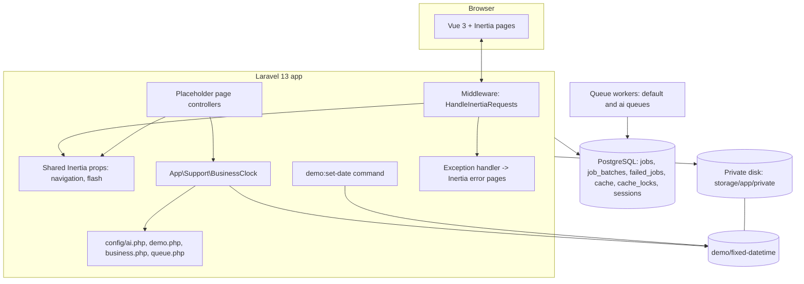
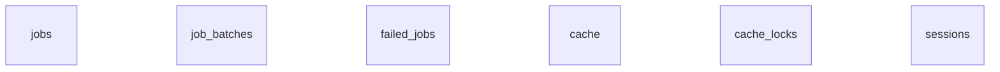

# Design Document

## Overview

S01 builds the technical base that every later spec (S02–S09) builds on: a Laravel 13 + Inertia/Vue 3 modular monolith, native local development against PostgreSQL, the design system tokens and eight shared UI components, the application shell with a complete typed navigation list, global error handling, toasts, environment configuration, the database queue/cache foundation with two named queues, private storage, an AI configuration skeleton (no AI calls), the `BusinessClock` helper with a file-based demo clock and the `demo:set-date` command, a focused automated test harness, and verified-version documentation.

This is a planning design for a single pass: there is no code in this document. Per `docs/stage-1-refinements.md` R5 and `.kiro/steering/verification.md`, S01 sets up the Laravel test framework and a small smoke test set; open points are resolved as documented assumptions rather than review questions, consistent with `.kiro/steering/scope-control.md`.

Priority tiers follow R1: every S01 item is PoV Core except the table-row Skeleton, page progress indicator and `aria-live` toast region, which are PoV Polish. InsufficientDataNotice, Timeline, FileDropzone, the polling composable and the frontend render error boundary are not built in S01; the first spec that needs each one builds it (the boundary and polling composable as PoV Polish). No placeholder services, empty directories or unused interfaces are created.

S01 introduces no business logic, no authentication, and no Stage 2 feature, per Requirement 1 and Requirement 23.

## Selected Approach

Scaffold from the official Laravel Vue starter kit (Assumption A1 in requirements.md) rather than building the Inertia/Vue/Vite/Tailwind wiring by hand. Rationale:

- It already wires Laravel 13 + Inertia.js + Vue 3 (Composition API) + TypeScript + Vite + Tailwind, matching Requirement 1.1 and `docs/architecture.md` §2 exactly, so S01 effort goes into BusinessPulse-specific structure instead of re-deriving framework glue.
- Its bundled authentication screens and `User` model are **not extended**. They are kept only where removing them would break the build (Assumption A1); S02 owns their final shape. This avoids S01 quietly growing auth logic it does not own (scope-control.md).
- The starter kit's test framework (Pest if shipped, otherwise PHPUnit) is used as shipped and pointed at a PostgreSQL test database; no second test tool is added.
- The starter kit's existing `tsconfig.json`, ESLint and Prettier configuration are tightened (`strict: true`, no unexplained `any`) rather than replaced, to minimize divergence from the Laravel-maintained template that later upgrades will track.

Alternative considered: hand-roll the Laravel+Inertia+Vite wiring from `laravel new` plus manual Inertia/Vue install. Rejected because it duplicates what the official starter kit already provides correctly and risks subtle Vite/Inertia SSR-less config drift; no identified benefit over the starter kit for Stage 1.

Everything else in S01 (design tokens, shell, components, config skeletons, `BusinessClock`) is additive on top of that scaffold, organized per `docs/architecture.md` §3–4 and `.kiro/steering/structure.md`.

## Architecture

S01 stands up the left/right edges of the architecture diagram in `docs/architecture.md` §1 (browser ↔ Laravel/Inertia ↔ PostgreSQL, plus the queue worker and private storage) without any of the business modules (Imports, Intelligence, Briefing, Meetings, Tasks, Outcomes) and without the AI HTTP client. The AI box in that diagram is represented only by configuration in S01.

### Affected / introduced modules

Per `docs/architecture.md` §3, S01 does not own any business module. It creates the cross-cutting scaffolding those modules will sit in:

| Area | S01 responsibility | Location |
|---|---|---|
| Support | `BusinessClock` | `app/Support/BusinessClock.php` |
| Console | `demo:set-date` command | `app/Console/Commands/DemoSetDate.php` |
| Configuration | AI/demo/business config skeletons, queue settings | `config/ai.php`, `config/demo.php`, `config/business.php`, `config/queue.php` |
| Shared Inertia contract | navigation/flash shared props | `app/Http/Middleware/HandleInertiaRequests.php` |
| Navigation definition | single typed config list of nav items | `config/navigation.php` read by shared props (or one equivalent server-side list, Requirement 7.4) |
| Placeholder pages | routes + controllers for the 8 nav sections + Today redirect | `routes/web.php`, `app/Http/Controllers/*` |
| Error handling | exception rendering to Inertia error pages | `bootstrap/app.php` (Laravel 13 exception handling) |
| UI components | design system + 8 shared components | `resources/js/components`, `resources/js/components/ui` |
| Frontend types | shared prop + component prop types | `resources/js/types` |
| Tests | Test harness, smoke tests, PostgreSQL test DB | `phpunit.xml`, `.env.testing.example`, `tests/` |
| Tooling | verification scripts | `package.json`, `composer.json` |
| Docs | README, architecture §11 | `README.md`, `docs/architecture.md` |

No `app/Actions`, `app/Services/*`, `app/Jobs`, or `app/Policies` classes or folders are created in S01 (Requirements 1.3, 16.12, 18.6, 23.5); later specs create them when they add the first file.

## Components and Interfaces

### Backend contracts

**`App\Support\BusinessClock`**
- `today(?string $timezone = null): CarbonImmutable` — date-only (time truncated), company/business timezone by default, overridable per Requirement 19.6.
- `now(?string $timezone = null): CarbonImmutable` — date-time, same timezone rule.
- Reads `config('business.timezone')` for the default and `config('demo.mode')` / `config('demo.clock_file')` for the demo clock. `config/demo.php` holds `mode` (`DEMO_MODE`, bool, default false) and `clock_file` (`demo/fixed-datetime`, relative to the private disk).
- Demo clock: when `demo.mode` is true and the file on the private disk exists, its content `YYYY-MM-DD HH:MM` (business timezone) is returned by `now()` and its date by `today()`. When the file is absent, real time is returned. When `demo.mode` is false, the file is ignored.
- Throws `InvalidArgumentException` (descriptive message naming the Demo_Clock_File) when demo mode is on and the file content is not a valid date-time (19.5), and when an explicit timezone argument is not a valid identifier (19.7).
- Bound in the container as a singleton so later specs can resolve it via constructor injection or the `app(BusinessClock::class)` helper (19.10). The file is read per call so that `demo:set-date` takes effect without a restart.

**`demo:set-date {date} [--time=09:00]`**
- Refuses (non-zero exit, message naming `DEMO_MODE`) unless `config('demo.mode')` is true; no other guard (Requirement 24.3, 24.8).
- Validates `date` as a real `YYYY-MM-DD` calendar date and `--time` as `HH:MM` (24-hour); on invalid input leaves the file unchanged and exits non-zero (24.4).
- Writes `YYYY-MM-DD HH:MM` to `demo/fixed-datetime` on the private disk, creating the `demo` directory if needed, and prints the stored date-time and timezone (24.1, 24.2, 24.5, 24.6).
- Deleting the file returns the clock to real time (documented in the README, 24.7).

**`config/business.php`**: `timezone` (default `Asia/Kuala_Lumpur`, from `BUSINESS_TIMEZONE`).

**`config/ai.php`**: `base_url`, `api_key`, `text_model`, `transcription_model`, `speech_model`, `speech_voice`, `timeouts` (HTTP seconds: `text` 30, `speech` 60, `transcription` 120, `extraction` 60). Every model/base-url/key value is read from env with no hardcoded default (Requirement 18.3); unset env values resolve to `null`. There is no `retry` key: retries live only in the queue jobs of later specs (R6, 18.4). No class in `app/Services/AI` is created in S01 (18.6) and no network call is made (18.5).

**`config/queue.php`** (database connection): `retry_after` 300, `after_commit` true (R6; `retry_after` exceeds the largest later job timeout of 150 s plus margin and must be re-checked if any timeout rises). Two named queues are used, `default` and `ai`; S01 defines the names and documents them but dispatches no job. The local start command runs one worker for `--queue=default,ai`. The README documents the deployment Supervisor programs `bp-default` (`--queue=default`) and `bp-ai` (`--queue=ai`), each with `--tries=3 --timeout=180 --max-time=3600`, `stopwaitsecs=200`, `stopasgroup=true`, `killasgroup=true`, plus `queue:restart` after deploy.

**Shared Inertia props** (set in `HandleInertiaRequests::share()`):
- `navigation`: ordered `NavItem[]` built from the single typed navigation config list (Requirement 7.4), with `active` computed from the current route. No role filtering is applied in S01; S02 replaces the list with role-based visibility filtering. Vue only renders the list it is given.
- `flash`: `FlashMessage | null` (`type: 'success'|'error'|'info'|'warning'`, `message: string`), set by one server-side helper (Requirement 14.6), consumed once by the toast host and not re-shown on back/forward navigation without a new flash (14.7) — the frontend tracks the last-rendered flash id in memory and skips re-toasting an unchanged id.

### Frontend contracts (`resources/js/types`)

- `Severity = 'high' | 'medium' | 'low'`
- `StatusTone = 'neutral' | 'info' | 'success' | 'warning' | 'danger'`
- `NavItem = { label: string; href: string; icon: string; active: boolean }`
- `FlashMessage = { id: string; type: 'success'|'error'|'info'|'warning'; message: string }`
- Per-component prop interfaces (`KpiCardProps`, `SeverityBadgeProps`, `StatusBadgeProps`, `EmptyStateProps`, `ErrorStateProps`, `EChartProps`) co-located in each component file or in `resources/js/types` (Requirement 9.8). The `Role` type is added by S02, and `TimelineEvent` by the spec that builds Timeline.

### Component library (Vue 3, `resources/js/components`)

| Component | Contract summary |
|---|---|
| `AppShell` | Sidebar (248px / icon-rail ≤1280px / off-canvas Sheet ≤768px), top bar (title, breadcrumbs, bell + user menu placeholders), landmarks, skip link. Consumes the `navigation` prop only for rendering — no authorization decisions. |
| `PageHeader` | `title` (24px semibold), optional `description`, optional action slot. |
| `KpiCard` | `label`, `value` (28px semibold tabular-nums), optional `change` (`{ direction: 'up'|'down'|'flat'; text: string }` rendered as icon + signed text, never color alone), optional `caption`, `loading` → `Skeleton`. |
| `SeverityBadge` | `severity: Severity` → icon + label + matching `--severity-*` tokens. |
| `StatusBadge` | `label`, `tone: StatusTone` → pill with matching token. |
| `EmptyState` | `icon`, `message`, optional primary action slot/prop. |
| `ErrorState` | `icon`, `message`, emits `retry`. |
| `EChart` | Tree-shaken ECharts wrapper; props: `option`, `ariaLabel` (required), `tableData?`, `isEmpty?`; handles resize via `ResizeObserver`, disposes on unmount, disables animation under `prefers-reduced-motion: reduce`, defaults series colors to the chart palette, renders `EmptyState` when `isEmpty`. |
| Toast host (Sonner-based) | Renders `flash` and client `useToast()` calls; auto-dismiss 3–5s, manually dismissible, `aria-live`. |

### Placeholder pages and routing

Eight routes (Today, Issues, Data Imports, Briefs, Meetings, Tasks, Outcomes, Settings), each: Form Request-free simple `Route::get` → thin controller method → Inertia render with `PageHeader` + `EmptyState` naming the section (Requirement 8.1–8.2). Root `/` redirects to Today (8.3). Every route is reachable by every visitor in S01; no role check exists and S02 adds role filtering and policies.

### Error handling surface

Laravel 13 exception handling (`bootstrap/app.php` `->withExceptions()`) renders Inertia error pages for 403/404/419/500/503 inside the app layout, each showing status, plain-language title, one-sentence explanation, and a link to Today; 419 adds a reload button, 503 adds a maintenance message. `APP_DEBUG=false` strips stack traces/paths/SQL/env values. Unhandled exceptions log path + method only (no body/secrets). Non-Inertia (JSON/asset) requests get Laravel's standard JSON error shape at the same status. A frontend render error boundary is not built in S01; the first spec that needs one builds it as PoV Polish.

## Data Models

S01 adds no business entity. It is responsible only for the infrastructure tables already named in `docs/data-model.md` §1 as kept entities: `jobs`, `job_batches`, `failed_jobs`, `cache`, `cache_locks` (Laravel queue/cache, Requirement 16.3), and `sessions` (Laravel session auth, needed for the starter kit's auth scaffolding to function even though S01 does not author auth logic). These come from Laravel's own default migrations; S01's job is to confirm they are present and run cleanly against PostgreSQL, not to design new schema.

No `users`, `companies`, `departments`, or any business table (`imports`, `sales_records`, `issues`, etc. — all owned by S02+) is created, altered, or seeded by S01, per Requirement 23.5 and the "Dropped/Kept" ownership in `docs/data-model.md` §1.

No relationships exist between these tables in S01; they are independent infrastructure tables, each written to by the framework (queue worker, cache store, session middleware) rather than by application code.

## Correctness Properties

Per `docs/stage-1-refinements.md` R5 and `.kiro/steering/verification.md`, S01 sets up the automated harness and a small deterministic smoke test set; it uses no browser automation and no property-based tools. S01 is mostly infrastructure and presentational scaffolding, so only rule-like behavior is tested automatically, and the round-trip rule below is checked with a few fixed example dates rather than generated inputs.

Automated smoke tests (feature tests on the PostgreSQL database `businesspulse_testing`, run by `composer test`):

- **App boots (Requirement 22.8)**: a request to `/` returns a response (the redirect to Today).
- **Login page renders (22.8)**: the starter kit's login route returns 200 with the expected Inertia component.
- **BusinessClock demo mode off ignores the file (validates 19.2)**: with `demo.mode=false` and a valid Demo_Clock_File on a fake private disk, `today()` equals the real current date in the business timezone.
- **BusinessClock demo mode on honors the file (validates 19.3, 19.9)**: see Property 1. With `demo.mode=true`, for example dates `2024-01-01`, `2024-02-29` and `2025-12-31` at `09:00` and one other time, `today()` formatted `Y-m-d` and `now()` formatted `H:i` equal the written values; with the file absent (19.4) the clock returns real time.
- **BusinessClock invalid file throws (validates 19.5)**: malformed content raises the descriptive exception.
- **`demo:set-date` guard (validates 24.3)**: with `demo.mode=false` the command exits non-zero and writes no file.

### Property 1: BusinessClock demo round-trip

*For any* valid date D and time T written by `demo:set-date` while `DEMO_MODE` is true, `BusinessClock::today()` formatted `Y-m-d` equals D and `BusinessClock::now()` formatted `H:i` equals T. Checked in the smoke tests with the fixed example values above, not with generated inputs.

**Validates: Requirements 19.3, 19.9**

### Property 2: Demo mode off ignores the clock file

*For any* Demo_Clock_File content, while `DEMO_MODE` is false `BusinessClock::today()` equals the real current date in the business timezone.

**Validates: Requirements 19.2**

Manual-only checks (no automated test): the sidebar modes at 360/768/1280px, accessibility spot checks, error-page walkthrough and the README walkthrough, listed under Testing Strategy.

## Error Handling

- **Database connection failure** (Requirement 2.3): caught by Laravel's own `QueryException` → non-debug 500 page; no credentials in the response body or logs.
- **Invalid Demo_Clock_File content** (demo mode on): `BusinessClock` throws a descriptive `InvalidArgumentException` naming the file; since S01 makes no business call to `BusinessClock` yet, this surfaces only when later code, the smoke tests or verification scripts invoke it, and the README documents deleting the file as the fix.
- **`demo:set-date` misuse**: non-true `DEMO_MODE` or invalid date/time exits non-zero without touching the file (Requirement 24.3, 24.4).
- **403/404/419/500/503**: Inertia-rendered error pages inside the layout, per the Error Handling Surface above; JSON requests get Laravel's default JSON error envelope at the same status.
- **Private storage path access** (`/storage/*` direct hit): 404, since no public symlink is created (Requirement 17.2, 17.4).
- **Logging discipline**: unhandled exceptions log request path + method only; no request bodies, passwords, tokens, or API keys (Requirement 13.6), consistent with `.kiro/steering/security.md`'s redaction rule.

## Security

Aligned with `.kiro/steering/security.md`, scoped to what S01 actually touches:

- CSRF protection enabled on all state-changing routes (framework default, Requirement 23.1) — S01 has no state-changing route of its own beyond what the starter kit provides, but the setting must hold for later specs to inherit.
- `APP_DEBUG=false` in `.env.example` (23.2); `SESSION_SECURE_COOKIE` documented with guidance to enable under HTTPS (23.3).
- `OPENAI_API_KEY` and `DEMO_PASSWORD` are never put into Inertia shared props or exposed as `VITE_*` env vars (Requirement 15.8) — enforced by keeping them out of `HandleInertiaRequests::share()` and out of any `import.meta.env.VITE_*` reference.
- `.env` excluded from version control (15.5); every env var the app reads is documented in `.env.example` with a placeholder/default and one-line comment (15.1), updated in the same change that introduces a new var (15.6).
- Private disk (`storage/app/private`) holds no public URL and no `public/storage` symlink is created as part of setup (17.1–17.2); this is the baseline later specs (S03 imports, S06 meetings) build authorized streaming downloads on top of.
- No outbound request, email, or notification is sent in S01 (23.4) — the AI config skeleton is inert (18.5).
- No auth/user/role/policy logic is authored in S01 (23.5); the starter kit's bundled auth screens are retained unmodified only to the extent needed to keep the build working, per Assumption A1, and are explicitly not BusinessPulse's authorization boundary — that remains S02's job. S01 has no role concept: the navigation list is shown in full to every visitor, documented in the README and code comments (Requirement 7.5).
- `demo:set-date` is guarded by `DEMO_MODE=true` only (24.8); the Demo_Clock_File lives on the private disk and holds no secret.
- Throttling on login/uploads/AI endpoints (security.md) is out of scope for S01 since none of those endpoints exist yet; flagged here so S02/S03/S06 pick it up when they add the respective routes.

## Integration Dependencies

- **Laravel Vue starter kit** (Assumption A1): external scaffold dependency; version pinned via `composer.lock`/npm lock once installed, recorded in `docs/architecture.md` §11.
- **PostgreSQL**: native local install, no Docker (Requirement 2.1–2.5); connection parameters from `DB_*` env vars only.
- **`@fontsource-variable/inter`** (npm): self-hosted font, no CDN fetch (Requirement 4.3).
- **shadcn-vue / Lucide / Apache ECharts**: UI primitive dependencies installed per Requirement 5 and 10; ECharts imported module-by-module (tree-shaken), not as the full bundle.
- **Test database**: native PostgreSQL database `businesspulse_testing` (no SQLite) created by the developer per the README, configured in `phpunit.xml` and `.env.testing.example`.
- **AI provider**: configuration-only dependency in S01 (`config/ai.php` reads env, no SDK, no HTTP client, no network call) — the actual integration is S04+'s responsibility per `docs/architecture.md` §6.
- **Downstream specs (S02–S09)**: consume the shared Inertia props (the `navigation` list gains role filtering in S02), the navigation config list, the eight shared components, `BusinessClock` and `demo:set-date`, the queue configuration and the config skeletons. Later specs build InsufficientDataNotice, Timeline, FileDropzone, the polling composable and the render error boundary themselves. S01 must not assume or encode any S02+ behavior (no user/role/policy model), so these contracts are deliberately minimal and typed to avoid breaking changes later.

## Testing Strategy

Automated verification is the Laravel test framework as shipped by the starter kit (Pest if present) on the PostgreSQL database `businesspulse_testing`, run with `composer test` (Requirement 22.6–22.9). Only the smoke tests in Correctness Properties are authored in S01. No Playwright, Cypress, browser automation, property-based tool, heavy mocking or external provider call is used. Remaining checks are static, database and manual:

- **Static/style checks**: `npm run type-check` (vue-tsc, strict mode), `npm run lint` (ESLint), `npm run format:check` (Prettier), `npm run build` (Vite production build), then `composer test`, chained as `npm run verify`, stopping at first failure (Requirement 22.1, 22.5). `composer pint-test` (Pint in test mode) for PHP style (22.2). All expected to exit 0 on a clean checkout (22.3); a violation or failing test must exit non-zero and print the file and line or test name (22.4).
- **Migration check**: `php artisan migrate:fresh --seed` on a scratch database only (never production, per `verification.md`), confirming `jobs`, `job_batches`, `failed_jobs`, `cache`, `cache_locks`, and `sessions` tables are created in PostgreSQL (Requirement 16.4), plus a rollback check.
- **Queue/cache smoke check**: with a worker running for `--queue=default,ai`, dispatch a trivial job and confirm it is removed from `jobs` on success (16.5); force a failure path to confirm it lands in `failed_jobs` (16.6). Confirm `config('queue.connections.database.retry_after')` is 300 and `after_commit` is true (16.7) with `php artisan config:show queue`.
- **Config check**: `php artisan config:show ai` shows the four timeouts, no retry key and a masked or null key (18.1, 18.4, 18.7).
- **Demo clock check**: `php artisan demo:set-date 2025-09-22 --time=09:00` with `DEMO_MODE=true`, then `tinker` shows `BusinessClock::now()` at that date-time; deleting the file returns real time (19.3, 19.4, 24.1–24.7).
- **Responsive check**: shell and components at 360px, 768px, 1280px per `verification.md`, confirming sidebar modes (full/icon-rail/off-canvas) and KPI/table responsive behavior described in `docs/ui-ux-design-system.md` §7.
- **Accessibility spot checks**: keyboard focus ring on every interactive shadcn-vue component (5.3), skip link (6.8), `aria-live` on toasts (12.3), text alternative on `EChart` (10.6), reduced-motion handling (10.7).
- **Error-page walkthrough**: manually trigger 404 (unknown route), 419 (expired session), 500 (forced exception), 503 (maintenance mode) and 403 (a temporary route that aborts 403) and confirm each renders the correct Inertia error page content with `APP_DEBUG=false`.
- **Version record check**: confirm `docs/architecture.md` §11 has no remaining `TBD` and each entry cites its source command or lock-file line (Requirement 20.1–20.3).
- **README walkthrough**: a developer follows the README top-to-bottom on a clean machine with only the documented prerequisites and reaches a working Today page with no undocumented steps (Requirement 21.5).

Passing these checks demonstrates the foundation works as specified, not production readiness, and that caveat is restated in the README per Requirement 22.10.

## Assumptions and Open Points Carried Into Design

- Starter kit's bundled auth screens/`User` model are kept unmodified only where needed for the build (A1); any shape mismatch with S02's eventual `users` table is S02's problem to resolve, not S01's.
- `BUSINESS_TIMEZONE` default `Asia/Kuala_Lumpur` is a demo default (A2), not a confirmed client requirement, and is clearly comment-tagged as such in `.env.example`.
- Placeholder pages contain only `PageHeader` + `EmptyState`, no business data, charts, or tables, even though `KpiCard`/`EChart` are built in S01 — they are exercised only by a one-off dev/story page or manual Vue playground if needed, not by the placeholder routes themselves (A3).
- Demo mode is the `DEMO_MODE` boolean; the demo date-time is the Demo_Clock_File `YYYY-MM-DD HH:MM` in the business timezone, written by `demo:set-date`; no `DEMO_FIXED_DATE` variable exists (A4).
- No dark mode variant is implemented (A5).
- Automated verification is the starter kit's test framework with a small smoke set only (A6, R5); the focused business tests of later specs are owned by those specs.
- The local start command runs one worker for both queues; the two Supervisor programs are documented for deployment only (R6).

These assumptions are flagged for review per `.kiro/steering/scope-control.md` rather than blocking this design pass; they can be revisited if the user disagrees before implementation starts.
