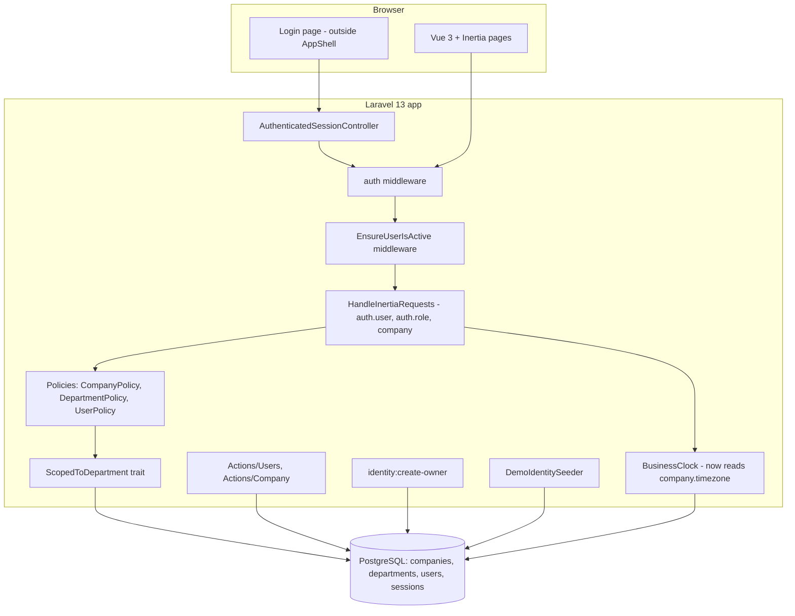
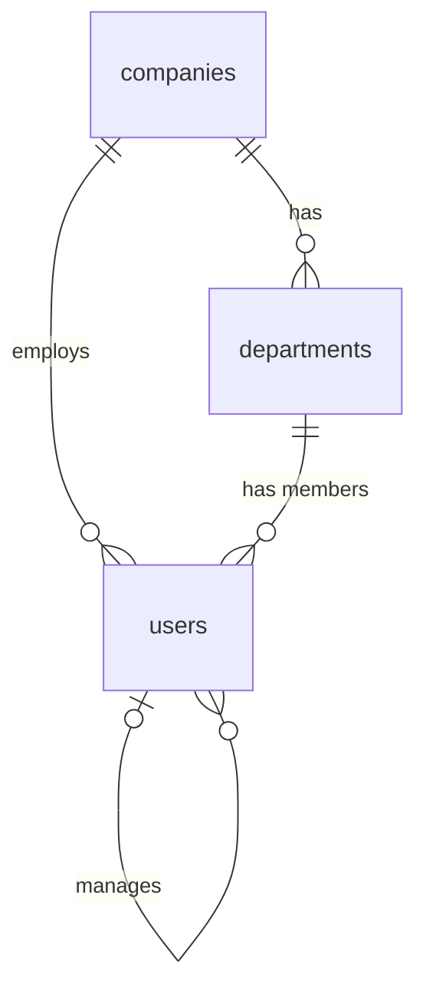

# Design Document

## Overview

S02 adds real session authentication and access control to the S01 foundation. It introduces the Identity module: `companies`, `departments`, `users`, the `Role` enum, policies for every model S02 owns, a reusable department-scoping trait (`ScopedToDepartment`) that S03–S08 apply to their own department-scoped tables, role filtering of the S01 navigation list, read-only Settings pages (Company, Staff, Department) in PoV Core with edit/CRUD forms in PoV Polish, an Owner-bootstrap Artisan command, an idempotent demonstration seeder, and a small set of focused feature tests.

**Tier legend** (`docs/stage-1-refinements.md` R1): `[PoV Core]` is needed for the 22-step demonstration; `[PoV Polish]` is Stage 1 scope built after the Core slice works. Core: login/logout, roles, policies, department scope, tables, demo user seeder, role navigation, read-only Company/Department/Staff display, focused tests. Polish: staff CRUD UI, Manager staff list, password reset UI, company profile edit UI, and safeguards beyond database constraints (reporting-cycle detection, last-Owner and Manager-with-reports checks).

This is a planning design for a single pass: there is no code in this document, verification is a small set of deterministic feature tests on the S01 harness plus manual checks (R5), and open points are resolved as documented assumptions rather than review questions, consistent with `.kiro/steering/scope-control.md`.

S02 introduces no sales data, imports, rules, issues, briefs, meetings, tasks, outcomes, or activity logging (requirements.md A11, Requirement 20.6). It builds only the identity and access-control framework that those specs will depend on.

## Selected Approach

Build directly on the S01 starter-kit scaffold rather than introducing a separate auth package (Fortify/Breeze/Jetstream). Rationale:

- The starter kit already ships Laravel's built-in session guard, a `User` model, and auth-adjacent routes/views (S01 design, "Selected Approach"). S02's job is to reshape that scaffolding to BusinessPulse's actual rules (no registration, no email recovery, Owner-managed passwords, three fixed roles, department scoping), not to add another framework layer on top of it.
- A full auth package would bring registration, email verification, and password-reset flows that Requirement 5 explicitly removes. Hand-rolling the login/logout/throttle controllers directly against `Auth::attempt()` and Laravel's built-in `RateLimiter` is less code than installing and then stripping down a package.
- Policies are plain Laravel `Illuminate\Auth\Access\Policy` classes registered via auto-discovery (model name → `{Model}Policy` convention) rather than a third-party authorization package, matching `docs/architecture.md` §4 ("Policies" as a first-class app folder) and keeping the authorization model in a single, well-understood primitive that S03–S08 reuse without new concepts.
- Department scoping is a single trait + local query scope (`ScopedToDepartment::scopeVisibleTo()`), not a global scope automatically applied to every model. An explicit, opt-in scope keeps S01's rule "create an abstraction only when it holds real code" (`.kiro/steering/structure.md`) and avoids a later spec accidentally depending on implicit query rewriting it did not ask for. Each later spec applies `visibleTo()` explicitly in its own controllers/policies, exactly as Requirement 13.7 describes for route model binding.

Alternative considered: a general-purpose multi-tenancy package (e.g. tenant-scoped global scopes keyed by `company_id`). Rejected — Stage 1 has exactly one company (A1), so a multi-tenant abstraction solves a problem that does not exist yet and risks hiding the department-level (not company-level) scoping rule that actually matters here.

## Architecture



S02 fills in the "Identity" module row of `docs/architecture.md` §3 and the left part of §6's access-control summary. It does not touch Imports, Intelligence, Briefing, Meetings, Tasks, Outcomes, or Activity.

### Affected / introduced modules

| Area | S02 responsibility | Location |
|---|---|---|
| Models | `Company`, `Department`, `User` | `app/Models` |
| Enums | `Role` | `app/Enums/Role.php` |
| Policies | `CompanyPolicy`, `DepartmentPolicy`, `UserPolicy`, shared base trait | `app/Policies`, `app/Policies/Concerns/AuthorizesByDepartment.php` |
| Query scope | `ScopedToDepartment` trait | `app/Models/Concerns/ScopedToDepartment.php` |
| Actions [PoV Polish] | `CreateUser`, `UpdateUser`, `DeactivateUser`, `ReactivateUser`, `ResetUserPassword`, `UpdateCompanyProfile` | `app/Actions/Users`, `app/Actions/Company` |
| Services [PoV Core] | `CurrentCompany` (needed by `BusinessClock` and the shared `company` prop) | `app/Services/CurrentCompany.php` |
| Middleware | `EnsureUserIsActive` | `app/Http/Middleware/EnsureUserIsActive.php` |
| Form Requests | [Core] `LoginRequest`. [Polish] `StoreUserRequest`, `UpdateUserRequest`, `ResetUserPasswordRequest`, `UpdateCompanyProfileRequest` | `app/Http/Requests` |
| Controllers | [Core] `AuthenticatedSessionController`; read-only `index`/`show` of `UserController` (Owner Staff list), `CompanyController`, `DepartmentController`. [Polish] write actions of `UserController` and `CompanyController`, Manager staff list | `app/Http/Controllers` |
| Commands [PoV Core] | `identity:create-owner`, `DemoIdentitySeeder` | `app/Console/Commands`, `database/seeders` |
| Shared Inertia contract | `auth.user`, `auth.role`, `company` | `app/Http/Middleware/HandleInertiaRequests.php` (extends S01's) |
| Frontend types | `AuthUser`, `CompanyProfile`, `Role` | `resources/js/types` |
| Pages | [Core] Login, Settings with read-only Company/Staff/Department tabs. [Polish] Staff and Company forms | `resources/js/pages/auth`, `resources/js/pages/settings` |
| Tests [PoV Core] | Feature tests: department scope, 404/403, deactivated login, seeder | `tests/Feature/Identity` |
| Changes to S01 | S01 navigation list gains role filtering; `BusinessClock` reads company timezone | navigation config and `HandleInertiaRequests`, `app/Support/BusinessClock.php` |

No `app/Services/AI`, `app/Services/Imports`, `app/Services/Intelligence`, `app/Jobs`, or business-module controllers are authored in S02 (Requirement 20.6).

## Components and Interfaces

### Backend contracts

**`App\Enums\Role`** (string-backed enum: `owner`, `manager`, `staff`)
- Carries the capability documentation required by Requirement 2.2 as PHPDoc on the enum, citing `docs/business-workflows.md` D23.
- No other code path constructs a role value outside this enum (Requirement 2.4); Form Requests validate against `Role::values()`.

**`App\Models\Company`**
- Fields: `name`, `timezone`, `currency`, `trading_days` (cast to array, normalized sorted on save per Requirement 10.8/10.12), `reporting_cutoff_time` (`HH:MM`), `reporting_cutoff_lag_days` (integer), `is_demo`, `recording_retention_days`. The calendar fields are stored here and interpreted by S03/S04 (R2).
- Relationships: `hasMany(Department::class)`, `hasMany(User::class)`.
- `trading_days` cast via a custom cast or mutator that sorts and de-duplicates on set, satisfying the round-trip property in Requirement 10.12.

**`App\Models\Department`**
- Fields: `company_id`, `name`, `slug`, `settings` (JSONB cast to array, default `{}`). `settings.expected_branches` is a string array (accessor `expectedBranches()` returns `[]` when absent). S02 creates the column; S03 only reads and (Polish) edits it; `intelligence.last_evaluated_at` is written by S04.
- Relationships: `belongsTo(Company::class)`, `hasMany(User::class)`.
- Unique constraint `(company_id, slug)` enforced at the database level (Requirement 1.3); no application code creates, renames, or deletes departments beyond the two commands in Requirement 11.6.

**`App\Models\User`**
- Fields: `company_id`, `department_id` (nullable), `manager_id` (nullable, self-referencing FK), `name`, `email` (unique, stored lowercase per A7), `password` (hashed cast), `role` (enum cast to `Role`), `job_title`, `is_active`, `remember_token`.
- Relationships: `belongsTo(Company::class)`, `belongsTo(Department::class)`, `belongsTo(User::class, 'manager_id')` as `manager`, `hasMany(User::class, 'manager_id')` as `reports`.
- Helpers: `isOwner()`, `isManager()`, `isStaff()` (Requirement 2.3).
- `$hidden = ['password', 'remember_token']` (Requirement 1.6, 14.6).
- Database check constraint on `role` restricts values to the three enum cases (Requirement 1.5) — belt-and-suspenders alongside Form Request validation (Requirement 2.5).

**`App\Models\Concerns\ScopedToDepartment`** — the reusable contract S03–S08 depend on

```php
trait ScopedToDepartment
{
    public function scopeVisibleTo(Builder $query, User $user): Builder
    {
        if (! $user->is_active) {
            return $query->whereRaw('1 = 0');
        }

        if ($user->isOwner()) {
            return $query->where('company_id', $user->company_id);
            // or, for models without a direct company_id column,
            // a join/whereHas against departments.company_id — documented per-model.
        }

        if ($user->department_id === null) {
            return $query->whereRaw('1 = 0');
        }

        return $query->where('department_id', $user->department_id);
    }
}
```

- Contract: any model with a `department_id` column (and either a direct `company_id` column or a `department` relation reachable to `company_id`) may `use ScopedToDepartment;` and call `Model::visibleTo($user)` to get only the rows that user may see.
- Behavior (Requirement 13.2–13.6, 13.11): Owner → all rows of the user's company; Manager/Staff → only rows whose `department_id` equals the user's `department_id`; inactive user or null-department non-Owner → no rows.
- Applied by `User::visibleTo()` itself for the Staff list (Requirement 13.10): `User` uses the same trait, scoped by `department_id` on the `users` table.
- **Route model binding contract for later specs**: a scoped route parameter (e.g. `Route::get('/imports/{import}', ...)`) resolves via a binding closure (or `UniqueStrictBinding`-style resolver) that calls `Model::visibleTo($request->user())->findOrFail($id)`, converting an out-of-scope id into a 404 automatically (Requirement 13.7–13.8). S02 documents this pattern once in `docs/architecture.md`; S03+ wire their own route bindings using it, since S02 owns no business-module routes to apply it to directly.
- This trait assumes exactly one company in the request context (A1 is Stage 1-wide); the Owner branch filters by `company_id` rather than returning all rows globally, so the contract still holds if a second company is ever introduced without an application restart.

**`App\Services\CurrentCompany`**
- `resolve(): Company` — returns the single `Company` row, memoized for the lifetime of one request (container-scoped singleton bound in a service provider, Requirement 16.5).
- Used by `BusinessClock` (via the S01 container binding) and by `HandleInertiaRequests` to build the `company` shared prop.

**`BusinessClock` changes (extends S01)**
- `today()`/`now()` without an explicit timezone argument now resolve `CurrentCompany::resolve()->timezone` when a Company row exists, falling back to `config('business.timezone')` when none exists yet (Requirement 16.1–16.2) — relevant only before `identity:create-owner` has run.
- An explicit timezone argument still overrides both (Requirement 16.3, unchanged from S01).
- The demo date and time keep coming only from S01's demo clock file written by `demo:set-date`; S02 adds no other override (Requirement 16.5).
- No restart is required after the Owner changes the timezone because `CurrentCompany` is request-scoped, not process-cached (Requirement 16.4).

**Policies**

| Policy | `view`/`viewAny` | `update` | `create` | `deactivate`/`reactivate` | `resetPassword` |
|---|---|---|---|---|---|
| `CompanyPolicy` | Owner, Manager | Owner | — | — | — |
| `DepartmentPolicy` | Owner (any), Manager (own only) | — | — | — | — |
| `UserPolicy` | `viewAny`: Owner, Manager. `view`: Owner (any), Manager (own department) | Owner | Owner | Owner | Owner |

- Shared trait `App\Policies\Concerns\AuthorizesByDepartment` exposes `sameDepartment(User $user, int $departmentId): bool` (Requirement 12.9), used by `DepartmentPolicy::view()` and `UserPolicy::view()`.
- No policy defines a `before()` hook that blanket-grants the Owner (Requirement 12.8) — each method explicitly checks `$user->isOwner()` where the rule is "company-wide," so the department-scoped Manager branches are never bypassed by a shortcut.
- Default-deny: every policy method returns `false` unless a condition explicitly matches (Requirement 12.6); Laravel's own default-deny applies to any action not named in the table above.
- Every policy method's first check (or a shared `before()` restricted to this purpose only) denies when `! $user->is_active` (Requirement 12.7).
- Controllers call `$this->authorize()` or `Gate::authorize()` explicitly in every action; navigation visibility is never treated as an authorization decision (Requirement 12.5), consistent with S01's documented position that `auth.role`-driven nav is display-only.

### Authentication flow

- `AuthenticatedSessionController@create` renders the Login page (outside `AppShell`, per Requirement 3.2) for guests; redirects authenticated users to Today (Requirement 3.9).
- `AuthenticatedSessionController@store`, validated by `LoginRequest`:
  1. Rate-limit key `email|ip` via `RateLimiter::tooManyAttempts()` (Requirement 3.7, A9: 5/minute). On throttle, return a field error with seconds remaining; log the throttled attempt (Requirement 3.11).
  2. Case-insensitive email lookup (`whereRaw('lower(email) = ?', [Str::lower($email)])`, Requirement 3.4).
  3. `Auth::attempt()`; on failure, `RateLimiter::hit()`, log the attempt (no password), return the generic message (Requirement 3.5).
  4. On success against an inactive user, treat identically to failure (same message, no session, Requirement 3.6) — checked before or as part of the `Auth::attempt()` path (e.g. a custom `Authenticatable::getAuthPassword` short-circuit is avoided; instead the controller checks `is_active` immediately after a successful credential check and logs out/aborts before the session is considered established).
  5. On success: `RateLimiter::clear()`, `session()->regenerate()`, redirect to Today (Requirement 3.3, 3.8).
- `AuthenticatedSessionController@destroy`: POST-only, CSRF-protected, `Auth::logout()`, `session()->invalidate()`, `session()->regenerateToken()`, redirect to Login (Requirement 4.1–4.2).
- `EnsureUserIsActive` middleware runs after `auth` on every authenticated route (web and the handful of JSON endpoints, Requirement 6.3): if the current user's `is_active` is false, it logs the user out, invalidates the session, and redirects (web) or returns 401 JSON (non-Inertia) with the message "Your account is inactive" (Requirement 6.2).
- Session configuration: `SESSION_DRIVER=database` (uses S01's `sessions` table), `SESSION_LIFETIME` idle timeout enforced by Laravel's built-in session expiry (Requirement 4.4), cookie flags `HttpOnly`, `SameSite=Lax`, `Secure` when `SESSION_SECURE_COOKIE=true` (Requirement 4.6). Inertia's standard behavior already converts an expired-session 419 into a full-page redirect on the frontend (Requirement 4.5) — no custom code needed beyond S01's error-page wiring.
- Removed starter-kit routes: registration, forgot-password, reset-password, email verification, password confirmation, two-factor setup — deleted from `routes/*.php`, not just hidden, so they 404 (Requirement 5.1–5.2). Login page displays "Forgot your password? Ask your Owner to reset it." (Requirement 5.4).

### Staff management (Settings → Staff tab)

**Tiers:** the read-only Staff list for the Owner is [PoV Core]. Create, edit, deactivate, reactivate, password reset, the Manager staff list, status filter and pagination, and every safeguard beyond database constraints (reporting-cycle detection, last-Owner check, Manager-with-reports check) are [PoV Polish]. Database constraints (unique email, role CHECK, foreign keys) stay Core.

- `UserController` actions: `index` (list), `store` (create), `update` (edit), `destroy`→repurposed as `deactivate`, `reactivate`, `resetPassword` — each authorized via `UserPolicy` before any Form Request validation runs, consistent with `docs/architecture.md` §4's controller shape (authorize → validate → Action → respond).
- `StoreUserRequest` / `UpdateUserRequest` accept only `name`, `email`, `job_title`, `role`, `department_id`, `manager_id`, and (create only) `password`; `company_id`, `is_active`, `id` are never read from the request body (Requirement 7.14) — the Action always sets `company_id` from the authenticated Owner's own company (Requirement 7.15).
- Validation rules encode Requirements 7.4–7.11: email format + uniqueness; password ≥ 12 chars on create; `department_id` required when role is `manager`/`staff`; `department_id`/`manager_id` forced null when role is `owner`; manager-of-staff must be an active Manager in the same department; manager-of-manager must be the Owner; no self-management cycle (a custom rule walks the `manager_id` chain to detect cycles, Requirement 7.10).
- Editing a Manager's role/department while they have active reports is blocked with an error naming the report count (Requirement 7.11) — checked by `UpdateUser` Action before any write, inside the same transaction as the rest of the update.
- `CreateUser`, `UpdateUser`, `DeactivateUser`, `ReactivateUser`, `ResetUserPassword` are single-`handle()` Actions (per `.kiro/steering/structure.md`) because each is a multi-step write: e.g. `DeactivateUser::handle()` sets `is_active = false` and deletes the user's `sessions` rows in one DB transaction (Requirement 6.1); `ResetUserPassword::handle()` hashes and stores the new password and deletes the user's sessions in one transaction (Requirement 8.3).
- Owner self-protection: `DeactivateUser` rejects when the target is the acting Owner (Requirement 6.6); `DeactivateUser` and the role-change path in `UpdateUser` both reject when the target is the last active Owner (Requirement 6.7) — checked via a count query (`User::where('role', Role::Owner)->where('is_active', true)->count()`) inside the same transaction to avoid a race between the check and the write.
- Every successful create/edit/deactivate/reactivate flashes a success toast through the S01 flash helper (Requirement 7.13).
- Manager view of the Staff tab is the same `index` action with policy-driven read-only rendering (`UserPolicy::viewAny` passes, but `create`/`update`/`deactivate`/`resetPassword` all fail for a Manager, so the page renders without those controls) — list restricted to the Manager's own department via `User::visibleTo($user)` (Requirement 9.2, 13.10). Staff role gets 403 on the whole tab (Requirement 9.3). Status filter (active/inactive/all, default active) and 25-row pagination apply to both Owner and Manager views (Requirement 9.4, 9.6); empty filtered results render `EmptyState` (Requirement 9.5).
- A Manager hitting another department's user detail/edit URL gets 404 (out of scope, Requirement 9.7); a Manager hitting an in-scope user's edit/create/deactivate/reset-password route gets 403 (in scope but role-forbidden, Requirement 9.8) — this is the 404-vs-403 split formalized in Requirement 19.1–19.2 and implemented by resolving the user via `visibleTo()` route binding first (404 if absent) and only then running the policy check (403 if present but forbidden).

### Company and Department settings

**Tiers:** read-only display of Company (including cutoff fields) and Department (including Expected_Branches) is [PoV Core]; the Company edit form, `UpdateCompanyProfileRequest` and `UpdateCompanyProfile` are [PoV Polish].

- `CompanyController@edit`/`update`: Owner-only write via `UpdateCompanyProfileRequest` (name ≤150 chars non-empty; `timezone` validated against `DateTimeZone::listIdentifiers()`; `trading_days` non-empty subset of 1–7 with no duplicates; `recording_retention_days` integer 1–365, `reporting_cutoff_time` valid `HH:MM`, `reporting_cutoff_lag_days` integer 0–7 — Requirement 10.4–10.7, 10.13). `UpdateCompanyProfile` Action persists and normalizes `trading_days` to a sorted array (Requirement 10.8). Manager sees the same data read-only (Requirement 10.9); Staff gets 403 (Requirement 10.10). `currency` and `is_demo` are rendered read-only with no corresponding write path in the Form Request (Requirement 10.2–10.3).
- `DepartmentController@show`: read-only for Owner (any department — though only one exists in Stage 1) and Manager (own department only, enforced by `DepartmentPolicy::view` + route binding via `visibleTo`); displays department name, expected branches, manager name(s), active staff count, and staff list with job titles (Requirement 11.2). Staff gets 403 (Requirement 11.4). No create/rename/delete/merge route exists anywhere in the app (Requirement 11.6). A Manager or Staff user with a null `department_id` is treated as having no accessible department and sees no department-scoped records (Requirement 11.7).
- Settings page shell: tabs Company, Staff, Department, each gated by the relevant policy; the tab bar itself reserves documented extension points for S03's Import template tab and S04's Rules tab but does not render placeholders for them (Requirement 15.10).

### Shared Inertia props and frontend types

- `HandleInertiaRequests::share()` additions:
  - `auth.user`: `{ id, name, email, role, job_title, department: { id, name } | null }` for authenticated requests, `null` on the Login page (Requirement 14.1, 14.3).
  - `auth.role`: mirrors `auth.user.role`, preserving the S01 prop name so S01-built components keep working unchanged (Requirement 14.2).
  - `company`: `{ name, timezone, currency, trading_days }` (Requirement 14.4, 10.11) — sourced from `CurrentCompany::resolve()`.
  - Explicitly excluded from any shared prop: `password`, `remember_token`, `manager_id`, any other user's `is_active`, and all session data (Requirement 14.6); no list of other users is ever shared globally (Requirement 14.7) — the Staff list is page-prop data on the Staff tab response only.
- `resources/js/types`: `AuthUser`, `CompanyProfile`, `Role` (string union mirroring the PHP enum) — used by all S02 Vue components, with no untyped `any` except where a third-party type forces it with a comment (Requirement 14.5, 20.8).
- Navigation: S02 adds role-based filtering to the S01 navigation list, using `auth.user.role` (Requirement 15.1). Owner and Manager see all 8 items; Staff sees only Today and Tasks (Requirement 15.2–15.4). No item definition, route, or label changes (Requirement 15.5). Opening a route whose section the role cannot see returns 403 (Requirement 15.6) — this is a direct route-level policy/middleware check, not inferred from the nav list (consistent with Requirement 12.5). The user menu shows name, role, and (for Manager/Staff) department name, plus Sign out (Requirement 15.7). Settings link routes to the first tab the role can see (Requirement 15.8). A code comment states that nav visibility is display-only (Requirement 15.9).

### Commands

**`identity:create-owner`**
- Options `--company`, `--name`, `--email`, `--password` (interactive prompts, hidden input for password, when options are omitted — Requirement 17.1, 17.4).
- In one DB transaction: creates the `Company` (defaults per Requirement 10's column defaults), the `Sales` department (`slug: 'sales'`, Requirement 11.1), and the Owner user (`department_id` and `manager_id` null, per A5).
- Aborts with no writes if a `Company` row already exists (Requirement 17.2), or if email/password fail validation (Requirement 17.3). Never prints or logs the password (Requirement 17.5). Documented in the README as the production setup step (Requirement 17.6).

**`DemoIdentitySeeder`**
- Guarded: refuses to run, with no writes and a message naming the variable, unless `DEMO_MODE=true` (Requirement 18.7) or `DEMO_PASSWORD` is empty/under 12 chars (Requirement 18.8); aborts with no writes if a non-demo `Company` already exists (Requirement 18.9).
- Upserts (identified by email, and by company name for the `Company` row) "Meridian Home Supplies Sdn Bhd" (`timezone: Asia/Kuala_Lumpur`, `currency: MYR`, `trading_days: [1,2,3,4,5,6]` i.e. Monday to Saturday, `reporting_cutoff_time: 12:00`, `reporting_cutoff_lag_days: 1`, `is_demo: true`), the Sales department with `settings.expected_branches` explicitly set to `["KL","PG","JB"]` (no auto-fill from imports, R2), and the six demo users from `docs/demo-scenario.md` §1 (Requirement 18.1–18.2), wiring `manager_id` per Requirement 18.3 and `job_title` branch codes per Requirement 18.4 / A10.
- Running it twice is a no-op beyond updating already-matching rows — no duplicate rows (idempotence, Requirement 18.5). Password is hashed from `DEMO_PASSWORD`, never printed or logged (Requirement 18.6, 18.10); `.env.example`'s `DEMO_PASSWORD` stays empty and is never committed with a value (Requirement 18.11). Only fictional names and the `meridian.demo` email domain are used (Requirement 18.12).

## Data Models

### New tables (migrations)

**`companies`**

| Column | Type | Constraint |
|---|---|---|
| `id` | bigint PK | |
| `name` | string | not null |
| `timezone` | string | not null, default `'Asia/Kuala_Lumpur'` |
| `currency` | string | not null, default `'MYR'` |
| `trading_days` | jsonb | not null, default `'[1,2,3,4,5,6]'` |
| `reporting_cutoff_time` | time | not null, default `'12:00'` |
| `reporting_cutoff_lag_days` | smallint | not null, default `1` |
| `is_demo` | boolean | not null, default `false` |
| `recording_retention_days` | integer | not null, default `30` |
| `created_at`, `updated_at` | timestamp | |

**`departments`**

| Column | Type | Constraint |
|---|---|---|
| `id` | bigint PK | |
| `company_id` | bigint FK → `companies.id` | not null, `onDelete('cascade')` |
| `name` | string | not null |
| `slug` | string | not null |
| `settings` | jsonb | not null, default `'{}'` |
| `created_at`, `updated_at` | timestamp | |

- Unique index on (`company_id`, `slug`) (Requirement 1.3).
- `settings` is created here and S03 does not add it. It holds `expected_branches` (string array) and later `intelligence.last_evaluated_at` (S04).

**`users`**

| Column | Type | Constraint |
|---|---|---|
| `id` | bigint PK | |
| `company_id` | bigint FK → `companies.id` | not null, `onDelete('cascade')` |
| `department_id` | bigint FK → `departments.id`, nullable | `onDelete('restrict')` |
| `manager_id` | bigint FK → `users.id`, nullable | `onDelete('set null')` |
| `name` | string | not null |
| `email` | string | not null, unique |
| `password` | string | not null, `hashed` cast |
| `role` | string | not null, CHECK IN (`owner`,`manager`,`staff`) |
| `job_title` | string, nullable | |
| `is_active` | boolean | not null, default `true` |
| `remember_token` | string, nullable | |
| `created_at`, `updated_at` | timestamp | |

- `role` check constraint added via a raw `DB::statement` in the migration (Requirement 1.5); Laravel migrations don't natively express enum-check constraints portably, so this is a documented raw-SQL step.
- Index on `department_id` (supports `visibleTo()` filtering) and on `manager_id`.
- `sessions` table: already created by S01 (starter kit default); S02 adds no new migration for it, only documents that `SESSION_DRIVER=database` depends on it (Requirement 1.1, 4.3).

### Migration ordering and compatibility

- Migrations run after S01's existing migrations without modification (Requirement 1.7); `users`' foreign key to `companies` and `departments` requires those tables to migrate first, enforced by Laravel's timestamp-ordered migration filenames.
- The starter kit's own `users` migration (if still present from S01) is replaced/edited in place to match the schema above — S01 explicitly left the starter kit's `User` model and migration as a placeholder "kept only where removing them would break the build," and S02 is where that placeholder is retired (S01 design, "Selected Approach"; S02 requirements "Changes to S01").

### Eloquent relationships

- `Company::departments()` hasMany, `Company::users()` hasMany.
- `Department::users()` hasMany, `Department::company()` belongsTo.
- `User::department()` belongsTo, `User::manager()` belongsTo(User, 'manager_id'), `User::reports()` hasMany(User, 'manager_id'), `User::company()` belongsTo.
- No model/table/column exists for Super Admin, custom permissions, multiple companies, or tenant switching (Requirement 1.9).



## Correctness Properties

*A property is a characteristic or behavior that should hold true across all valid executions of a system—essentially, a formal statement about what the system should do. Properties serve as the bridge between human-readable specifications and machine-verifiable correctness guarantees.*

Per `docs/stage-1-refinements.md` R5, no property-based framework is used. Each property below is checked by a small deterministic feature test over a fixed fixture matrix, using the S01 harness on PostgreSQL (`RefreshDatabase`).

### Property 1: Department visibility invariant [PoV Core]

For all users U and department-scoped records R (where R belongs to a model using `ScopedToDepartment`), R is returned by `visibleTo(U)` if and only if U is active and either U is the Owner of R's company, or U's `department_id` equals R's `department_id`.

**Validates: Requirements 13.2, 13.3, 13.4, 13.5, 13.6, 13.11**

*Test*: fixtures with the Owner, a Sales Manager, a Sales Staff user, an inactive Sales Staff user, a Manager with null `department_id`, and rows in Sales and in a second test-only department. The test asserts the returned set for each user and row combination (Requirement 21.2).

### Property 2: Out-of-scope 404 and wrong-role 403 split [PoV Core]

For every scoped S02 route, a record outside the requester's Department yields 404, and an in-scope record with a forbidden action yields 403.

**Validates: Requirements 9.7, 9.8, 13.7, 13.8, 13.9, 19.1, 19.2**

*Test*: Manager requests a user of another Department (404); Manager requests the create/edit action for an in-scope user (403); Staff requests the Staff, Company and Department tabs (403) (Requirement 21.3, 21.4).

### Property 3: Deactivated users have no access [PoV Core]

An inactive user cannot start a session, and an already-established session of an inactive user is rejected on the next request.

**Validates: Requirements 3.6, 6.2**

*Test*: login attempt with correct credentials for an inactive user returns the generic message and no session; an authenticated request after `is_active` is set false redirects to Login (Requirement 21.5).

### Property 4: Identity seeder idempotence and guard [PoV Core]

For any number of consecutive runs of `DemoIdentitySeeder` with `DEMO_MODE=true` and a valid `DEMO_PASSWORD`, the row counts and Expected_Branches are identical to a single run. With `DEMO_MODE` not `true`, no row is written.

**Validates: Requirements 18.1, 18.2, 18.5, 18.7**

*Test*: run the seeder twice and assert one Company, one Sales department with `["KL","PG","JB"]`, six Users, and unchanged primary keys; run with `DEMO_MODE=false` and assert no writes (Requirement 21.6).

### Property 5: Trading-days round trip [PoV Polish]

For all valid `trading_days` arrays, saving the Company profile and reading it back returns the same set sorted ascending.

**Validates: Requirements 10.12**

*Test*: fixed examples `[5,1,3]`, `[7]`, `[1,2,3,4,5,6,7]` (Requirement 21.7).

The remaining criteria (session cookie flags, removed routes, field-error messages, UI behavior) are checked manually per the Testing Strategy.

## Error Handling

- **Login failures (wrong credentials, inactive user)**: identical generic message, no session started, logged with timestamp + IP, never the password (Requirement 3.5, 3.6, 3.11, 19.7).
- **Login throttling**: field error naming seconds remaining; counter keyed by `email|ip`, cleared on success (Requirement 3.7, 3.8).
- **Session expiry / inactive-user mid-session**: Inertia requests get a full-page redirect to Login (419-style handling already in S01); JSON requests to a protected route from a guest get 401 JSON (Requirement 19.3); an inactive user's live session is invalidated and redirected with "Your account is inactive" (Requirement 6.2).
- **CSRF missing/expired on a state-changing request**: 419 error page, reusing S01's error-page wiring (Requirement 19.4).
- **Out-of-scope record (different department)**: 404, via `visibleTo()`-based route binding — existence is never revealed (Requirement 13.8, 19.2).
- **In-scope record, forbidden action**: 403, via policy check after successful binding (Requirement 13.9, 19.1).
- **Validation errors** (Staff create/edit, Company profile, password reset): redisplay the form with field errors, preserving non-secret submitted values; the submitted password is never redisplayed (Requirement 19.5, 19.6).
- **Owner self-protection violations** (deactivating self, removing the last Owner): validation error on the relevant field, no partial write — enforced inside the same DB transaction as the rest of the Action.
- **Manager-report conflict on role/department edit**: validation error naming the number of active reports to reassign first (Requirement 7.11); no partial write.
- **Seeder/command guard failures** (`DEMO_MODE` false, weak `DEMO_PASSWORD`, pre-existing non-demo company, pre-existing company for `identity:create-owner`): abort before any write, print a message naming the specific offending variable (Requirements 17.2–17.3, 18.7–18.9).
- **Logging discipline**: passwords, session identifiers, and tokens are redacted from all logs and error messages (Requirement 19.7), consistent with `.kiro/steering/security.md`.

## Security

Aligned with `.kiro/steering/security.md` and scoped to what S02 owns:

- Session auth with Laravel's default hasher for passwords (Requirement 20.1); every state-changing S02 route runs behind `auth` + `EnsureUserIsActive` + CSRF, except the Login POST, which runs behind CSRF + the login throttle instead of `auth` (Requirement 20.2).
- Every S02 query goes through Eloquent or the query builder with bound parameters — no raw string interpolation of user input, including the `role` check-constraint migration statement and the case-insensitive email lookup, both of which use parameter binding (Requirement 20.3).
- Every S02 request body is validated by a Form Request class before any write (Requirement 20.4).
- No Super Admin, custom permission, public registration, company switching, SaaS onboarding, two-factor auth, or invitation email exists anywhere in S02 (Requirement 20.5).
- `password` and `remember_token` are excluded from model serialization and from every Inertia shared/page prop (Requirement 1.6, 14.6); API keys and other secrets remain untouched S01 concerns (S02 introduces none of its own).
- Deactivating or resetting a password for a user deletes all of that user's `sessions` rows in the same transaction as the write, so a revoked user cannot continue using an already-established session (Requirement 6.1, 8.3).
- Throttling: login is throttled per Requirement 3.7/A9 (5/minute per email+IP); S02 introduces no upload or AI endpoints, so those throttle rules remain a later spec's responsibility per `docs/architecture.md` §6/§8.
- Fictional data only: the demo seeder uses only fictional names and the `meridian.demo` domain (Requirement 18.12), consistent with the security steering's "fictional data only until the client authorizes real data."
- Activity logging, recording consent, and retention are explicitly out of scope for S02 (A11); nothing in this design writes to `activity_logs` or implements consent/retention, since those tables/flows belong to later specs.

## Integration Dependencies

- **S01 foundation**: `AppShell`, `Navigation_Provider`, design-system components, error pages (403/404/419/500/503), the flash/toast helper, `BusinessClock`, `SESSION_DRIVER`, `DEMO_PASSWORD`, `DEMO_MODE`, the demo clock file and `demo:set-date`, the test harness (`composer test`, `businesspulse_testing`), and the `sessions` table/migration — all consumed, not re-implemented, by S02.
- **Laravel starter kit auth scaffolding**: S02 reshapes (rather than replaces outright) the starter kit's bundled `User` model/migration and auth routes, per the "Selected Approach" section above.
- **`docs/business-workflows.md` D23**: source of truth for the Owner/Manager/Staff capability split, documented in `App\Enums\Role` (Requirement 2.2).
- **`docs/demo-scenario.md` §1**: source of the six demo users, their emails, manager chain, and branch-code job titles consumed by `DemoIdentitySeeder` (Requirement 18.2–18.4).
- **Downstream specs (S03–S09)**: consume `ScopedToDepartment`/`visibleTo()` as the standard department-scoping mechanism, the policy conventions documented in `docs/architecture.md` (one policy per model, no blanket-Owner `before()` hook, Form Request validation, department scoping), `auth.user`/`auth.role`/`company` shared props, and the Settings tab extension points for the Import template tab (S03) and Rules tab (S04). S02 must not assume or encode any S03+ behavior (no import/sales/rule/issue/brief/meeting/task/outcome model or route), per Requirement 20.6–20.7.

## Testing Strategy

Per R5, S02 authors a small set of deterministic feature tests on the S01 harness (Pest or PHPUnit as shipped, PostgreSQL `businesspulse_testing`, `RefreshDatabase`, no SQLite, no browser automation, no property-based tool, no external provider call). Tests live in `tests/Feature/Identity` and use fictional fixtures only. **[PoV Core]**

### Automated (`composer test`)

- **Department scope** (Property 1): `visibleTo` for Owner, Manager, Staff, inactive user, and null-department user against rows in two departments.
- **Unauthorized department access** (Property 2): Manager gets 404 for another Department's user; Staff cannot read another Department's records; wrong role gets 403 on the Staff, Company and Department tabs and on Manager create-user.
- **Deactivated user** (Property 3): cannot log in (generic message, no session); an open session is rejected on the next request.
- **Seeder** (Property 4): idempotent with `DEMO_MODE=true`; writes nothing when `DEMO_MODE` is not `true`; Sales `expected_branches` equals `["KL","PG","JB"]`, trading days 1 to 6, cutoff `12:00`, lag 1.
- **Role navigation**: Staff receives only Today and Tasks in the shared `navigation` prop; Owner and Manager receive all eight.
- **Trading-days round trip** [PoV Polish] (Property 5).

### Static and manual

- `npm run verify` and `composer pint-test` exit 0.
- **Migration check**: `php artisan migrate:fresh --seed` on a scratch database creates the tables with the cutoff columns and `departments.settings`; rollback works.
- **Owner bootstrap**: `identity:create-owner` once creates Company, Sales department and Owner; a second run aborts with no writes.
- **Login walkthrough**: wrong password, unknown email, case-insensitive email, 5-attempt throttle and recovery, idle expiry, logout.
- **Removed routes**: registration, forgot-password, reset-password, email verification, password confirmation and two-factor routes return 404.
- **Shared props**: `auth.user`, `auth.role`, `company` match the Requirement 14 lists with no excluded field.
- **BusinessClock**: changing the Company timezone takes effect on the next request without restart (manual until the Company edit form exists in Polish; before that, use `tinker`).
- **Polish walkthroughs**: Staff create/edit validation, Owner self-protection, password reset, Company edit validation.
- **Responsive and accessibility spot checks**: Login and Settings at 360/768/1280px, labelled fields, `aria-live` error region.

Passing these checks shows the access-control layer works as specified, not that the product is production-ready.

## Assumptions and Open Points Carried Into Design

All assumptions A1–A14 from requirements.md are carried into this design unchanged and are not re-litigated here; three are worth calling out because they shape specific design choices above:

- A3/A4 (no self-service password change; Manager Staff-list access is read-only) directly shape the Staff Manager policy table above — if the client later confirms otherwise, only `UserPolicy` and the corresponding Form Requests change, not the data model.
- A5/A6 (Owner has null `department_id`/`manager_id`; Manager's manager is the Owner; Staff's manager is a Manager in the same department) are encoded as validation rules in `StoreUserRequest`/`UpdateUserRequest`, not as database constraints, since the "same department" and "is a Manager" checks need query context a check constraint cannot express portably in PostgreSQL without a trigger — a trigger is deliberately avoided per `.kiro/steering/structure.md`'s preference for Eloquent-level logic over database procedural code.
- A14 (demo reset belongs to S09) means `DemoIdentitySeeder` is additive/idempotent only — it has no corresponding "wipe demo data" command in this spec; that command is S09's to build.

These assumptions are flagged for review per `.kiro/steering/scope-control.md` rather than blocking this design pass.
