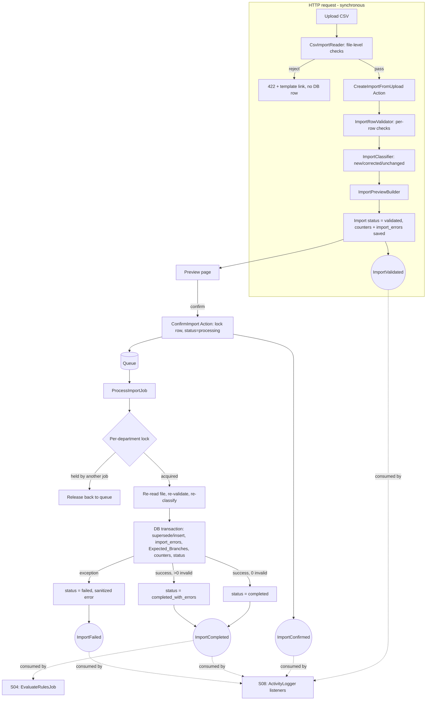

# Design Document

## Overview

S03 implements CSV-based daily sales ingestion for BusinessPulse: upload → file-level validation → row-level validation and classification → preview → confirm → queued processing → committed `sales_records` with full supersede history. It also provides the `ReportingCoverage` service that S04 (rule evaluation) and S08 (activity logging) depend on to decide whether a reporting week is complete, and it is the sole owner of the `imports`, `import_errors` and `sales_records` tables.

S03 is deliberately a thin, synchronous-validation / queued-commit pipeline: validation happens inside the web request (file size is capped at 5 MB / 10,000 rows, so this stays fast), while the actual writes happen in `ProcessImportJob` so a slow transaction never blocks the request and so writes can be made safely idempotent and re-entrant.

Per `docs/business-workflows.md` decisions D1–D8, D26 and the steering file `verification.md`, this feature ships with no automated test suite. Correctness is checked against the fixture files F1–F12 defined in Requirement 22, plus the authorization matrix and responsive checks described in the Testing Strategy section.

## Research and key decisions

### CSV parsing library: PHP native (`fgetcsv`) over `league/csv`

**Decision: use PHP's native `SplFileObject`/`fgetcsv` streaming, not `league/csv`.**

Reasoning:
- The format is simple, fixed-column CSV (RFC 4180, comma delimiter, UTF-8 with optional BOM). `league/csv` adds a dependency and an abstraction layer (`Reader`, `Statement`, `TabularDataReader`) for features S03 does not need (fragment identifiers, nested collections, PDO export).
- `SplFileObject::setFlags(SplFileObject::READ_CSV | SplFileObject::SKIP_EMPTY | SplFileObject::DROP_NEW_LINE)` streams line-by-line without loading the file into memory, satisfying Requirement 4.13 (streaming, memory use independent of row count below the 10,000-row ceiling) with zero extra dependencies.
- BOM stripping, encoding validation (`mb_check_encoding($raw, 'UTF-8')` after removing an optional `EF BB BF` prefix) and "any line ending" tolerance are a few lines of code; native `fgetcsv` already tolerates `\r\n`, `\n` and (with `auto_detect_line_endings` not required in PHP 8.1+) `\r`-only files once the whole stream is read in binary mode and normalized once up front for the header check.
- Laravel's own file upload abstraction (`UploadedFile::getRealPath()`) gives a local temp path S03 can feed directly to `SplFileObject` before the file is moved into private storage, avoiding a second read pass for the header check.

Trade-off accepted: S03 owns a small amount of CSV-edge-case code (quoting, embedded commas/newlines in quoted fields) that `league/csv` would have handled. RFC 4180 quoting is exactly what `fgetcsv` implements, so this is low risk, and keeping the dependency list small matches the steering decision "fewer dependencies" (`docs/architecture.md` §10).

### Decimal handling: strings + `bcmath`, never float

Money (`revenue`, `target_revenue`) is parsed with a strict regex (`^[0-9]{1,12}(\.[0-9]{1,2})?$`) straight from the CSV cell, kept as a **string** through validation and classification, and only cast to a PHP `numeric` cast on the Eloquent model (Laravel's `decimal:2` cast stores/retrieves money as a string too, avoiding float round-off). Comparisons for classification (`unchanged` vs `corrected`) normalize both sides to a fixed 2-decimal-place string with `bcadd($value, '0', 2)` before `===` string comparison — never `==` on floats. `order_count` is a plain integer (no fractional risk). Percentages computed elsewhere in the system use `bcmath` at 4 dp per D8; S03 does not compute percentages itself (that is `ReportingCoverage::weekCoverage()`'s `coveragePct`, which follows the same rule).

### Validation timing: synchronous upload, queued commit

Per Assumption A9, full row validation runs inside the upload request (bounded cost: ≤10,000 rows, ≤5 MB). Only the commit (classification re-check + writes) is queued, because:
- The user needs the preview (counts, coverage, errors) before deciding to confirm — this cannot be asynchronous without a poll-and-wait UX that is worse for the stated file sizes.
- The commit step re-validates and re-classifies against current Active_Records (Requirement 9.5) because the exact set of active rows can have changed between validation and confirmation (another import, concurrent edit) — this must run exactly once, transactionally, which is what a queued job with `ShouldBeUnique` + per-department locking buys us (Requirement 9.6, 9.7).

## Architecture



### Module layout (within the `Imports` module, per `docs/architecture.md` §3–4)

```
app/
  Models/{Import,ImportError,SalesRecord}.php
  Enums/{ImportStatus,ImportRowResult,CoverageStatus}.php
  Policies/{ImportPolicy,SalesRecordPolicy}.php
  Services/Imports/
    CsvImportReader.php
    ImportRowValidator.php
    ImportClassifier.php
    ImportPreviewBuilder.php
    ReportingCoverage.php
    ExpectedBranches.php
  Actions/Imports/
    CreateImportFromUpload.php
    ConfirmImport.php
    CancelImport.php
    RetryImport.php
    UpdateExpectedBranches.php
  Jobs/ProcessImportJob.php
  Events/Imports/{ImportValidated,ImportConfirmed,ImportCancelled,ImportCompleted,ImportFailed,ImportFileDownloaded}.php
  Http/Requests/{UploadImportRequest,UpdateExpectedBranchesRequest}.php
  Http/Controllers/{ImportController,ImportFileController,ImportTemplateController,ImportTemplateSettingsController}.php
resources/js/pages/Imports/{Index,Upload,Show}.vue
resources/js/pages/Settings/Tabs/ImportTemplate.vue
config/imports.php
```

## Components and Interfaces

### `CsvImportReader` (file-level validation + streaming parse)

Responsibility: everything in Requirement 4. Runs before any `imports` row exists.

```php
final class CsvImportReader
{
    // Throws ImportRejectedException(code, message, details) on any file-level failure.
    // Never touches the database. Reads from the UploadedFile's local temp path.
    public function validate(UploadedFile $file): void;

    // Streams the already-validated file and yields raw associative row arrays
    // (header-keyed, trimmed keys, in header order) plus the 1-based data row number.
    // Memory bounded: one row materialized at a time via SplFileObject.
    public function rows(string $path): Generator; // yields [rowNumber:int, cells:array<string,string>]

    public function headerColumns(): array; // ['sales_date','branch_code','revenue','target_revenue','order_count']
}
```

Column spec (header names, required flags, regexes) is defined once in `config/imports.php` and read by `CsvImportReader`, `ImportTemplateController` (template download) and the Template Tab's displayed table, satisfying Requirement 3.5–3.6.

File-level checks run in this order (first failure wins, Requirement 4.2–4.9): extension → MIME (`finfo` on the real path, not the client-supplied MIME) → size → empty/no-header → encoding (BOM-stripped `mb_check_encoding` UTF-8) → header set (missing/unexpected/duplicate columns) → row count (counted during the same stream pass used for parsing, aborting the stream once the 10,001st data row is seen, so this never requires loading the whole file into memory first).

### `ImportRowValidator`

```php
final class ImportRowValidator
{
    // Validates one raw row against the rules in Requirement 5 and the CSV format
    // section. Returns zero or more RowError value objects (one per distinct
    // problem, in column order) and, when there are zero errors, a normalized
    // ValidRow DTO (sales_date: Carbon date-only, branch_code: trimmed+uppercased,
    // revenue/target_revenue: decimal strings at 2dp, order_count: int|null).
    public function validate(int $rowNumber, array $cells, array $expectedBranches, CarbonImmutable $businessToday): RowValidationResult;
}

final class RowValidationResult
{
    public function __construct(
        public readonly int $rowNumber,
        public readonly array $errors,     // RowError[]
        public readonly ?ValidRow $row,    // null when $errors is non-empty
    ) {}
}
```

`duplicate_in_file` (Requirement 7.4) cannot be decided per-row in isolation, so `ImportRowValidator` exposes a second pass:

```php
    // Given all per-row ValidRow results for a file, finds Record_Identity
    // collisions and returns additional RowError[] (code duplicate_in_file,
    // message naming the other row numbers) for every row sharing an identity.
    public function detectDuplicateIdentities(array $validRowsByNumber): array;
```

### `ImportClassifier`

```php
final class ImportClassifier
{
    // $departmentId scopes the Active_Record lookup. Loads Active_Records for
    // the touched (branch_code, sales_date) pairs in one query (WHERE ... IN
    // (list of composite tuples) via a WHERE (branch_code, sales_date) IN (...)
    // or an equivalent indexed lookup) - no N+1 queries.
    public function classify(int $departmentId, array $validRows): array; // ClassifiedRow[] { row, result: ImportRowResult, activeRecord: ?SalesRecord }
}
```

Equality for `unchanged` vs `corrected` normalizes `revenue`/`target_revenue` to 2dp strings (Requirement 18.2) and treats `order_count` null-vs-null as equal, null-vs-value as different (Requirement 7.2).

### `ImportPreviewBuilder`

```php
final class ImportPreviewBuilder
{
    // Produces the full preview DTO for the Upload/Show pages: counts, date
    // range, distinct branches, paginated errors, non-trading-day notice count,
    // per-week CoverageStatus (via ReportingCoverage::weekCoverage with
    // pendingIdentities), "file already imported" notice, and the
    // "preview refreshed" flag when re-reading a validated Import yields
    // different counts than what is persisted (Requirement 8.12-8.13).
    public function build(Import $import): ImportPreviewData;
}
```

`ImportPreviewBuilder::build()` is the single code path used both right after validation (to persist counters) and when a user reopens a `validated` Import (Requirement 8.12), so persisted counters and on-demand rebuild can never drift except for the explicitly-handled "Active_Records changed" case.

### `ReportingCoverage`

This is the contract depended on by S04 and S08 — its shape must not change without updating this document and `docs/architecture.md`.

```php
final class ReportingCoverage
{
    /** Department.settings.expected_branches, sorted unique upper-case codes. */
    public function expectedBranches(Department $department): array; // string[]

    /** ISO weekday-filtered trading dates within the Mon-Sun week containing $weekStart. */
    public function tradingDates(Company $company, CarbonImmutable $weekStart): array; // CarbonImmutable[]

    /**
     * @param array<array{department_id:int,branch_code:string,sales_date:string,revenue:string,target_revenue:string,order_count:?int}>|null $pendingIdentities
     *   Rows to overlay as if they were Active_Records (used by the preview, Requirement 8.7 / 16.14).
     *   When null, only persisted Active_Records are used.
     */
    public function weekCoverage(Department $department, CarbonImmutable $weekStart, ?array $pendingIdentities = null): WeekCoverage;

    /** Coverage_Gaps for the inclusive date range, bounded to department's expected branches/trading days. */
    public function missingBranchDays(Department $department, CarbonImmutable $startDate, CarbonImmutable $endDate): array; // CoverageGap[]

    /** Most recent Complete_Week at/before the Monday of the as-of week, or null. */
    public function latestCompleteWeek(Department $department): ?WeekCoverage;

    /** Latest sales_date among Active_Records, or null. */
    public function asOfDate(Department $department): ?CarbonImmutable;

    /** {as_of_date: ?string, days_since: ?int} computed from BusinessClock::today() (or DEMO_FIXED_DATE). */
    public function freshness(Department $department): Freshness;
}

final class WeekCoverage
{
    public function __construct(
        public readonly CarbonImmutable $weekStart,     // ISO Monday
        public readonly CarbonImmutable $weekEnd,       // ISO Sunday
        public readonly CoverageStatus $status,         // complete|partial|absent
        public readonly int $expectedBranchDays,
        public readonly int $presentBranchDays,
        public readonly ?string $coveragePct,           // decimal string 4dp, round half up; null if expectedBranchDays=0
        public readonly array $gaps,                    // CoverageGap[]
    ) {}
}

final class CoverageGap
{
    public function __construct(
        public readonly string $branchCode,
        public readonly CarbonImmutable $date,
    ) {}
}

final class Freshness
{
    public function __construct(
        public readonly ?string $asOfDate,
        public readonly ?int $daysSince,
    ) {}
}
```

Status rule (Requirement 16.4–16.6, 16.17 completeness invariant): `complete` iff `expectedBranchDays > 0 AND presentBranchDays == expectedBranchDays`; else `partial` if any Active_Record exists in the week (after applying `pendingIdentities`); else `absent` (covers both "no Active_Record" and "no Expected_Branches").

`weekCoverage` is read-only, stateless, and answers with a bounded number of queries (Requirement 16.15): one query to fetch Active_Records for the department within the week's date range (indexed by `(department_id, sales_date)`), independent of total row count in the table, with `pendingIdentities` merged in memory rather than written.

### `ExpectedBranches`

```php
final class ExpectedBranches
{
    public function get(Department $department): array; // sorted unique upper-case
    public function set(Department $department, array $codes): void; // validates format, dedupes, uppercases, sorts, saves
    public function initializeFromImport(Department $department, array $validRowBranchCodes): void; // only if currently empty; called inside ProcessImportJob's transaction
}
```

### Actions

- `CreateImportFromUpload`: stores file to private disk, computes `file_hash` (SHA-256), creates `Import(status=uploaded)`, runs `ImportRowValidator` + `ImportClassifier` + duplicate detection, persists `import_errors` and counters, sets `status=validated`, dispatches `ImportValidated` after commit.
- `ConfirmImport`: `SELECT ... FOR UPDATE` on the Import row, guards status is `validated` and `valid_rows > 0`, sets `processing` + `confirmed_at`, dispatches `ProcessImportJob` and `ImportConfirmed` after commit (Requirement 9.1–9.2).
- `CancelImport`: guards status in `{uploaded, validated}`, sets `cancelled`, dispatches `ImportCancelled`.
- `RetryImport`: guards status is `failed` and file still exists on disk, locks row, sets `processing`, clears `error_message`, dispatches a new `ProcessImportJob`.
- `UpdateExpectedBranches`: validates branch format, non-empty-after-non-empty rule, max 50 codes, blocks while a department-scoped Import is `processing` (Requirement 6.10), delegates to `ExpectedBranches::set()`.

### `ProcessImportJob`

```php
final class ProcessImportJob implements ShouldQueue, ShouldBeUnique
{
    public int $tries = 3;
    public array $backoff = [10, 30, 60];

    public function uniqueId(): string { return (string) $this->importId; }

    public function handle(CsvImportReader $reader, ImportRowValidator $validator, ImportClassifier $classifier, ExpectedBranches $expectedBranches): void
    {
        // 1. Reload Import; if status !== processing, return (already handled / stale dispatch).
        // 2. Acquire Cache::lock("import-processing:department:{$departmentId}", ttl) ->block(...)
        //    If another job holds it, release this job back to the queue (release($delaySeconds)).
        // 3. Re-read stored file via CsvImportReader, re-run ImportRowValidator + ImportClassifier
        //    against Active_Records as they are right now.
        // 4. If zero valid rows after re-validation: status=failed, error_message="No valid rows to import", return.
        // 5. DB::transaction: for each ClassifiedRow in chunks of <=1000 -
        //      new -> insert SalesRecord(is_active=true)
        //      corrected -> update old Active_Record (is_active=false, superseded_by_import_id, superseded_at); insert new Active_Record
        //      unchanged -> no-op
        //    Replace import_errors for this Import, update counters, call
        //    ExpectedBranches::initializeFromImport() if currently empty, set
        //    status completed|completed_with_errors, set completed_at.
        // 6. After commit: dispatch ImportCompleted (or, on step-4 early exit, nothing;
        //    the failed() handler path covers true exceptions).
    }

    public function failed(Throwable $e): void
    {
        // status=failed, sanitized error_message (no paths/cell values/stack traces),
        // dispatch ImportFailed.
    }
}
```

**Idempotency and concurrency** (Requirement 9, D21):
- `ShouldBeUnique` keyed by Import id prevents two queued jobs for the *same* Import from running concurrently.
- The per-department `Cache::lock` prevents two Imports of the *same department* from writing concurrently (Requirement 9.7) — necessary because two different Imports could otherwise both read the same Active_Record as "old" and both try to supersede it, racing on the partial unique index.
- The partial unique index on `sales_records` is the final backstop: if it is violated anyway (e.g. a concurrent write slipped through), the transaction is rolled back and the Import fails with the sanitized message "Data changed during import. Please upload again" (Requirement 10.7), rather than silently corrupting data.
- Double-clicking Confirm is handled by `ConfirmImport`'s row lock + status guard (Requirement 9.2): the second call sees `processing` already and returns the existing Import without a second dispatch.
- Re-running `ProcessImportJob` for an Import already `completed`/`completed_with_errors` (e.g. a stale queued duplicate) is a no-op because step 1 checks `status === processing`.

## Data Models

Per `docs/data-model.md` §2 (authoritative), S03 adds no new columns beyond what's already specified there, except the explicitly-called-out additive `departments.settings` column. Table definitions used by S03 migrations:

### `imports`
| Column | Type | Notes |
|---|---|---|
| id | bigint PK | |
| company_id | bigint FK → companies | |
| department_id | bigint FK → departments | indexed with status |
| uploaded_by | bigint FK → users | |
| original_filename | varchar | sanitized, display-only |
| stored_path | varchar | private disk path, never exposed |
| file_hash | char(64) | SHA-256 hex; indexed |
| status | varchar | check constraint: one of `ImportStatus` values |
| total_rows, valid_rows, invalid_rows, inserted_rows, corrected_rows, unchanged_rows | integer | default 0 |
| min_date, max_date | date | nullable |
| confirmed_at, completed_at | timestamp | nullable |
| error_message | text | nullable, sanitized |
| timestamps | | |

Indexes: `(department_id, status)`, `(file_hash)`.
Check constraint: `status IN ('uploaded','validated','processing','completed','completed_with_errors','failed','cancelled')`.

### `import_errors`
| Column | Type | Notes |
|---|---|---|
| id | bigint PK | |
| import_id | bigint FK → imports, ON DELETE CASCADE | |
| row_number | integer | |
| column | varchar | nullable (file-level-adjacent errors not used here; always set for row errors) |
| code | varchar | |
| message | text | |
| raw_row | jsonb | |
| timestamps | | |

Index: `(import_id)`.

### `sales_records`
| Column | Type | Notes |
|---|---|---|
| id | bigint PK | |
| department_id | bigint FK → departments | |
| import_id | bigint FK → imports | source import |
| branch_code | varchar(20) | stored upper-case |
| sales_date | date | |
| revenue | numeric(14,2) | check `>= 0` |
| target_revenue | numeric(14,2) | check `>= 0` |
| order_count | integer | nullable |
| is_active | boolean | default true |
| superseded_by_import_id | bigint FK → imports | nullable |
| superseded_at | timestamp | nullable |
| timestamps | | |

Indexes: `(department_id, sales_date)`, `(import_id)`.
**Partial unique index:** `UNIQUE (department_id, branch_code, sales_date) WHERE is_active`.
Check constraints: `revenue >= 0`, `target_revenue >= 0`.

Example migration shape for the partial unique index (PostgreSQL, via Laravel raw expression since the query builder has no native partial-index helper):

```php
DB::statement(
    'CREATE UNIQUE INDEX sales_records_active_identity_unique
     ON sales_records (department_id, branch_code, sales_date)
     WHERE is_active'
);
```

and the two check constraints:

```php
DB::statement('ALTER TABLE sales_records ADD CONSTRAINT sales_records_revenue_non_negative CHECK (revenue >= 0)');
DB::statement('ALTER TABLE sales_records ADD CONSTRAINT sales_records_target_revenue_non_negative CHECK (target_revenue >= 0)');
DB::statement("ALTER TABLE imports ADD CONSTRAINT imports_status_check CHECK (status IN ('uploaded','validated','processing','completed','completed_with_errors','failed','cancelled'))");
```

### Additive migration: `departments.settings`

```php
Schema::table('departments', function (Blueprint $table) {
    $table->jsonb('settings')->default('{}');
});
```

`Department` model casts `settings` to `array`. Contract: `settings.expected_branches` is a JSON array of unique, sorted, upper-case branch code strings (Requirement 1.10, 6.1). This migration must run after S02's `departments` migration and must not otherwise modify S02's table.

> **Doc update required (tracked for cross-review):** `docs/data-model.md` §2 currently lists `departments` without a `settings` column. This design requires adding a row to that table's column list — `settings` (JSONB, default `{}`) — and documenting the `expected_branches` contract there, plus documenting the `imports` counter-invariant semantics and the `ReportingCoverage` method contract in `docs/architecture.md`, per Requirement 1.10 and 17.9. This update is **not** made by this design document itself; it is a cross-review action item to apply to `docs/data-model.md` and `docs/architecture.md` before or alongside S03 implementation.

### Models

- `Import extends Model` — `use ScopedToDepartment;` casts: `status => ImportStatus::class`. Relations: `belongsTo(Department)`, `belongsTo(User, 'uploaded_by')`, `hasMany(ImportError)`, `hasMany(SalesRecord)`.
- `ImportError extends Model` — casts: `raw_row => array`. `belongsTo(Import)`.
- `SalesRecord extends Model` — `use ScopedToDepartment;` `belongsTo(Department)`, `belongsTo(Import, 'import_id')`, `belongsTo(Import, 'superseded_by_import_id')`.
- `Department` (S02-owned, S03 adds): casts `settings => array`.

### Events (contract for S04 and S08)

Namespace `App\Events\Imports`. Every event has base public properties `int $importId`, `int $departmentId`, `?int $actorUserId` (null for system-originated, e.g. the job's own completion), `CarbonImmutable $occurredAt`. All events are dispatched **after** the transaction that produced them commits (Requirement 17.5).

| Event | Extra properties | Dispatched when |
|---|---|---|
| `ImportValidated` | — | `CreateImportFromUpload` sets status `validated` |
| `ImportConfirmed` | — | `ConfirmImport` sets status `processing` |
| `ImportCancelled` | — | `CancelImport` sets status `cancelled` |
| `ImportCompleted` | `ImportStatus $status` (`completed`\|`completed_with_errors`), `int $insertedRows`, `int $correctedRows`, `int $unchangedRows`, `int $invalidRows`, `?CarbonImmutable $minDate`, `?CarbonImmutable $maxDate` | `ProcessImportJob` reaches `completed`/`completed_with_errors` |
| `ImportFailed` | — | `ProcessImportJob::failed()`, or file-validation-after-row-creation failure |
| `ImportFileDownloaded` | — | authorized file download completes |

S04 registers a listener on `ImportCompleted` to dispatch `EvaluateRulesJob`. S08 registers listeners on all six events to write `activity_logs` rows. S03 defines the events and dispatches them; it has no knowledge of any listener (Requirement 17.8) and ships with none registered for S04/S08 — those modules register their own listeners in their own service providers.

## Correctness Properties

Not applicable. S03's core transformation logic (CSV parsing, row validation, classification, decimal normalization, `ReportingCoverage` week-completeness computation) would, in isolation, be good property-based-testing candidates (round-trip parse/format, classification invariants, coverage completeness invariant). However, this project's steering file `.kiro/steering/verification.md` and Requirement 21.6 explicitly exclude any automated unit or end-to-end test suite — including property-based tests — from Stage 1 for every spec. Correctness is instead checked by hand against the fixed fixture files F1–F12 (Requirement 22) with their documented expected outcomes, which already cover the equivalent invariants as concrete examples (e.g. F6/F9 cover the coverage completeness rule, F4/F7 cover classification and the revenue-non-inflation invariant, F18.6 is checked as a manual round-trip spot check on one fixture row). See Testing Strategy below.

## Error Handling

| Layer | Failure | Handling |
|---|---|---|
| File-level (`CsvImportReader`) | Any of the 8 file-level codes (Requirement 4) | Throws `ImportRejectedException`; controller catches and returns 422 with code + message + template link; no `imports` row created, no file stored (Requirement 4.10, 8.1 implicit) |
| Row-level (`ImportRowValidator`) | Any of the 10 row codes (Requirement 5) | Collected as `import_errors`, never blocks other rows; row-level errors never throw |
| Upload throttling | >10 uploads/min/user | Laravel `throttle` middleware, HTTP 429 with `Retry-After` surfaced as "seconds remaining" |
| Confirm on wrong status | Import not `validated` | `ConfirmImport` returns existing Import unchanged, no error surfaced to a legitimate double-click; a genuinely wrong-status direct request gets a 422/409-style validation message |
| Cancel on wrong status | Import not `uploaded`/`validated` | `CancelImport` rejects with message naming current status (422) |
| `ProcessImportJob` exception mid-transaction | DB error, unique violation, disk read failure | Transaction rolled back automatically; job's `failed()` sets `status=failed` with sanitized message, dispatches `ImportFailed`; on unique-index violation specifically, message is "Data changed during import. Please upload again" (Requirement 10.7) |
| Stored file missing at process time | File deleted from disk after validation | Job fails the Import with a sanitized message, no Sales_Record change (fixture F12) |
| Zero valid rows at process time | Active_Records changed such that re-validation yields 0 valid rows | `status=failed`, message "No valid rows to import" (Requirement 9.14) |
| Unauthorized access | Wrong role / wrong department | Policy denies → 403 (in-scope) or 404 (out-of-scope, via `visibleTo()`) per Requirement 2 |
| Unexpected exception in controller | Any uncaught throwable | S01 generic error page, no internal details (Requirement 20.5) |
| Logging | Any S03 log line | Never includes cell values, file contents, absolute paths, or session data (Requirement 20.4) — achieved by never passing raw row/file data into `Log::*()` calls; only codes, ids, and counts are logged |

## Testing Strategy

No automated unit or end-to-end test suite is included in S03, per `.kiro/steering/verification.md` and Requirement 21.6. Verification is manual and fixture-based:

1. **Fixture calculation checks (F1–F12, Requirement 22.2–22.12):** author the twelve CSV fixtures exactly as specified (S09 owns authoring; S03 verification consumes them), upload each through the real UI/API, and confirm the resulting counts, statuses, `Expected_Branches`, coverage statuses, and Active_Record sums match the documented expected values exactly. This is the primary correctness check and covers: header validation (F2), row-level error codes and row numbers (F3), classification and counter invariants (F4, F7, F8), duplicate-in-file detection (F5), same-file-hash idempotency and the no-revenue-inflation invariant (F1 re-upload, F7), coverage completeness and gap reporting (F6, F9), double-confirm safety (F11), and missing-file-at-process-time failure handling (F12).
2. **Round-trip spot check (Requirement 18.6):** for one or two representative fixture rows, manually confirm that the stored `Sales_Record` values, when formatted back to CSV cell strings, reproduce the same `sales_date`, upper-case `branch_code`, 2-decimal `revenue`/`target_revenue`, and `order_count` as the source row.
3. **Authorization matrix (Requirement 22.13):** manually exercise every S03 route (list, upload, show, confirm, cancel, retry, template download, file download, expected-branches update) as Owner, Manager (own department), Manager (other department), and Staff, confirming the 403/404 split defined in Requirement 2 and Requirement 12.
4. **Migration check:** `php artisan migrate:fresh` followed by a rollback of the S03 migrations on a scratch database, confirming the partial unique index, check constraints, and the additive `departments.settings` column apply and roll back cleanly.
5. **Static/format checks:** `composer pint-test` (or equivalent Pint check), `npm run type-check`, `npm run build` / `npm run verify` as defined by the project's existing tooling.
6. **Responsive and keyboard checks (Requirement 22.14):** Upload, preview, and Import detail pages at 360px, 768px, and 1280px widths; one full upload-to-confirm run using only the keyboard.
7. **Concurrency spot checks:** double-submit Confirm in quick succession (Requirement 22.11) and confirm only one set of Sales_Record changes results; manually trigger two imports for the same department in close succession and confirm the per-department lock serializes their writes rather than racing.

No property-based or example-based automated tests are written for `ImportClassifier`, `ReportingCoverage`, or the decimal/round-trip logic; their correctness is demonstrated entirely through the fixture runs above, consistent with this project's Stage 1 verification policy.
