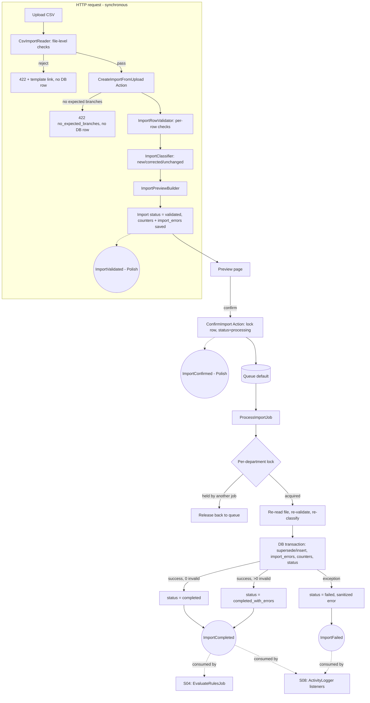

# Design Document

## Overview

S03 implements CSV-based daily sales ingestion for BusinessPulse: upload → file-level validation → row-level validation and classification → preview → confirm → queued processing → committed `sales_records` with full supersede history. It also provides the `ReportingCoverage` service that S04 (rule evaluation), S05 (dashboard freshness) and S08 (outcomes) depend on. `ReportingCoverage` answers calendar questions from the company calendar (`trading_days`, `reporting_cutoff_time`, `reporting_cutoff_lag_days`) and `BusinessClock::now()`: which trading days are due, which ISO weeks are closed, whether a closed week is complete, which due branch-days are missing, and how fresh the data is. S03 is the sole owner of the `imports`, `import_errors` and `sales_records` tables, of the deterministic demo fixtures with their `FixtureGenerator` (`database/demo/`), and of the commands `demo:import` and `demo:check-fixtures`.

S03 is deliberately a thin, synchronous-validation / queued-commit pipeline: validation happens inside the web request (file size is capped at 5 MB / 10,000 rows, so this stays fast), while the actual writes happen in `ProcessImportJob` so a slow transaction never blocks the request and so writes can be made safely idempotent and re-entrant. S03 reads `departments.settings.expected_branches` (created and seeded by S02); it never creates or derives the list, so an upload into a department without expected branches is rejected.

S03 evaluates no rule and creates no issue. `ReportingCoverage` returns facts (due, closed, complete, gaps, freshness); S04 turns them into `insufficient_data`, `missing_sales_data` and issues.

**Tier legend** (`docs/stage-1-refinements.md` R1): `[PoV Core]` is needed for the 22-step demonstration; `[PoV Polish]` is Stage 1 scope built after the Core slice works. Core: upload, file and row validation, preview, confirm, `ProcessImportJob`, supersede, history list, import detail, `ReportingCoverage`, fixtures with `FixtureGenerator`, `demo:import`, `demo:check-fixtures`, the events `ImportCompleted` and `ImportFailed`, and the focused feature tests. Polish: the expected-branches settings UI (`UpdateExpectedBranches`, editor), the Template_Tab beyond a template download link, the source CSV download with `ImportFileDownloaded`, the events `ImportValidated`, `ImportConfirmed` and `ImportCancelled`, and rate-limit tuning. Items without a tag are PoV Core.

Per `docs/stage-1-refinements.md` R5, S03 ships small deterministic feature tests on the S01 harness (PostgreSQL `businesspulse_testing`, `RefreshDatabase`), using the Demo_Fixtures. No browser automation, property-based framework or external AI call is used. Per R1, S03 builds `FileDropzone` and a polling composable because it is their first consumer; S01 does not provide them.

## Research and key decisions

### CSV parsing library: PHP native (`fgetcsv`) over `league/csv`

**Decision: use PHP's native `SplFileObject`/`fgetcsv` streaming, not `league/csv`.**

Reasoning:
- The format is simple, fixed-column CSV (RFC 4180, comma delimiter, UTF-8 with optional BOM). `league/csv` adds a dependency and an abstraction layer (`Reader`, `Statement`, `TabularDataReader`) for features S03 does not need (fragment identifiers, nested collections, PDO export).
- `SplFileObject::setFlags(SplFileObject::READ_CSV | SplFileObject::SKIP_EMPTY | SplFileObject::DROP_NEW_LINE)` streams line-by-line without loading the file into memory, satisfying Requirement 4.13 (streaming, memory use independent of row count below the 10,000-row ceiling) with zero extra dependencies.
- BOM stripping, encoding validation (`mb_check_encoding($raw, 'UTF-8')` after removing an optional `EF BB BF` prefix) and "any line ending" tolerance are a few lines of code; native `fgetcsv` already tolerates `\r\n`, `\n` and (with `auto_detect_line_endings` not required in PHP 8.1+) `\r`-only files once the whole stream is read in binary mode and normalized once up front for the header check.
- Laravel's own file upload abstraction (`UploadedFile::getRealPath()`) gives a local temp path S03 can feed directly to `SplFileObject` before the file is moved into private storage, avoiding a second read pass for the header check.

Trade-off accepted: S03 owns a small amount of CSV-edge-case code (quoting, embedded commas/newlines in quoted fields) that `league/csv` would have handled. RFC 4180 quoting is exactly what `fgetcsv` implements, so this is low risk, and keeping the dependency list small matches the steering decision "fewer dependencies" (`docs/architecture.md` §10).

### Decimal handling: strings + `bcmath`, never float

Money (`revenue`, `target_revenue`) is parsed with a strict regex (`^[0-9]{1,12}(\.[0-9]{1,2})?$`) straight from the CSV cell, kept as a **string** through validation and classification, and only cast to a PHP `numeric` cast on the Eloquent model (Laravel's `decimal:2` cast stores/retrieves money as a string too, avoiding float round-off). Comparisons for classification (`unchanged` vs `corrected`) normalize both sides to a fixed 2-decimal-place string with `bcadd($value, '0', 2)` before `===` string comparison — never `==` on floats. `order_count` is a plain integer (no fractional risk). Percentages computed elsewhere in the system use `bcmath` at 4 dp per D8; S03 does not compute percentages itself (that is the `coveragePct` of `ReportingCoverage::weekState()`, which follows the same rule).

### Validation timing: synchronous upload, queued commit

Per Assumption A9, full row validation runs inside the upload request (bounded cost: ≤10,000 rows, ≤5 MB). Only the commit (classification re-check + writes) is queued, because:
- The user needs the preview (counts, coverage, errors) before deciding to confirm — this cannot be asynchronous without a poll-and-wait UX that is worse for the stated file sizes.
- The commit step re-validates and re-classifies against current Active_Records (Requirement 9.5) because the exact set of active rows can have changed between validation and confirmation (another import, concurrent edit) — this must run exactly once, transactionally, which is what a queued job with `ShouldBeUnique` + per-department locking buys us (Requirement 9.6, 9.7).

### Reporting calendar: due days from the business clock, not from the data

A day is reported missing only when it is due. A trading day D is due when `BusinessClock::now()` is at or after (D + `reporting_cutoff_lag_days`) at `reporting_cutoff_time` in the company timezone (D3, R2). Deriving "missing" from the latest imported date alone would either flag future days or hide a trailing gap (a branch that stopped reporting after the latest date). `ReportingCoverage` therefore separates four conditions: missing rows inside the submitted period, missing due days after the latest sales date, freshness, and the incomplete open week (informational). The calendar arithmetic lives in a small pure value object `ReportingCalendar` (no database), so the same code serves production queries, previews with a pending overlay, tests and `demo:check-fixtures`. Alternative considered: compute due days in SQL. Rejected because the cutoff and lag rules are clearer and testable in PHP, and a week has at most seven dates.

### Fixtures: one generator, literal expectations

The six demo CSV files are produced by `FixtureGenerator` from the weekly totals of `docs/demo-scenario.md` section 2 and committed under `database/demo/`. `expected.json` is authored by hand with literal totals, counts and week states, so `demo:check-fixtures` compares the generator output and the real validator against independent numbers instead of against itself. `demo:import` drives the real upload, confirm and `ProcessImportJob` path with the `sync` queue connection, so demo data is created exactly like user data and never by direct inserts.

## Architecture



### Module layout (within the `Imports` module, per `docs/architecture.md` §3–4)

```
app/
  Models/{Import,ImportError,SalesRecord}.php
  Enums/{ImportStatus,ImportRowResult,WeekStatus,WeekCompleteness,FreshnessState}.php
  Policies/{ImportPolicy,SalesRecordPolicy}.php
  Services/Imports/
    CsvImportReader.php
    ImportRowValidator.php
    ImportClassifier.php
    ImportPreviewBuilder.php
    ReportingCalendar.php
    ReportingCoverage.php
    ExpectedBranches.php
  Services/Demo/FixtureGenerator.php
  Actions/Imports/
    CreateImportFromUpload.php
    ConfirmImport.php
    CancelImport.php
    RetryImport.php
    UpdateExpectedBranches.php          [PoV Polish]
  Jobs/ProcessImportJob.php
  Events/Imports/{ImportCompleted,ImportFailed}.php
  Events/Imports/{ImportValidated,ImportConfirmed,ImportCancelled,ImportFileDownloaded}.php   [PoV Polish]
  Console/Commands/{DemoImport,DemoCheckFixtures}.php
  Http/Requests/UploadImportRequest.php
  Http/Requests/UpdateExpectedBranchesRequest.php    [PoV Polish]
  Http/Controllers/{ImportController,ImportTemplateController}.php
  Http/Controllers/{ImportFileController,ImportTemplateSettingsController}.php   [PoV Polish]
database/demo/{history,week8-decline,week8-with-errors,week8-correction,week9-interim,week10-recovery}.csv, expected.json
resources/js/components/FileDropzone.vue, resources/js/composables/usePolling.ts
resources/js/pages/Imports/{Index,Upload,Show}.vue
resources/js/pages/Settings/Tabs/ImportTemplate.vue   [PoV Polish]
tests/Feature/Imports/
config/imports.php
```

## Components and Interfaces

### `CsvImportReader` (file-level validation + streaming parse)

Responsibility: everything in Requirement 4. Runs before any `imports` row exists.

```php
final class CsvImportReader
{
    // Throws ImportRejectedException(code, message, details) on any file-level failure.
    // Never touches the database. Reads from the UploadedFile's local temp path.
    public function validate(UploadedFile $file): void;

    // Streams the already-validated file and yields raw associative row arrays
    // (header-keyed, trimmed keys, in header order) plus the 1-based data row number.
    // Memory bounded: one row materialized at a time via SplFileObject.
    public function rows(string $path): Generator; // yields [rowNumber:int, cells:array<string,string>]

    public function headerColumns(): array; // ['sales_date','branch_code','revenue','target_revenue','order_count']
}
```

Column spec (header names, required flags, regexes) is defined once in `config/imports.php` and read by `CsvImportReader`, `ImportTemplateController` (template download) and the Template Tab's displayed table, satisfying Requirement 3.5–3.6.

File-level checks run in this order (first failure wins, Requirement 4.2–4.9): extension → MIME (`finfo` on the real path, not the client-supplied MIME) → size → empty/no-header → encoding (BOM-stripped `mb_check_encoding` UTF-8) → header set (missing/unexpected/duplicate columns) → row count (counted during the same stream pass used for parsing, aborting the stream once the 10,001st data row is seen, so this never requires loading the whole file into memory first).

### `ImportRowValidator`

```php
final class ImportRowValidator
{
    // Validates one raw row against the rules in Requirement 5 and the CSV format
    // section. Returns zero or more RowError value objects (one per distinct
    // problem, in column order) and, when there are zero errors, a normalized
    // ValidRow DTO (sales_date: Carbon date-only, branch_code: trimmed+uppercased,
    // revenue/target_revenue: decimal strings at 2dp, order_count: int|null).
    public function validate(int $rowNumber, array $cells, array $expectedBranches, CarbonImmutable $businessToday): RowValidationResult;
}

final class RowValidationResult
{
    public function __construct(
        public readonly int $rowNumber,
        public readonly array $errors,     // RowError[]
        public readonly ?ValidRow $row,    // null when $errors is non-empty
    ) {}
}
```

`duplicate_in_file` (Requirement 7.4) cannot be decided per-row in isolation, so `ImportRowValidator` exposes a second pass:

```php
    // Given all per-row ValidRow results for a file, finds Record_Identity
    // collisions and returns additional RowError[] (code duplicate_in_file,
    // message naming the other row numbers) for every row sharing an identity.
    public function detectDuplicateIdentities(array $validRowsByNumber): array;
```

### `ImportClassifier`

```php
final class ImportClassifier
{
    // $departmentId scopes the Active_Record lookup. Loads Active_Records for
    // the touched (branch_code, sales_date) pairs in one query (WHERE ... IN
    // (list of composite tuples) via a WHERE (branch_code, sales_date) IN (...)
    // or an equivalent indexed lookup) - no N+1 queries.
    public function classify(int $departmentId, array $validRows): array; // ClassifiedRow[] { row, result: ImportRowResult, activeRecord: ?SalesRecord }
}
```

Equality for `unchanged` vs `corrected` normalizes `revenue`/`target_revenue` to 2dp strings (Requirement 18.2) and treats `order_count` null-vs-null as equal, null-vs-value as different (Requirement 7.2).

### `ImportPreviewBuilder`

```php
final class ImportPreviewBuilder
{
    // Produces the full preview DTO for the Upload/Show pages: counts, date
    // range, distinct branches, paginated errors, non-trading-day notice count,
    // per-week Week_State (via ReportingCoverage::weekStates with
    // pendingIdentities), the overdue branch-day count after the overlay
    // (Requirement 8.15), "file already imported" notice, and the
    // "preview refreshed" flag when re-reading a validated Import yields
    // different counts than what is persisted (Requirement 8.12-8.13).
    public function build(Import $import): ImportPreviewData;
}
```

`ImportPreviewBuilder::build()` is the single code path used both right after validation (to persist counters) and when a user reopens a `validated` Import (Requirement 8.12), so persisted counters and on-demand rebuild can never drift except for the explicitly-handled "Active_Records changed" case.

### `ReportingCalendar` and `ReportingCoverage`

This is the contract depended on by S04, S05 and S08. Its shape must not change without updating this document and `docs/architecture.md`. Evaluation is not done here: the service returns facts only.

```php
// Pure value object, no database access. Built from the Company and a clock instant.
final class ReportingCalendar
{
    public static function forCompany(Company $company, CarbonImmutable $now): self;

    // trading day AND $now >= ($date + lag days) at cutoff time, company timezone.
    public function isDue(CarbonImmutable $date): bool;
    // Latest due trading day (searches back from $now, bounded by lag + 7 days).
    public function lastDueDate(): CarbonImmutable;
    // Dates of the Mon-Sun week whose ISO weekday is in trading_days.
    public function tradingDates(CarbonImmutable $weekStart): array;      // CarbonImmutable[]
    // true iff every trading date of the week isDue().
    public function isWeekClosed(CarbonImmutable $weekStart): bool;
}

final class ReportingCoverage
{
    public function __construct(private BusinessClock $clock) {}

    /** $now defaults to $this->clock->now(); the override exists for demo:check-fixtures and tests. */
    public function calendar(Company $company, ?CarbonImmutable $now = null): ReportingCalendar;

    /** Department.settings.expected_branches (sorted, unique, upper-case); [] when absent. */
    public function expectedBranches(Department $department): array;      // string[]

    public function isDue(Department $department, CarbonImmutable $date, ?CarbonImmutable $now = null): bool;
    public function lastDueDate(Department $department, ?CarbonImmutable $now = null): CarbonImmutable;
    public function tradingDates(Department $department, CarbonImmutable $weekStart): array;

    /**
     * @param PendingRows|null $pending Valid rows of an unprocessed import, overlaid as if they were Active_Records.
     */
    public function weekState(Department $department, CarbonImmutable $weekStart, ?PendingRows $pending = null, ?CarbonImmutable $now = null): WeekState;

    /** One query for the whole range; weekState() is the one-week case. Used by the preview and the detail page. */
    public function weekStates(Department $department, CarbonImmutable $fromWeekStart, CarbonImmutable $toWeekStart, ?PendingRows $pending = null, ?CarbonImmutable $now = null): array; // WeekState[]

    /** Database-free calculation shared by weekState(); used by demo:check-fixtures and tests. */
    public function weekStateForRows(ReportingCalendar $calendar, array $expectedBranches, CarbonImmutable $weekStart, iterable $rows): WeekState;

    /** Most recent closed week, whatever its completeness. S04 decides insufficient_data. */
    public function latestClosedWeek(Department $department, ?CarbonImmutable $now = null): WeekState;

    /**
     * Expected branch x due trading day with no Active_Record in [windowStart, min(windowEnd, lastDueDate)].
     * Covers (a) rows missing inside the submitted period (date <= latest sales date, kind inside_period) and
     * (b) due days after the latest sales date (kind after_latest). Never returns a not-yet-due date.
     */
    public function missingDueBranchDays(Department $department, CarbonImmutable $windowStart, CarbonImmutable $windowEnd, ?PendingRows $pending = null, ?CarbonImmutable $now = null): array; // CoverageGap[]

    public function latestSalesDate(Department $department, ?PendingRows $pending = null): ?CarbonImmutable;
    public function freshness(Department $department, ?PendingRows $pending = null, ?CarbonImmutable $now = null): Freshness;
}

final class WeekState
{
    public function __construct(
        public readonly CarbonImmutable $weekStart,          // ISO Monday
        public readonly CarbonImmutable $weekEnd,            // ISO Sunday
        public readonly WeekStatus $status,                  // closed | open
        public readonly ?WeekCompleteness $completeness,     // complete | incomplete | absent; null when open
        public readonly int $expectedBranchDays,             // trading days x expected branches
        public readonly int $presentBranchDays,
        public readonly int $dueBranchDays,                  // due trading days x expected branches
        public readonly ?string $coveragePct,                // decimal string, 4 dp, round half up; null if expected is 0
        public readonly array $gaps,                         // CoverageGap[] (due days only)
    ) {}
}

final class CoverageGap
{
    public function __construct(
        public readonly string $branchCode,
        public readonly CarbonImmutable $date,
        public readonly string $kind,                        // inside_period | after_latest
    ) {}
}

final class Freshness
{
    public function __construct(
        public readonly ?CarbonImmutable $latestSalesDate,
        public readonly CarbonImmutable $lastDueDate,
        public readonly FreshnessState $state,               // current | behind
        public readonly ?int $overdueBranchDays,             // null when no Active_Record exists
        public readonly ?CarbonImmutable $overdueFrom,
        public readonly ?CarbonImmutable $overdueTo,
    ) {}
}
```

**Rules (Requirements 15 and 16)**
- `isDue`: non-trading days are never due; a trading day D is due iff `now >= D + lag days at cutoff time` in the company timezone. Future days and days whose cutoff has not passed are therefore never reported missing. Worked example with the demo calendar (lag 1, cutoff 12:00): at 2026-09-28 09:00 Saturday 2026-09-26 is due (its cutoff was Sunday 2026-09-27 12:00) and Monday 2026-09-28 is not.
- `weekState`: `closed` iff every trading date is due, else `open`. For a closed week: `absent` iff `presentBranchDays = 0` or Expected_Branches is empty; else `incomplete` iff any expected branch-day has no row; else `complete`. For an open week `completeness` is null, the week is informational, and `gaps` lists only due branch-days (S04 never evaluates an open week with the decline or target rules).
- Present means an Active_Record (or pending row) exists for an expected branch on a trading day of the week. Rows on non-trading days and for non-expected branches are ignored. A zero revenue is present. No figure substitutes zero for a gap.
- `freshness`: `latestSalesDate` = max `sales_date` of Active_Records (plus pending rows). `state` = `current` iff `latestSalesDate >= lastDueDate`, else `behind` (also `behind` with a null count when no record exists). `overdueBranchDays` = (due trading days in `(latestSalesDate, lastDueDate]`) x (expected branch count), with `overdueFrom` and `overdueTo` the first and last of those dates. Invariant: `overdueBranchDays` equals the count of `after_latest` gaps from `missingDueBranchDays` over that range.
- Example (demo, clock 2026-09-28 09:00, history imported): `latestSalesDate` 2026-09-19, `lastDueDate` 2026-09-26, state `behind`, 6 trading days x 3 branches = 18 overdue branch-days, "Sales for 21–26 Sep not yet received: 18 branch-days overdue". At clock 2026-09-21 09:00 the same data is `current` and W8 is `open` with no gap.
- `latestClosedWeek`: the week of `lastDueDate` if it is closed (the last trading day is due), otherwise the previous week.
- Query shape: `weekStates` and `missingDueBranchDays` run one query for the Active_Records of the department in the date range (branch and date only, indexed by `(department_id, sales_date)`) plus one `max(sales_date)` aggregate; pending rows merge in memory. The query count does not depend on row count. `weekStateForRows` runs no query.

### `ExpectedBranches`

```php
final class ExpectedBranches
{
    public function get(Department $department): array;                 // sorted unique upper-case; [] when absent
    public function set(Department $department, array $codes): void;    // [PoV Polish] validates format, dedupes, uppercases, sorts, saves under settings.expected_branches and preserves every other settings key
}
```

There is no `initializeFromImport`: the list is seeded by S02 and never derived from an import (D3, R2). `get()` is the only method used by Core code. `ReportingCoverage::expectedBranches()` delegates to it.

### Actions

- `CreateImportFromUpload` [PoV Core]: first checks that the department has Expected_Branches; if empty, throws `ImportRejectedException('no_expected_branches')` before any file read (no row, no file). Then runs `CsvImportReader::validate`, stores the file to the private disk, computes `file_hash` (SHA-256), creates `Import(status=uploaded)`, runs `ImportRowValidator` + `ImportClassifier` + duplicate detection, persists `import_errors` and counters, sets `status=validated`. [PoV Polish] dispatches `ImportValidated` after commit.
- `ConfirmImport` [PoV Core]: `SELECT ... FOR UPDATE` on the Import row, guards status is `validated` and `valid_rows > 0`, sets `processing` + `confirmed_at`, dispatches `ProcessImportJob` after commit (Requirement 9.1–9.2). [PoV Polish] dispatches `ImportConfirmed`.
- `CancelImport` [PoV Core]: guards status in `{uploaded, validated}`, sets `cancelled`. [PoV Polish] dispatches `ImportCancelled`.
- `RetryImport` [PoV Core]: guards status is `failed` and file still exists on disk, locks row, sets `processing`, clears `error_message`, dispatches a new `ProcessImportJob`.
- `UpdateExpectedBranches` [PoV Polish]: validates branch format, non-empty, max 50 codes, blocks while a department-scoped Import is `processing` (Requirement 6.11), delegates to `ExpectedBranches::set()`.

### `ProcessImportJob`

Queue configuration follows `docs/stage-1-refinements.md` R6: queue `default`, no HTTP call, `$timeout` 120 s (below the worker ceiling of 180 s and the `retry_after` of 300 s), `$tries` 3, `backoff()` 10, 30, 60 s, unique with `uniqueFor` 900 s (longer than the whole retry window), dispatched `afterCommit`.

```php
final class ProcessImportJob implements ShouldQueue, ShouldBeUnique
{
    use Queueable;

    public int $timeout = 120;
    public int $tries = 3;
    public int $uniqueFor = 900;

    public function __construct(public readonly int $importId)
    {
        $this->onQueue('default');
        $this->afterCommit();
    }

    public function backoff(): array { return [10, 30, 60]; }
    public function uniqueId(): string { return (string) $this->importId; }

    public function handle(CsvImportReader $reader, ImportRowValidator $validator, ImportClassifier $classifier, ExpectedBranches $expectedBranches): void
    {
        // 1. Reload Import; if status !== processing, return (already handled / stale dispatch).
        // 2. Acquire Cache::lock("import-processing:department:{$departmentId}", ttl) ->block(...)
        //    If another job holds it, release this job back to the queue (release($delaySeconds)).
        // 3. If Expected_Branches is empty: status=failed, message "Expected branches are not configured",
        //    dispatch ImportFailed, return (Requirement 6.6).
        // 4. Re-read the stored file via CsvImportReader, re-run ImportRowValidator + ImportClassifier
        //    against Active_Records as they are right now. A missing file fails the Import with a sanitized message.
        // 5. If zero valid rows after re-validation: status=failed, "No valid rows to import", dispatch ImportFailed, return.
        // 6. DB::transaction: for each ClassifiedRow in chunks of <=1000 -
        //      new -> insert SalesRecord(is_active=true)
        //      corrected -> update old Active_Record (is_active=false, superseded_by_import_id, superseded_at); insert new Active_Record
        //      unchanged -> no-op
        //    Replace import_errors for this Import, update counters, set status completed|completed_with_errors, set completed_at.
        // 7. After commit: dispatch ImportCompleted.
    }

    public function failed(Throwable $e): void
    {
        // status=failed, sanitized error_message (no paths/cell values/stack traces),
        // dispatch ImportFailed.
    }
}
```

**Idempotency and concurrency** (Requirement 9, D21):
- `ShouldBeUnique` keyed by Import id prevents two queued jobs for the *same* Import from running concurrently.
- The per-department `Cache::lock` prevents two Imports of the *same department* from writing concurrently (Requirement 9.7), because two different Imports could otherwise both read the same Active_Record as "old" and both try to supersede it, racing on the partial unique index.
- The partial unique index on `sales_records` is the final backstop: if it is violated anyway, the transaction is rolled back and the Import fails with the sanitized message "Data changed during import. Please upload again" (Requirement 10.7).
- Double-clicking Confirm is handled by `ConfirmImport`'s row lock + status guard (Requirement 9.2).
- Re-running `ProcessImportJob` for an Import already `completed`/`completed_with_errors` is a no-op because step 1 checks `status === processing`.

### `FixtureGenerator` and the fixtures [PoV Core]

```php
final class FixtureGenerator
{
    /** @return array<string,string> file name => CSV content (LF line endings, trailing newline, no BOM) */
    public function files(): array;
    /** Six daily totals: floor(weekly / 6) each, +1 from Monday until the remainder is used. */
    public function dailyTotals(int $weeklyTotal): array;
    /** [KL, PG, JB] whole MYR: PG = floor(D*8/26), JB = floor(D*6/26), KL = D - PG - JB. */
    public function split(int $dailyTotal): array;
}
```

- Rows are ordered by date, then KL, PG, JB. Each row is `date,branch,revenue(2dp),target(2dp),` with an empty `order_count`; targets are 12000.00, 8000.00, 6000.00. Money is written from integers so no float is involved. The header is the `config/imports.php` header.
- Weekly totals and date ranges are those of `docs/demo-scenario.md` section 2. Worked example: W8 124,000 gives daily totals 20,667 (Monday to Thursday) and 20,666 (Friday, Saturday); Monday splits into PG 6,359, JB 4,769, KL 9,539.
- `week8-correction.csv` is `week8-decline.csv` with revenue +1,000.00 on KL Wednesday 2026-09-23 and PG Thursday 2026-09-24 (W8 total 126,000.00).
- `week8-with-errors.csv` has 20 data rows: the 18 W8 rows in order (rows 2 to 19, with JB Saturday on row 19 carrying a non-numeric `target_revenue`), row 20 with `sales_date` `2026-09-31` (`invalid_date`), row 21 on Sunday 2026-09-27 with a negative `revenue` (`negative_value`). Valid rows: 17; invalid rows: 3; JB Saturday missing.
- `database/demo/expected.json` is hand-authored with literal values:

```json
{
  "calendar": { "timezone": "Asia/Kuala_Lumpur", "tradingDays": [1,2,3,4,5,6], "cutoffTime": "12:00", "cutoffLagDays": 1 },
  "expectedBranches": ["JB", "KL", "PG"],
  "fixtures": {
    "history": {
      "file": "history.csv", "clock": "2026-09-21 09:00", "after": [],
      "totalRows": 126, "validRows": 126, "invalidRows": 0, "errors": [],
      "weeklyTotals": { "2026-08-03": "150000.00", "...": "..." },
      "branchDays": { "2026-08-03": 18, "...": 18 },
      "weekStates": { "2026-09-14": { "status": "closed", "completeness": "complete" }, "2026-09-21": { "status": "open", "completeness": null } }
    },
    "week8-with-errors": {
      "file": "week8-with-errors.csv", "clock": "2026-09-28 09:00", "after": ["history"],
      "totalRows": 20, "validRows": 17, "invalidRows": 3,
      "errors": [ { "row": 19, "column": "target_revenue", "code": "invalid_number" }, { "row": 20, "column": "sales_date", "code": "invalid_date" }, { "row": 21, "column": "revenue", "code": "negative_value" } ],
      "weekStates": { "2026-09-21": { "status": "closed", "completeness": "incomplete" } }
    }
  }
}
```

  Clock and `after` per fixture follow the demo timeline: `history` at 2026-09-21 09:00; `week8-decline`, `week8-with-errors` (after `history`) and `week8-correction` (after `history`, `week8-decline`) at 2026-09-28 09:00; `week9-interim` (after `history`, `week8-decline`) at 2026-10-05 09:00; `week10-recovery` (after `history`, `week8-decline`, `week9-interim`) at 2026-10-12 09:00. S04 adds an `evaluations` key later.

### `demo:import {fixture}` [PoV Core]

`app/Console/Commands/DemoImport.php`. Steps:
1. Refuse (non-zero exit, message naming `DEMO_MODE`) unless `config('demo.mode')` is true.
2. Accept one of the six names with or without `.csv`; otherwise list the valid names and exit non-zero.
3. Resolve the Owner of the company with `is_demo` true (S02 seeder); exit non-zero if absent.
4. Set `config(['queue.default' => 'sync'])` for this process so `ProcessImportJob` runs inline through the same class as production; wrap `database/demo/{fixture}.csv` in an `UploadedFile` (test mode) and call `CreateImportFromUpload`, then `ConfirmImport` (outside any transaction), authenticating as the Owner for the actions.
5. Print status, counters and error codes. Exit non-zero if the upload is rejected, the Import is not `completed` or `completed_with_errors`, or the counters differ from `expected.json` for that fixture. Direct inserts into `sales_records` are never used.
The command does not change the demo clock; the presenter runs `demo:set-date` first (README by S09).

### `demo:check-fixtures [--write]` [PoV Core]

`app/Console/Commands/DemoCheckFixtures.php`. Reads no database row and writes nothing, except the CSV files when `--write` is given (then `expected.json` is untouched). For each fixture in `expected.json`:
1. File bytes equal `FixtureGenerator::files()[file]`.
2. The real `CsvImportReader` and `ImportRowValidator` (businessToday = date of the fixture clock, Expected_Branches from `expected.json`) give the expected `totalRows`, `validRows`, `invalidRows` and error `(row, column, code)` list.
3. Weekly totals (decimal strings, bcmath) and branch-day counts of valid rows, per ISO week start, equal `expected.json`.
4. `ReportingCoverage::weekStateForRows(ReportingCalendar::forCompany(calendar from expected.json, clock), expectedBranches, weekStart, rows)` returns the listed `status` and `completeness`, where `rows` are the valid rows of the fixtures in `after` overlaid with this fixture's valid rows (later rows replace the same identity).
Prints one line per mismatch (fixture, check, expected, actual); exit code 0 only when every check passes.

## Data Models

Per `docs/data-model.md` §2 (authoritative), S03 adds no columns beyond what is already specified there. `departments.settings` is created by S02; S03 reads (and, as PoV Polish, writes) only its key `expected_branches`. Table definitions used by S03 migrations:

### `imports`
| Column | Type | Notes |
|---|---|---|
| id | bigint PK | |
| company_id | bigint FK → companies | |
| department_id | bigint FK → departments | indexed with status |
| uploaded_by | bigint FK → users | |
| original_filename | varchar | sanitized, display-only |
| stored_path | varchar | private disk path, never exposed |
| file_hash | char(64) | SHA-256 hex; indexed |
| status | varchar | check constraint: one of `ImportStatus` values |
| total_rows, valid_rows, invalid_rows, inserted_rows, corrected_rows, unchanged_rows | integer | default 0 |
| min_date, max_date | date | nullable |
| confirmed_at, completed_at | timestamp | nullable |
| error_message | text | nullable, sanitized |
| timestamps | | |

Indexes: `(department_id, status)`, `(file_hash)`.
Check constraint: `status IN ('uploaded','validated','processing','completed','completed_with_errors','failed','cancelled')`.

### `import_errors`
| Column | Type | Notes |
|---|---|---|
| id | bigint PK | |
| import_id | bigint FK → imports, ON DELETE CASCADE | |
| row_number | integer | |
| column | varchar | nullable (file-level-adjacent errors not used here; always set for row errors) |
| code | varchar | |
| message | text | |
| raw_row | jsonb | |
| timestamps | | |

Index: `(import_id)`.

### `sales_records`
| Column | Type | Notes |
|---|---|---|
| id | bigint PK | |
| department_id | bigint FK → departments | |
| import_id | bigint FK → imports | source import |
| branch_code | varchar(20) | stored upper-case |
| sales_date | date | |
| revenue | numeric(14,2) | check `>= 0` |
| target_revenue | numeric(14,2) | check `>= 0` |
| order_count | integer | nullable |
| is_active | boolean | default true |
| superseded_by_import_id | bigint FK → imports | nullable |
| superseded_at | timestamp | nullable |
| timestamps | | |

Indexes: `(department_id, sales_date)`, `(import_id)`.
**Partial unique index:** `UNIQUE (department_id, branch_code, sales_date) WHERE is_active`.
Check constraints: `revenue >= 0`, `target_revenue >= 0`.

Example migration shape for the partial unique index (PostgreSQL, via Laravel raw expression since the query builder has no native partial-index helper):

```php
DB::statement(
    'CREATE UNIQUE INDEX sales_records_active_identity_unique
     ON sales_records (department_id, branch_code, sales_date)
     WHERE is_active'
);
```

and the two check constraints:

```php
DB::statement('ALTER TABLE sales_records ADD CONSTRAINT sales_records_revenue_non_negative CHECK (revenue >= 0)');
DB::statement('ALTER TABLE sales_records ADD CONSTRAINT sales_records_target_revenue_non_negative CHECK (target_revenue >= 0)');
DB::statement("ALTER TABLE imports ADD CONSTRAINT imports_status_check CHECK (status IN ('uploaded','validated','processing','completed','completed_with_errors','failed','cancelled'))");
```

### `departments.settings` (created by S02)

S03 adds no migration for `departments`. The S02 column `settings` (JSONB, not null, default `{}`) holds `expected_branches`, a JSON array of unique, sorted, upper-case branch code strings, seeded as `["JB","KL","PG"]` by `DemoIdentitySeeder`. S03 reads it through `Department::expectedBranches()` / `ExpectedBranches::get()` and never creates, derives or auto-fills it. The PoV Polish editor writes only that key and preserves every other key (for example `intelligence.last_evaluated_at` of S04).

> **Doc update (task 8.1):** `docs/data-model.md` already lists `departments.settings`. S03 adds the import counter semantics (`total_rows = valid_rows + invalid_rows`, `valid_rows = inserted_rows + corrected_rows + unchanged_rows`) there, and documents the `ReportingCoverage` contract, the events and the demo commands in `docs/architecture.md`.

### Models

- `Import extends Model` — `use ScopedToDepartment;` casts: `status => ImportStatus::class`. Relations: `belongsTo(Department)`, `belongsTo(User, 'uploaded_by')`, `hasMany(ImportError)`, `hasMany(SalesRecord)`.
- `ImportError extends Model` — casts: `raw_row => array`. `belongsTo(Import)`.
- `SalesRecord extends Model` — `use ScopedToDepartment;` `belongsTo(Department)`, `belongsTo(Import, 'import_id')`, `belongsTo(Import, 'superseded_by_import_id')`.
- `Department` (S02-owned): used read-only through `expectedBranches()`; S03 adds no cast or column.

### Events (contract for S04 and S08)

Namespace `App\Events\Imports`. Every event has base public properties `int $importId`, `int $departmentId`, `?int $actorUserId` (null for system-originated, e.g. the job's own completion), `CarbonImmutable $occurredAt`. All events are dispatched **after** the transaction that produced them commits (Requirement 17.5).

| Event | Tier | Extra properties | Dispatched when |
|---|---|---|---|
| `ImportCompleted` | Core | `ImportStatus $status` (`completed`\|`completed_with_errors`), `int $insertedRows`, `int $correctedRows`, `int $unchangedRows`, `int $invalidRows`, `?CarbonImmutable $minDate`, `?CarbonImmutable $maxDate` | `ProcessImportJob` reaches `completed`/`completed_with_errors` |
| `ImportFailed` | Core | — | `ProcessImportJob::failed()`, an early job failure, or a file-validation-after-row-creation failure |
| `ImportValidated` | Polish | — | `CreateImportFromUpload` sets status `validated` |
| `ImportConfirmed` | Polish | — | `ConfirmImport` sets status `processing` |
| `ImportCancelled` | Polish | — | `CancelImport` sets status `cancelled` |
| `ImportFileDownloaded` | Polish | — | authorized source file download completes |

S04 registers a listener on `ImportCompleted` to dispatch `EvaluateRulesJob`. S08 registers listeners on `ImportCompleted` and `ImportFailed` (PoV Core activity events, R7) and later on the Polish events. S03 defines the events and dispatches them; it has no knowledge of any listener (Requirement 17.8) and ships with none registered for S04/S08.

## Correctness Properties

*A property is a characteristic that should hold across all valid executions of the system. Properties bridge the requirements and the focused tests.*

Per `docs/stage-1-refinements.md` R5, no property-based framework is used. Each property below is checked by a small deterministic feature test over the Demo_Fixtures, using the S01 harness on PostgreSQL (`RefreshDatabase`).

### Property 1: Re-importing the same file does not inflate revenue [PoV Core]

For any completed Import of a file F, importing F again classifies every valid row `unchanged`, inserts no Sales_Record, and leaves the number of Active_Records and the sum of Active_Record revenue unchanged.

**Validates: Requirements 7.2, 7.6, 7.7, 10.3, 10.6**

*Test*: import `week8-decline.csv` twice; assert 18 unchanged on the second Import, the "File already imported" notice, 18 Active_Records and an unchanged revenue sum of 124,000.00.

### Property 2: A correction supersedes and preserves history [PoV Core]

For any corrected identity, exactly one Active_Record remains, the previous row stays with `is_active` false, `superseded_by_import_id` set and its old values readable, and no Sales_Record is deleted.

**Validates: Requirements 10.2, 10.4, 10.5, 10.8**

*Test*: import `week8-decline.csv`, then `week8-correction.csv`; assert 16 unchanged, 2 corrected, 18 Active_Records, 2 inactive rows with the old revenue and the second Import id, and 20 rows in total.

### Property 3: A duplicated identity inside one file is invalid [PoV Core]

For any file in which two rows share a Record_Identity, both rows are invalid with `duplicate_in_file`, and `total_rows = valid_rows + invalid_rows`.

**Validates: Requirements 7.4, 7.8**

*Test*: an in-test CSV with two rows for the same branch and date plus valid rows.

### Property 4: Only due days are ever missing [PoV Core]

For any clock instant, no Coverage_Gap and no Overdue_Branch_Day has a date that is not a Due_Day, a day is due exactly when its cutoff (day + lag at cutoff time) has passed, and `overdueBranchDays` equals the number of `after_latest` gaps.

**Validates: Requirements 15.3, 15.4, 16.2, 16.3, 16.13, 16.20**

*Test*: with `history.csv` imported, clock 2026-09-21 09:00 gives W8 `open`, no gap, Freshness `current`; clock 2026-09-28 09:00 gives Saturday 2026-09-26 due, Monday 2026-09-28 not due, W8 `closed` and `absent`, Freshness `behind` with 18 overdue branch-days. A row-missing case: `week8-with-errors.csv` gives W8 `incomplete` with exactly one `inside_period` gap (JB, 2026-09-26).

### Property 5: Completeness invariant [PoV Core]

For every closed week, completeness is `complete` if and only if `presentBranchDays = expectedBranchDays` and `expectedBranchDays > 0`; a zero-revenue row counts as present; no figure substitutes zero for a gap.

**Validates: Requirements 16.7, 16.9, 16.10, 16.19**

*Test*: `weekStateForRows` over fixture rows with one branch-day removed (incomplete), with a `0.00` revenue row (present), and with no rows (absent).

### Property 6: Branch configuration is explicit [PoV Core]

An upload into a department with empty Expected_Branches is rejected with `no_expected_branches`, creating no `imports` row and no stored file; a row with a branch outside Expected_Branches is invalid with `unknown_branch`; no import changes Expected_Branches.

**Validates: Requirements 6.3, 6.4, 6.5**

*Test*: empty the list in a test, assert rejection and no rows; with the seeded list, upload a row for branch `XX` and assert `unknown_branch`.

### Property 7: Fixtures are deterministic and consistent [PoV Core]

The Fixture_Generator output equals the committed files, and the real validator and coverage calculation agree with the literal `expected.json` values.

**Validates: Requirements 22.1, 22.2, 22.3, 22.5, 22.6, 22.7, 22.11, 22.12**

*Test*: run `demo:check-fixtures` and assert exit code 0.

### Property 8: Import access follows department scope [PoV Core]

For every Import_Page route and Import action, an Import outside the Manager's department yields 404, a Staff user yields 403, and the Owner and own-department Manager are permitted.

**Validates: Requirements 2.1, 2.2, 2.3, 2.4**

*Test*: a second test-only department with an Import, plus Owner, own Manager, other Manager and Staff users.

### Property 9: Source file download is authorized [PoV Polish]

The source file of an Import is streamed only to the Owner and the own-department Manager; Staff receive 403 and a Manager of another department receives 404.

**Validates: Requirements 12.3, 12.4**

*Test*: download requests with the four user types.

## Error Handling

| Layer | Failure | Handling |
|---|---|---|
| Preflight (`CreateImportFromUpload`) | Department has no Expected_Branches | Throws `ImportRejectedException('no_expected_branches')`; controller returns 422 with a message to configure expected branches; no `imports` row, no file (Requirement 6.3) |
| `ProcessImportJob` | Expected_Branches became empty after confirmation | Import fails with "Expected branches are not configured", no Sales_Record change, `ImportFailed` (Requirement 6.6) |
| `demo:import` | `DEMO_MODE` false, unknown fixture name, no demo Owner, rejected upload, counters differ from `expected.json` | Non-zero exit with a message naming the cause; never inserts directly |
| `demo:check-fixtures` | Any mismatch | One line per mismatch (fixture, check, expected, actual), non-zero exit; no database access |
| File-level (`CsvImportReader`) | Any of the 8 file-level codes (Requirement 4) | Throws `ImportRejectedException`; controller catches and returns 422 with code + message + template link; no `imports` row created, no file stored (Requirement 4.10, 8.1 implicit) |
| Row-level (`ImportRowValidator`) | Any of the 10 row codes (Requirement 5) | Collected as `import_errors`, never blocks other rows; row-level errors never throw |
| Upload throttling | >10 uploads/min/user | Laravel `throttle` middleware, HTTP 429 with `Retry-After` surfaced as "seconds remaining" |
| Confirm on wrong status | Import not `validated` | `ConfirmImport` returns existing Import unchanged, no error surfaced to a legitimate double-click; a genuinely wrong-status direct request gets a 422/409-style validation message |
| Cancel on wrong status | Import not `uploaded`/`validated` | `CancelImport` rejects with message naming current status (422) |
| `ProcessImportJob` exception mid-transaction | DB error, unique violation, disk read failure | Transaction rolled back automatically; job's `failed()` sets `status=failed` with sanitized message, dispatches `ImportFailed`; on unique-index violation specifically, message is "Data changed during import. Please upload again" (Requirement 10.7) |
| Stored file missing at process time | File deleted from disk after validation | Job fails the Import with a sanitized message, no Sales_Record change (fixture F12) |
| Zero valid rows at process time | Active_Records changed such that re-validation yields 0 valid rows | `status=failed`, message "No valid rows to import" (Requirement 9.14) |
| Unauthorized access | Wrong role / wrong department | Policy denies → 403 (in-scope) or 404 (out-of-scope, via `visibleTo()`) per Requirement 2 |
| Unexpected exception in controller | Any uncaught throwable | S01 generic error page, no internal details (Requirement 20.5) |
| Logging | Any S03 log line | Never includes cell values, file contents, absolute paths, or session data (Requirement 20.4) — achieved by never passing raw row/file data into `Log::*()` calls; only codes, ids, and counts are logged |

## Testing Strategy

Per R5, S03 authors a small set of deterministic feature tests on the S01 harness (Pest or PHPUnit as shipped, PostgreSQL `businesspulse_testing`, `RefreshDatabase`, no SQLite, no browser automation, no property-based tool, no external provider call). Tests live in `tests/Feature/Imports` and use the Demo_Fixtures or small in-test CSV strings. Per-test department and user fixtures are created in the test (including a second test-only department), not in the seeder.

### Automated (`composer test`) [PoV Core]
- **Duplicate import** (Property 1): identical re-upload gives all `unchanged`, the "File already imported" notice and an unchanged Active_Record count and revenue sum.
- **Correction** (Property 2): `week8-correction.csv` after `week8-decline.csv` gives 16 unchanged and 2 corrected, 18 Active_Records, and 2 preserved inactive rows with `superseded_by_import_id`.
- **Duplicate in file** (Property 3): both rows `duplicate_in_file`, counters satisfy the invariants.
- **Reporting cutoff and incomplete coverage** (Properties 4 and 5): future and not-yet-due days are not reported missing (clock 2026-09-21 09:00); due trailing days are reported (clock 2026-09-28 09:00, 18 overdue branch-days); `week8-with-errors.csv` gives W8 `incomplete` with one `inside_period` gap.
- **Branch configuration** (Property 6): `unknown_branch` row error; `no_expected_branches` rejection with no row and no file.
- **Authorization** (Property 8): Manager of another department 404, Staff 403, Owner and own Manager permitted on the Import_Pages routes, confirm and cancel.
- **Fixtures** (Property 7): `demo:check-fixtures` exits 0.
- **Source download authorization** [PoV Polish] (Property 9): Staff 403, other-department Manager 404, only if the download exists.

### Static and manual
- `composer pint-test` and `npm run verify` exit 0.
- **Migration check**: `php artisan migrate:fresh --seed` on a scratch database creates the S03 tables, the partial unique index and the check constraints; rollback of the S03 migrations works.
- **Demo path** (M2): at clock 2026-09-21 run `demo:import history`; at clock 2026-09-28 upload `week8-decline.csv` in the UI and confirm that the preview shows W8 as closed and complete with no overdue days after the overlay, and that confirm dispatches `ImportCompleted`.
- **Concurrency spot checks**: double-submit Confirm (one set of Sales_Record changes); delete the stored file of a `validated` Import before confirming (Import fails with a sanitized message, no Sales_Record change); import two files for the same department in close succession (the lock serializes writes).
- **Bulk file**: a generated 6,000-row file within the limits completes with the counter invariants satisfied.
- **Responsive and keyboard checks**: Upload, preview, and Import detail pages at 360, 768 and 1280 px width; one full upload-to-confirm run using only the keyboard.
