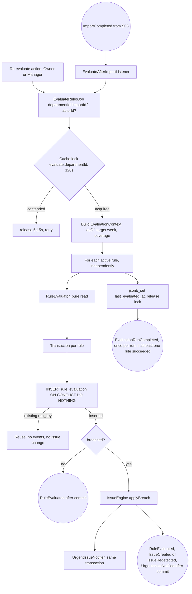

# Design Document

## Overview

S04 is the Business Intelligence and Issue Engine. It consumes confirmed sales data from S03 and does four things:

1. Computes deterministic metrics with decimal-string math (`bcmath`, no floats).
2. Evaluates three predefined rules per department and stores every evaluation with a full evidence snapshot.
3. Creates and maintains deduplicated Issues, and owns the Issue lifecycle state machine, including an append-only status history stored on the Issue row.
4. Notifies the Owner and department Managers of high-severity Issues through Laravel database notifications.

S04 also defines the extension contracts that S05 to S08 plug into: `IssueEvidence`, `IssuePanelProvider` with the `panels` Inertia prop, `IssueTaskStateReader`, the lifecycle entry points, and the event set.

Decisions fixed for this design (resolving gaps in the requirements):

| # | Gap | Decision |
|---|---|---|
| G1 | Status timeline source (Req 14.4) | Append-only JSONB column `issues.status_history`, written by `IssueLifecycle` (and by `IssueEngine` at creation) inside the same transaction as the status change. No new table. No dependency on S08 `activity_logs`. |
| G2 | `BusinessRuleUpdated` event (Req 3.14) | Kept. Defined in `App\Events\Intelligence` next to the other S04 events. |
| G3 | Per-department evaluation lock (Req 4.7) | `Cache::store('database')->lock("evaluate:{$departmentId}", 120)`. On contention the job releases itself back to the queue. Correctness never depends on the lock (see section "Evaluation lock"). |
| G4 | "Latest evaluation time" when all evaluations are reused (Req 4.11, 14.13) | Store `departments.settings.intelligence.last_evaluated_at` (S03 already added `departments.settings` JSONB). Updated by atomic `jsonb_set` when a job finishes all rules without error. No new column. |
| G5 | Manual resolve note (Req 10.6) | Stored as `reason` in the `status_history` entry. No `resolution_note` column. |
| G6 | `IssuePanelProvider::$key` (Req 14.10) | PHP interfaces cannot declare properties before 8.4, so the contract is `key(): string`. Same meaning, method form. |
| G7 | `rule_evaluations.severity` | Nullable. Set only when `result = breached` (check constraint). `docs/data-model.md` must note this. |
| G8 | Job "3 tries" under lock contention | Contention releases do not count as failures. The job uses `maxExceptions = 3` and `retryUntil()` of 15 minutes instead of a plain `$tries = 3`. Failure backoff stays 10, 30, 60 s. |

### Research notes

- Laravel atomic locks: the `database` cache store supports `Cache::lock($name, $seconds)` backed by the `cache_locks` table; `release()` only releases when the owner token matches, so a job whose lock expired cannot free another job's lock. See [Laravel atomic locks](https://laravel.com/docs/cache#atomic-locks).
- PostgreSQL `INSERT ... ON CONFLICT (cols) WHERE predicate DO NOTHING RETURNING id` can infer a partial unique index when the predicate is repeated. This gives race-free issue creation without relying on exception handling inside an aborted transaction. See [PostgreSQL INSERT](https://www.postgresql.org/docs/current/sql-insert.html).
- PostgreSQL `numeric` `SUM()` is exact, so weekly totals are summed in SQL and only divisions and roundings run in `bcmath`.
- Laravel jobs: `release($delay)` counts as an attempt, which is why G8 uses `retryUntil` and `maxExceptions`. See [Laravel queues, max attempts](https://laravel.com/docs/queues#max-job-attempts-and-timeout).

Content was rephrased for compliance with licensing restrictions.

## Architecture



```mermaid
flowchart LR
  subgraph Web
    IL[IssueController index/show] --> REG[IssuePanelRegistry]
    TR[IssueTransitionController] --> LC[IssueLifecycle]
    RS[RuleSettingsController] --> BRU[UpdateBusinessRule action]
    NF[NotificationController]
  end
  REG -.providers registered by S05..S08.-> P[IssuePanelProvider]
  LC --> EV((IssueStatusChanged))
  BRU --> EV3((BusinessRuleUpdated))
  S07[S07 task events] -.-> LC
  S08[S08 outcomes] -.resolveVerified / reopen.-> LC
```

### Module layout

```
app/
  Models/{BusinessRule,RuleEvaluation,Issue}.php
  Enums/{RuleKey,RuleResult,InsufficientReason,IssueSeverity,IssueStatus,ResolutionType,StatusTrigger}.php
  Policies/{IssuePolicy,BusinessRulePolicy,RuleEvaluationPolicy}.php
  Services/Intelligence/
    MetricCalculator.php
    EvaluationContext.php
    Evaluators/{RuleEvaluator(interface),WeeklyRevenueDeclineEvaluator,SalesTargetShortfallEvaluator,MissingSalesDataEvaluator}.php
    RunKey.php
    EvidenceBuilder.php
    IssueEngine.php
    IssueLifecycle.php
    IssueEvidence.php            (read model + IssueEvidenceFactory)
    UrgentIssueNotifier.php
    Panels/{IssuePanelProvider,IssuePanelRegistry}.php
    Contracts/IssueTaskStateReader.php   (+ NullIssueTaskStateReader default binding)
  Actions/Intelligence/{SeedDefaultRules,UpdateBusinessRule,DispatchEvaluation}.php
  Jobs/EvaluateRulesJob.php
  Listeners/Intelligence/EvaluateAfterImportListener.php
  Notifications/UrgentIssueNotification.php
  Events/Intelligence/{RuleEvaluated,IssueCreated,IssueRedetected,IssueStatusChanged,UrgentIssueNotified,BusinessRuleUpdated,EvaluationRunCompleted}.php
  Http/Controllers/{IssueController,IssueTransitionController,RuleSettingsController,ReevaluateController,NotificationController}.php
  Http/Requests/{UpdateRulesRequest,ResolveIssueRequest}.php
resources/js/pages/Issues/{Index,Show}.vue
resources/js/pages/Settings/Tabs/Rules.vue
resources/js/issue-panels/index.ts      (registerIssuePanel(name, component))
```

## Components and Interfaces

### MetricCalculator

Pure, stateless, no I/O. All values are decimal strings. Money is 2 dp, percentages are 4 dp internally and 2 dp for storage and display.

```
CALC_SCALE = 12
ZERO_DENOMINATOR = sentinel value (not a string, not null)

function roundHalfUp(x: DecString, places: int): DecString
    negative = x starts with '-'
    a = abs(x)                                    // strip sign
    half = '0.' + repeat('0', places) + '5'       // places=4 -> '0.00005'
    r = bcadd(a, half, places)                    // bcadd truncates beyond `places`
    if bccomp(r, '0', places) == 0: return r      // never return '-0.0000'
    return negative ? '-' + r : r

function pct(numerator: Money, denominator: Money): Dec4 | ZERO_DENOMINATOR
    if bccomp(denominator, '0', 2) == 0: return ZERO_DENOMINATOR
    q = bcdiv(bcmul(numerator, '100', CALC_SCALE), denominator, CALC_SCALE)
    return roundHalfUp(q, 4)

function targetAchievementPct(revenue, target): Dec4 | ZERO_DENOMINATOR
    return pct(revenue, target)

function weeklyChangePct(current, comparison): Dec4 | ZERO_DENOMINATOR
    return pct(bcsub(current, comparison, 2), comparison)

function coveragePct(present: int, expected: int): Dec4 | ZERO_DENOMINATOR
    if expected == 0: return ZERO_DENOMINATOR
    return pct(string(present), string(expected))

function display2(x4: Dec4): Dec2            // stored in numeric(8,2) and shown in UI
    return roundHalfUp(x4, 2)

function weekTotals(department, weekStart): {revenue: Money, target: Money}
    // one SQL query, exact numeric arithmetic:
    // SELECT COALESCE(SUM(revenue),0), COALESCE(SUM(target_revenue),0)
    //   FROM sales_records
    //  WHERE department_id=? AND is_active AND sales_date BETWEEN ? AND ?
```

Rules of use:
- No `float`, `round()` or `number_format()` anywhere in S04 code. Money is never cast to float for display; the UI formats strings.
- Threshold comparisons use the 4 dp value (`bccomp(a, b, 4)`), never the 2 dp display value. A drop of 15.00004 percent rounds to 15.0000 and is not strictly greater than a threshold of 15.00.
- Double rounding (12 dp to 4 dp to 2 dp) is intentional and deterministic. Example: 124000 / 156000 gives 79.487179... then 79.4872 then 79.49.
- The calculator never decides whether a period is comparable. The evaluators do (Req 1.10).

### EvaluationContext

Built once per job run, shared by the three evaluators so they agree on dates and read coverage once.

```
function buildContext(department): EvaluationContext
    asOf = ReportingCoverage.asOfDate(department)          // null when no Active_Record
    if asOf == null: return Context(noData=true)
    targetStart  = asOf.startOfIsoWeek()                   // Monday
    targetEnd    = targetStart + 6 days
    compStart    = targetStart - 7 days
    compEnd      = compStart + 6 days
    return Context(
        asOf, targetStart, targetEnd, compStart, compEnd,
        targetCoverage = ReportingCoverage.weekCoverage(department, targetStart),
        compCoverage   = ReportingCoverage.weekCoverage(department, compStart),
        expectedBranches = ReportingCoverage.expectedBranches(department),
        businessToday = BusinessClock.today())
```

### Rule evaluator algorithms

Common contract. An evaluator is a pure read function. It never writes and never dispatches events.

```php
interface RuleEvaluator {
    public function key(): RuleKey;
    public function evaluate(BusinessRule $rule, Department $dept, EvaluationContext $ctx): EvaluationOutcome;
}
// EvaluationOutcome: result, severity?, insufficientReason?, metricName,
// periodStart, periodEnd, comparisonStart?, comparisonEnd?,
// currentValue?, comparisonValue?, differenceValue?, differencePct4? (Dec4),
// evidence (array), contributingRecordIds (int[])
```

**Weekly revenue decline** (`weekly_change_pct`):

```
function evaluateDecline(rule, dept, ctx):
    T = rule.threshold                                   // e.g. '15.00'
    high = rule.params.high_drop_pct                     // e.g. '25'
    base = outcome(metric='weekly_change_pct', period=ctx.target, comparison=ctx.comp)

    if ctx.noData:                               return insufficient(base, NO_DATA)
    if ctx.targetCoverage.status != complete:    return insufficient(base, CURRENT_PERIOD_PARTIAL)
    if ctx.compCoverage.status == absent:        return insufficient(base, COMPARISON_PERIOD_UNAVAILABLE)
    if ctx.compCoverage.status != complete:      return insufficient(base, COMPARISON_PERIOD_PARTIAL)

    cur  = weekTotals(dept, ctx.targetStart).revenue
    prev = weekTotals(dept, ctx.compStart).revenue
    chg  = weeklyChangePct(cur, prev)
    if chg == ZERO_DENOMINATOR:                  return insufficient(base, ZERO_DENOMINATOR)

    base.currentValue    = cur
    base.comparisonValue = prev
    base.differenceValue = bcsub(cur, prev, 2)
    base.differencePct4  = chg

    // breached when drop strictly greater than threshold, i.e. chg < -T
    if bccomp(chg, '-' + T, 4) < 0:
        sev = bccomp(chg, '-' + high, 4) <= 0 ? HIGH : MEDIUM   // drop >= high_drop_pct
        return breached(base, sev)
    return notBreached(base)
```

**Sales target shortfall** (`target_achievement_pct`, no comparison period):

```
function evaluateTarget(rule, dept, ctx):
    T = rule.threshold                                   // '80.00'
    highBelow = rule.params.high_below_pct               // '70'
    if ctx.noData:                               return insufficient(base, NO_DATA)
    if ctx.targetCoverage.status != complete:    return insufficient(base, CURRENT_PERIOD_PARTIAL)

    {revenue, target} = weekTotals(dept, ctx.targetStart)
    ach = targetAchievementPct(revenue, target)
    if ach == ZERO_DENOMINATOR:                  return insufficient(base, ZERO_DENOMINATOR)

    base.currentValue = revenue; base.comparisonValue = target
    base.differenceValue = bcsub(revenue, target, 2); base.differencePct4 = ach

    // breached when achievement strictly below threshold
    if bccomp(ach, T, 4) < 0:
        sev = bccomp(ach, highBelow, 4) < 0 ? HIGH : MEDIUM     // achievement < high_below_pct
        return breached(base, sev)
    return notBreached(base)
```

**Missing sales data** (`coverage_pct`, window = Monday of Target_Week through As_Of_Date inclusive):

```
function evaluateMissingData(rule, dept, ctx):
    if ctx.noData: return insufficient(base, NO_DATA)
    windowStart = ctx.targetStart
    windowEnd   = ctx.asOf
    gap = ReportingCoverage.missingBranchDays(dept, windowStart, windowEnd)   // CoverageGap[]
    expected = count(ctx.expectedBranches) * countTradingDays(dept.company, windowStart, windowEnd)
    present  = expected - count(gap)

    base.currentValue = string(present); base.comparisonValue = string(expected)
    if expected == 0: return insufficient(base, NO_DATA)

    cov = coveragePct(present, expected)                 // ZERO_DENOMINATOR impossible, expected>0 checked above
    base.differencePct4 = cov
    base.evidence.missingBranchDays = gap                // [{branch_code, date}], stored verbatim

    if count(gap) > 0: return breached(base, MEDIUM)      // severity fixed at medium (Req 7.10, A7's "critical unused")
    return notBreached(base)
```

Severity classification for all three evaluators only applies when `result = breached` (G7): `rule_evaluations.severity` is written, otherwise left `null`.

### Run_Key and evidence

```
function computeRunKey(rule, dept, ctx, recordIds: int[]): string
    payload = {
        ruleKey: rule.key, departmentId: dept.id,
        periodStart: ctx.periodStart, periodEnd: ctx.periodEnd,
        comparisonStart: ctx.comparisonStart, comparisonEnd: ctx.comparisonEnd,
        recordIds: sort(recordIds),                      // ids of Active_Records read, both periods
        ruleConfig: { threshold: rule.threshold, severity: rule.severity, params: rule.params },
    }
    return sha256(canonicalJson(payload))                 // stable key order, no whitespace
```

`recordIds` are the ids of the `sales_records` rows read by `weekTotals`/`missingBranchDays` for the periods in scope (Req 8.3). When the set exceeds 1,000 ids, the evidence snapshot stores compact id ranges (`[[minId,maxId], ...]` over contiguous runs) instead of the full list (Req 8.6); `Run_Key` hashing always uses the full sorted id list before compaction, so compaction never changes the key.

`EvidenceBuilder` assembles the JSONB payload stored in `rule_evaluations.evidence`:

```
evidence = {
  asOfDate, thresholdUsed, paramsUsed,
  periods: { target: {start,end,revenue,target}, comparison: {start,end,revenue,target}? },
  coverage: { expectedBranches, expectedBranchDays, presentBranchDays, missingBranchDays: [{branch_code,date}] },
  contributingImportIds: int[],
  contributingRecordIds: int[] | [[min,max],...],
}
```

All money values are decimal strings; all percentages are decimal strings at 4 dp (Req 8.7).

### Evaluation lock and job

```php
final class EvaluateRulesJob implements ShouldQueue
{
    public int $maxExceptions = 3;
    public array $backoff = [10, 30, 60];

    public function retryUntil(): DateTime { return now()->addMinutes(15); }

    public function handle(SeedDefaultRules $seed, EvidenceBuilder $evidence, IssueEngine $issues, UrgentIssueNotifier $notifier): void
    {
        $lock = Cache::store('database')->lock("evaluate:{$this->departmentId}", 120);
        if (! $lock->get()) {
            $this->release(random_int(5, 15));   // contention: not a failure, not counted against maxExceptions
            return;
        }
        try {
            $seed->ensureRulesExist($this->departmentId);     // idempotent, cheap no-op after first run
            $ctx = EvaluationContext::build($department);
            $anyWritten = false;
            $evaluationIds = [];
            foreach ($department->businessRules()->where('is_active', true)->get() as $rule) {
                try {
                    // returns the rule_evaluations id, whether newly inserted or reused
                    $evaluationIds[] = $this->evaluateOneRule($rule, $ctx, $evidence, $issues, $notifier); // own transaction, own event dispatch
                    $anyWritten = true;
                } catch (Throwable $e) {
                    Log::warning('rule_evaluation_failed', ['rule_id' => $rule->id, 'department_id' => $this->departmentId]);
                    // continue to next rule (Req 4.8); counts toward maxExceptions only if rethrown
                }
            }
            if ($anyWritten) {
                Department::query()->whereKey($department->id)
                    ->update(['settings' => DB::raw("jsonb_set(settings, '{intelligence,last_evaluated_at}', to_jsonb(now()::text))")]);

                $this->announceRunCompleted($department->id, array_values(array_unique($evaluationIds)));
            }
        } finally {
            $lock->release();
        }
    }

    /** Req 16.10-16.14. A failure to announce must not fail an evaluation that already committed. */
    private function announceRunCompleted(int $departmentId, array $evaluationIds): void
    {
        sort($evaluationIds);   // ascending, no duplicates, never empty here
        try {
            EvaluationRunCompleted::dispatch(
                $departmentId, $this->importId, $this->actorUserId, $evaluationIds, CarbonImmutable::now(),
            );
        } catch (Throwable $e) {
            Log::warning('evaluation_run_completed_dispatch_failed', [
                'department_id' => $departmentId, 'exception' => $e::class,   // ids and class only
            ]);
        }
    }
}
```

`EvaluationRunCompleted` is dispatched once per job run, after the rule loop and the `last_evaluated_at` update, and only when at least one rule was processed without error (`$anyWritten`). It is not dispatched when the lock is not acquired (the job returns early after `release()`), when every rule throws, or when the job fails. At dispatch time no transaction is open (each rule has its own committed transaction), so it fires immediately; `ShouldDispatchAfterCommit` keeps it safe if a caller wraps the job in a transaction.

Why correctness never depends on the lock: the uniqueness of `rule_evaluations` is enforced by the database unique index on `(business_rule_id, period_start, period_end, run_key)`, and Issue creation uses `INSERT ... ON CONFLICT` against the partial unique index on `issues` (see below). The lock only reduces wasted work (two jobs computing the same `run_key` and racing on the conflict) and keeps the per-department query load serialized; a lock loss (e.g. TTL expiry under a very slow run) degrades to "two jobs do the same idempotent work", not to a correctness bug.

`EvaluateAfterImportListener` (Req 4.1) listens for `ImportCompleted` with status `completed` or `completed_with_errors`, and dispatches `EvaluateRulesJob::dispatch($departmentId, $importId, actorUserId: null)`. `ReevaluateController` (Req 4.3-4.6) is throttled with Laravel's `throttle:6,1` middleware keyed by user id, authorizes via `BusinessRulePolicy`/`IssuePolicy` (403 in scope, 404 cross-department via `visibleTo()`), and dispatches the same job with `importId: null, actorUserId: $request->user()->id`.

### Issue creation and dedup transaction

Per rule evaluation, after a `breached` result is persisted:

```sql
-- Issue creation, race-free via the partial unique index:
INSERT INTO issues (business_rule_id, department_id, scope_key, title, severity,
                     first_detected_at, last_detected_at, detection_count,
                     period_start, period_end, baseline_evaluation_id, latest_evaluation_id,
                     status, status_history)
VALUES (:rule_id, :dept_id, 'department', :title, :severity,
        :now, :now, 1,
        :period_start, :period_end, :eval_id, :eval_id,
        'open', :initial_history_json)
ON CONFLICT (business_rule_id, department_id, scope_key) WHERE status <> 'resolved'
DO NOTHING
RETURNING id;
```

```
function applyBreach(rule, evaluation, now):
    inserted = runInsertOnConflict(...)                  // SQL above, single round trip
    if inserted:
        dispatch IssueCreated (after commit)
        maybeNotifyUrgent(issue)                          // same transaction
        return

    // Either an Open_Issue already existed, or it was created concurrently between
    // our SELECT and our INSERT (Req 9.9) - both paths converge here.
    issue = Issue::where(rule, dept, scope_key)->where('status', '!=', 'resolved')
                  ->lockForUpdate()->first()               // row lock, same transaction
    if issue == null:
        // lost race against a resolve that just ran; retry the INSERT once
        retry applyBreach once, then give up and log (extremely rare)
        return

    if evaluation.reusedExistingRunKey:                    // Req 8.4, 9.10
        return   // no detection_count change, no event

    newSeverity = max(issue.severity, evaluation.severity)  // monotonic, Req 9.4-9.5
    issue.update(
        last_detected_at: now,
        latest_evaluation_id: evaluation.id,
        detection_count: issue.detection_count + 1,
        severity: newSeverity,
    )
    appendStatusHistory(issue, from: issue.status, to: issue.status, trigger: 're_detection', reason: null)
       // "to == from": re-detection is not a status transition, but still an auditable event (see Data Models)
    dispatch IssueRedetected (after commit)
    if newSeverity == 'high' and issue.severity was not already 'high':
        maybeNotifyUrgent(issue)
```

Recurrence (Req 9.7): when the `INSERT ... ON CONFLICT DO NOTHING` returns no row **and** the `lockForUpdate` SELECT also finds no Open_Issue (because the most recent Issue of that identity is `resolved`), `IssueEngine` inserts a new Issue directly (no conflict possible, since the unique index excludes resolved rows) with `recurrence_of_issue_id` set to that resolved Issue's id and a fresh baseline.

`baseline_evaluation_id` is set once at creation (first insert or recurrence insert) and is never updated by any later statement in `IssueEngine` or `IssueLifecycle` (Req 9.6, 10.11).

### IssueLifecycle

Transition table (Req 10.1-10.12). All transitions run inside `DB::transaction()` with `Issue::lockForUpdate()` and a status check against the loaded row before writing (Req 10.3).

| From | To | Entry point | Actor | Guard |
|---|---|---|---|---|
| `open` | `acknowledged` | `acknowledge(issue, actor)` | Owner / Manager in scope | none beyond status |
| `open` | `action_in_progress` | `markActionInProgress(issue, actor)` | system (first task approved) | none |
| `acknowledged` | `action_in_progress` | `markActionInProgress(issue, actor)` | system | none |
| `action_in_progress` | `monitoring` | `markMonitoringIfTasksComplete(issue, actor)` | system via `IssueTaskStateReader` | ≥1 completed linked task and none pending/in_progress/blocked |
| `action_in_progress` | `monitoring` | `moveToMonitoring(issue, actor)` | Owner / Manager in scope | none (manual override, Req 13's D13) |
| `monitoring` | `resolved` | `resolveManually(issue, actor, note)` | Owner / Manager in scope | note non-empty, ≤2000 chars |
| `monitoring` | `resolved` | `resolveVerified(issue, outcomeRef)` | system (S08) | none |
| `monitoring` | `open` | `reopen(issue, reason)` | system (S08, follow-up worsened) | none |
| any other pair | — | — | — | rejected: `IssueTransitionNotAllowedException`, issue unchanged |

```
function transition(issue, to, actor, extra):
    DB::transaction(function () use (...) {
        locked = Issue::lockForUpdate()->find(issue.id)
        from = locked.status
        if not isAllowed(from, to):
            throw IssueTransitionNotAllowedException(from, to)   // Req 10.2

        // idempotent double-submit (Req 10.17): if a prior identical transition already
        // landed (from == to going into this call because a concurrent request won the
        // race under the same lock), return success without a second write or event.
        if from == to and to != locked.status_history.lastTarget():
            // unreachable in practice because `from` is read post-lock; kept as a documented invariant
            pass

        locked.status = to
        if to == 'resolved':
            locked.resolved_at = now(); 
            locked.resolved_by = (actor is system) ? null : actor.id
            locked.resolution_type = (actor is system) ? 'system_verified' : 'manual'
        if to == 'open' and from == 'monitoring':
            // reopen keeps baseline_evaluation_id untouched (Req 10.11, 9.6)
            pass

        appendStatusHistory(locked, from, to, actor, extra.reason, trigger: extra.trigger)
        locked.save()
    })
    dispatch IssueStatusChanged(issue.id, from, to, actor?.id, extra.reason) // after commit (Req 10.14)
```

Double-submit handling in practice: the second request's `lockForUpdate()` blocks until the first transaction commits, then reads `status == to` already, and `isAllowed(to, to)` is false by table lookup — so the second call throws `IssueTransitionNotAllowedException`. The controller treats "already in target status" as a 200 no-op response rather than surfacing the exception to the user (Req 10.17), by checking `locked.status == to` before calling `isAllowed`.

`appendStatusHistory` always appends, never mutates prior entries:

```
function appendStatusHistory(issue, from, to, actor, reason, trigger):
    entry = { from, to, at: now()->toIso8601String(),
              by_user_id: actor?.id,     // null for system
              reason: reason,             // manual resolve note, or null
              trigger: trigger }          // 'manual' | 'task_approved' | 'tasks_complete' |
                                           // 'outcome_verified' | 'outcome_worsened' | 're_detection' | 'created'
    issue.status_history = issue.status_history + [entry]   // JSONB array append, same transaction
```

`IssueCreated` also calls `appendStatusHistory(issue, from: null, to: 'open', actor: null, reason: null, trigger: 'created')` so history always starts from a single root entry (Req 14.4's "no history exists -> first detection only" is simply "history has exactly one entry").

### IssueEvidence read model

```php
final class IssueEvidence implements Arrayable
{
    public function __construct(
        public readonly int $issueId,
        public readonly string $title,
        public readonly IssueSeverity $severity,
        public readonly IssueStatus $status,
        public readonly RuleKey $ruleKey,
        public readonly EvaluationSummary $baseline,     // from baseline_evaluation_id snapshot
        public readonly EvaluationSummary $latest,       // from latest_evaluation_id snapshot
        public readonly string $primaryMetricName,       // weekly_change_pct | target_achievement_pct | coverage_pct
        public readonly string $baselinePrimaryValue,     // decimal string, from baseline.evidence
        public readonly string $latestPrimaryValue,
        public readonly array $missingBranchDays,         // [{branch_code,date}], from latest evidence
        public readonly array $importIds,
    ) {}

    public static function forIssue(Issue $issue): self
    {
        // Reads ONLY rule_evaluations rows (baseline + latest) and their evidence JSONB.
        // Never queries sales_records. Department scoping is the caller's responsibility
        // (controllers/policies resolve the Issue through a scoped query first).
    }

    public function toArray(): array { /* decimal strings and ints only, JSONB-safe */ }
    public static function fromArray(array $data): self { /* inverse of toArray */ }
}
```

Round-trip contract (Req 15.5): `IssueEvidence::fromArray($evidence->toArray())` produces a value-equal object for any Issue — verified manually per fixture (see Testing Strategy), not by an automated property test, per the project's no-test-suite policy (`.kiro/steering/verification.md`, Req 19.1).

### IssuePanelProvider extension contract

```php
interface IssuePanelProvider
{
    /** Stable slot identifier: 'briefs' | 'meetings' | 'tasks' | 'outcome' | 'feedback' | 'activity'. */
    public function key(): string;

    /** Returns a JSON-serializable array for the panel, or null when nothing to show yet. */
    public function panelFor(Issue $issue, User $user): ?array;
}

final class IssuePanelRegistry
{
    /** @param IssuePanelProvider[] $providers tagged via each ServiceProvider's boot() */
    public function __construct(private iterable $providers) {}

    public function panelsFor(Issue $issue, User $user): array
    {
        // Always returns all six keys. A key with no registered provider, or whose
        // provider returns null, maps to null (Req 14.8) so the Vue page always
        // receives a stable prop shape for `panels`.
        $out = array_fill_keys(['briefs','meetings','tasks','outcome','feedback','activity'], null);
        foreach ($this->providers as $p) {
            $out[$p->key()] = $p->panelFor($issue, $user);
        }
        return $out;
    }
}
```

`IssueController::show()` passes `panels: $registry->panelsFor($issue, $user)` as an Inertia prop. `resources/js/pages/Issues/Show.vue` renders six named slots (`<slot name="briefs" :data="panels.briefs">`), each defaulting to a `<PanelPlaceholder />` component when `panels.<key>` is `null` (Req 14.9). S05-S08 register their own `IssuePanelProvider` implementation via their service provider; S04 never imports or references their classes.

### IssueTaskStateReader contract (used by `markMonitoringIfTasksComplete`)

```php
interface IssueTaskStateReader
{
    /** True when the issue has at least one completed linked task and none pending/in_progress/blocked. */
    public function readyForMonitoring(Issue $issue): bool;
}
```

S04 ships `NullIssueTaskStateReader` (`readyForMonitoring` always returns `false`) bound by default, so `markMonitoringIfTasksComplete` is a safe no-op until S07 is installed and rebinds the interface in its own service provider.

### UrgentIssueNotifier

```
function maybeNotifyUrgent(issue):
    if issue.severity != 'high': return
    dedupeKey = "{$issue.id}:high"
    recipients = [company.owner()] + department.activeManagers()
    foreach recipients as user:
        if user.is_active == false: continue
        exists = DatabaseNotification::where('notifiable_id', user.id)
                     ->where('data->>dedupe_key', dedupeKey)->exists()
        if exists: continue
        user.notify(new UrgentIssueNotification(issue, dedupeKey))   // same transaction (Req 11.6)
    dispatch UrgentIssueNotified(issue.id, 'high', dedupeKey, recipientUserIds) // after commit
```

Notification `data`: `{dedupe_key, issue_id, title, severity, department_name, summary_line, url}`. `summary_line` is built from the evaluation's `differencePct4`/`currentValue` already in scope — no extra query.

## Data Models

Per `docs/data-model.md` §2, this design adds the columns below (cross-review action item to merge into that document, per Req 19.7).

### `business_rules` (defined in data-model.md; no changes)

Columns as already documented: `department_id, key, name, threshold, severity, is_active, params (jsonb)`. Unique `(department_id, key)`.

### `rule_evaluations`

| Column | Type | Notes |
|---|---|---|
| id | bigint PK | |
| business_rule_id | bigint FK → business_rules | |
| department_id | bigint FK → departments | |
| import_id | bigint FK → imports, nullable | trigger, null for manual re-evaluate |
| period_start, period_end | date | |
| comparison_start, comparison_end | date, nullable | |
| metric_name | varchar | check: one of `weekly_change_pct`, `target_achievement_pct`, `coverage_pct` |
| current_value, comparison_value, difference_value | numeric(14,2) | nullable |
| difference_pct | numeric(8,4) | nullable; **stored at 4 dp**, not 2 — amends data-model.md's blanket "percentages `numeric(8,2)`" for this column only, because Req 8.7 requires the evidence/metric precision at 4 dp |
| result | varchar | check: `breached`, `not_breached`, `insufficient_data` |
| severity | varchar, nullable | check: `low`,`medium`,`high`,`critical`; **must be null unless `result='breached'`** (G7) |
| insufficient_reason | varchar, nullable | check: `no_data`,`current_period_partial`,`comparison_period_unavailable`,`comparison_period_partial`,`zero_denominator`; null unless `result='insufficient_data'` |
| evidence | jsonb | see EvidenceBuilder shape |
| evaluated_at | timestamp | |
| run_key | char(64) | sha256 hex |

Indexes: `(department_id, evaluated_at)`. **Unique**: `(business_rule_id, period_start, period_end, run_key)` (Req 8.2).
Check constraints: `metric_name IN (...)`, `result IN (...)`, `severity IS NULL OR severity IN (...)`, `(result = 'breached') = (severity IS NOT NULL)`, `(result = 'insufficient_data') = (insufficient_reason IS NOT NULL)`.

### `issues`

All columns already in `docs/data-model.md` §2, plus one new column:

| Column | Type | Notes |
|---|---|---|
| status_history | jsonb | **new.** Default `'[]'`. Append-only array of `{from: string\|null, to: string, at: ISO8601 string, by_user_id: int\|null, reason: string\|null, trigger: string}`. Written only by `IssueEngine`/`IssueLifecycle`, in the same transaction as the status/detection change it records. No foreign key; `by_user_id` is a plain integer snapshot (not FK-enforced) so history survives user deletion. |

Existing columns used as documented in `docs/data-model.md`: `department_id, business_rule_id, scope_key, recurrence_of_issue_id, title, severity, status, first_detected_at, last_detected_at, resolved_at, resolved_by, resolution_type, baseline_evaluation_id, latest_evaluation_id, detection_count, period_start, period_end`.

Indexes/constraints: **partial unique** `(business_rule_id, department_id, scope_key) WHERE status <> 'resolved'` (Req 9.1). Check: `status IN ('open','acknowledged','action_in_progress','monitoring','resolved')`, `severity IN ('low','medium','high','critical')`, `(status = 'resolved') = (resolved_at IS NOT NULL)`.

### `departments.settings` (S03-owned column, additive use by S04)

S04 adds the `intelligence` key to the existing JSONB contract: `settings.intelligence.last_evaluated_at` (ISO8601 string, nullable). Written only via the atomic `jsonb_set` update in `EvaluateRulesJob` (G4); never read-then-written as a PHP array to avoid clobbering concurrent writers of unrelated `settings` keys (e.g. S03's `expected_branches`).

### Laravel `notifications` table

Used as-is (no migration). `type = App\Notifications\UrgentIssueNotification`, `data` JSON per the shape in `UrgentIssueNotifier` above.

### Migrations (new in S04)

```php
Schema::create('business_rules', function (Blueprint $t) {
    $t->id();
    $t->foreignId('department_id')->constrained()->cascadeOnDelete();
    $t->string('key'); $t->string('name');
    $t->decimal('threshold', 8, 2);
    $t->string('severity');
    $t->boolean('is_active')->default(true);
    $t->jsonb('params')->default('{}');
    $t->timestamps();
    $t->unique(['department_id', 'key']);
});
DB::statement("ALTER TABLE business_rules ADD CONSTRAINT business_rules_key_check CHECK (key IN ('weekly_revenue_decline','sales_target_shortfall','missing_sales_data'))");
DB::statement("ALTER TABLE business_rules ADD CONSTRAINT business_rules_severity_check CHECK (severity IN ('low','medium','high','critical'))");

Schema::create('rule_evaluations', function (Blueprint $t) {
    $t->id();
    $t->foreignId('business_rule_id')->constrained()->cascadeOnDelete();
    $t->foreignId('department_id')->constrained();
    $t->foreignId('import_id')->nullable()->constrained();
    $t->date('period_start'); $t->date('period_end');
    $t->date('comparison_start')->nullable(); $t->date('comparison_end')->nullable();
    $t->string('metric_name');
    $t->decimal('current_value', 14, 2)->nullable();
    $t->decimal('comparison_value', 14, 2)->nullable();
    $t->decimal('difference_value', 14, 2)->nullable();
    $t->decimal('difference_pct', 8, 4)->nullable();
    $t->string('result');
    $t->string('severity')->nullable();
    $t->string('insufficient_reason')->nullable();
    $t->jsonb('evidence');
    $t->timestamp('evaluated_at');
    $t->char('run_key', 64);
    $t->index(['department_id', 'evaluated_at']);
    $t->unique(['business_rule_id', 'period_start', 'period_end', 'run_key']);
});
DB::statement("ALTER TABLE rule_evaluations ADD CONSTRAINT rule_evaluations_metric_check CHECK (metric_name IN ('weekly_change_pct','target_achievement_pct','coverage_pct'))");
DB::statement("ALTER TABLE rule_evaluations ADD CONSTRAINT rule_evaluations_result_check CHECK (result IN ('breached','not_breached','insufficient_data'))");
DB::statement("ALTER TABLE rule_evaluations ADD CONSTRAINT rule_evaluations_severity_presence_check CHECK ((result = 'breached') = (severity IS NOT NULL))");
DB::statement("ALTER TABLE rule_evaluations ADD CONSTRAINT rule_evaluations_insufficient_presence_check CHECK ((result = 'insufficient_data') = (insufficient_reason IS NOT NULL))");

Schema::create('issues', function (Blueprint $t) {
    $t->id();
    $t->foreignId('department_id')->constrained();
    $t->foreignId('business_rule_id')->constrained();
    $t->string('scope_key')->default('department');
    $t->foreignId('recurrence_of_issue_id')->nullable()->constrained('issues');
    $t->string('title'); $t->string('severity'); $t->string('status')->default('open');
    $t->timestamp('first_detected_at'); $t->timestamp('last_detected_at');
    $t->timestamp('resolved_at')->nullable();
    $t->foreignId('resolved_by')->nullable()->constrained('users');
    $t->string('resolution_type')->nullable();
    $t->foreignId('baseline_evaluation_id')->constrained('rule_evaluations');
    $t->foreignId('latest_evaluation_id')->constrained('rule_evaluations');
    $t->unsignedInteger('detection_count')->default(1);
    $t->date('period_start'); $t->date('period_end');
    $t->jsonb('status_history')->default('[]');
    $t->timestamps();
});
DB::statement('CREATE UNIQUE INDEX issues_open_identity_unique ON issues (business_rule_id, department_id, scope_key) WHERE status <> \'resolved\'');
DB::statement("ALTER TABLE issues ADD CONSTRAINT issues_status_check CHECK (status IN ('open','acknowledged','action_in_progress','monitoring','resolved'))");
DB::statement("ALTER TABLE issues ADD CONSTRAINT issues_severity_check CHECK (severity IN ('low','medium','high','critical'))");
DB::statement("ALTER TABLE issues ADD CONSTRAINT issues_resolved_presence_check CHECK ((status = 'resolved') = (resolved_at IS NOT NULL))");
```

All four migrations roll back cleanly (`Schema::dropIfExists` plus the check constraints drop automatically with their tables); `issues_open_identity_unique` is dropped explicitly in `down()` via `DROP INDEX IF EXISTS` before the table drop runs (Postgres drops indexes with their table too, but the explicit drop keeps `down()` symmetrical and safe to run standalone against a partially-migrated schema).

## Events contract

Namespace `App\Events\Intelligence`. Every event carries `int $departmentId`, `?int $actorUserId` (null = system), `CarbonImmutable $occurredAt`, dispatched only after the producing transaction commits (Req 16.6).

| Event | Extra properties | Dispatched when | Not dispatched when |
|---|---|---|---|
| `RuleEvaluated` | `ruleKey, result, severity?, importId?, evaluationId` | a `rule_evaluations` row is newly inserted | the `run_key` already existed (reused) — Req 16.8 |
| `IssueCreated` | `issueId, severity, recurrenceOfIssueId?` | `IssueEngine` inserts a new Issue (fresh or recurrence) | re-detection of an existing Open_Issue |
| `IssueRedetected` | `issueId, detectionCount, previousSeverity, newSeverity` | an Open_Issue's `last_detected_at`/`detection_count` is updated | the evaluation reused an existing `run_key` (Req 9.10) |
| `IssueStatusChanged` | `issueId, from, to, reason?` | any `IssueLifecycle::transition()` succeeds | rejected transitions, no-op double submits |
| `UrgentIssueNotified` | `issueId, severity, dedupeKey, recipientUserIds` | ≥1 new notification row created | all recipients already had the dedupe key, or severity ≠ high |
| `BusinessRuleUpdated` | `businessRuleId, changedAttributes` (array of attribute => [old,new]) | `UpdateBusinessRule` persists a change | validation failure |
| `EvaluationRunCompleted` | `?importId` (null for manual Re-evaluate), `evaluationIds` (`list<int>`: ids of rule_evaluations processed by the run, new or reused, sorted ascending, no duplicates, never empty, excludes inactive rules and rules whose evaluation failed). `actorUserId` is null for an import-triggered run. | `EvaluateRulesJob` finishes the rule loop and the `last_evaluated_at` update with at least one rule processed without error; once per job run | the lock was not acquired, every rule failed, or the job fails |

`EvaluationRunCompleted` carries no figures, text or company id. Its consumer is the S08 `OutcomeVerifier` (through a listener that dispatches `VerifyOutcomesJob`). A dispatch failure is caught and logged (department id and exception class only) and leaves the committed evaluations and Issue changes untouched and the job successful. S04 writes no `activity_logs` row for it (Req 16.15).

S04 writes no `activity_logs` rows (Req 16.7); S08 is expected to listen to this table and write its own entries. S04 has no dependency on S08 and does not read `activity_logs`.

## Error Handling

| Layer | Failure | Handling |
|---|---|---|
| `EvaluateRulesJob` | lock contention | `release(random 5-15s)`; not counted as an exception/attempt (G8) |
| `EvaluateRulesJob` | one rule's evaluator throws | caught per-rule, logged with ids/codes only, loop continues to next rule (Req 4.8); if every rule throws, job still completes without updating `last_evaluated_at` |
| `EvaluateRulesJob` | `EvaluationRunCompleted` dispatch throws | caught in `announceRunCompleted`, logged as `evaluation_run_completed_dispatch_failed` with department id and exception class; job still succeeds (Req 16.14) |
| `EvaluateRulesJob` | job exhausts `maxExceptions` or `retryUntil` | job marked failed, `rule_evaluations`/`issues` left exactly as before (Req 4.9); Horizon/`failed_jobs` captures it; no user-facing error page since the job never runs in-request |
| Issue insert | partial unique index conflict | `ON CONFLICT DO NOTHING` + `lockForUpdate` re-read (Req 9.9); no exception surfaces |
| Issue insert | lost race, no Open_Issue and no resolved Issue found on re-read | single retry of the insert; if it fails again, log and skip this evaluation's issue-side effects (evaluation row is still correctly stored) |
| `IssueLifecycle::transition` | disallowed transition | `IssueTransitionNotAllowedException` -> controller returns 422 with the current status |
| `IssueLifecycle::transition` | double-submit | second call sees `status == to` already, controller returns 200 no-op (Req 10.17) |
| `IssueLifecycle::resolveManually` | empty/too-long note | `ValidationException` -> 422 field error (Req 10.7) |
| Rules settings | invalid threshold/params | `UpdateRulesRequest` rejects with field-level message, stored config unchanged (Req 3.9) |
| Rules/Issue/Evaluation routes | Staff access | `BusinessRulePolicy`/`IssuePolicy`/`RuleEvaluationPolicy` deny -> 403 |
| Rules/Issue/Evaluation routes | cross-department access | scoped query (`visibleTo()`) finds nothing -> 404 |
| Re-evaluate | throttle exceeded | Laravel `throttle:6,1` -> 429 with `Retry-After` |
| Notifications | mark another user's notification read | scoped query finds nothing -> 404 |
| Logging | any S04 log line | only ids, rule keys, codes, counts — no revenue, no evidence values, no file paths (Req 19.5) |

## Security

- All S04 routes require authentication and the default CSRF middleware (Req 17.6); none are excluded.
- `IssuePolicy`, `BusinessRulePolicy`, `RuleEvaluationPolicy` implement D23: Owner — company-wide; Manager — own department only; Staff — no access to any S04 policy-gated action (Req 17.1, 17.4).
- `Issue`, `BusinessRule`, `RuleEvaluation` models use the existing `ScopedToDepartment` trait/global scope (from S02) so an out-of-scope id resolves to "not found" before policy checks run, yielding 404 rather than leaking existence via 403 (Req 17.2).
- `EvaluateRulesJob` only ever queries/writes rows for `$this->departmentId`; no cross-department read ever happens inside one job run (Req 17.5).
- All evidence text rendered on the Issue detail page is passed through Vue's default text interpolation (auto-escaped); no `v-html` is used for evidence/branch-code/title values (Req 17.7).
- Notification `data` contains only ids, names already visible to the recipient's role, and a URL — no raw sales figures beyond what the recipient's role can already see on the Issue detail page.

## Testing Strategy

No automated unit, property-based, or end-to-end tests are included in S04, per `.kiro/steering/verification.md` and Req 19.1. All of `MetricCalculator`'s arithmetic, `RuleEvaluator`'s branching, `IssueEngine`'s dedup/recurrence logic, and `IssueEvidence`'s round-trip would be strong PBT candidates in isolation (deterministic pure functions, clear invariants such as "breached implies severity set", "resolved implies resolved_at set", "serialize then deserialize is identity") — but the project-wide Stage 1 policy excludes PBT and unit tests for every spec, so S04 verification is entirely manual against fixed fixtures and the authorization matrix, run after the S03 fixtures in sequence (S04 reads the `sales_records` left behind by those imports).

### Fixture verification procedure (Req 18, 19.2)

Preconditions: demo company reset (`demo:reset --force`), `DEMO_MODE=true`, `DEMO_FIXED_DATE` unset until step 1 (natural business-today), S03 fixtures imported and confirmed in the order below. Each row is checked by reading the created/updated `rule_evaluations` and `issues` rows directly (e.g. via `php artisan tinker` or the Issue detail page) against the exact expected value — no tolerance beyond the stated 2 dp.

| Step | Import | Rule | Expected result | Expected severity | Key figures |
|---|---|---|---|---|---|
| 1 | `history.csv`, as-of 2026-09-19 | `weekly_revenue_decline` | `not_breached` | — | current 155,000.00, comparison 154,000.00, difference_pct **+0.65** |
| 1 | (same) | `sales_target_shortfall` | `not_breached` | — | achievement **99.36** |
| 1 | (same) | `missing_sales_data` | `not_breached` | — | coverage **100.00** |
| 2 | `week8-decline.csv` | `weekly_revenue_decline` | `breached` | **high** | current 124,000.00, comparison 155,000.00, difference −31,000.00, difference_pct **−20.00** |
| 2 | (same) | `sales_target_shortfall` | `breached` | **medium** | current 124,000.00, comparison 156,000.00, achievement **79.49** |
| 2 | (same) | `missing_sales_data` | `not_breached` | — | coverage **100.00** |
| 2 | (same) | — | — | — | exactly 2 Open_Issues created (`open`), 1 urgent notification (decline, severity high) to Owner + Manager, **0** notifications for the shortfall issue |
| 3 (fresh reset) | `week8-with-errors.csv` | `missing_sales_data` | `breached` | medium | present **17**, expected **18**, coverage **94.44** |
| 3 | (same) | `weekly_revenue_decline` | `insufficient_data` | — | reason per current data shape (current_period_partial or comparison_period_unavailable depending on which week is short) |
| 3 | (same) | `sales_target_shortfall` | `insufficient_data` | — | reason as above |
| 4 | `week9-recovery.csv` (after step 2's issues exist) | `weekly_revenue_decline` | `not_breached` | — | difference_pct **+20.97** |
| 4 | (same) | `sales_target_shortfall` | `not_breached` | — | achievement **96.15** |
| 4 | (same) | — | — | — | if the decline Issue from step 2 is in `monitoring`, it is left unchanged by S04 (no write to that Issue row) — resolution is S08's `resolveVerified` |
| 5 | re-upload step 2's file unchanged | all | — | — | **0** new `rule_evaluations`, **0** new Issues, **0** new notifications (same `run_key`s reused). `EvaluationRunCompleted` still dispatches once, with `evaluationIds` holding the reused ids |
| 6 | `week8-correction.csv` after `week8-decline.csv` | all affected | new evaluations, different `run_key` | — | existing Issues re-detected, `detection_count = 2`, original `baseline_evaluation_id`/evidence unchanged |

Additional manual checks:

1. **Authorization matrix**: for Issue list, Issue detail, Rules tab (view+update), Re-evaluate, notification endpoints — exercise as Owner, Manager (own department), Manager (other department), Staff; confirm 403 for Staff everywhere, 404 for Manager cross-department, 200 otherwise.
2. **Notification dedupe**: trigger the same high-severity re-detection twice (e.g. re-run evaluate without new data) and confirm no duplicate notification row for the same user and `issue_id:severity`.
3. **Double-submit**: click "Acknowledge" twice in quick succession on one Issue; confirm one `IssueStatusChanged` event (checked via a temporary log line or `Event::fake()->assertDispatchedTimes` run manually once, not kept as a test) and `status_history` has exactly one new entry.
4. **Status history round-trip**: for one Issue, read `status_history`, confirm entries are in chronological order with `from -> to` matching the transition table, and that `baseline_evaluation_id` never changed across any entry.
5. **IssueEvidence round-trip**: for the step-2 decline Issue, call `IssueEvidence::forIssue()->toArray()` then `::fromArray()` and confirm the reconstructed object's properties equal the original (Req 15.5).
6. **Lock behavior**: dispatch two `EvaluateRulesJob` for the same department back-to-back (e.g. one from import completion, one from a manual Re-evaluate click within the same second); confirm the second either waits and reuses `run_key`s (no duplicate evaluations) or is released and retried, and that exactly one set of evaluations results.
7. **Responsive and keyboard**: Issue list and Issue detail at 360px, 768px, 1280px; full Acknowledge -> Monitoring -> Resolve flow using only the keyboard.
8. **Migration check**: `php artisan migrate:fresh` then roll back the four S04 migrations on a scratch database; confirm the partial unique index, both unique constraints, and all check constraints apply and drop cleanly.
9. **Performance check (Req 19.3)**: seed one department with 10,000 Active_Records and confirm `EvaluateRulesJob` completes within 10 seconds, with query count independent of total row count (checked via Laravel's query log count before/after doubling unrelated departments' data).

### Documentation follow-up (Req 19.7, cross-review action item)

This design is not itself the update, but it specifies text to merge into `docs/data-model.md` and `docs/architecture.md` before or alongside implementation:
- `docs/data-model.md` §2 `issues` row: add `status_history jsonb` and its shape.
- `docs/data-model.md` §2 `rule_evaluations` row: note `difference_pct numeric(8,4)` as an exception to the document's general "percentages `numeric(8,2)`" statement, and `severity` nullability tied to `result`.
- `docs/data-model.md` §2 `departments` row: note the additive `settings.intelligence.last_evaluated_at` key (S03's `settings` column, S04-owned subkey).
- `docs/architecture.md`: add the `IssuePanelProvider`/`IssuePanelRegistry` contract, the `IssueTaskStateReader` contract and its null default binding, and the S04 event list, to the cross-module contracts section.
