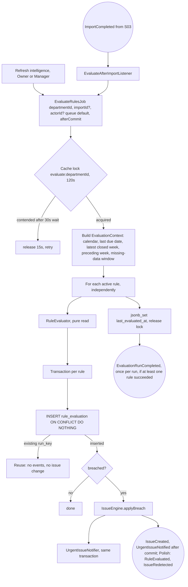
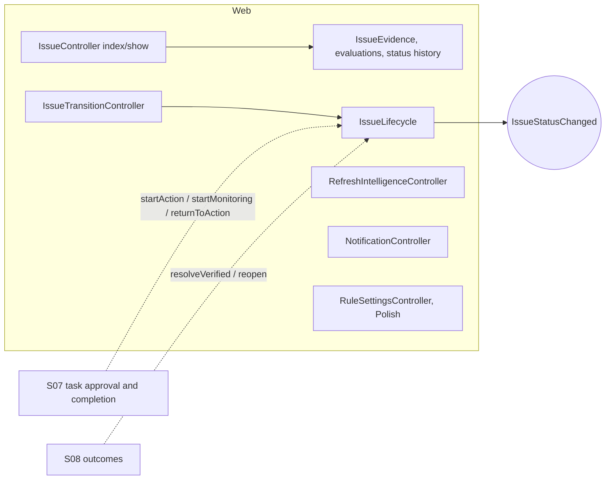

# Design Document

## Overview

S04 is the Business Intelligence and Issue Engine. It consumes confirmed sales data from S03 and does four things:

1. Computes deterministic metrics with decimal-string math (`bcmath`, no floats).
2. Evaluates three predefined rules per department against the S03 reporting calendar (due days, closed weeks) and stores every evaluation with a full evidence snapshot.
3. Creates and maintains deduplicated Issues, and owns the Issue lifecycle state machine (R4), including an append-only status history stored on the Issue row.
4. Notifies the Owner and department Managers of high-severity Issues through Laravel database notifications.

S04 supplies `IssueEvidence` (read model for S05 and S08), the lifecycle methods called by S07 and S08, and the Core events. It defines no panel registry and no task-state reader (R7). Later specs add their own props to `IssueController::show` and their own Vue panel components to the Issue detail page.

### Priority tiers (R1)

| Tier | Contents |
|---|---|
| [PoV Core] | `MetricCalculator`, `EvaluationContext`, three evaluators, seeded fixed rules, `EvaluateRulesJob`, listener, Refresh intelligence, `IssueEngine`, `IssueLifecycle`, `UrgentIssueNotifier`, notification feed and bell, Issue list and detail, `IssueEvidence`, events `IssueCreated`, `IssueStatusChanged`, `UrgentIssueNotified`, `EvaluationRunCompleted`, Feature tests |
| [PoV Polish] | Settings "Rules" tab (read-only display and editing), `UpdateBusinessRule`, events `BusinessRuleUpdated`, `RuleEvaluated`, `IssueRedetected`, Owner department filter on the Issue list |

Rule evaluations and re-detections are persisted in Core. Only their events are Polish: the dispatch calls for `RuleEvaluated` and `IssueRedetected` are added in the Polish pass, and no placeholder event classes exist in Core.

Decisions fixed for this design (resolving gaps in the requirements):

| # | Gap | Decision |
|---|---|---|
| G1 | Status timeline source (Req 14.4) | Append-only JSONB column `issues.status_history`, written by `IssueLifecycle` (and by `IssueEngine` at creation and re-detection) inside the same transaction as the change. No new table. No dependency on S08 `activity_logs`. |
| G2 | `BusinessRuleUpdated` event (Req 3.14) | [PoV Polish]. Defined in `App\Events\Intelligence` with the Rules tab. |
| G3 | Per-department serialization (Req 4.7) | Two layers: `ShouldBeUniqueUntilProcessing` with `uniqueFor = 900` and `uniqueId = departmentId` keeps at most one pending job, and `Cache::store('database')->lock("evaluate:{$departmentId}", 120)` keeps one running job. `ShouldBeUniqueUntilProcessing` (not `ShouldBeUnique`) releases the unique lock when the job starts, so a dispatch that arrives while a job runs is queued and sees the newest data. Correctness never depends on the locks (see "Evaluation lock"). |
| G4 | "Latest evaluation time" when all evaluations are reused (Req 4.12) | Store `departments.settings.intelligence.last_evaluated_at` (jsonb key per `docs/data-model.md`). Updated by atomic `jsonb_set` with a `BusinessClock::now()` value bound as a parameter, when a job finishes with at least one rule processed. |
| G5 | Manual reason storage | Manual resolve reason goes to `issues.resolution_note` and to the `status_history` entry. Other manual transitions put the reason in the `status_history` entry only. |
| G6 | `rule_evaluations.severity` | Nullable. Set only when `result = breached` (check constraint). |
| G7 | Pending job drops a later trigger's metadata | A second dispatch while one is pending is dropped. The pending job reads current data when it runs, so evaluation is correct. `EvaluationRunCompleted.importId` and `actorUserId` then describe the first dispatch. Accepted for Stage 1. |
| G8 | Demo expectation for the correction fixture | `week8-correction.csv` lifts W8 to 126,000.00. The decline Issue is re-detected (−18.71, count 2). The target achievement becomes 80.77 and is `not_breached`, so the target Issue is not touched. |
| G9 | `as_of_date` nullability | Null only when the department has no Active_Record (`no_records`). `docs/data-model.md` gets a note (task 11.2). |
| G10 | Evaluation timestamps | `evaluated_at`, `first_detected_at`, `last_detected_at`, `action_started_at`, `monitoring_started_at`, `resolved_at` and history `at` use `BusinessClock::now()` (A11). |

### Research notes

- Laravel atomic locks: the `database` cache store supports `Cache::lock($name, $seconds)` backed by the `cache_locks` table; `release()` only releases when the owner token matches. See [Laravel atomic locks](https://laravel.com/docs/cache#atomic-locks).
- Laravel unique jobs: `ShouldBeUniqueUntilProcessing` releases the unique lock when processing starts, whereas `ShouldBeUnique` holds it until the job finishes. See [Laravel queues, unique jobs](https://laravel.com/docs/queues#unique-jobs).
- PostgreSQL `INSERT ... ON CONFLICT (cols) WHERE predicate DO NOTHING RETURNING id` can infer a partial unique index when the predicate is repeated. This gives race-free issue creation. See [PostgreSQL INSERT](https://www.postgresql.org/docs/current/sql-insert.html).
- PostgreSQL `numeric` `SUM()` is exact, so weekly totals are summed in SQL and only divisions and roundings run in `bcmath`.

Content was rephrased for compliance with licensing restrictions.

## Architecture





### Module layout

```
app/
  Models/{BusinessRule,RuleEvaluation,Issue}.php
  Enums/{RuleKey,RuleResult,InsufficientReason,IssueSeverity,IssueStatus,ResolutionType}.php
  Policies/{IssuePolicy,BusinessRulePolicy,RuleEvaluationPolicy}.php
  Services/Intelligence/
    MetricCalculator.php
    EvaluationContext.php
    Evaluators/{RuleEvaluator(interface),WeeklyRevenueDeclineEvaluator,SalesTargetShortfallEvaluator,MissingSalesDataEvaluator}.php
    RunKey.php
    EvidenceBuilder.php
    IssueEngine.php
    IssueLifecycle.php
    IssueTransitionNotAllowedException.php
    IssueEvidence.php            (read model)
    UrgentIssueNotifier.php
  Actions/Intelligence/{SeedDefaultRules,DispatchEvaluation}.php
  Actions/Intelligence/UpdateBusinessRule.php                                   [PoV Polish]
  Jobs/EvaluateRulesJob.php
  Listeners/Intelligence/EvaluateAfterImportListener.php
  Notifications/UrgentIssueNotification.php
  Events/Intelligence/{IssueCreated,IssueStatusChanged,UrgentIssueNotified,EvaluationRunCompleted}.php
  Events/Intelligence/{RuleEvaluated,IssueRedetected,BusinessRuleUpdated}.php   [PoV Polish]
  Http/Controllers/{IssueController,IssueTransitionController,RefreshIntelligenceController,NotificationController}.php
  Http/Controllers/RuleSettingsController.php                                   [PoV Polish]
  Http/Requests/{TransitionIssueRequest}.php, UpdateRulesRequest.php            [PoV Polish]
resources/js/pages/Issues/{Index,Show}.vue
resources/js/pages/Settings/Tabs/Rules.vue                                      [PoV Polish]
tests/Feature/Intelligence/                                                     [PoV Core]
database/demo/expected.json                                                     (adds `evaluations`)
```

## Components and Interfaces

### MetricCalculator

Pure, stateless, no I/O. All values are decimal strings. Money is 2 dp, percentages are 4 dp internally and 2 dp for storage and display.

```
CALC_SCALE = 12
ZERO_DENOMINATOR = sentinel value (not a string, not null)

function roundHalfUp(x: DecString, places: int): DecString
    negative = x starts with '-'
    a = abs(x)
    half = '0.' + repeat('0', places) + '5'       // places=4 -> '0.00005'
    r = bcadd(a, half, places)                    // bcadd truncates beyond `places`
    if bccomp(r, '0', places) == 0: return r      // never return '-0.0000'
    return negative ? '-' + r : r

function pct(numerator: Money, denominator: Money): Dec4 | ZERO_DENOMINATOR
    if bccomp(denominator, '0', 2) == 0: return ZERO_DENOMINATOR
    q = bcdiv(bcmul(numerator, '100', CALC_SCALE), denominator, CALC_SCALE)
    return roundHalfUp(q, 4)

function targetAchievementPct(revenue, target): Dec4 | ZERO_DENOMINATOR
function weeklyChangePct(current, comparison): Dec4 | ZERO_DENOMINATOR
    return pct(bcsub(current, comparison, 2), comparison)
function coveragePct(present: int, expected: int): Dec4 | ZERO_DENOMINATOR
function display2(x4: Dec4): Dec2

function weekTotals(department, weekStart): {revenue: Money, target: Money}
    // one SQL query, exact numeric arithmetic:
    // SELECT COALESCE(SUM(revenue),0), COALESCE(SUM(target_revenue),0)
    //   FROM sales_records
    //  WHERE department_id=? AND is_active AND sales_date BETWEEN ? AND ?
```

Rules of use:
- No `float`, `round()` or `number_format()` anywhere in S04 code.
- Threshold comparisons use the 4 dp value (`bccomp(a, b, 4)`), never the 2 dp display value.
- Double rounding (12 dp, 4 dp, 2 dp) is intentional and deterministic: 124000 / 156000 gives 79.487179..., then 79.4872, then 79.49.
- The calculator never decides whether a period is comparable. The evaluators do.

### EvaluationContext

Built once per job run from `ReportingCoverage` (S03) and shared by the three evaluators, so they agree on dates and read coverage once.

```
function buildContext(department): EvaluationContext
    now          = BusinessClock.now()
    asOf         = ReportingCoverage.latestSalesDate(department)        // null when no Active_Record
    lastDue      = ReportingCoverage.lastDueDate(department, now)
    latest       = ReportingCoverage.latestClosedWeek(department, now)  // WeekState, any completeness
    prevStart    = latest.weekStart - 7 days
    preceding    = ReportingCoverage.weekState(department, prevStart, null, now)   // always closed
    winStart     = startOfIsoWeek(BusinessClock.today()) - 7 days
    gaps         = ReportingCoverage.missingDueBranchDays(department, winStart, lastDue, null, now)
    expectedBr   = ReportingCoverage.expectedBranches(department)
    dueDates     = [d for d in tradingDates over [winStart .. lastDue] if isDue(d)]
    return Context(now, asOf, lastDue, latest, preceding, window(winStart, lastDue), gaps,
                   expectedBr, dueDates, calendarSettings(company.trading_days,
                   company.reporting_cutoff_time, company.reporting_cutoff_lag_days),
                   noRecords = (asOf == null))
```

`latestClosedWeek` is a calendar fact and works without records (its completeness is `absent`). The `noRecords` flag is derived from `asOf == null`.

Freshness (`ReportingCoverage::freshness`) is never read by the engine. It is a live display value for S03 and S05 and creates no Issue.

### Rule evaluator algorithms

Common contract. An evaluator is a pure read function. It never writes and never dispatches events.

```php
interface RuleEvaluator {
    public function key(): RuleKey;
    public function evaluate(BusinessRule $rule, Department $dept, EvaluationContext $ctx): EvaluationOutcome;
}
// EvaluationOutcome: result, severity?, insufficientReason?, metricName,
// periodStart, periodEnd, comparisonStart?, comparisonEnd?,
// currentValue?, comparisonValue?, differenceValue?, differencePct4? (Dec4),
// asOfDate?, lastDueDate, evidence (array), contributingRecordIds (int[]), contributingImportIds (int[])
```

**Weekly revenue decline** (`weekly_change_pct`):

```
function evaluateDecline(rule, dept, ctx):
    T = rule.threshold; high = rule.params.high_drop_pct
    base = outcome(metric='weekly_change_pct', period=ctx.latest, comparison=ctx.preceding)

    if ctx.noRecords:                              return insufficient(base, NO_RECORDS)
    if ctx.latest.completeness == absent:          return insufficient(base, PERIOD_ABSENT)
    if ctx.latest.completeness == incomplete:      return insufficient(base, INCOMPLETE_PERIOD)
    if ctx.preceding.completeness == absent:       return insufficient(base, PERIOD_ABSENT)
    if ctx.preceding.completeness == incomplete:   return insufficient(base, INCOMPLETE_PERIOD)

    cur  = weekTotals(dept, ctx.latest.weekStart).revenue
    prev = weekTotals(dept, ctx.preceding.weekStart).revenue
    chg  = weeklyChangePct(cur, prev)
    if chg == ZERO_DENOMINATOR:                    return insufficient(base, ZERO_DENOMINATOR)

    base.currentValue = cur; base.comparisonValue = prev
    base.differenceValue = bcsub(cur, prev, 2); base.differencePct4 = chg

    if bccomp(chg, '-' + T, 4) < 0:                // drop strictly greater than threshold
        sev = bccomp(chg, '-' + high, 4) <= 0 ? HIGH : MEDIUM
        return breached(base, sev)
    return notBreached(base)
```

**Sales target shortfall** (`target_achievement_pct`, no comparison period):

```
function evaluateTarget(rule, dept, ctx):
    T = rule.threshold; highBelow = rule.params.high_below_pct
    if ctx.noRecords:                              return insufficient(base, NO_RECORDS)
    if ctx.latest.completeness == absent:          return insufficient(base, PERIOD_ABSENT)
    if ctx.latest.completeness == incomplete:      return insufficient(base, INCOMPLETE_PERIOD)

    {revenue, target} = weekTotals(dept, ctx.latest.weekStart)
    ach = targetAchievementPct(revenue, target)
    if ach == ZERO_DENOMINATOR:                    return insufficient(base, ZERO_DENOMINATOR)

    base.currentValue = revenue; base.comparisonValue = target
    base.differenceValue = bcsub(revenue, target, 2); base.differencePct4 = ach

    if bccomp(ach, T, 4) < 0:                      // strictly below threshold
        sev = bccomp(ach, highBelow, 4) < 0 ? HIGH : MEDIUM
        return breached(base, sev)
    return notBreached(base)
```

**Missing sales data** (`coverage_pct`, window = Monday of the ISO week before the week of `BusinessClock::today()` through `last_due_date`):

```
function evaluateMissingData(rule, dept, ctx):
    if ctx.noRecords: return insufficient(base, NO_RECORDS)
    gaps     = ctx.gaps                          // Due_Branch_Days with no Active_Record, kind inside_period | after_latest
    expected = count(ctx.expectedBranches) * count(ctx.dueDates)
    if expected == 0: return insufficient(base, ZERO_DENOMINATOR)
    present  = expected - count(gaps)

    base.period = ctx.window; base.comparison = null
    base.currentValue = string(present); base.comparisonValue = string(expected)
    base.differencePct4 = coveragePct(present, expected)
    base.evidence.missingDueBranchDays = gaps    // [{branch_code, date, kind}]

    if count(gaps) > 0: return breached(base, MEDIUM)
    return notBreached(base)
```

Properties of the missing-data window that make the demo values hold:
- A not-yet-due day is never inside `dueDates` and `missingDueBranchDays` never returns a date after `last_due_date`, so an Open_Week never alerts (Req 5.11).
- At clock 2026-09-28 the window is 2026-09-21 to 2026-09-26 (18 Due_Branch_Days). With the W8 file: 18 of 18. With the errors file: 17 of 18. With no W8 file: 0 of 18. The week of 2026-09-28 has no due day yet.
- At clock 2026-09-21 the window is 2026-09-14 to 2026-09-19 (W7): 18 of 18.

Severity applies only when `result = breached` (G6).

Demo walk-through of reasons: `week8-with-errors.csv` at clock 09-28 makes W8 a closed, incomplete week, so decline and target record `incomplete_period`. Refresh at 09-28 before any W8 upload makes W8 closed and absent, so they record `period_absent`.

### Run_Key and evidence

```
function computeRunKey(rule, dept, ctx, outcome, recordIds: int[], importIds: int[]): string
    payload = {
        ruleId: rule.id,
        threshold: rule.threshold, params: rule.params,
        periodStart: outcome.periodStart, periodEnd: outcome.periodEnd,
        comparisonStart: outcome.comparisonStart, comparisonEnd: outcome.comparisonEnd,
        asOfDate: ctx.asOf, lastDueDate: ctx.lastDue,
        expectedBranches: ctx.expectedBranches,            // sorted
        tradingDays: company.trading_days,                 // sorted ints
        cutoff: { time: company.reporting_cutoff_time, lagDays: company.reporting_cutoff_lag_days },
        recordIds: sort(recordIds),                        // active sales_record ids in scope
        importIds: sort(importIds),                        // import ids of those records
    }
    return sha256(canonicalJson(payload))                   // stable key order, no whitespace
```

Scope of record ids per rule: decline reads the ids of both weeks, target reads the latest closed week, missing data reads the ids inside the window. Record ids and import ids are read in the same query that sums the totals. When the id set exceeds 1,000, the evidence snapshot stores compact `[[minId,maxId], ...]` ranges, and Run_Key hashing always uses the full sorted id list before compaction.

Consequence of including `last_due_date`: the same unchanged data evaluated on a later business day yields a new Rule_Evaluation, and a breach is re-detected (count + 1). Evaluating again within the same due state is a reuse. This is the intended behavior: a rule is judged against the calendar it was evaluated in.

The unique constraint stays `(business_rule_id, period_start, period_end, run_key)`.

`EvidenceBuilder` assembles the JSONB payload stored in `rule_evaluations.evidence`:

```
evidence = {
  asOfDate, lastDueDate, thresholdUsed, paramsUsed,
  calendar: { tradingDays, cutoffTime, cutoffLagDays, timezone },
  periods: { current: {start,end,status,completeness,revenue,target}, comparison: {...}? },
  coverage: { expectedBranches, expectedDueBranchDays, presentDueBranchDays,
              missingDueBranchDays: [{branch_code,date,kind}] },
  contributingImportIds: int[],
  contributingRecordIds: int[] | [[min,max],...],
}
```

All money values are decimal strings; all percentages are decimal strings at 4 dp.

### Evaluation lock and job

```php
final class EvaluateRulesJob implements ShouldQueue, ShouldBeUniqueUntilProcessing
{
    use Queueable;   // onQueue('default'), dispatched with ->afterCommit()

    public int $timeout = 120;
    public int $tries = 3;
    public int $uniqueFor = 900;

    public function __construct(public int $departmentId, public ?int $importId = null, public ?int $actorUserId = null) {
        $this->onQueue('default');
        $this->afterCommit();
    }

    public function uniqueId(): string { return (string) $this->departmentId; }
    public function backoff(): array { return [10, 30, 60]; }

    public function handle(SeedDefaultRules $seed, EvidenceBuilder $evidence, IssueEngine $issues, UrgentIssueNotifier $notifier): void
    {
        $lock = Cache::store('database')->lock("evaluate:{$this->departmentId}", 120);
        try {
            $lock->block(30);                           // wait up to 30 s; LockTimeoutException otherwise
        } catch (LockTimeoutException) {
            $this->release(15);                         // contention: retry later
            return;
        }
        try {
            $seed->ensureRulesExist($this->departmentId);          // idempotent, cheap no-op after first run
            $ctx = EvaluationContext::build($department);
            $anyProcessed = false;
            $evaluationIds = [];
            foreach ($department->businessRules()->where('is_active', true)->get() as $rule) {
                try {
                    // returns the rule_evaluations id, whether newly inserted or reused
                    $evaluationIds[] = $this->evaluateOneRule($rule, $ctx, $evidence, $issues, $notifier); // own transaction
                    $anyProcessed = true;
                } catch (Throwable $e) {
                    Log::warning('rule_evaluation_failed', ['rule_id' => $rule->id, 'department_id' => $this->departmentId]);
                }
            }
            if ($anyProcessed) {
                Department::query()->whereKey($department->id)->update(['settings' => DB::raw(
                    "jsonb_set(settings, '{intelligence,last_evaluated_at}', to_jsonb(?::text))"  // bound: BusinessClock::now() ISO string
                )]);
                $this->announceRunCompleted($department->id, array_values(array_unique($evaluationIds)));
            }
        } finally {
            $lock->release();
        }
    }

    private function announceRunCompleted(int $departmentId, array $evaluationIds): void
    {
        sort($evaluationIds);
        try {
            EvaluationRunCompleted::dispatch($departmentId, $this->importId, $this->actorUserId, $evaluationIds, BusinessClock::now()->toImmutable());
        } catch (Throwable $e) {
            Log::warning('evaluation_run_completed_dispatch_failed', ['department_id' => $departmentId, 'exception' => $e::class]);
        }
    }
}
```

(The `jsonb_set` call creates the `intelligence` object path when missing, via `jsonb_set(coalesce(settings,'{}'), '{intelligence}', coalesce(settings->'intelligence','{}') || ...)` in the implementation; the call shown is the shape, the migration or action guarantees the `intelligence` key exists first.)

`EvaluationRunCompleted` is dispatched once per job run, after the rule loop and the `last_evaluated_at` update, and only when at least one rule was processed without error. It is not dispatched when the lock is not acquired, when every rule throws, or when the job fails. No transaction is open at dispatch time (each rule has its own committed transaction).

Why correctness never depends on the locks: uniqueness of `rule_evaluations` is enforced by the unique index, and Issue creation uses `INSERT ... ON CONFLICT` against the partial unique index on `issues`. The locks only reduce wasted work. A lock loss degrades to "two jobs do the same idempotent work".

`EvaluateAfterImportListener` listens for `ImportCompleted` with status `completed` or `completed_with_errors` and dispatches `EvaluateRulesJob::dispatch($departmentId, $importId, null)->afterCommit()`. `RefreshIntelligenceController` is throttled with `throttle:6,1`, authorizes through `IssuePolicy::refresh` (403 Staff, 404 cross-department via `visibleTo()`), and dispatches the job with `importId: null, actorUserId: $request->user()->id`.

### Issue creation and dedup transaction

Per rule evaluation, after a `breached` result is persisted (timestamps from `BusinessClock::now()`):

```sql
INSERT INTO issues (business_rule_id, department_id, scope_key, title, severity,
                     first_detected_at, last_detected_at, detection_count,
                     period_start, period_end, baseline_evaluation_id, latest_evaluation_id,
                     status, status_history)
VALUES (:rule_id, :dept_id, 'department', :title, :severity,
        :now, :now, 1,
        :period_start, :period_end, :eval_id, :eval_id,
        'open', :initial_history_json)
ON CONFLICT (business_rule_id, department_id, scope_key) WHERE status <> 'resolved'
DO NOTHING
RETURNING id;
```

```
function applyBreach(rule, evaluation, reused, now):
    if reused: return                                       // Req 8.4, 9.10: nothing changes

    latestResolved = Issue::where(rule, dept, scope_key)->where('status','resolved')->latest('resolved_at')->first()
    inserted = runInsertOnConflict(..., recurrence_of_issue_id: latestResolved?.id)   // SQL above; recurrence id only when no Open_Issue
    if inserted:
        dispatch IssueCreated (after commit)
        maybeNotifyUrgent(issue)                             // same transaction
        return

    // An Open_Issue exists (or was created concurrently): both converge here (Req 9.9).
    issue = Issue::where(rule, dept, scope_key)->where('status','!=','resolved')->lockForUpdate()->first()
    if issue == null: retry applyBreach once, then log and skip
    newSeverity = max(issue.severity, evaluation.severity)  // monotonic
    previousSeverity = issue.severity
    issue.update(last_detected_at: now, latest_evaluation_id: evaluation.id,
                 detection_count: issue.detection_count + 1, severity: newSeverity)   // status unchanged
    appendStatusHistory(issue, from: issue.status, to: issue.status, trigger: 're_detection')
    [Polish] dispatch IssueRedetected (after commit)
    if newSeverity == 'high' and previousSeverity != 'high': maybeNotifyUrgent(issue)
```

Re-detection never changes status (Req 9.3), including `monitoring`. A later `not_breached` or `insufficient_data` evaluation changes nothing on the Issue (Req 9.12); the page reads the latest evaluation for the rule separately (see `IssueController::show`).

The recurrence insert path: the partial index excludes resolved rows, so an insert never conflicts with a resolved Issue. `recurrence_of_issue_id` is set from `latestResolved` in the same statement and a fresh baseline is used.

`baseline_evaluation_id` is set once at creation and never updated by any statement in `IssueEngine` or `IssueLifecycle`.

### IssueLifecycle

Pure transition methods. Each runs inside `DB::transaction()` with `Issue::lockForUpdate()` and a status check against the locked row. All timestamps use `BusinessClock::now()`.

| From | To | Method | Actor | Guard and side effects |
|---|---|---|---|---|
| `open` | `acknowledged` | `acknowledge(issue, actor)` | Owner / Manager in scope | none |
| `open`, `acknowledged` | `action_in_progress` | `startAction(issue, ?actor)` | system (S07, first linked task approved or created) | sets `action_started_at` only when null; other statuses: no-op without error |
| `action_in_progress` | `monitoring` | `startMonitoring(issue, ?actor, ?reason)` | system (actor null), called by S07 when all non-cancelled linked tasks are completed and at least one is completed | sets `monitoring_started_at`, trigger `tasks_complete` |
| `action_in_progress` | `monitoring` | `startMonitoring(issue, actor, reason)` | Owner / Manager in scope | reason required (1 to 2,000 chars), trigger `manual`, sets `monitoring_started_at` |
| `monitoring` | `action_in_progress` | `returnToAction(issue, ?actor)` | system (S07, a linked task reopened or a new linked task approved) | clears `monitoring_started_at`, keeps `action_started_at` |
| `monitoring` | `resolved` | `resolveVerified(issue, outcomeRef)` | system (S08) | `resolution_type=system_verified`, `resolved_at`, `resolved_by` null |
| `open`, `acknowledged`, `action_in_progress`, `monitoring` | `resolved` | `resolveManual(issue, actor, reason)` | Owner / Manager in scope | reason required (1 to 2,000 chars), `resolution_type=manual`, `resolution_note`, `resolved_by`, `resolved_at` |
| `monitoring` | `open` | `reopen(issue, reason)` | system (S08) | keeps `baseline_evaluation_id`; clears `action_started_at` and `monitoring_started_at` (A12) |
| any other pair | | | | `IssueTransitionNotAllowedException`, issue unchanged |

```
const ALLOWED = [
  open:               [acknowledged, action_in_progress, resolved],
  acknowledged:       [action_in_progress, resolved],
  action_in_progress: [monitoring, resolved],
  monitoring:         [action_in_progress, resolved, open],
  resolved:           [],
]

function transition(issue, to, actor, reason, trigger, apply):
    result = DB::transaction(function () use (...) {
        locked = Issue::lockForUpdate()->find(issue.id)
        from = locked.status
        if from == to and isIdempotentRepeat(locked, to, trigger): return NoOp            // double submit, Req 10.19
        if to not in ALLOWED[from]:  throw IssueTransitionNotAllowedException(from, to)
        apply(locked, BusinessClock.now())        // column changes per method (see table)
        locked.status = to
        appendStatusHistory(locked, from, to, actor, reason, trigger)
        locked.save()
        return Changed(from, to)
    })
    if result is Changed: dispatch IssueStatusChanged(issue.id, from, to, actor?.id, reason)   // after commit
```

`startAction` on an Issue that is already `action_in_progress`, `monitoring` or `resolved` returns without error and without a history entry (Req 10.5). The other methods throw on a forbidden pair, except a repeat of the same already-applied transition (double submit), which returns a no-op that the controller maps to HTTP 200.

Validation (reasons): `startMonitoring` with an actor and `resolveManual` require a trimmed non-empty reason of at most 2,000 characters; otherwise a `ValidationException` is thrown before any write.

`appendStatusHistory` always appends, never mutates prior entries:

```
entry = { from, to, at: BusinessClock.now().toIso8601String(),
          by_user_id: actor?.id,        // null for system
          reason: reason,               // null when none
          trigger: trigger }            // 'created' | 'manual' | 'task_approved' | 'tasks_complete' | 'task_reopened'
                                        // | 'outcome_verified' | 'outcome_worsened' | 're_detection'
issue.status_history = issue.status_history + [entry]
```

`IssueEngine` writes the root entry at creation: `{from: null, to: 'open', trigger: 'created', by_user_id: null}`.

S07 decides when linked tasks are all complete and calls `startMonitoring(issue, null)`; S04 contains no task reader and no `markActionInProgress` or `markMonitoringIfTasksComplete` methods (R7).

### IssueEvidence read model

```php
final class IssueEvidence implements Arrayable
{
    public function __construct(
        public readonly int $issueId,
        public readonly string $title,
        public readonly IssueSeverity $severity,
        public readonly IssueStatus $status,
        public readonly RuleKey $ruleKey,
        public readonly EvaluationSummary $baseline,
        public readonly EvaluationSummary $latest,
        public readonly string $primaryMetricName,       // weekly_change_pct | target_achievement_pct | coverage_pct
        public readonly string $baselinePrimaryValue,    // decimal string, from baseline evidence
        public readonly string $latestPrimaryValue,
        public readonly array $missingDueBranchDays,     // [{branch_code,date,kind}] from latest evidence
        public readonly array $importIds,
    ) {}

    public static function forIssue(Issue $issue): self { /* reads rule_evaluations and their evidence only, never sales_records */ }
    public function toArray(): array { /* decimal strings and ints only */ }
    public static function fromArray(array $data): self { /* inverse of toArray */ }
}
```

Round-trip contract (Req 15.5): `fromArray(toArray($e))` is value-equal to `$e` for every Issue. A Feature test covers it for the W8 decline Issue.

### IssueController::show composition (R7)

`IssueController::show` builds the Inertia props itself: the Issue, rule, department, baseline evaluation, latest breached evaluation (`latest_evaluation_id`), the most recent evaluation of the rule and department of any result (`latestRuleEvaluation`, ordered by `evaluated_at desc, id desc`), status history, allowed actions for the user, the stale-evaluation flag (latest `last_evaluated_at` older than the department's most recent completed import) and `lastEvaluatedAt`. Later specs append their own props to this method (S05 brief links, S06 meetings, S07 tasks, S08 outcomes, feedback and trace) and add their own Vue panel components to `Issues/Show.vue`. S04 ships no registry, provider interface or slot map.

### UrgentIssueNotifier

```
function maybeNotifyUrgent(issue):
    if issue.severity != 'high': return
    dedupeKey = "{$issue.id}:high"
    recipients = [company.owner()] + department.activeManagers()
    foreach recipients as user:
        if user.is_active == false: continue
        exists = DatabaseNotification::where('notifiable_id', user.id)->where('data->>dedupe_key', dedupeKey)->exists()
        if exists: continue
        user.notify(new UrgentIssueNotification(issue, dedupeKey))   // same transaction (Req 11.6)
    dispatch UrgentIssueNotified(issue.id, 'high', dedupeKey, recipientUserIds) // after commit, only when at least one was created
```

Notification `data`: `{dedupe_key, issue_id, title, severity, department_name, summary_line, url}`. `summary_line` is built from the evaluation already in scope.

## Data Models

Per `docs/data-model.md` §2, this design adds the columns below.

### `business_rules`

As documented: `department_id, key, name, threshold, severity, is_active, params (jsonb)`. Unique `(department_id, key)`.

### `rule_evaluations`

| Column | Type | Notes |
|---|---|---|
| id | bigint PK | |
| business_rule_id | bigint FK → business_rules | |
| department_id | bigint FK → departments | |
| import_id | bigint FK → imports, nullable | trigger, null for Refresh intelligence |
| period_start, period_end | date | |
| comparison_start, comparison_end | date, nullable | |
| metric_name | varchar | check: `weekly_change_pct`, `target_achievement_pct`, `coverage_pct` |
| current_value, comparison_value, difference_value | numeric(14,2) | nullable |
| difference_pct | numeric(8,4) | nullable |
| result | varchar | check: `breached`, `not_breached`, `insufficient_data` |
| severity | varchar, nullable | check: `low`,`medium`,`high`,`critical`; null unless `result='breached'` |
| insufficient_reason | varchar, nullable | check: `incomplete_period`,`period_absent`,`zero_denominator`,`no_records`; non-null iff `result='insufficient_data'` |
| as_of_date | date, nullable | null only for `no_records` |
| last_due_date | date | `ReportingCoverage::lastDueDate` at evaluation time |
| evidence | jsonb | see EvidenceBuilder shape |
| evaluated_at | timestamp | `BusinessClock::now()` |
| run_key | char(64) | sha256 hex |

Indexes: `(department_id, evaluated_at)`. **Unique**: `(business_rule_id, period_start, period_end, run_key)`.

### `issues`

All columns of `docs/data-model.md` §2, including:

| Column | Type | Notes |
|---|---|---|
| action_started_at | timestamp, nullable | set once per action cycle by `startAction` |
| monitoring_started_at | timestamp, nullable | set by `startMonitoring`, cleared when leaving `monitoring` |
| status_history | jsonb | default `'[]'`; append-only `{from, to, at, by_user_id, reason, trigger}`; no FK on `by_user_id` |
| resolved_at, resolved_by, resolution_type | nullable | `resolution_type` check: `system_verified`, `manual` |
| resolution_note | text, nullable | required when `resolution_type = 'manual'` |

Indexes and constraints: **partial unique** `(business_rule_id, department_id, scope_key) WHERE status <> 'resolved'`. Checks: status and severity enums; `(status = 'resolved') = (resolved_at IS NOT NULL)`; `(status = 'resolved') = (resolution_type IS NOT NULL)`; `resolution_type <> 'manual' OR resolution_note IS NOT NULL`.

### `departments.settings`

S04 owns the subkey `settings.intelligence.last_evaluated_at` (ISO8601 string, nullable). Written only by atomic `jsonb_set`, never read-then-written as a PHP array, so concurrent writers of `expected_branches` are not clobbered.

### Laravel `notifications` table

Used as-is. `type = App\Notifications\UrgentIssueNotification`, `data` JSON per the shape above.

### Migrations (new in S04)

```php
Schema::create('business_rules', function (Blueprint $t) {
    $t->id();
    $t->foreignId('department_id')->constrained()->cascadeOnDelete();
    $t->string('key'); $t->string('name');
    $t->decimal('threshold', 8, 2);
    $t->string('severity');
    $t->boolean('is_active')->default(true);
    $t->jsonb('params')->default('{}');
    $t->timestamps();
    $t->unique(['department_id', 'key']);
});
DB::statement("ALTER TABLE business_rules ADD CONSTRAINT business_rules_key_check CHECK (key IN ('weekly_revenue_decline','sales_target_shortfall','missing_sales_data'))");
DB::statement("ALTER TABLE business_rules ADD CONSTRAINT business_rules_severity_check CHECK (severity IN ('low','medium','high','critical'))");

Schema::create('rule_evaluations', function (Blueprint $t) {
    $t->id();
    $t->foreignId('business_rule_id')->constrained()->cascadeOnDelete();
    $t->foreignId('department_id')->constrained();
    $t->foreignId('import_id')->nullable()->constrained();
    $t->date('period_start'); $t->date('period_end');
    $t->date('comparison_start')->nullable(); $t->date('comparison_end')->nullable();
    $t->string('metric_name');
    $t->decimal('current_value', 14, 2)->nullable();
    $t->decimal('comparison_value', 14, 2)->nullable();
    $t->decimal('difference_value', 14, 2)->nullable();
    $t->decimal('difference_pct', 8, 4)->nullable();
    $t->string('result');
    $t->string('severity')->nullable();
    $t->string('insufficient_reason')->nullable();
    $t->date('as_of_date')->nullable();
    $t->date('last_due_date');
    $t->jsonb('evidence');
    $t->timestamp('evaluated_at');
    $t->char('run_key', 64);
    $t->timestamps();
    $t->index(['department_id', 'evaluated_at']);
    $t->unique(['business_rule_id', 'period_start', 'period_end', 'run_key']);
});
DB::statement("ALTER TABLE rule_evaluations ADD CONSTRAINT rule_evaluations_metric_check CHECK (metric_name IN ('weekly_change_pct','target_achievement_pct','coverage_pct'))");
DB::statement("ALTER TABLE rule_evaluations ADD CONSTRAINT rule_evaluations_result_check CHECK (result IN ('breached','not_breached','insufficient_data'))");
DB::statement("ALTER TABLE rule_evaluations ADD CONSTRAINT rule_evaluations_reason_check CHECK (insufficient_reason IS NULL OR insufficient_reason IN ('incomplete_period','period_absent','zero_denominator','no_records'))");
DB::statement("ALTER TABLE rule_evaluations ADD CONSTRAINT rule_evaluations_severity_presence_check CHECK ((result = 'breached') = (severity IS NOT NULL))");
DB::statement("ALTER TABLE rule_evaluations ADD CONSTRAINT rule_evaluations_insufficient_presence_check CHECK ((result = 'insufficient_data') = (insufficient_reason IS NOT NULL))");

Schema::create('issues', function (Blueprint $t) {
    $t->id();
    $t->foreignId('department_id')->constrained();
    $t->foreignId('business_rule_id')->constrained();
    $t->string('scope_key')->default('department');
    $t->foreignId('recurrence_of_issue_id')->nullable()->constrained('issues');
    $t->string('title'); $t->string('severity'); $t->string('status')->default('open');
    $t->timestamp('first_detected_at'); $t->timestamp('last_detected_at');
    $t->unsignedInteger('detection_count')->default(1);
    $t->date('period_start'); $t->date('period_end');
    $t->foreignId('baseline_evaluation_id')->constrained('rule_evaluations');
    $t->foreignId('latest_evaluation_id')->constrained('rule_evaluations');
    $t->timestamp('action_started_at')->nullable();
    $t->timestamp('monitoring_started_at')->nullable();
    $t->jsonb('status_history')->default('[]');
    $t->timestamp('resolved_at')->nullable();
    $t->foreignId('resolved_by')->nullable()->constrained('users');
    $t->string('resolution_type')->nullable();
    $t->text('resolution_note')->nullable();
    $t->timestamps();
});
DB::statement('CREATE UNIQUE INDEX issues_open_identity_unique ON issues (business_rule_id, department_id, scope_key) WHERE status <> \'resolved\'');
DB::statement("ALTER TABLE issues ADD CONSTRAINT issues_status_check CHECK (status IN ('open','acknowledged','action_in_progress','monitoring','resolved'))");
DB::statement("ALTER TABLE issues ADD CONSTRAINT issues_severity_check CHECK (severity IN ('low','medium','high','critical'))");
DB::statement("ALTER TABLE issues ADD CONSTRAINT issues_resolution_type_check CHECK (resolution_type IS NULL OR resolution_type IN ('system_verified','manual'))");
DB::statement("ALTER TABLE issues ADD CONSTRAINT issues_resolved_presence_check CHECK ((status = 'resolved') = (resolved_at IS NOT NULL))");
DB::statement("ALTER TABLE issues ADD CONSTRAINT issues_resolution_type_presence_check CHECK ((status = 'resolved') = (resolution_type IS NOT NULL))");
DB::statement("ALTER TABLE issues ADD CONSTRAINT issues_manual_note_check CHECK (resolution_type IS DISTINCT FROM 'manual' OR resolution_note IS NOT NULL)");
```

`down()` drops `issues_open_identity_unique` explicitly (`DROP INDEX IF EXISTS`), then the tables in reverse order.

## Events contract

Namespace `App\Events\Intelligence`. Every event carries `int $departmentId`, `?int $actorUserId` (null = system), `CarbonImmutable $occurredAt`, dispatched only after the producing transaction commits.

| Event | Tier | Extra properties | Dispatched when | Not dispatched when |
|---|---|---|---|---|
| `IssueCreated` | Core | `issueId, severity, recurrenceOfIssueId?` | `IssueEngine` inserts a new Issue (fresh or recurrence) | re-detection |
| `IssueStatusChanged` | Core | `issueId, from, to, reason?` | any `IssueLifecycle` transition succeeds | rejected transitions, no-ops |
| `UrgentIssueNotified` | Core | `issueId, severity, dedupeKey, recipientUserIds` | at least one new notification row created | all recipients already had the key, or severity is not high |
| `EvaluationRunCompleted` | Core | `?importId` (null for Refresh intelligence), `evaluationIds` (`list<int>` sorted ascending, unique, never empty, new or reused, excluding inactive and failed rules). `actorUserId` is null for an import-triggered run. | the job finishes the rule loop and the `last_evaluated_at` update with at least one rule processed; once per run | lock not acquired, every rule failed, the job fails |
| `RuleEvaluated` | Polish | `ruleKey, result, severity?, importId?, evaluationId` | a `rule_evaluations` row is newly inserted | the `run_key` already existed |
| `IssueRedetected` | Polish | `issueId, detectionCount, previousSeverity, newSeverity` | an Open_Issue's detection fields are updated | a reused evaluation |
| `BusinessRuleUpdated` | Polish | `businessRuleId, changedAttributes` | `UpdateBusinessRule` persists a change | validation failure |

`EvaluationRunCompleted` carries no figures, text or company id. Its consumer is the S08 `OutcomeVerifier`. A dispatch failure is caught and logged (department id and exception class only). S04 writes no `activity_logs` row for any event.

## Error Handling

| Layer | Failure | Handling |
|---|---|---|
| `EvaluateRulesJob` | lock wait of 30 s times out | `release(15)`; the attempt counts toward the 3 tries, so a persistent contention ends as a logged failed job and the next import or refresh evaluates again |
| `EvaluateRulesJob` | one rule's evaluator throws | caught per rule, logged with ids only, loop continues (Req 4.8); if every rule throws, `last_evaluated_at` is not updated and no `EvaluationRunCompleted` is dispatched |
| `EvaluateRulesJob` | `EvaluationRunCompleted` dispatch throws | caught, logged with department id and exception class; job succeeds (Req 16.13) |
| `EvaluateRulesJob` | job exhausts 3 tries | marked failed, evaluations and Issues unchanged (Req 4.9) |
| Issue insert | partial unique index conflict | `ON CONFLICT DO NOTHING` plus `lockForUpdate` re-read (Req 9.9) |
| Issue insert | lost race, nothing found on re-read | single retry, then log and skip the Issue-side effects; the evaluation row stays |
| `IssueLifecycle` | forbidden transition | `IssueTransitionNotAllowedException`, controller returns 422 with the current status |
| `IssueLifecycle` | double submit | second call finds the already-applied status, controller returns 200 |
| `IssueLifecycle` | empty or over-long reason | `ValidationException`, 422 field error |
| Rules settings (Polish) | invalid values | `UpdateRulesRequest` rejects with field messages, stored config unchanged |
| S04 routes | Staff access | policy denies, 403 |
| S04 routes | cross-department access | scoped query finds nothing, 404 |
| Refresh intelligence | throttle exceeded | `throttle:6,1`, 429 with `Retry-After` |
| Notifications | other user's notification | scoped query, 404 |
| Logging | any S04 log line | ids, rule keys, codes, counts only |

## Security

- All S04 routes require authentication and the default CSRF middleware.
- `IssuePolicy`, `BusinessRulePolicy`, `RuleEvaluationPolicy` implement D23: Owner company-wide, Manager own department, Staff no access.
- `Issue`, `BusinessRule`, `RuleEvaluation` use `ScopedToDepartment`, so an out-of-scope id resolves to 404 before policy checks run.
- `EvaluateRulesJob` reads and writes only rows for its `departmentId`.
- Evidence text on the Issue detail page uses Vue's escaped interpolation; no `v-html`.
- Notification `data` contains ids, names visible to the recipient's role, and a URL.

## Testing Strategy

Per R5, tests are Laravel Feature tests in `tests/Feature/Intelligence`, using the starter kit's framework (Pest if shipped, otherwise PHPUnit), `RefreshDatabase` on the PostgreSQL database `businesspulse_testing`, and the S01 harness. They use no SQLite, no browser automation, no property-based framework, no mocking of the database and no external call. The Business_Clock is fixed per test. Data comes from the S03 fixtures imported through the real import path (a test helper wraps `CreateImportFromUpload` and `ConfirmImport` with the queue set to `sync`), so evaluation runs through the same `EvaluateRulesJob` as production.

`database/demo/expected.json` gets an `evaluations` list per fixture, authored by hand with literal values (clock, rule key, result, severity, reason, current, comparison, difference, difference percentage at 2 dp, present and expected Due_Branch_Days). One test reads it and asserts every entry, so the file is the single source of the Requirement 18 numbers. Task 10.1 confirms the S03 `demo:check-fixtures` reader tolerates the added key.

| Test file | Covers |
|---|---|
| `MetricCalculatorTest` | rounding half up, no `-0.0000`, zero denominator indicator (pure unit-level Feature test, no database) |
| `RuleEvaluationTest` | decline −20.00% on W8 (124,000.00 vs 155,000.00, severity high), target 79.49% on W8, zero comparison revenue and zero target give `zero_denominator`, boundary strictness (drop exactly equal to the threshold is not breached) |
| `CoverageAndCutoffTest` | not-yet-due day not alerted (clock 2026-09-28, week of 09-28), due trailing days alerted (0 of 18 after a refresh before the W8 upload), incomplete closed week gives `incomplete_period` (`week8-with-errors.csv`, 17 of 18), absent closed week gives `period_absent`, no records gives `no_records` |
| `IssueEngineTest` | second evaluation updates the same Issue (count 2, monotonic severity), partial unique index rejects a second Open_Issue by direct insert, recurrence after `resolveManual`, reused Run_Key changes nothing, re-upload of an unchanged file creates nothing |
| `EvidencePreservationTest` | after `week8-correction.csv` the baseline evaluation row and the Issue `baseline_evaluation_id` are unchanged, the decline Issue is re-detected (−18.71, count 2), `IssueEvidence` round-trip |
| `IssueLifecycleTest` | every allowed and every forbidden pair of the table (data provider over all 25 status pairs per method), reasons required, `startAction` sets `action_started_at` once, `startMonitoring` and `returnToAction` timestamps, `resolveVerified` fields, `reopen` clears the timestamps and keeps the baseline, double submit applies once |
| `UrgentNotificationTest` | Owner and active Managers notified on high creation, severity escalation and recurrence, `issue_id:severity` dedupe, medium creates none, inactive users skipped |
| `IssueAuthorizationTest` | Owner and in-scope Manager can list and view, Staff 403, other-department Manager 404, Refresh intelligence and transition endpoints follow the same matrix, notification mark-read of another user's item 404 |
| `DemoExpectationsTest` | all `evaluations` entries of `expected.json`, `EvaluationRunCompleted` once per run with sorted unique ids (also when all evaluations are reused) and not on lock contention |

A short manual checklist in `docs/s04-manual-verification.md` covers what tests do not: the S04 steps of the 22-step demo walkthrough, the bell and Issue pages at 360, 768 and 1280 px with keyboard use, and a migration rollback on a scratch database.

### Documentation follow-up (Req 19.16, cross-review action item)

Text to merge into the project docs (task 11.2):
- `docs/data-model.md` `rule_evaluations`: note `as_of_date` is null only when `insufficient_reason = no_records`.
- `docs/architecture.md`: the S04 event list with tiers, the `IssueLifecycle` method set (`acknowledge`, `startAction`, `startMonitoring`, `returnToAction`, `resolveManual`, `resolveVerified`, `reopen`), the status history storage, and the statement that S05 to S08 extend `IssueController::show` directly.
