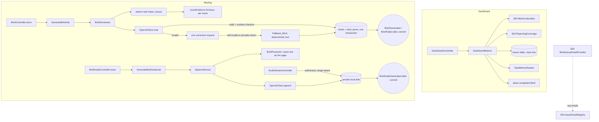

# Design Document

## Overview

S05 adds two user-facing surfaces and the services behind them:

1. **Today (dashboard)**: deterministic figures assembled by `DashboardMetrics` from S03's `ReportingCoverage` and S04's `MetricCalculator`/`issues` table, plus task counts from the `TaskMetricsReader` contract (null until S07).
2. **Executive Brief**: an on-demand, AI-worded summary of up to five open Issues. `BriefGenerator` selects and ranks evidence that S04 already computed, asks the Provider only to write a title and an explanation per finding, validates that response against a schema and a number allow-list, and falls back to a deterministic brief when the Provider is unavailable or its output cannot be trusted. `SpeechService` turns the finished brief text into audio, streamed back through an authorized, range-capable route.

Everything numeric is decided by existing S03/S04 code. S05 adds no new arithmetic; `DashboardMetrics` and `BriefGenerator` are assembly and selection logic over values `MetricCalculator`, `ReportingCoverage` and `IssueEvidence` already produce. AI output is restricted to natural-language wording and is checked against the same evidence before it is shown.

Decisions fixed for this design (resolving gaps in the requirements):

| # | Gap | Decision |
|---|---|---|
| G1 | `TaskMetricsReader` location and default (Req 1.7, 7.5-7.7) | Interface `App\Contracts\TaskMetricsReader` with `openCount(scope): int` and `overdueCount(scope): int`, where `scope` is a small value object `TaskScope::department(int $departmentId)` or `TaskScope::user(int $userId)`. S05 binds `NullTaskMetricsReader` (both methods return `null`, not `0`) as the default singleton in `AppServiceProvider`; `DashboardMetrics` renders `null` as "Not available yet" and never as `0` (Req 7.5). |
| G2 | Where `DashboardMetrics` lives relative to S04/S03 | `app/Services/Dashboard/DashboardMetrics.php`, a new "Dashboard" module area next to `Services/Intelligence`. It depends on `MetricCalculator`, `ReportingCoverage`, `Issue` (read-only query), and `TaskMetricsReader`. It is the only S05 class that reads `issues`; nothing else in S05 queries `sales_records` or `rule_evaluations` directly. |
| G3 | `briefs` has no `department_id` (requirements A1) | Confirmed: `briefs.company_id` only. A Manager's Brief is scoped at generation time (candidate Issues filtered to the Manager's department) and at read time (`BriefPolicy` lets any Owner/Manager of the company view any Brief of that company, per A1). No column added. |
| G4 | Dashboard payload shape when no `TaskMetricsReader` figure exists vs. Staff-only payload (Req 7.3-7.4) | Two distinct Inertia props are never conflated: `DashboardController` returns either `OwnerManagerDashboardData` (full shape, task fields nullable) or `StaffDashboardData` (only `openTaskCount`/`overdueTaskCount`, both nullable). The controller picks the shape by role before calling `DashboardMetrics`, so a Staff response never touches `MetricCalculator`/`ReportingCoverage`/`issues` (Req 7.4). |
| G5 | `source_ref` format (Req 9.6) | `"issue:{issueId}:evaluation:{evaluationId}"`. `BriefGenerator` parses this back when building the Issue-detail link, so the format must stay stable; no other S05 code parses it. |
| G6 | Headline/summary template inputs (Req 10.3, 12.1-12.4) | Deterministic Blade-free string templates in `BriefSummaryComposer`, keyed by `(itemCount == 0, coverageStatus)`. Five fixed templates cover all reachable combinations (see Components). No AI call is involved in building `headline`/`summary_text`; only `brief_items.title`/`explanation` come from the Provider. |
| G7 | Audio spoken-text construction (Req 18.3) | `SpeechService` builds the spoken text from the same `BriefPresenter` that renders the Brief page, so "the text sent to speech" and "the text the page displays" are provably the same string (Req 16.3), not two independently maintained builders. |
| G8 | Dashboard "Latest Complete Week" vs. S04's evaluation week — naming collision | Both S04 and S05 compute an ISO week anchored on the As_Of_Date, but they are not always the same week once the As_Of_Date falls mid-week versus at a week boundary, and S05 additionally requires the *week itself* to be complete, which S04's rule evaluators also require for their own current-period checks but S05 computes independently from the Dashboard's point of view. See "S04 evaluation week vs. S05 dashboard week" below; the UI always labels the week's own start/end dates (Req 1.8) so the two notions never need to be reconciled for the user. |

### S04 evaluation week vs. S05 dashboard week

S04's `EvaluationContext` (design.md of 04-intelligence-issue-engine) fixes `targetStart`/`targetEnd` as the ISO week **containing the As_Of_Date**, computed once per evaluation run, and evaluates rules against that single week without a "look back for a complete week" search — a partial current week simply yields `insufficient_data` for that run.

S05's `Latest_Complete_Week` (Req 2.1) is a different, independently-searched value: `DashboardMetrics` walks backward from the week of the As_Of_Date through up to 7 earlier weeks and returns the **first week `ReportingCoverage::weekCoverage` reports complete**, which may or may not be the week containing the As_Of_Date. If the current week is partial (as it usually is mid-week), the Dashboard shows the most recent *complete* week behind it, while an Issue created that same day by S04 is evaluated against the (still partial, or now complete once finished) current week.

Consequence: the revenue figure on the Dashboard and the `current_value` cited by an open Issue can legitimately describe different weeks at the same moment. This is expected, not a bug, because the two features answer different questions ("what is the last fully-known week's performance" vs. "has this week's data, as far as it goes, already crossed a threshold"). To keep this from reading as an inconsistency:

- Every KPI card, chart axis label and Brief finding period states its own explicit start and end date (Req 1.8, 10.8), never a bare "this week" or "last week".
- The Dashboard's weekly charts (Req 4) plot each ISO week by its own date range, so a viewer sees directly which week is "Incomplete" versus complete.
- `BriefGenerator` copies `period_label` from the Issue (already dated by S04), so a Brief finding's dates can differ from the Dashboard's current KPI dates, and the UI never implies they are the same period.

## Architecture



### Module layout

```
app/
  Contracts/TaskMetricsReader.php
  Services/Dashboard/
    DashboardMetrics.php
    NullTaskMetricsReader.php
    TaskScope.php
  Services/AI/
    OpenAiClient.php                 (shared with Meetings module, built in S05)
    BriefGenerator.php
    SpeechService.php
    BriefSummaryComposer.php
    BriefPresenter.php
    NumberAllowListChecker.php
  Models/{Brief,BriefItem}.php
  Enums/{BriefStatus,BriefSource,CoverageStatus,AudioStatus}.php
  Jobs/{GenerateBriefJob,GenerateBriefAudioJob}.php
  Events/Briefing/{BriefRequested,BriefGenerated,BriefFailed,BriefAudioGenerated}.php
  Policies/BriefPolicy.php
  Panels/BriefsIssuePanelProvider.php
  Http/Controllers/{DashboardController,BriefController,BriefAudioController,AudioStreamController}.php
  Http/Requests/{GenerateBriefRequest,RetryBriefRequest,GenerateBriefAudioRequest}.php
config/ai.php                        (extended: speech keys added in S05)
resources/js/pages/{Dashboard/Index.vue,Briefs/{Index,Show}.vue}
resources/js/issue-panels/BriefsPanel.vue
```

## Components and Interfaces

### TaskMetricsReader contract and null default

```php
final class TaskScope
{
    private function __construct(
        public readonly string $type,      // 'department' | 'user'
        public readonly int $id,
    ) {}
    public static function department(int $departmentId): self { return new self('department', $departmentId); }
    public static function user(int $userId): self { return new self('user', $userId); }
}

interface TaskMetricsReader
{
    /** Null means "not available yet", never 0 by convention of the null reader. */
    public function openCount(TaskScope $scope): ?int;
    public function overdueCount(TaskScope $scope): ?int;
}

final class NullTaskMetricsReader implements TaskMetricsReader
{
    public function openCount(TaskScope $scope): ?int { return null; }
    public function overdueCount(TaskScope $scope): ?int { return null; }
}
```

Bound in `AppServiceProvider::register()`: `$this->app->bind(TaskMetricsReader::class, NullTaskMetricsReader::class);`. S07 rebinds this in its own service provider to a reader backed by `tasks`. `DashboardMetrics` never checks which implementation is bound; it only treats `null` as "render as unavailable" (Req 7.5) regardless of why a value is null.

### DashboardMetrics

Pure assembly, one public method per audience, no new arithmetic.

```php
final class DashboardMetrics
{
    public function __construct(
        private MetricCalculator $calc,       // S04, unchanged
        private ReportingCoverage $coverage,  // S03, unchanged
        private TaskMetricsReader $tasks,
    ) {}

    public function forOwnerOrManager(Company $company, ?Department $department): DashboardData
    {
        $asOf = $this->coverage->asOfDate($department);                 // null when no Active_Record
        $latestComplete = $this->findLatestCompleteWeek($department, $asOf); // Req 2.1, see below
        $comparison = $latestComplete?->precedingWeek();

        $revenue = $this->revenueFigure($department, $latestComplete, $comparison);     // Req 2.2-2.4
        $target  = $this->targetFigure($department, $latestComplete);                   // Req 2.5
        $freshness = $this->coverage->freshness($department);                           // Req 3.1
        $weekCoverage = $asOf ? $this->coverage->weekCoverage($department, $asOf->startOfIsoWeek()) : null;

        return new DashboardData(
            revenue: $revenue,
            targetAchievement: $target,
            freshness: $freshness,
            weekCoverage: $weekCoverage,
            openIssueCount: $this->countIssues($department, status: 'open_like'),       // Req 1.5
            highPriorityIssueCount: $this->countIssues($department, status: 'open_like', severity: 'high'),
            resolvedIssueCount: $this->countResolvedWithin30Days($department),          // Req 1.6
            openTaskCount: $this->tasks->openCount($this->scopeFor($department)),
            overdueTaskCount: $this->tasks->overdueCount($this->scopeFor($department)),
            weeklyChart: $this->weeklySeries($department),                              // Req 4.1-4.3, 4.7
            latestBrief: Brief::where('company_id', $company->id)->where('status', 'completed')
                               ->latest('generated_at')->first(),                       // Req 1.1, 17.5
            priorityActions: $this->priorityActions($department),                       // Req 5.1
        );
    }

    public function forStaff(User $user): StaffDashboardData
    {
        return new StaffDashboardData(
            openTaskCount: $this->tasks->openCount(TaskScope::user($user->id)),
            overdueTaskCount: $this->tasks->overdueCount(TaskScope::user($user->id)),
        );
    }
}
```

`findLatestCompleteWeek` (Req 2.1-2.2): starting at the ISO week containing the As_Of_Date, check `ReportingCoverage::weekCoverage` for that week and up to 7 earlier weeks in descending order; return the first complete week found, or `null`. When `null`, revenue/change/target are all `InsufficientData::reason('no_complete_week')` (Req 2.2). `revenueFigure` additionally returns `InsufficientData::reason('comparison_week_incomplete')` when the comparison week is not complete (Req 2.3), or `InsufficientData::reason('zero_denominator')` when `MetricCalculator::weeklyChangePct` returns `ZERO_DENOMINATOR` (Req 2.4); `targetFigure` returns `InsufficientData::reason('zero_denominator')` under the same `MetricCalculator` sentinel for a zero target (Req 2.5). `InsufficientData` is a small value object (`reason: string`) that the Vue layer renders as `InsufficientDataNotice` instead of a number (Req 2.7).

`countIssues`/`countResolvedWithin30Days` query the `issues` table directly (the one exception noted in G2), scoped by `department_id` when `$department` is given or by the company's departments when not (Owner), filtered by `status <> 'resolved'` for "open-like" counts and by `resolved_at BETWEEN BusinessClock::today()->subDays(30) AND BusinessClock::today()` for resolved counts (Req 1.6, A4). These are plain `WHERE`/`COUNT` queries; no new index is required beyond the ones S04 already has on `issues` (`department_id`, `status`), since Stage 1 data volumes are small (fixture-scale, per `docs/architecture.md` §10's "recompute cost trivial at demo scale").

`priorityActions` (Req 5.1): `Issue::where(...open-like...)->orderByDesc('severity')->orderByDesc('last_detected_at')->limit(5)->get()`, mapped to `{issueId, title, severity, status, periodLabel, url}`.

`weeklySeries` (Req 4.1-4.3, 4.7): builds up to the 8 most recent ISO weeks that contain at least one Active_Record for the department, in chronological order, each with `{weekStart, weekEnd, revenue, target, isComplete}` from one `weekTotals`-shaped query per week (reusing `MetricCalculator`'s exact-SQL-sum approach, not re-implemented) and `ReportingCoverage::weekCoverage`. The weekly-change series derived from it sets `changePct` only when both the week and its immediately preceding week are complete (Req 4.2); otherwise the point is `null` ("gap"), never `0` (Req 4.3). When fewer than 2 such weeks exist, the caller renders `InsufficientDataNotice` instead of the change chart (Req 4.7) and the revenue-vs-target chart still renders with however many weeks exist (1 to 8).

### BriefGenerator pipeline

```php
final class BriefGenerator
{
    public function __construct(
        private OpenAiClient $client,
        private NumberAllowListChecker $numberCheck,
        private BriefSummaryComposer $summary,
    ) {}

    public function generate(Brief $brief): void
    {
        DB::transaction(function () use ($brief) {
            $scope = $brief->department_id ? Department::find($brief->department_id) : null; // A1
            $candidates = Issue::query()->openLike()->scopedTo($scope)
                ->orderByDesc('severity')->orderByDesc('last_detected_at')->orderBy('id')   // Req 9.2
                ->limit(5)->get();                                                          // Req 9.3

            $coverageStatus = $this->coverageStatus($brief);                                // Req 10.4
            $items = $candidates->map(fn ($issue, $i) => $this->buildDraftItem($issue, $i + 1)); // Req 9.4-9.7

            if ($items->isEmpty()) {
                $this->persistFallback($brief, $items, $coverageStatus, aiAttempted: false); // Req 12.5
                return;
            }

            $wording = $this->requestWording($brief, $items);                                // may be null
            if ($wording !== null) {
                $this->persistAi($brief, $items->map(fn ($it) => $it->withWording($wording[$it->position])),
                                  $coverageStatus);
                return;
            }
            $this->persistFallback($brief, $items, $coverageStatus, aiAttempted: true);       // Req 13.1-13.3
        });
    }

    private function requestWording(Brief $brief, Collection $items): ?array
    {
        if (! config('ai.text_model') || ! config('ai.api_key')) return null;                 // Req 13.5

        foreach ([1, 2] as $attempt) {                                                        // Req 11.6-11.7
            try {
                $response = $this->client->chat($this->buildPrompt($brief, $items, correction: $attempt === 2));
                $wording = $this->validate($response, $items);                                // Req 11.3-11.4
                if ($this->numberCheck->passes($wording, $items)) return $wording;             // Req 11.5
            } catch (ProviderUnavailableException|ProviderValidationException $e) {
                continue; // one corrective retry, then fall back
            }
        }
        return null;
    }
}
```

**Selection and ranking (Req 9.1-9.3, 9.8)**: candidates are Open_Issues only — the `issues` table never contains a row for `not_breached`/`insufficient_data` results (S04 only inserts on `breached`), so 9.8 holds structurally, not through an extra filter. Ranking is severity desc, `last_detected_at` desc, `id` asc (the `id` tiebreaker exists only in the Brief ranking, not the Dashboard's priority list, because a Brief must be deterministic byte-for-byte on identical input — two Issues with equal severity and equal `last_detected_at` must always produce the same position).

**Draft item construction (Req 9.4-9.7)**: `buildDraftItem` calls `IssueEvidence::forIssue($issue)` (S04, read-only; `BriefGenerator` never queries `rule_evaluations` or `sales_records` directly) and copies `evidence` into the Brief_Item's own `evidence` JSONB column at this point in time (Req 9.7) — a later change to the Issue's `latest_evaluation_id` does not touch an already-persisted `brief_items` row, because the copy is a value, not a reference. `issue_id`/`rule_evaluation_id`/`severity`/`period_label` are copied from the Issue (`rule_evaluation_id` from `latest_evaluation_id` at generation time); `source_ref` is `"issue:{$issue->id}:evaluation:{$issue->latest_evaluation_id}"` (G5).

**Provider request and validation (Req 11.1-11.5)**: the prompt sends, per item, only `{position, metricName, periodLabel, currentValue, comparisonValue, differencePct, severity}` drawn from `evidence` (Req 16.1-16.2), fenced as delimited untrusted data with an instruction that forbids invented figures, causes, forecasts or recommendations (Req 11.2, 11.9), and requests a JSON response matching a schema of `{items: [{position: int, title: string, explanation: string}]}` via the Provider's structured-output / JSON-schema response format (see OpenAiClient below). `validate()` runs a Laravel `Validator` requiring exactly one entry per supplied position (no missing, no duplicate, no unknown), non-empty `title` (≤120 chars) and `explanation` (≤400 chars) (Req 11.3-11.4). `NumberAllowListChecker::passes()` extracts every numeric token from `title`+`explanation` (regex over decimal/integer literals, matching S04's decimal-string formatting so `"124,000.00"` and `"124000.00"` both normalize to the same comparable token) and rejects the response if any token is absent from the item's `Evidence_Set` — the flattened set of decimal strings, dates and integers present in that item's `evidence` JSON (Req 11.5).

**Corrective retry and fallback (Req 11.6-11.8, 13.1-13.3)**: on a validation or number-check failure, exactly one corrective request is sent, with the prompt appended with a sentence naming the specific failed constraint (e.g. "position 3 used a number not present in the supplied evidence"). If that also fails, or the Provider is unavailable after `OpenAiClient`'s bounded retries (Requirement 15), `BriefGenerator` builds a Fallback_Brief: each item's `title` is the Issue's `title` and `explanation` is a fixed template sentence built only from `evidence` values (e.g. `"{metricName} was {currentValue} against {comparisonValue} ({differencePct}%) for {periodLabel}."`) — no Provider call, no AI text. The whole set of Brief + Brief_Items is written in the one surrounding `DB::transaction` regardless of path, so a thrown exception at any point leaves no partial Brief (Req 11.8); the job's `catch` block (see Error Handling) converts an uncaught exception into `status = failed`, not a partially-committed Brief.

**Headline, summary and coverage status (Req 10.3-10.4, 12.1-12.4, G6)**: `BriefSummaryComposer::compose($items, $coverageStatus, $asOfDate)` selects one of five fixed templates:

| itemCount | coverageStatus | Template |
|---|---|---|
| 0 | sufficient | "No active issues were found." |
| 0 | partial | "No active issues were found. Data for the week of {asOfDate} is incomplete ({missingBranchDays} branch-days missing); results may change once the week closes." |
| 0 | stale | "No sales data yet." when `asOfDate` is null (Req 12.4); otherwise "No active issues were found. The most recent data is from {asOfDate}, {daysSince} days ago." |
| >0 | partial | "{n} issue(s) need attention. Data for the week of {asOfDate} is incomplete ({missingBranchDays} branch-days missing); results cover incomplete data." |
| >0 | stale or sufficient | "{n} issue(s) need attention." (+ the stale clause above when `coverageStatus = stale`) |

`coverageStatus` is `stale` when `Freshness.isStale` (Req 10.4, A2), else `partial` when the week of the As_Of_Date is not complete, else `sufficient` — computed once in `generate()` before item selection, from the same `ReportingCoverage` calls `DashboardMetrics` makes (not recomputed differently).

### OpenAiClient

Single thin client shared by `BriefGenerator` and `SpeechService` (and, per `docs/architecture.md` §6, by the Meetings module built in a later spec); S05 is where it is first built.

```php
final class OpenAiClient
{
    public function __construct(private readonly array $config /* config('ai') */) {}

    public function chat(ChatRequest $request): ChatResponse
    {
        return $this->send('POST', '/chat/completions', [
            'model' => $this->config['text_model'],
            'messages' => $request->messages,
            'response_format' => [
                'type' => 'json_schema',
                'json_schema' => ['name' => 'brief_items', 'strict' => true, 'schema' => $request->schema],
            ],
        ], timeoutSeconds: 30);
    }

    public function speech(SpeechRequest $request): SpeechResponse
    {
        return $this->send('POST', '/audio/speech', [
            'model' => $this->config['speech_model'],
            'voice' => $this->config['speech_voice'],
            'input' => $request->text,
        ], timeoutSeconds: 60, expectBinary: true);
    }

    private function send(string $method, string $path, array $body, int $timeoutSeconds, bool $expectBinary = false): mixed
    {
        $attempt = 0;
        $delays = [10, 30, 60];
        while (true) {
            $attempt++;
            $started = microtime(true);
            try {
                $response = Http::baseUrl($this->config['base_url'])
                    ->withToken($this->config['api_key'])
                    ->timeout($timeoutSeconds)
                    ->{$method === 'POST' ? 'post' : 'get'}($path, $body);
            } catch (ConnectionException $e) {
                $response = null; // timeout / network failure, treated like a retryable status below
            }
            $status = $response?->status();
            Log::info('ai_request', ['type' => $path, 'attempt' => $attempt, 'status' => $status,
                                      'duration_ms' => (int) ((microtime(true) - $started) * 1000)]); // Req 15.9, no body logged

            if ($response && $response->successful()) {
                return $expectBinary ? SpeechResponse::fromBinary($response->body()) : ChatResponse::fromJson($response->json());
            }
            $retryable = $response === null || $status === 429 || $status >= 500;
            if (! $retryable) {
                throw new ProviderNonRecoverableException(ProviderError::sanitize($status, $response));   // Req 15.5
            }
            if ($attempt >= 3) {
                throw new ProviderUnavailableException(ProviderError::sanitize($status, $response));      // Req 15.4
            }
            sleep($delays[$attempt - 1]);
        }
    }
}
```

Points enforced by this design:

- Built entirely on Laravel's `Http` facade; no AI SDK or framework dependency (Req 15.1).
- All model/voice/base-URL/key values come from `config('ai.*')`, itself reading `AI_BASE_URL`, `AI_TEXT_MODEL`, `AI_SPEECH_MODEL`, `AI_SPEECH_VOICE`, `OPENAI_API_KEY` — no model name is a literal in `OpenAiClient` (Req 15.2).
- Timeouts: 30s for `chat`, 60s for `speech` (Req 15.3, A8).
- Retry: up to 3 total attempts on timeout, 429, or 5xx, waiting 10s then 30s between attempts (Req 15.4). A non-429 4xx raises `ProviderNonRecoverableException` immediately, no retry (Req 15.5).
- `ProviderError::sanitize()` builds an error object with a fixed code (`timeout`, `rate_limited`, `server_error`, `client_error`, `invalid_response`) and a message drawn only from that code — never from `$response->body()` or the request payload — so no API key, prompt content, evidence value or raw provider text ever reaches `error_message`, logs, or an Inertia prop (Req 15.6-15.7).
- The structured-output request sets `response_format.type = json_schema` with the schema `BriefGenerator` supplies, so the Provider itself is constrained to the shape `validate()` expects; `validate()` still re-checks it server-side because a schema-conformant response can still contain invented numbers or over-length strings (Req 11.1, 11.3-11.4).
- Speech uses the Provider's audio/speech endpoint, binary response, no JSON schema involved (Req 18.3-18.4).
- `.env.example` lists `AI_BASE_URL`, `AI_TEXT_MODEL`, `AI_SPEECH_MODEL`, `AI_SPEECH_VOICE`, `OPENAI_API_KEY` with empty values (Req 15.8).

### SpeechService and audio storage

```php
final class SpeechService
{
    public function __construct(private OpenAiClient $client, private BriefPresenter $presenter) {}

    public function generate(Brief $brief): void
    {
        $text = $this->presenter->spokenText($brief);                 // Req 18.3, same source as the page (Req 16.3)
        $audio = $this->client->speech(new SpeechRequest($text));     // Req 18.4
        $newPath = 'briefs/audio/' . Str::random(40) . '.mp3';        // random filename, Req 18.5
        Storage::disk('local')->put($newPath, $audio->bytes);

        $oldPath = $brief->audio_path;
        $brief->forceFill(['audio_path' => $newPath, 'audio_model' => config('ai.speech_model'),
                            'audio_voice' => config('ai.speech_voice'), 'audio_status' => AudioStatus::Ready])->save();
        if ($oldPath && $oldPath !== $newPath) {
            Storage::disk('local')->delete($oldPath);                 // delete only after the new file is confirmed stored (Req 18.9)
        }
    }
}
```

`BriefPresenter::spokenText()` concatenates `headline`, `summary_text`, and for each `brief_items` row in `position` order: `title`, `explanation`, and the supporting figures formatted from structured `evidence` (not from AI text) by the same formatter the Vue page uses for its figure chips (Req 18.3). `BriefPresenter::displayText()` (used by the Vue page's "text version next to the player", Req 19.7) calls the identical building blocks, so Req 16.3's "only the Brief text the page displays" holds by construction rather than by convention.

**Regenerate ordering (Req 18.9, 18.11-18.12)**: the new file is written and `audio_path` updated in the same call before the old file is deleted, so a crash between those two steps leaves the old file orphaned on disk but never leaves `audio_path` pointing at a missing file. If the Provider call itself fails during a regenerate and a previous audio file exists, `GenerateBriefAudioJob`'s `catch` leaves `audio_path`/`audio_status` untouched (`ready`) and records a transient "last regeneration failed" flag for the UI message (Req 18.11); the job's `failed()` handler only sets `audio_status = failed` when no previous audio file exists at all (Req 18.12).

### Audio streaming (Req 19.1-19.4)

```php
final class AudioStreamController
{
    public function show(Request $request, Brief $brief)
    {
        $this->authorize('viewAudio', $brief);                         // BriefPolicy; 403 for Staff (Req 19.3)
        abort_unless($brief->company_id === $request->user()->company_id && $brief->audio_path, 404); // Req 19.2
        return response()->file(Storage::disk('local')->path($brief->audio_path), [
            'Content-Type' => 'audio/mpeg',
        ]); // Symfony BinaryFileResponse honors Range requests and emits 206/Accept-Ranges automatically (Req 19.4)
    }
}
```

No public URL is ever generated for the file; the only way to reach the bytes is this authorized, policy-checked route (Req 19.1).

### Dashboard page and Inertia props

`DashboardController::index()` picks the shape by role before calling `DashboardMetrics` (G4):

```php
public function index(Request $request): Response
{
    $user = $request->user();
    if ($user->role === Role::Staff) {
        return Inertia::render('Dashboard/Index', ['audience' => 'staff', 'data' => $this->metrics->forStaff($user)]);
    }
    $department = $user->role === Role::Manager ? $user->department : null;
    return Inertia::render('Dashboard/Index', ['audience' => 'owner_manager',
        'data' => $this->metrics->forOwnerOrManager($user->company, $department)]);
}
```

`resources/js/pages/Dashboard/Index.vue` branches on `audience`: the Staff branch renders only an own-task summary card; the Owner/Manager branch renders the KPI row (revenue, change, target achievement, each with an explicit period label per G8), the freshness/coverage banners, the two charts (`EChart` + text-table alternative, Req 4.5), the priority actions list, and the latest-Brief card — matching skeleton components while `data` is loading is unnecessary here because Inertia provides `data` synchronously on first render; the skeletons in Req 6.1 apply to the client-side polling refresh (e.g. after generating a Brief) where the page re-fetches via `router.reload({ only: ['data'] })` and shows skeletons for the KPI row, charts and lists until the reload resolves, with `ErrorState` and retry on a failed reload (Req 6.2).

### Briefs pages

- `Briefs/Index.vue`: paginated (15/page, Req 17.2) list sorted `created_at` desc (Req 17.1), `EmptyState` with "Generate Brief" when empty (Req 17.3).
- `Briefs/Show.vue`: polls every 3s via `router.reload` while `status` is `queued`/`generating` (Req 8.8), displaying `StatusBadge` and an `aria-live` region; once `completed`, shows headline, summary, `Limitation_Text` in an `Alert` (Req 12.7), up to 5 Findings each linking to its Issue and evaluation (Req 10.6), the "AI generated"/"AI unavailable"/"Generated from stored data" label (Req 10.7, 12.6), and the `AudioPlayer` with its own 3s poll while `audio_status` is `queued`/`generating` (Req 19.6).

### BriefsIssuePanelProvider (S04 extension point)

```php
final class BriefsIssuePanelProvider implements IssuePanelProvider
{
    public function key(): string { return 'briefs'; }

    public function panelFor(Issue $issue, User $user): ?array
    {
        if ($user->role === Role::Staff) return null;                                   // Req 20.4
        $briefs = Brief::where('company_id', $user->company_id)->where('status', 'completed')
            ->whereHas('items', fn ($q) => $q->where('issue_id', $issue->id))
            ->orderByDesc('generated_at')->limit(5)->get();                              // Req 20.2
        return $briefs->isEmpty() ? null : $briefs->map(fn ($b) => [                     // Req 20.3
            'briefId' => $b->id, 'headline' => $b->headline, 'generatedAt' => $b->generated_at,
            'source' => $b->source, 'url' => route('briefs.show', $b),
        ])->all();
    }
}
```

Registered via S05's service provider tagging into S04's `IssuePanelRegistry`; S04 code is not modified (Req 20.1).

## Data Models

Per `docs/data-model.md` lines 19-20, S05 implements the already-documented `briefs` and `brief_items` tables; this design adds the constraint/index detail `docs/data-model.md` does not spell out.

### `briefs`

| Column | Type | Notes |
|---|---|---|
| id | bigint PK | |
| company_id | bigint FK → companies | no `department_id` (A1) |
| requested_by | bigint FK → users, nullable | null only for a system-initiated Brief, none exist in Stage 1 but column stays nullable per data-model.md |
| status | varchar | check: `queued`,`generating`,`completed`,`failed` |
| source | varchar, nullable | check: `ai`,`fallback`; null while `status` is `queued`/`generating` |
| as_of_date | date, nullable | from `ReportingCoverage::asOfDate` at request time |
| period_start, period_end | date, nullable | Monday/Sunday of the ISO week containing `as_of_date`, or both null (Req 8.9) |
| coverage_status | varchar, nullable | check: `sufficient`,`partial`,`stale`; set when generation completes |
| headline | text, nullable | |
| summary_text | text, nullable | |
| input_snapshot | jsonb, nullable | verified metrics/evidence sent to the Provider; no personal data (Req 10.5, 16.1-16.2) |
| model | varchar, nullable | text model id used, null for a Fallback_Brief that never called the Provider |
| error_message | text, nullable | sanitized only (Req 15.6-15.7) |
| audio_status | varchar | check: `none`,`queued`,`generating`,`ready`,`failed`; default `none` |
| audio_path | varchar, nullable | private disk relative path |
| audio_model, audio_voice | varchar, nullable | |
| generated_at | timestamp, nullable | set when `status` becomes `completed` |
| created_at, updated_at | timestamp | |

Indexes: `(created_at)` (Req 17.1 listing); `(company_id, status)` to support the in-progress check (Req 8.3) and the latest-completed lookup (Req 17.5).
Check constraints: `status IN ('queued','generating','completed','failed')`, `source IS NULL OR source IN ('ai','fallback')`, `coverage_status IS NULL OR coverage_status IN ('sufficient','partial','stale')`, `audio_status IN ('none','queued','generating','ready','failed')`, `(period_start IS NULL) = (period_end IS NULL)`.

### `brief_items`

| Column | Type | Notes |
|---|---|---|
| id | bigint PK | |
| brief_id | bigint FK → briefs, cascade delete | Req 23.4 |
| position | smallint | check: between 1 and 5 |
| issue_id | bigint FK → issues, nullable | null only if the Issue is later deleted; evidence snapshot remains readable regardless (copy, not reference) |
| rule_evaluation_id | bigint FK → rule_evaluations, nullable | same nullability reasoning |
| title | varchar(120) | |
| explanation | varchar(400) | |
| severity | varchar | check: `low`,`medium`,`high`,`critical` (mirrors `issues.severity`) |
| period_label | varchar | copied from the Issue at generation time |
| evidence | jsonb | copied from `IssueEvidence::forIssue` at generation time (Req 9.7) |
| source_ref | varchar | `"issue:{id}:evaluation:{id}"` (G5) |
| created_at, updated_at | timestamp | |

Indexes: none beyond the FK indexes; row counts are small (≤5 per Brief).
Constraints: **unique** `(brief_id, position)` (Req 23.3); check `position BETWEEN 1 AND 5`; check `severity IN ('low','medium','high','critical')`.

### Migrations

```php
Schema::create('briefs', function (Blueprint $t) {
    $t->id();
    $t->foreignId('company_id')->constrained();
    $t->foreignId('requested_by')->nullable()->constrained('users');
    $t->string('status')->default('queued');
    $t->string('source')->nullable();
    $t->date('as_of_date')->nullable();
    $t->date('period_start')->nullable();
    $t->date('period_end')->nullable();
    $t->string('coverage_status')->nullable();
    $t->text('headline')->nullable();
    $t->text('summary_text')->nullable();
    $t->jsonb('input_snapshot')->nullable();
    $t->string('model')->nullable();
    $t->text('error_message')->nullable();
    $t->string('audio_status')->default('none');
    $t->string('audio_path')->nullable();
    $t->string('audio_model')->nullable();
    $t->string('audio_voice')->nullable();
    $t->timestamp('generated_at')->nullable();
    $t->timestamps();
    $t->index('created_at');
    $t->index(['company_id', 'status']);
});
DB::statement("ALTER TABLE briefs ADD CONSTRAINT briefs_status_check CHECK (status IN ('queued','generating','completed','failed'))");
DB::statement("ALTER TABLE briefs ADD CONSTRAINT briefs_source_check CHECK (source IS NULL OR source IN ('ai','fallback'))");
DB::statement("ALTER TABLE briefs ADD CONSTRAINT briefs_coverage_check CHECK (coverage_status IS NULL OR coverage_status IN ('sufficient','partial','stale'))");
DB::statement("ALTER TABLE briefs ADD CONSTRAINT briefs_audio_status_check CHECK (audio_status IN ('none','queued','generating','ready','failed'))");
DB::statement("ALTER TABLE briefs ADD CONSTRAINT briefs_period_pair_check CHECK ((period_start IS NULL) = (period_end IS NULL))");

Schema::create('brief_items', function (Blueprint $t) {
    $t->id();
    $t->foreignId('brief_id')->constrained()->cascadeOnDelete();
    $t->unsignedTinyInteger('position');
    $t->foreignId('issue_id')->nullable()->constrained('issues')->nullOnDelete();
    $t->foreignId('rule_evaluation_id')->nullable()->constrained('rule_evaluations')->nullOnDelete();
    $t->string('title', 120);
    $t->string('explanation', 400);
    $t->string('severity');
    $t->string('period_label');
    $t->jsonb('evidence');
    $t->string('source_ref');
    $t->timestamps();
    $t->unique(['brief_id', 'position']);
});
DB::statement("ALTER TABLE brief_items ADD CONSTRAINT brief_items_position_check CHECK (position BETWEEN 1 AND 5)");
DB::statement("ALTER TABLE brief_items ADD CONSTRAINT brief_items_severity_check CHECK (severity IN ('low','medium','high','critical'))");
```

Both migrations roll back cleanly with `Schema::dropIfExists` (check constraints drop with their table; `brief_items` drops before `briefs` in `down()` ordering, though cascade would allow either order).

### `config/ai.php` (extended)

S01's skeleton already defines `AI_BASE_URL`/`AI_TEXT_MODEL`/`OPENAI_API_KEY`. S05 adds:

```php
return [
    'base_url' => env('AI_BASE_URL'),
    'api_key' => env('OPENAI_API_KEY'),
    'text_model' => env('AI_TEXT_MODEL'),
    'speech_model' => env('AI_SPEECH_MODEL'),
    'speech_voice' => env('AI_SPEECH_VOICE'),
];
```

`.env.example` gains `AI_SPEECH_MODEL=` and `AI_SPEECH_VOICE=` (empty, Req 15.8). An empty `speech_model` makes the Brief page hide audio actions and show "Voice is not configured" (Req 18.14) without touching `OpenAiClient`.

## Correctness Properties

*A property is a characteristic or behavior that should hold true across all valid executions of a system — essentially, a formal statement about what the system should do. Properties serve as the bridge between human-readable specifications and machine-verifiable correctness guarantees.*

S05's core logic (selection, ranking, templating, validation, number-checking, sanitization, scoping) is pure and input-varying, so it is a strong conceptual fit for property-based testing. The properties below are recorded for traceability and for any future automated-testing effort, but per Stage 1 policy (`docs/demo-scenario.md`, Req 24.2, A10) no automated test suite — unit, property-based, or end-to-end — is implemented in S05. Verification is manual, against the fixtures in "Testing Strategy" below.

### Reflection on redundant candidates

Several prework candidates were consolidated before finalizing this list:

- Dashboard scoping (1.5, 7.1, 7.2) and Brief candidate scoping (9.1) share one shape ("for all actors and issue sets, the returned subset equals the department/company filter") and are expressed as Property 2 and Property 9 respectively, kept separate because they operate on different pipelines (Dashboard counts vs. Brief candidate selection) with different downstream consumers.
- The zero-denominator properties for revenue change (2.4) and target achievement (2.5) are combined into Property 3, since both reduce to "the relevant `MetricCalculator` sentinel propagates to the matching insufficient-data reason".
- The weekly-change-chart gap property (4.2, 4.3) is a single property (Property 5): "plotted iff both weeks complete, otherwise a gap, never zero".
- Brief ranking (9.2) and truncation (9.3) combine into Property 10, since truncation is simply "take the first 5 of the already-fully-specified order".
- The label-mapping properties (10.7, 12.6) combine into Property 15, a single mapping over `(source, itemCount)`.
- The audio request/job status-boundary properties (18.1, 18.2, 18.13) combine into Property 20, one boundary table over `(briefStatus, audioStatus, isRegeneration)`.
- The two 4xx/5xx-vs-retry properties (15.4, 15.5) combine into Property 17, a single property over the full HTTP status space.
- Company-scoping/404 properties for audio (19.2) and Brief access (17.7) are the same shape as Panel Provider scoping (20.4); kept as distinct properties (16, 22) only because they guard different routes, but Property 22 explicitly notes it subsumes the general pattern.

### Property 1: Freshness text formatting

*For any* non-negative integer `days_since`, the freshness text equals `"today"` when `days_since == 0` and `"{days_since} days ago"` otherwise.

**Validates: Requirements 3.1**

### Property 2: Dashboard figures are scoped to the actor

*For any* company with multiple departments and any mix of Issues and Active_Records across them, an Owner's Dashboard figures equal the aggregate across all departments, and a Manager's Dashboard figures equal the subset filtered to the Manager's own department.

**Validates: Requirements 1.5, 7.1, 7.2**

### Property 3: Zero-denominator metrics are insufficient data

*For any* comparison-week revenue of zero, revenue change is reported as insufficient data with reason `zero_denominator`; *for any* weekly target of zero, target achievement is reported as insufficient data with reason `zero_denominator`.

**Validates: Requirements 2.4, 2.5**

### Property 4: Latest complete week search

*For any* sequence of up to 8 weekly coverage results (complete or not) ending at the week of the As_Of_Date, `findLatestCompleteWeek` returns the most recent week marked complete, searched in descending order, or `null` when none of the 8 weeks is complete.

**Validates: Requirements 2.1, 2.2**

### Property 5: Weekly change chart plots only when both weeks are complete

*For any* sequence of weekly coverage flags, the weekly-change series has a non-null value at week `i` if and only if week `i` and week `i-1` are both complete; otherwise the point is a gap, never zero.

**Validates: Requirements 4.2, 4.3**

### Property 6: Chart week selection and insufficient-data threshold

*For any* set of ISO weeks with Active_Records, the revenue-vs-target chart includes at most the 8 most recent such weeks in chronological order; the weekly-change chart is replaced by `InsufficientDataNotice` if and only if fewer than 2 such weeks exist.

**Validates: Requirements 4.1, 4.7**

### Property 7: Priority actions ordering and limit

*For any* set of Open_Issues, the Dashboard's priority actions list contains at most 5 entries, ordered by severity descending then `last_detected_at` descending, and is exactly the top-ranked subset of the full candidate set under that order.

**Validates: Requirements 5.1**

### Property 8: Staff payload excludes non-task data

*For any* Staff user, the Dashboard response contains only `openTaskCount` and `overdueTaskCount` (each possibly null) and no sales, Issue, Brief or Freshness field.

**Validates: Requirements 7.3, 7.4**

### Property 9: Null task reader never reports zero

*For any* scope passed to `NullTaskMetricsReader`, both `openCount` and `overdueCount` return `null`; the Dashboard renders a `null` task count as "Not available yet", never as `0`.

**Validates: Requirements 7.5**

### Property 10: Brief candidate ranking, scoping and truncation

*For any* set of Issues across one or more departments, the Brief's candidate set is exactly the Open_Issues within the Actor's department scope (Owner: company-wide; Manager: own department), ordered by severity descending, then `last_detected_at` descending, then Issue id ascending, truncated to the first 5 as Brief_Items with `position` 1 to n in that order.

**Validates: Requirements 9.1, 9.2, 9.3**

### Property 11: Brief_Item fields are copied from the Issue at generation time

*For any* Issue selected as a candidate, the resulting Brief_Item's `issue_id`, `rule_evaluation_id`, `severity`, and `period_label` equal the Issue's corresponding values at the moment of generation, and `source_ref` encodes exactly that Issue id and evaluation id.

**Validates: Requirements 9.5, 9.6**

### Property 12: Brief_Item evidence is an immutable snapshot

*For any* Brief_Item created from an Issue, a subsequent change to that Issue's evidence (e.g. a new evaluation) does not change the already-persisted Brief_Item's `evidence` value.

**Validates: Requirements 9.7**

### Property 13: Provider response validation

*For any* candidate response payload, validation accepts it if and only if it has exactly one entry per supplied position (no missing, no duplicate, no unknown), with a non-empty title of at most 120 characters and a non-empty explanation of at most 400 characters.

**Validates: Requirements 11.3, 11.4**

### Property 14: Number allow-list check

*For any* title/explanation text and any Evidence_Set, the Number_Check passes if and only if every numeric token in the text appears in the Evidence_Set.

**Validates: Requirements 11.5**

### Property 15: Fallback item text is a deterministic function of evidence

*For any* Issue and its evidence, the Fallback_Brief item's `title` equals the Issue's title and its `explanation` equals the fixed template applied to that evidence, with no randomness and no Provider call.

**Validates: Requirements 13.2**

### Property 16: Zero-item Briefs are always fallback

*For any* Brief whose candidate set is empty, `source` is `fallback` and the Provider is never called.

**Validates: Requirements 12.5**

### Property 17: Source/item-count label mapping

*For any* Brief, the displayed label is "AI generated" when `source = ai`; "AI unavailable" when `source = fallback` and `brief_items` is non-empty; "Generated from stored data" when `source = fallback` and `brief_items` is empty.

**Validates: Requirements 10.7, 12.6**

### Property 18: Coverage status mapping

*For any* combination of `isStale` and `isCurrentWeekComplete`, `coverage_status` is `stale` when `isStale`; else `partial` when not `isCurrentWeekComplete`; else `sufficient`.

**Validates: Requirements 10.4**

### Property 19: Sensitive payload exclusion

*For any* BriefGenerator input containing user emails, names, passwords, session data, file paths or API keys alongside allowed metrics/evidence, the constructed Provider request body and `input_snapshot` contain only the allowed structured metrics, evidence, coverage status and schema, and none of the disallowed fields.

**Validates: Requirements 10.5, 16.1, 16.2**

### Property 20: Spoken text equals displayed text

*For any* completed Brief, the text sent to the Speech Provider equals the text the Brief page displays (headline, summary, and each item's title, explanation and formatted evidence figures, in position order).

**Validates: Requirements 16.3, 18.3**

### Property 21: Provider retry policy

*For any* sequence of up to 3 simulated response outcomes drawn from `{timeout, 429, 5xx, success}`, `OpenAiClient` retries on timeout/429/5xx up to a total of 3 attempts with waits of 10s then 30s, and returns the first successful response; *for any* 4xx response other than 429, it raises a non-recoverable error immediately with zero retries.

**Validates: Requirements 15.4, 15.5**

### Property 22: Error sanitization

*For any* raised Provider error, the resulting sanitized error code and message never contain the API key value, the request body, the response body, or any evidence value, regardless of what those contained.

**Validates: Requirements 15.6**

### Property 23: In-progress generation request boundary

*For any* existing Brief status, a new generation request for the same company is rejected if and only if that status is `queued` or `generating`.

**Validates: Requirements 8.3**

### Property 24: Brief period derivation

*For any* As_Of_Date (or its absence), `period_start`/`period_end` equal the Monday and Sunday of the ISO week containing that date, or are both null when the As_Of_Date is absent.

**Validates: Requirements 8.9**

### Property 25: Brief job idempotency

*For any* Brief, running `GenerateBriefJob`'s handler twice in sequence for the same Brief id produces exactly one set of Brief_Items, not two.

**Validates: Requirements 14.5**

### Property 26: Audio request/job status boundary

*For any* combination of Brief `status`, current `audio_status`, and whether the request is a regeneration: an audio request is accepted only when Brief `status = completed` and (`audio_status` is `none` or `failed`, or the request is an explicit regeneration of a `ready` audio); the job is a no-op exactly when `audio_status = ready` and the request is not a regeneration.

**Validates: Requirements 8.7, 18.1, 18.2, 18.13**

### Property 27: Regenerate preserves prior audio until replacement succeeds

*For any* regenerate sequence where a previous audio file exists, the previous `audio_path` remains valid and `audio_status` remains `ready` until a new file is fully stored; if the Provider call fails, the previous file and path are unchanged and a failure message is shown, and the `failed()` handler sets `audio_status = failed` only when no previous audio file exists.

**Validates: Requirements 18.9, 18.11, 18.12**

### Property 28: Company-scoped access returns 404

*For any* Brief and any Actor whose company differs from the Brief's company, every S05 Brief and audio route returns 404; *for any* Actor whose company matches, the route proceeds to its normal authorization check.

**Validates: Requirements 17.7, 19.2**

### Property 29: Range request handling

*For any* valid HTTP Range header within the audio file's byte length, the audio stream route returns a 206 response with the exact requested byte range and correct `Content-Range`/`Content-Length` headers; for a range outside the file's bounds, it returns 416.

**Validates: Requirements 19.4**

### Property 30: Issue brief panel filter, order and limit

*For any* set of completed Briefs and Brief_Items referencing various Issues, the panel for a given Issue returns exactly the 5 most recent completed Briefs (by `generated_at` descending) that contain a Brief_Item for that Issue, restricted to the Actor's company, or `null` when none match or the Actor is Staff.

**Validates: Requirements 20.2, 20.3, 20.4**

### Property 31: Event payload completeness and exclusion

*For any* Briefing event (`BriefRequested`, `BriefGenerated`, `BriefFailed`, `BriefAudioGenerated`), the payload contains the Brief id, company id, `actorUserId` (nullable) and `occurredAt`, plus the event-specific fields (`source`+count for `BriefGenerated`, sanitized error code for `BriefFailed`), and contains no Brief figures, evidence values, or Brief text.

**Validates: Requirements 21.2, 21.4, 21.6**

### Property 32: Pagination and ordering of the Briefs list

*For any* set of Briefs, the Briefs list is sorted by `created_at` descending and split into pages of at most 15; the latest-Brief Dashboard card shows the most recently `generated_at` Brief among those with `status = completed`.

**Validates: Requirements 17.1, 17.2, 17.5**

## Error Handling

| Layer | Failure | Handling |
|---|---|---|
| `DashboardMetrics` | no As_Of_Date | revenue/change/target are `InsufficientData('no_complete_week')`; freshness banner shows "No sales data yet" with an Import link (Req 3.2) |
| `DashboardMetrics` | `TaskMetricsReader` throws | not caught locally; S05 ships only `NullTaskMetricsReader`, which cannot throw, so this is a contract obligation on S07's future implementation, not handled defensively in S05 |
| `GenerateBriefJob` | Brief already `completed`/`failed` when job starts | exits without changes (Req 8.7) |
| `GenerateBriefJob` | concurrent request while `queued`/`generating` | rejected at the controller before any job dispatch, with a user-facing "already in progress" message (Req 8.3); `ShouldBeUnique` on the job is a second line of defense against a dispatch race |
| `BriefGenerator` | Provider validation/number-check failure (both attempts) | falls back to `Fallback_Brief`, no partial AI text persisted (Req 11.7-11.8) |
| `BriefGenerator` | Provider unavailable (timeouts/429/5xx exhausted) | falls back to `Fallback_Brief`, `error_message` set to the sanitized code (Req 13.1, 13.3) |
| `BriefGenerator` | any other uncaught exception inside the transaction | transaction rolls back; job's outer `catch` sets `status = failed`, sanitized `error_message`, dispatches `BriefFailed` (Req 14.1) |
| `GenerateBriefJob` | job exhausts queue attempts | `failed()` handler sets `status = failed` (Req 14.2) |
| `BriefController::retry` | Brief not `failed` | rejected with a validation error; only a `failed` Brief can be retried (Req 14.3-14.4) |
| `GenerateBriefAudioJob` | Provider failure, no previous audio | `audio_status = failed`, sanitized error, manual Retry shown (Req 18.10) |
| `GenerateBriefAudioJob` | Provider failure during regenerate, previous audio exists | previous file/path kept, `audio_status` stays `ready`, failure message shown (Req 18.11) |
| `BriefAudioController` | audio requested on non-`completed` Brief | `GenerateBriefAudioRequest` rejects with a validation error (Req 18.13) |
| `AudioStreamController` | Brief not in Actor's company, or no audio file | 404 (Req 19.2) |
| `AudioStreamController` | Staff actor | 403 via `BriefPolicy` (Req 19.3) |
| `BriefController`/`BriefAudioController` | throttle exceeded | 429 with `Retry-After`, via Laravel's `throttle` middleware (Req 8.6, 19.8) |
| `OpenAiClient` | any Provider error | converted to a sanitized, coded exception before leaving the class; never logs body/key (Req 15.6-15.7, 15.9) |
| Panel Provider | no matching Brief, or Staff actor | returns `null`; S04's Issue page shows its placeholder (Req 20.3-20.4) |
| Logging | any S05 log line | request type, Brief id, attempt number, status code, duration only — no figures, evidence, text, or key (Req 15.9, 22.7) |

## Security

- Every S05 route requires session authentication and CSRF (framework default), validated by a Form Request (`GenerateBriefRequest`, `RetryBriefRequest`, `GenerateBriefAudioRequest`) (Req 22.3-22.4).
- `BriefPolicy` governs Dashboard (implicitly, via controller role branching), Briefs index/show/generate/retry, and audio request/stream: Owner — company-wide; Manager — own department scope; Staff — denied on every Briefing action (403) and excluded from sales/Issue/Brief/Freshness data entirely at the controller level, not just at the policy level (Req 7.4, 22.1-22.2, G4).
- `Brief`/`BriefItem` queries are always scoped by `company_id` before any policy check, so a cross-company id resolves to 404 rather than leaking existence via 403 (Req 17.7, 19.2).
- Every Brief text value (`headline`, `summary_text`, `title`, `explanation`) is rendered through Vue's default escaping; no `v-html` is used anywhere in `Briefs/Show.vue` or `BriefsPanel.vue` (Req 22.6).
- The API key, request bodies, response bodies and evidence values never reach logs, Inertia props, `input_snapshot`, or `error_message` (Req 15.6-15.7, 16.4); `input_snapshot` is built from the same allow-listed structure sent to the Provider, so it is a copy of what left the system, not a superset (Req 16.1-16.2, 16.4).
- AI-calling routes (`generate`, `retry`, `audio request`) are throttled per user (Req 8.6, 22.5); the audio stream route is throttled per user separately (Req 19.8).

## Testing Strategy

No automated unit, property-based, or end-to-end test suite is included in S05, per `.kiro/steering/verification.md` and Req 24.2. `BriefGenerator`'s selection/ranking, `NumberAllowListChecker`, `BriefSummaryComposer`'s template selection, `OpenAiClient`'s retry policy, and `DashboardMetrics`'s insufficient-data branching are strong candidates for property-based testing in isolation — the Correctness Properties above are written to that standard for future use — but the project-wide Stage 1 policy excludes PBT and unit tests for every spec. Verification is manual, against fixed fixtures, mirroring S04's approach.

### Fixture verification procedure (Req 24.3)

Preconditions: `demo:reset --force`, `DEMO_MODE=true`, S03 imports and S04 evaluations already run per the S04 fixture table (history through week9-recovery), so the `issues` and `rule_evaluations` rows referenced below already exist with the values S04's own fixture table documents.

| Step | State | Dashboard/Brief check | Expected value |
|---|---|---|---|
| 1 | After `history.csv` (as-of 2026-09-19, W7 complete) | Dashboard revenue (Latest_Complete_Week) | W7 revenue 155,000.00, change vs W6 **+0.65%**, target achievement **99.36%**, labeled "Week of 2026-09-14 to 2026-09-20" (or the actual Monday-Sunday dates of W7) |
| 1 | same | Freshness | "today" (as-of date equals business today), no stale banner |
| 1 | same | Open/High/Resolved issue counts | 0 / 0 / 0 |
| 2 | After `week8-decline.csv` | Dashboard revenue | W8 is now the Latest_Complete_Week if complete: 124,000.00, change **−20.00%**, target achievement **79.49%** |
| 2 | same | Open/High issue counts | 2 open, 1 high (decline), coverage 100% so no partial/stale banner |
| 2 | same | Priority actions list | decline Issue first (severity high), shortfall Issue second (severity medium) |
| 2 | same | Generate Brief (Owner) | Brief `status: queued` then `generating` then `completed`; 2 Brief_Items, position 1 = decline (title = Issue title or AI wording containing only 124,000.00/155,000.00/−20.00/−31,000.00-class figures), position 2 = shortfall; `coverage_status = sufficient` |
| 2 | same | Brief figures | every number shown in each finding's explanation appears in that finding's `evidence` (manual spot check against the `rule_evaluations.evidence` snapshot in the S04 table) |
| 2 (no `OPENAI_API_KEY` configured) | same | Generate Brief | `source = fallback`, label "AI unavailable", explanation text is the fixed template with the same figures above, no Provider call (check logs show none) |
| 2 | same | Audio generation | `audio_status` → `generating` → `ready`; player streams and seeks (drag the seek bar); spoken text (read via a temporary debug dump of `BriefPresenter::spokenText`) matches the displayed text exactly |
| 3 (fresh reset) | After `week8-with-errors.csv` | Dashboard coverage notice | "17 of 18 branch-days" / **94.44%**-equivalent wording, partial-week banner shown; Dashboard change/target show `InsufficientDataNotice` |
| 3 | same | Generate Brief | `coverage_status = partial`, `summary_text` includes the missing-branch-days count and "incomplete data" wording |
| 4 | After `week9-recovery.csv` (decline Issue resolved per S04/S08 flow, assume still open for this check if S08 not yet run) | Dashboard revenue | W9 150,000.00, change **+20.97%**, target achievement **96.15%** |
| 4 | same | Resolved issue count | reflects whichever Issues have `resolved_at` within the last 30 business days at the time of checking |
| 5 | Staff login (any branch user) | Dashboard | only own open/overdue task counts shown, both "Not available yet" (no `TaskMetricsReader` bound yet), no sales/Issue/Brief data present in the page's Inertia props (inspect via browser devtools network tab) |
| 6 | Manager login (Sales department, the only department in Stage 1) | Dashboard, Briefs | figures identical to Owner's in this single-department demo (A1), confirming department scoping code path runs without changing the visible numbers |
| 7 | Any Brief id from another (non-demo) company, if a second company fixture exists; otherwise simulate via a direct URL with an incorrect id | Brief show, audio stream | 404 |
| 8 | Staff direct URL to Briefs index, show, generate, audio routes | all | 403 |

### Provider failure drills (Req 24.5, shared with S04/S15's client)

| Drill | Method | Expected |
|---|---|---|
| Invalid API key | set `OPENAI_API_KEY` to a bad value | immediate non-recoverable error (401 is a non-429 4xx) → Fallback_Brief, "AI unavailable" |
| Timeout | point `AI_BASE_URL` at a non-responding host | 3 attempts with 10s/30s waits, then Fallback_Brief |
| HTTP 429 | mock/proxy returns 429 | retried up to 3 attempts, then Fallback_Brief if still 429 |
| HTTP 5xx | mock/proxy returns 500 | same retry/fallback behavior as 429 |
| Invalid JSON | mock returns malformed JSON body | validation fails, one corrective retry, then Fallback_Brief |
| Invented number | mock returns a number not in the Evidence_Set | Number_Check fails, one corrective retry, then Fallback_Brief if still invented |

### Responsive and concurrency checks (Req 24.6-24.7)

- Dashboard and Briefs pages checked at 360px, 768px, 1280px (KPI grid collapses per Req 6.3; keyboard focus visible on every link/control per Req 6.4).
- Two Brief generation requests submitted within one second for the same company: confirm exactly one Brief row is created and the second request receives the "already in progress" response (Req 8.3, 24.7).
- Audio regenerate requested twice in quick succession: confirm the job's `ShouldBeUnique` prevents a duplicate audio job, and the final `audio_path` points at a file that exists on disk.

### Documentation follow-up (Req 23.6)

This design specifies text to merge into `docs/architecture.md` and `docs/data-model.md`:
- `docs/architecture.md` §6: add the `TaskMetricsReader` contract and its null default, the S05 event list, the `briefs` Panel_Provider, and the distinction between S04's per-evaluation week and S05's Latest_Complete_Week (G8).
- `docs/data-model.md`: add the check constraints and indexes for `briefs`/`brief_items` specified above, and the Stale threshold (`days_since > 7`, A2) under the Freshness contract.
