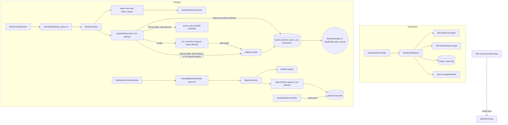

# Design Document

## Overview

S05 adds two user-facing surfaces and the services behind them:

1. **Today (dashboard)**: deterministic figures assembled by `DashboardMetrics` from S03's `ReportingCoverage` and S04's `MetricCalculator` and `issues` table. There are no task KPIs and no Staff summary in S05; S07 extends `DashboardMetrics` with them (R7).
2. **Executive Brief**: an on-demand, AI-worded summary of up to five open Issues. `BriefGenerator` selects and ranks evidence that S04 already computed, asks the Provider only to write a title and an explanation per finding, validates that response against a schema and a number allow-list, and falls back to a deterministic brief when the Provider is unavailable or its output cannot be trusted. `SpeechService` turns the finished brief text into audio, streamed back through an authorized route.

Everything numeric is decided by existing S03 and S04 code. S05 adds no arithmetic of its own. AI output is restricted to natural-language wording and is checked against the same evidence before it is shown.

### Priority tiers (R1)

| Tier | Contents |
|---|---|
| [PoV Core] | Dashboard KPIs (revenue, change, target achievement, open and high-priority Issue counts; no task KPIs), revenue-vs-target chart, freshness banner, Brief generate, view and fallback, voice generation and `AudioPlayer`, authorized audio stream, Brief history list, events `BriefGenerated` and `BriefFailed`, `ExecutiveIntelligenceTest` |
| [PoV Polish] | Weekly-change chart, resolved-in-30-days KPI, priority actions list, regenerate audio, explicit range-request support, Issue detail brief links, events `BriefRequested` and `BriefAudioGenerated` |

### Decisions fixed for this design

| # | Gap | Decision |
|---|---|---|
| G1 | Task KPIs (R7) | None in S05. No `TaskMetricsReader`, no null reader. S07 adds `openTaskCount`, `overdueTaskCount` and the Staff summary to `DashboardMetrics`. Staff visiting Today see an `EmptyState`. |
| G2 | Where `DashboardMetrics` lives | `app/Services/Dashboard/DashboardMetrics.php`. It depends on `MetricCalculator`, `ReportingCoverage` and a read-only query of `issues`. It reads the maximum `rule_evaluations.evaluated_at` of the department only to state when intelligence was last refreshed. Nothing else in S05 queries `sales_records`. |
| G3 | `briefs` has no `department_id` (A1) | Confirmed. A Manager's Brief is scoped at generation time (candidate Issues filtered to the Manager's department) and at read time `BriefPolicy` lets any Owner or Manager of the company view any Brief of that company. |
| G4 | Dashboard payload for Staff (Req 7.3-7.4) | `DashboardController` picks the shape by role before calling `DashboardMetrics`. A Staff response is `['audience' => 'staff']` with no data prop and never touches `ReportingCoverage` or `issues`. |
| G5 | `source_ref` format (Req 9.6) | `"issue:{issueId}:evaluation:{evaluationId}"`. |
| G6 | Headline and summary templates (Req 10.3, 12) | Deterministic string templates in `BriefSummaryComposer` (below). No AI involvement. |
| G7 | Spoken text (Req 18.3) | `SpeechService` builds spoken text from the same `BriefPresenter` that renders the Brief page. |
| G8 | Dashboard week vs S04 evaluation week (R2) | Both use `ReportingCoverage::latestClosedWeek`. The dashboard does not search back for an older complete week. If the latest closed week is incomplete or absent, the dashboard shows insufficient data, exactly as S04 produces `insufficient_data`. The dashboard figures and the evidence of an open Issue therefore describe the same week. |
| G9 | Retry layering (R6) | `OpenAiClient` makes one HTTP attempt per call. The queue job retries. Details below. |
| G10 | Issue detail brief links (R7) | `IssueController::show` gains a `briefs` prop, built by `BriefsForIssue`. `Issues/Show.vue` includes `RelatedBriefsPanel.vue`. No registry or provider interface. |
| G11 | Coverage status (R2) | `stale` when Freshness is `behind` (or no sales data), else `partial` when the latest closed week is `incomplete` or `absent`, else `sufficient`. The 7-day threshold no longer exists. |

## Architecture



### Module layout

```
app/
  Services/Dashboard/DashboardMetrics.php
  Services/AI/
    OpenAiClient.php                 (shared; S06 reuses it)
    Exceptions/{RecoverableProviderException,ProviderException}.php
    BriefGenerator.php
    SpeechService.php
    BriefSummaryComposer.php
    BriefPresenter.php
    NumberAllowListChecker.php
  Services/Briefing/BriefsForIssue.php               [PoV Polish]
  Models/{Brief,BriefItem}.php
  Enums/{BriefStatus,BriefSource,CoverageStatus,AudioStatus}.php
  Jobs/{GenerateBriefJob,GenerateBriefAudioJob}.php
  Events/Briefing/{BriefGenerated,BriefFailed}.php   (Core)
  Events/Briefing/{BriefRequested,BriefAudioGenerated}.php  (Polish)
  Policies/BriefPolicy.php
  Http/Controllers/{DashboardController,BriefController,BriefAudioController,AudioStreamController}.php
  Http/Requests/{GenerateBriefRequest,RetryBriefRequest,GenerateBriefAudioRequest}.php
config/ai.php                        (extended: speech keys)
resources/js/pages/{Dashboard/Index.vue,Briefs/{Index,Show}.vue}
resources/js/components/{InsufficientDataNotice.vue,AudioPlayer.vue}
resources/js/components/briefs/RelatedBriefsPanel.vue   [PoV Polish]
tests/Feature/ExecutiveIntelligenceTest.php
```

## Components and Interfaces

### DashboardMetrics

Pure assembly, one public method per audience that has content, no new arithmetic.

```php
final class DashboardMetrics
{
    public function __construct(
        private MetricCalculator $calc,       // S04
        private ReportingCoverage $coverage,  // S03
    ) {}

    public function forOwnerOrManager(Company $company, Department $department): DashboardData
    {
        $latest = $this->coverage->latestClosedWeek($department);                    // WeekState
        $previous = $this->coverage->weekState($department, $latest->weekStart->subWeek());
        $freshness = $this->coverage->freshness($department);

        return new DashboardData(
            revenue: $this->revenueFigure($department, $latest, $previous),          // Req 2
            targetAchievement: $this->targetFigure($department, $latest),
            freshness: $freshness,                                                    // Req 3
            lastEvaluationTime: $this->lastEvaluationTime($department),
            coverageNotice: $this->coverageNotice($latest),                           // Req 3.5
            openIssueCount: $this->countOpenIssues($department),
            highPriorityIssueCount: $this->countOpenIssues($department, 'high'),
            revenueVsTarget: $this->revenueVsTargetSeries($department),               // Req 4.1, 4.3
            latestBrief: Brief::where('company_id', $company->id)->completed()
                               ->latest('generated_at')->first(),
            // [PoV Polish], filled by the polish task:
            weeklyChange: $this->weeklyChangeSeries($department),                     // Req 4.2, 4.7
            resolvedIssueCount: $this->countResolvedWithin30Days($department),        // Req 1.6
            priorityActions: $this->priorityActions($department),                     // Req 5.1
        );
    }
}
```

For an Owner of a company, `$department` is the company's Sales department (A1). The Staff path does not call `DashboardMetrics`.

`revenueFigure` rules (Req 2):

| Condition | Result |
|---|---|
| `$latest->completeness === absent` | revenue, change and target all `InsufficientData('period_absent')` |
| `$latest->completeness === incomplete` | all `InsufficientData('incomplete_period')` |
| complete, `$previous->completeness !== complete` | revenue and target shown; change `InsufficientData('comparison_week_incomplete')` |
| complete, `MetricCalculator::weeklyChangePct` returns `ZERO_DENOMINATOR` | change `InsufficientData('zero_denominator')` |
| complete, target total is zero | target achievement `InsufficientData('zero_denominator')` |

Revenue and target totals come from `MetricCalculator::weekTotals($department, $latest->weekStart)`; change from `weeklyChangePct`; target achievement from `targetAchievementPct`; display values from `display2`. An open week is never used. Every figure carries `periodStart` and `periodEnd` from the `WeekState` (Req 1.8).

`coverageNotice` (Req 3.5): when `$latest->completeness === incomplete`, returns `count($latest->gaps)` branch-days missing.

`lastEvaluationTime`: `RuleEvaluation::whereHas('rule', fn ($q) => $q->where('department_id', ...))->max('evaluated_at')`, or null.

`revenueVsTargetSeries` (Req 4.1, 4.3): one call to `ReportingCoverage::weekStates($department, $from, $to)` over the last 8 closed ISO weeks that contain Active_Records, plus `weekTotals` per complete week. Each point is `{weekStart, weekEnd, revenue, target, isComplete}`. Incomplete closed weeks carry `revenue = null` and render as a gap labelled "Incomplete". Open weeks are excluded. No closed week with Active_Records gives an empty series and the notice of Req 4.8.

`weeklyChangeSeries` [PoV Polish]: a point has a value only when the week and the preceding week are both closed and complete (`weeklyChangePct` over the two `weekTotals`), otherwise null. Fewer than 2 closed weeks gives `InsufficientData`.

`countOpenIssues` queries `issues` with `status <> 'resolved'`, scoped by department. `countResolvedWithin30Days` [PoV Polish] filters `resolved_at` between `today - 30 days` and today. `priorityActions` [PoV Polish] returns the top 5 Open_Issues by severity desc then `last_detected_at` desc, mapped to `{issueId, title, severity, status, periodLabel, url}`.

The Dashboard Core slice links the open and high-priority counts to the Issues list with filters, which stands in for the priority actions list until the Polish task is built.

### Freshness banner

`ReportingCoverage::freshness()` provides everything. The Vue banner is rendered when `state === 'behind'`:

- With a `latestSalesDate`: "Sales for {overdueFrom}–{overdueTo} not yet received: {overdueBranchDays} branch-days overdue" (for example "Sales for 21–26 Sep not yet received: 18 branch-days overdue"), followed by "Intelligence has not been refreshed since {lastEvaluationTime}" or "No evaluation has run yet".
- With no `latestSalesDate`: "No sales data yet" with a link to Data Imports.

The banner is computed live from the business clock. It creates no Issue, alert or notification.

### BriefGenerator pipeline

```php
final class BriefGenerator
{
    public function __construct(
        private OpenAiClient $client,
        private NumberAllowListChecker $numberCheck,
        private BriefSummaryComposer $summary,
        private ReportingCoverage $coverage,
    ) {}

    /** Throws RecoverableProviderException when the caller should let the queue retry. */
    public function generate(Brief $brief, bool $finalAttempt): void
    {
        $department = $this->departmentFor($brief);                                    // Manager scope or company Sales department
        $candidates = Issue::query()->openLike()->scopedTo($brief->scopeDepartment)
            ->orderByDesc('severity')->orderByDesc('last_detected_at')->orderBy('id')   // Req 9.2
            ->limit(5)->get();                                                          // Req 9.3

        $context = $this->coverageContext($department);                                // WeekState, Freshness, lastEvaluationTime
        $coverageStatus = $this->coverageStatus($context);                             // G11
        $items = $candidates->map(fn ($issue, $i) => $this->buildDraftItem($issue, $i + 1)); // Req 9.4-9.7

        $wording = null;
        $reason = null;
        if ($items->isNotEmpty() && $this->providerConfigured()) {                      // Req 12.5, 13.5
            try {
                $wording = $this->requestWording($brief, $items);                       // may be null after corrective failure
                $reason = $wording === null ? 'invalid_response' : null;
            } catch (RecoverableProviderException $e) {
                if (! $finalAttempt) throw $e;                                          // queue retries (R6)
                $reason = $e->errorCode();
            } catch (ProviderException $e) {
                $reason = $e->errorCode();
            }
        }

        DB::transaction(function () use ($brief, $items, $wording, $reason, $coverageStatus, $context) {
            $this->persist($brief, $items, $wording, $reason, $coverageStatus, $context);
        });
        // BriefGenerated dispatched after commit by the job.
    }
}
```

**Selection and ranking (Req 9)**: the `issues` table contains only breached Issues, so 9.8 holds structurally. The Issue id tiebreaker makes the Brief deterministic.

**Draft item construction**: `buildDraftItem` calls `IssueEvidence::forIssue($issue)` (never `sales_records`), copies `toArray()` into the item's own `evidence` value, and sets `issue_id`, `rule_evaluation_id` (`latest_evaluation_id`), `severity`, `period_label`, and `source_ref` (G5). A later evaluation does not alter a persisted item because the copy is a value.

**Provider request (Req 11, 16)**: sends per item only `{position, metricName, periodLabel, currentValue, comparisonValue, differencePct, severity}` taken from the evidence, plus the Coverage_Status, as delimited untrusted data, with an instruction forbidding invented figures, causes, forecasts and recommendations. The JSON schema is `{items: [{position, title, explanation}]}`.

**Validation**: Laravel Validator requires exactly one entry per supplied position, a non-empty title of at most 120 characters, a non-empty explanation of at most 400 characters. `NumberAllowListChecker::passes(wording, items)` extracts numeric tokens, normalizes thousands separators, and requires each token to be in that item's Evidence_Set (decimal strings, dates and integers flattened from its `evidence`).

**Corrective request**: on a validation or number-check failure the generator sends one corrective request naming the failed constraint, inside the same job attempt, without consuming `$tries`. If that fails too, `requestWording` returns null and the Fallback_Brief is built.

**Fallback**: each item's title is the Issue title and the explanation is `"{metricName} was {currentValue} against {comparisonValue} ({differencePct}%) for {periodLabel}."`, built only from the evidence. `source = fallback`, `model = null`, `error_message` is the sanitized code (null when no provider call was attempted). Status is `completed`.

**Persistence**: the Brief fields and all Brief_Items are written in one `DB::transaction`, so no partial AI output is stored (Req 11.8).

### Coverage status and summary templates

`coverageStatus` (G11), computed from S03 values:

```
if freshness.state == behind or freshness.latestSalesDate == null: stale
elif latestClosedWeek.completeness in (incomplete, absent):        partial
else:                                                               sufficient
```

`BriefSummaryComposer::compose($items, $coverageStatus, $context)` selects among fixed templates. All figures come from `WeekState` and `Freshness`.

| Items | Status | Text |
|---|---|---|
| 0 | sufficient | "No active issues were found." |
| 0 | partial | "No active issues were found. The latest closed week ({weekStart}–{weekEnd}) has {missing} missing branch-days; results cover incomplete data." (absent: "has no sales data") |
| 0 | stale, no sales date | "No sales data yet." |
| 0 | stale | "No active issues were found. Sales for {overdueFrom}–{overdueTo} not yet received: {overdueBranchDays} branch-days overdue. Latest sales date is {latestSalesDate}. {intelligenceClause}" |
| >0 | sufficient | "{n} issue(s) need attention." |
| >0 | partial | "{n} issue(s) need attention. The latest closed week ({weekStart}–{weekEnd}) has {missing} missing branch-days; results cover incomplete data." |
| >0 | stale | "{n} issue(s) need attention. Sales for {overdueFrom}–{overdueTo} not yet received: {overdueBranchDays} branch-days overdue. Latest sales date is {latestSalesDate}. {intelligenceClause}" |

`intelligenceClause` is "Intelligence was last refreshed {time}." or "No evaluation has run yet." The `headline` is the first sentence. The Limitation_Text is every sentence after the first for non-sufficient statuses, and is shown in an `Alert` above the Findings.

### OpenAiClient (R6 layering)

One thin client shared by `BriefGenerator`, `SpeechService`, and S06. It makes one HTTP attempt per call. It does not retry and does not sleep.

```php
final class OpenAiClient
{
    public function __construct(private readonly array $config /* config('ai') */) {}

    public function chat(ChatRequest $request): ChatResponse
    {
        return $this->send('/chat/completions', [
            'model' => $this->config['text_model'],
            'messages' => $request->messages,
            'response_format' => ['type' => 'json_schema',
                'json_schema' => ['name' => 'brief_items', 'strict' => true, 'schema' => $request->schema]],
        ], timeoutSeconds: 30, requestType: 'chat', briefId: $request->briefId);
    }

    public function speech(SpeechRequest $request): SpeechResponse
    {
        return $this->send('/audio/speech', [
            'model' => $this->config['speech_model'],
            'voice' => $this->config['speech_voice'],
            'input' => $request->text,
        ], timeoutSeconds: 60, requestType: 'speech', briefId: $request->briefId, expectBinary: true);
    }

    private function send(string $path, array $body, int $timeoutSeconds, string $requestType, int $briefId, bool $expectBinary = false): mixed
    {
        $started = microtime(true);
        try {
            $response = Http::baseUrl($this->config['base_url'])->withToken($this->config['api_key'])
                ->timeout($timeoutSeconds)->post($path, $body);
        } catch (ConnectionException) {
            $this->log($requestType, $briefId, null, $started);
            throw new RecoverableProviderException('timeout');             // timeout or connection failure
        }
        $status = $response->status();
        $this->log($requestType, $briefId, $status, $started);              // type, brief id, status, duration only

        if ($status === 429)  throw new RecoverableProviderException('rate_limited');
        if ($status >= 500)   throw new RecoverableProviderException('server_error');
        if (! $response->successful()) throw new ProviderException('client_error');
        return $expectBinary ? SpeechResponse::fromBinary($response->body()) : ChatResponse::fromJson($response->json()); // malformed -> ProviderException('invalid_response')
    }
}
```

- Built on the Laravel `Http` facade; no AI SDK (Req 15.1). All model, voice, base URL and key values come from `config('ai.*')` (Req 15.2).
- Exceptions carry only a fixed code (`timeout`, `rate_limited`, `server_error`, `client_error`, `invalid_response`) and a message derived from that code. They never contain the API key, a request or response body, or evidence values (Req 15.7-15.8).
- A response that cannot be parsed raises `ProviderException('invalid_response')` immediately. The corrective request of Requirement 11.6 applies only to a parsed response that fails validation or the Number_Check, so an unparsable body goes to the fallback path.
- `.env.example` lists `AI_BASE_URL`, `AI_TEXT_MODEL`, `AI_SPEECH_MODEL`, `AI_SPEECH_VOICE`, `OPENAI_API_KEY` with empty values.

### Jobs (R6)

```php
final class GenerateBriefJob implements ShouldQueue, ShouldBeUnique
{
    use Queueable;
    public int $timeout = 60;      // HTTP 30 s, plus one corrective request within the budget
    public int $tries = 3;
    public int $uniqueFor = 900;

    public function __construct(public int $briefId) { $this->onQueue('ai'); $this->afterCommit(); }
    public function uniqueId(): string { return (string) Brief::findOrFail($this->briefId)->company_id; }
    public function backoff(): array { return [10, 30, 60]; }

    public function handle(BriefGenerator $generator): void
    {
        $brief = Brief::findOrFail($this->briefId);
        if (in_array($brief->status, [BriefStatus::Completed, BriefStatus::Failed], true)) return;   // Req 8.7
        $brief->update(['status' => BriefStatus::Generating]);
        try {
            $generator->generate($brief, finalAttempt: $this->attempts() >= $this->tries);
        } catch (RecoverableProviderException $e) {
            throw $e;                                                       // queue retries with backoff
        } catch (Throwable $e) {
            $this->markFailed($brief, $e);                                  // status failed, sanitized message, BriefFailed after commit
            return;
        }
        DB::afterCommit(fn () => event(new BriefGenerated(...)));
    }

    public function failed(Throwable $e): void { /* status failed, sanitized code, BriefFailed after commit */ }
}
```

`GenerateBriefAudioJob` has the same shape: queue `ai`, `$timeout` 90 (HTTP 60), `$tries` 3, `backoff()` `[10, 30, 60]`, `uniqueFor` 900, `uniqueId()` is the Brief id, `afterCommit`. A `RecoverableProviderException` before the final attempt is rethrown; on the final attempt, or on a `ProviderException`, the job sets `audio_status = failed` (or keeps previous audio, see below). The worker runs under the `bp-ai` Supervisor program.

Worst case, one user action causes 3 provider call attempts, never multiplied, because only the job retries. The idempotent item creation (delete items of the Brief then insert, inside the transaction) makes a retried or duplicated job yield one set of items (Req 14.5).

Dispatch happens from `BriefController::store` after the creating transaction commits (`afterCommit`). The Brief ends `failed` only for non-provider failures or when `failed()` runs after exhausted attempts. A Provider outage ends with a completed Fallback_Brief. A failed Brief shows the sanitized reason and a manual Retry (Req 14).

### SpeechService and audio storage

```php
final class SpeechService
{
    public function __construct(private OpenAiClient $client, private BriefPresenter $presenter) {}

    public function generate(Brief $brief): void
    {
        $text = $this->presenter->spokenText($brief);                      // same blocks as the page (G7)
        $audio = $this->client->speech(new SpeechRequest($brief->id, $text));
        $newPath = 'briefs/audio/' . Str::random(40) . '.mp3';
        Storage::disk('local')->put($newPath, $audio->bytes);

        $oldPath = $brief->audio_path;
        $brief->forceFill(['audio_path' => $newPath, 'audio_model' => config('ai.speech_model'),
            'audio_voice' => config('ai.speech_voice'), 'audio_status' => AudioStatus::Ready])->save();
        if ($oldPath && $oldPath !== $newPath) {                            // [PoV Polish] regenerate
            Storage::disk('local')->delete($oldPath);
        }
    }
}
```

`BriefPresenter::spokenText()` and `displayText()` share the same building blocks: headline, summary, then for each item in position order the title, explanation and figures formatted by the server from `evidence`.

**Regenerate [PoV Polish]**: the new file is written and `audio_path` updated before the old file is deleted. If the provider fails and a previous file exists, the job leaves `audio_path` and `audio_status = ready` untouched and sets a `regeneration_failed` flag shown as a message. `failed()` sets `audio_status = failed` only when no previous audio file exists. In the Core slice, generate and retry apply to Audio_Status `none` and `failed`.

### Audio streaming

```php
final class AudioStreamController
{
    public function show(Request $request, Brief $brief)
    {
        $this->authorize('viewAudio', $brief);                                // Staff: 403
        abort_unless($brief->company_id === $request->user()->company_id && $brief->audio_path, 404);
        return response()->file(Storage::disk('local')->path($brief->audio_path), ['Content-Type' => 'audio/mpeg']);
    }
}
```

No public URL is generated. The route is throttled per user. Explicit verification of HTTP range requests (206 and `Content-Range`, seeking) is [PoV Polish]; `response()->file` is a Symfony `BinaryFileResponse`, which handles `Range` headers.

### Issue detail brief links [PoV Polish]

`IssueController::show` appends one prop, in line with S04's composition contract (R7):

```php
'briefs' => $this->briefsForIssue->forIssue($issue, $request->user()),
```

```php
final class BriefsForIssue
{
    public function forIssue(Issue $issue, User $user): ?array
    {
        if ($user->role === Role::Staff) return null;
        return Brief::where('company_id', $user->company_id)->completed()
            ->whereHas('items', fn ($q) => $q->where('issue_id', $issue->id))
            ->orderByDesc('generated_at')->limit(5)->get()
            ->map(fn ($b) => ['briefId' => $b->id, 'headline' => $b->headline, 'generatedAt' => $b->generated_at,
                              'source' => $b->source, 'url' => route('briefs.show', $b)])->all();
    }
}
```

`Issues/Show.vue` includes `RelatedBriefsPanel.vue`, which renders the list with escaped text or a short empty text when the list is empty. S05 does not change any other S04 behavior.

### Dashboard page and Inertia props

```php
public function index(Request $request): Response
{
    $user = $request->user();
    if ($user->role === Role::Staff) {
        return Inertia::render('Dashboard/Index', ['audience' => 'staff']);
    }
    $department = $user->role === Role::Manager ? $user->department : $user->company->salesDepartment();
    return Inertia::render('Dashboard/Index', ['audience' => 'owner_manager',
        'data' => $this->metrics->forOwnerOrManager($user->company, $department)]);
}
```

`Dashboard/Index.vue`: the staff branch renders only an `EmptyState`. The Owner and Manager branch renders the KPI row (revenue, change, target achievement, open Issues, high priority; each money figure labelled with its dates), the freshness banner, the coverage notice, the revenue-vs-target `EChart` with a text table, the latest-Brief card, and `InsufficientDataNotice` wherever a figure is insufficient. [PoV Polish] adds the weekly-change chart, the resolved KPI card and the priority actions list. Skeletons and `ErrorState` apply to `router.reload({ only: ['data'] })`.

### Briefs pages

- `Briefs/Index.vue`: paginated list (15 per page, `created_at` desc), `EmptyState` with Generate Brief.
- `Briefs/Show.vue`: polls every 3 seconds while `status` is `queued` or `generating`; shows status, Limitation_Text `Alert`, Findings with links, labels ("AI generated", "AI unavailable", "Generated from stored data"), the Provider notice, and `AudioPlayer` with its own 3-second poll while `audio_status` is `queued` or `generating`. All text is escaped; no `v-html`.

## Data Models

Per `docs/data-model.md`, S05 implements `briefs` and `brief_items`. This design adds constraint and index detail.

### `briefs`

| Column | Type | Notes |
|---|---|---|
| id | bigint PK | |
| company_id | bigint FK → companies | no `department_id` (A1) |
| requested_by | bigint FK → users, nullable | |
| status | varchar | check: `queued`, `generating`, `completed`, `failed` |
| source | varchar, nullable | check: `ai`, `fallback` |
| as_of_date | date, nullable | `BusinessClock::today()` at request time |
| period_start, period_end | date, nullable | Monday and Sunday of the Latest_Closed_Week, or both null |
| coverage_status | varchar, nullable | check: `sufficient`, `partial`, `stale` |
| headline, summary_text | text, nullable | deterministic |
| input_snapshot | jsonb, nullable | verified metrics and evidence sent to the Provider, plus latest sales date and last evaluation time; no personal data |
| model | varchar, nullable | |
| error_message | text, nullable | sanitized only |
| audio_status | varchar | check: `none`, `queued`, `generating`, `ready`, `failed`; default `none` |
| audio_path, audio_model, audio_voice | varchar, nullable | |
| generated_at | timestamp, nullable | |
| created_at, updated_at | timestamp | |

Indexes: `(created_at)`; `(company_id, status)`.

### `brief_items`

| Column | Type | Notes |
|---|---|---|
| id | bigint PK | |
| brief_id | bigint FK → briefs, cascade delete | |
| position | smallint | check 1 to 5 |
| issue_id | bigint FK → issues, nullable, nullOnDelete | |
| rule_evaluation_id | bigint FK → rule_evaluations, nullable, nullOnDelete | |
| title | varchar(120) | |
| explanation | varchar(400) | |
| severity | varchar | check: `low`, `medium`, `high`, `critical` |
| period_label | varchar | |
| evidence | jsonb | copy of `IssueEvidence::toArray()` |
| source_ref | varchar | G5 |
| created_at, updated_at | timestamp | |

Unique `(brief_id, position)`.

### Migrations

```php
Schema::create('briefs', function (Blueprint $t) {
    $t->id();
    $t->foreignId('company_id')->constrained();
    $t->foreignId('requested_by')->nullable()->constrained('users');
    $t->string('status')->default('queued');
    $t->string('source')->nullable();
    $t->date('as_of_date')->nullable();
    $t->date('period_start')->nullable();
    $t->date('period_end')->nullable();
    $t->string('coverage_status')->nullable();
    $t->text('headline')->nullable();
    $t->text('summary_text')->nullable();
    $t->jsonb('input_snapshot')->nullable();
    $t->string('model')->nullable();
    $t->text('error_message')->nullable();
    $t->string('audio_status')->default('none');
    $t->string('audio_path')->nullable();
    $t->string('audio_model')->nullable();
    $t->string('audio_voice')->nullable();
    $t->timestamp('generated_at')->nullable();
    $t->timestamps();
    $t->index('created_at');
    $t->index(['company_id', 'status']);
});
DB::statement("ALTER TABLE briefs ADD CONSTRAINT briefs_status_check CHECK (status IN ('queued','generating','completed','failed'))");
DB::statement("ALTER TABLE briefs ADD CONSTRAINT briefs_source_check CHECK (source IS NULL OR source IN ('ai','fallback'))");
DB::statement("ALTER TABLE briefs ADD CONSTRAINT briefs_coverage_check CHECK (coverage_status IS NULL OR coverage_status IN ('sufficient','partial','stale'))");
DB::statement("ALTER TABLE briefs ADD CONSTRAINT briefs_audio_status_check CHECK (audio_status IN ('none','queued','generating','ready','failed'))");
DB::statement("ALTER TABLE briefs ADD CONSTRAINT briefs_period_pair_check CHECK ((period_start IS NULL) = (period_end IS NULL))");

Schema::create('brief_items', function (Blueprint $t) {
    $t->id();
    $t->foreignId('brief_id')->constrained()->cascadeOnDelete();
    $t->unsignedTinyInteger('position');
    $t->foreignId('issue_id')->nullable()->constrained('issues')->nullOnDelete();
    $t->foreignId('rule_evaluation_id')->nullable()->constrained('rule_evaluations')->nullOnDelete();
    $t->string('title', 120);
    $t->string('explanation', 400);
    $t->string('severity');
    $t->string('period_label');
    $t->jsonb('evidence');
    $t->string('source_ref');
    $t->timestamps();
    $t->unique(['brief_id', 'position']);
});
DB::statement("ALTER TABLE brief_items ADD CONSTRAINT brief_items_position_check CHECK (position BETWEEN 1 AND 5)");
DB::statement("ALTER TABLE brief_items ADD CONSTRAINT brief_items_severity_check CHECK (severity IN ('low','medium','high','critical'))");
```

`down()` drops `brief_items`, then `briefs`.

### `config/ai.php`

```php
return [
    'base_url' => env('AI_BASE_URL'),
    'api_key' => env('OPENAI_API_KEY'),
    'text_model' => env('AI_TEXT_MODEL'),
    'speech_model' => env('AI_SPEECH_MODEL'),
    'speech_voice' => env('AI_SPEECH_VOICE'),
];
```

An empty `speech_model` hides audio actions and shows "Voice is not configured".

## Correctness Properties

Per R5, S05 keeps only the cases covered by `ExecutiveIntelligenceTest`. Each is a plain fixture-based example, not a property-based test.

1. **Number allow-list**: `NumberAllowListChecker` rejects text whose numbers are not in the Evidence_Set, and accepts text whose numbers all are (Requirement 11.5).
2. **Fallback uses only evidence**: the fallback explanation and `BriefSummaryComposer` output contain only figures from the evidence and the S03 `WeekState` and `Freshness` values (Requirements 10.3, 12, 13.2).
3. **Evidence copy**: Brief_Item `evidence` equals the Issue's evidence at generation time and does not change after a later evaluation (Requirements 9.4, 9.7).
4. **Authorization**: a Staff user cannot generate a Brief (403) and the audio route denies Staff and other-company users (Requirements 8.5, 19.2, 19.3).

## Error Handling

| Layer | Failure | Handling |
|---|---|---|
| `DashboardMetrics` | incomplete or absent latest closed week | `InsufficientData` with `incomplete_period` or `period_absent` |
| `DashboardMetrics` | no sales data | "No sales data yet" with Import link |
| `GenerateBriefJob` | Brief already `completed` or `failed` | exits without changes (Req 8.7) |
| `GenerateBriefJob` | concurrent request | rejected in the controller (Req 8.3); `ShouldBeUnique` is a second guard |
| `BriefGenerator` | validation or Number_Check failure after the corrective request | Fallback_Brief, no AI text persisted |
| `BriefGenerator` | `RecoverableProviderException`, attempts left | rethrown; queue retries with backoff 10, 30, 60 s |
| `BriefGenerator` | `RecoverableProviderException`, final attempt | Fallback_Brief with sanitized code |
| `BriefGenerator` | `ProviderException` (4xx, invalid response) | Fallback_Brief immediately, no retry |
| `GenerateBriefJob` | any other exception | status `failed`, sanitized message, `BriefFailed` after commit |
| `GenerateBriefJob` | attempts exhausted | `failed()` sets `failed`, dispatches `BriefFailed` |
| `BriefController::retry` | Brief not `failed` | validation error |
| `GenerateBriefAudioJob` | recoverable, attempts left | rethrown; queue retries |
| `GenerateBriefAudioJob` | final attempt or `ProviderException`, no previous audio | `audio_status = failed`, manual Retry |
| `GenerateBriefAudioJob` | same, previous audio exists [PoV Polish] | previous file and status `ready` kept, regeneration-failed message |
| `BriefAudioController` | Brief not `completed` | validation error |
| `AudioStreamController` | other company or no file | 404 |
| `AudioStreamController` | Staff | 403 |
| Routes | throttle exceeded | 429 |
| `OpenAiClient` | any provider error | sanitized coded exception; no body or key in logs |
| Logging | any S05 log line | request type, Brief id, status code, duration only |

## Security

- Every S05 route requires session authentication and CSRF, validated by a Form Request.
- `BriefPolicy`: Owner company-wide, Manager department-scoped generation, Staff denied (403) on every Briefing action. The Staff Dashboard payload contains no data at all, so exclusion happens in the controller, not only the policy.
- `Brief` queries are scoped by `company_id` before authorization so a cross-company id returns 404.
- Brief text is rendered with Vue escaping; no `v-html`.
- The API key, request and response bodies and evidence values never reach logs, Inertia props, `input_snapshot` or `error_message`. `input_snapshot` is a copy of what was sent to the Provider.
- AI-calling routes (generate, retry, audio request) and the audio stream route are throttled per user.

## Testing Strategy

Per `docs/stage-1-refinements.md` R5, S05 includes one small [PoV Core] feature test group. It uses Laravel's test framework with `RefreshDatabase` on the PostgreSQL scratch database. `Http::preventStrayRequests()` is enabled, so no test calls the external Provider.

`tests/Feature/ExecutiveIntelligenceTest.php`:

| Test | Checks |
|---|---|
| `number_allow_list_rejects_numbers_not_in_evidence` | text containing `99,999.00` against the W8 decline evidence is rejected; text with only `124,000.00`, `155,000.00` and `-20.00` passes |
| `fallback_summary_uses_only_evidence_figures` | `BriefSummaryComposer` and the fallback explanation for the W8 decline Issue contain only figures present in the evidence and the `WeekState` and `Freshness` values; the stale template states the overdue range and branch-days |
| `brief_item_evidence_is_copied_from_rule_evaluations` | with no API key configured, generating a Brief gives items whose `evidence` equals `IssueEvidence::forIssue()->toArray()`; after a further evaluation the stored item is unchanged |
| `staff_cannot_generate_a_brief` | Staff POST to the generate route returns 403 and creates no Brief |
| `audio_route_denies_unauthorized_users` | Staff gets 403, a user of another company gets 404, a guest is redirected to login |

Everything else is verified manually, against the fixtures of `docs/demo-scenario.md`:

| Step | State | Check | Expected |
|---|---|---|---|
| 1 | clock 2026-09-28, after `history.csv` | Dashboard revenue (W7) | W7 155,000.00 vs W6, change **+0.65%**, target achievement **99.36%**, labelled with W7 dates |
| 1 | same | Freshness banner | "Sales for 21–26 Sep not yet received: 18 branch-days overdue", plus the intelligence-refresh statement |
| 1 | same | Generate Brief | zero items, `coverage_status = stale`, Limitation_Text states the overdue range and branch-days, `source = fallback`, "Generated from stored data" |
| 2 | after `week8-decline.csv` | Dashboard | W8 124,000.00, change **-20.00%**, target achievement **79.49%**, freshness current, banner absent |
| 2 | same | Generate Brief (key configured) | 2 items (decline first, shortfall second), `coverage_status = sufficient`, every number in each explanation appears in its evidence |
| 2 | no `OPENAI_API_KEY` | Generate Brief | `source = fallback`, "AI unavailable", no provider call |
| 2 | same | Audio generate | `queued`, `generating`, `ready`, player plays; spoken text equals displayed text |
| 3 | after `week8-with-errors.csv` | Dashboard | `incomplete_period` notice, coverage notice with the missing branch-day count, Brief `coverage_status = partial` |
| 4 | Staff login | Dashboard | `EmptyState` only; no sales, Issue, Brief or Freshness in the Inertia props |
| 5 | Staff direct URL | Briefs and audio routes | 403 |
| 6 | other-company id | Brief and audio routes | 404 |

Provider failure drills: invalid API key (`ProviderException`, immediate fallback), timeout, HTTP 429, HTTP 5xx (each: queue retries at 10 s, 30 s, then final-attempt fallback), invalid JSON (`ProviderException` `invalid_response`, fallback), invented number (one corrective request, then fallback).

Responsive checks at 360, 768 and 1280 pixels. Concurrency check: two generation requests within one second create one Brief.

### Documentation follow-up (Req 23.6)

- `docs/architecture.md`: the S05 events and their tiers, the `briefs` prop on the Issue detail page, the AI data flow (what is sent and stored; fictional data until client authorization), the retry layering (client one attempt, job `$tries` 3, backoff 10, 30, 60 s, queue `ai`), and the Coverage_Status definition.
- `docs/data-model.md`: the check constraints and indexes of `briefs` and `brief_items`, and the freshness-based `coverage_status` meaning.
