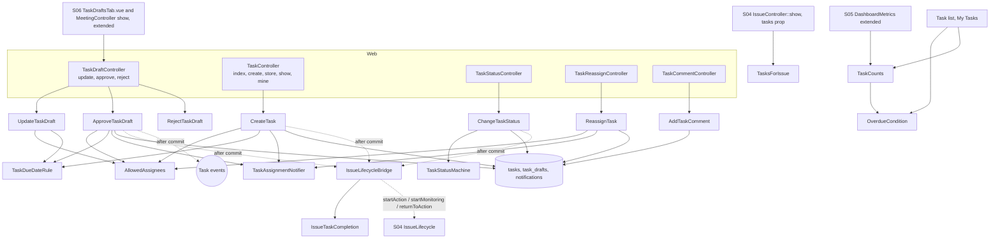
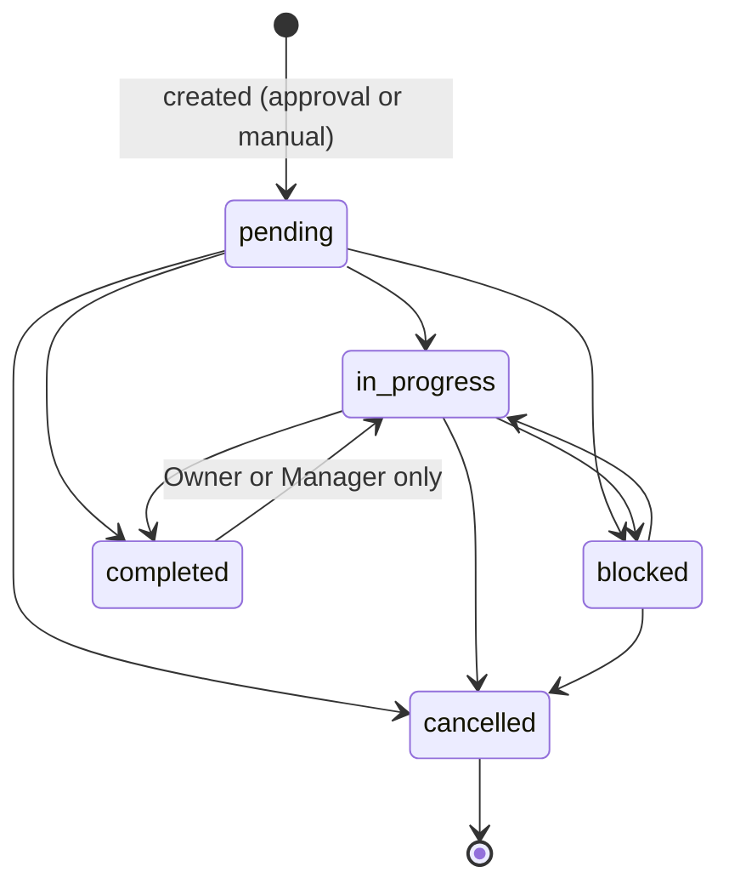

# Design Document

## Overview

S07 turns the Task_Drafts that S06 produced into accountable Tasks, and lets the assigned employee carry each Task to completion. AI is not involved anywhere in S07. A Task exists only because a person approved a draft or created it by hand.

The design rests on four mechanisms:

1. **One write path per fact.** `ApproveTaskDraft` is the only code that turns a draft into a Task. `TaskStatusMachine` is the only code that writes `tasks.status`. `AllowedAssignees` and `TaskDueDateRule` are the only definitions of who can be assigned and which dates are valid, and every action (edit, approve, manual create, reassign) calls them.
2. **Row lock plus unique constraints for idempotency.** Approval locks the draft row with `SELECT ... FOR UPDATE`, re-reads the status under the lock, and relies on `tasks.task_draft_id` and `task_drafts.task_id` unique constraints as a backstop. A second approval returns the existing Task and causes no side effects.
3. **Compare-and-set for status changes.** Every transition is `UPDATE tasks SET status = :to ... WHERE id = :id AND status = :from`, so two racing requests cannot both win.
4. **Side effects after commit.** Events use `ShouldDispatchAfterCommit`. The `IssueLifecycle` call runs after the transaction commits, and a failure there never undoes a Task.

S07 follows R7: it defines no cross-spec contract. It does not bind `IssueTaskStateReader`, `TaskMetricsReader`, `MeetingDraftsTabProvider` or `IssuePanelProvider`. Instead it (a) extends S05's `DashboardMetrics` with the Task KPIs and the Staff summary, (b) evaluates "all non-cancelled linked Tasks completed and at least one completed" itself and calls the pure S04 `IssueLifecycle` methods `startAction`, `startMonitoring` and `returnToAction`, (c) appends a `tasks` prop to `IssueController::show`, and (d) extends S06's `TaskDraftsTab.vue` and the `taskDrafts` prop of `MeetingController@show` directly.

This is a planning pass. The document describes the design; nothing is implemented. Per R5, S07 includes a small set of focused [PoV Core] Laravel feature tests (see Testing Strategy). There is no Correctness Properties section because no property-based framework is used. Manual acceptance, static checks and demo rehearsals remain required.

### Priority tiers (R1)

- **[PoV Core]**: draft review (edit, approve, reject), Task list with status, Assignee and overdue filters, Task detail, My Tasks, status transitions, comments, assignment notification, overdue condition, Dashboard Task KPIs and Staff summary, Issue lifecycle calls, the Issue `tasks` prop and panel, the events `TaskDraftApproved`, `TaskAssigned`, `TaskStatusChanged`, `TaskCompleted`, and the feature tests.
- **[PoV Polish]**: manual Task creation (`CreateTask`), reassignment (`ReassignTask`), the Issue and department filters of the Task list, the Issue-panel "Create task" link, and the events `TaskDraftRejected` and `TaskCommentAdded`.
- Sections and components below that are Polish carry the marker "[PoV Polish]". Unmarked ones are Core.

### Design decisions that resolve gaps in the requirements

| # | Gap or tension | Decision |
|---|---|---|
| D1 | The request for this design asks for the notification "after commit", but Req 6.1 says the Assignment_Notification is written "in the same transaction" and Req 4.9 says a failed transaction sends none. | The notification row is inserted inside the transaction, as the last step before commit. It is therefore invisible to every other connection until commit and is rolled back with the Task if anything fails. A post-commit insert could be lost on a process crash between commit and insert, and the draft would then be `approved` with no way to resend. Events (`TaskDraftApproved`, `TaskAssigned`) and the `IssueLifecycle` call are the true post-commit steps. If the intended meaning is a post-commit insert, Req 6.1 must be changed first. |
| D2 | Req 12.3 says the Assignee may request a transition to `pending`, but the Req 12.1 table has no transition into `pending` and says "no others". | The table wins. A request for `pending` fails with 422 from the machine. Requirement 12.3 should drop "pending". |
| D3 | S06 always stores `task_drafts.issue_id = null` (S06 Req 13.3), but Req 22.5 expects the first approval to move the Issue to `action_in_progress`. | The extended `TaskDraftsTab.vue` pre-fills the Issue field with the Meeting's Issue when the Meeting has exactly one linked Issue and the draft has none. The value is a visible form default that the Reviewer submits explicitly; the server never fills it in on its own (Req 4.14, 5.4). With two or more Issues the Reviewer must choose. |
| D4 | Req 9.8 sorts "by due date ascending with Tasks without an overdue state after overdue ones". | Interpreted as `ORDER BY is_overdue DESC, due_date ASC, id DESC`. Overdue Tasks come first, then the rest by due date. |
| D5 | Req 21.9 says S07 shows no revenue, but Req 11.5 shows an evidence snapshot. | The snapshot shows only the rule label and the primary metric name, baseline value and latest value from `IssueEvidence`. All three S04 primary metrics are percentages, so no currency amounts appear. `missingBranchDays`, import ids and `EvaluationSummary` details are not passed to the page. |
| D6 | Req 6.4 dedupes on `task_assigned:{task_id}:{assignee_id}`. Reassigning A to B to A produces the same key for A. | Accepted. A would not receive a second notification. This is a Stage 1 limitation; adding a reassignment counter to the key is a one-line change if it matters. |
| D7 | Req 8.14 asks for double-submit protection on manual create without naming a mechanism. | A transaction-scoped Postgres advisory lock on a hash of `(actor, title, assignee, due_date)`, then a lookup for a Task with `task_draft_id IS NULL` and the same four values created within 5 seconds. A hit returns the existing Task. This is race-safe and needs no cache store. |
| D8 | R7 removed `TaskMetricsReader`, `TaskScope` and the null readers. | `TaskCounts` (S07) returns plain `int` pairs, and `DashboardMetrics` calls it. The Dashboard shows numbers, never "Not available yet". |
| D9 | R4 and D16: a `monitoring` Issue must return to `action_in_progress` on task reopen or a new linked Task, and `startAction` is a no-op unless the Issue is `open` or `acknowledged`. | `IssueLifecycleBridge::taskAdded` reads the Issue's current status after commit: `open` or `acknowledged` calls `startAction`; `monitoring` calls `returnToAction`; others do nothing. `IssueLifecycleBridge::taskReopened` calls `returnToAction` only for `monitoring`. `resolved` is never touched, and the Task page states "Linked issue already resolved; outcome unchanged". Past outcomes and baseline evidence are never written by S07. |
| D10 | Who decides "all linked Tasks complete"? | S07 only. `IssueTaskCompletion::isSatisfied(issueId)` runs one `COUNT(*) FILTER` query. `IssueLifecycleBridge::tasksSettled` calls `startMonitoring(issue, null)` only when the Issue is `action_in_progress` and the condition holds. S04's own guard ignores repeats. |
| D11 | S05 G4 gives Staff an `EmptyState` on Today. | S07 changes `DashboardController` so a Staff user is redirected to `tasks.mine` before any metric call. The Staff summary (`open`, `overdue`) is rendered on My Tasks from `DashboardMetrics::staffTaskSummary`. |
| D12 | Real parallel requests cannot be produced inside a single PHP test process. | The feature tests prove the idempotency logic by calling the action twice, by pre-creating a competing Task row to force the unique-constraint backstop, and by asserting the locked re-read path. True parallel requests stay in the manual verification. |

### Research notes

- The database is PostgreSQL (S04 and S06 use `jsonb`, partial indexes and `interval` arithmetic). `SELECT ... FOR UPDATE` blocks a second transaction on the same row until the first commits or rolls back, and under the default `READ COMMITTED` isolation the second transaction's next statement sees the committed result. This is what makes the re-read-under-lock pattern correct.
- A unique violation inside a PostgreSQL transaction aborts that transaction. The unique-constraint backstop therefore cannot be handled inside the same `DB::transaction`; the action catches `UniqueConstraintViolationException` outside the closure and re-reads by `task_draft_id`.
- Laravel's `DB::transaction` ends with a commit, and events that implement `ShouldDispatchAfterCommit` are held until the outermost transaction commits and are dropped on rollback. This is the same mechanism S06 uses for its events.
- Named rate limiters keyed by user id share one counter across every route that uses the same limiter name, which satisfies the "shared across those actions" rule in Req 18.7.

## Architecture



### Task status machine



### Module layout

```
app/
  Enums/{TaskStatus}.php                       (TaskDraftStatus, AssigneeResolution, DeadlineResolution come from S06)
  Models/{Task,TaskComment}.php                (TaskDraft is S06; S07 adds task(), rejection_reason)
  Policies/{TaskPolicy,TaskDraftPolicy}.php
  Actions/Tasks/{ApproveTaskDraft,RejectTaskDraft,UpdateTaskDraft,
                 ChangeTaskStatus,AddTaskComment}.php
  Actions/Tasks/{CreateTask,ReassignTask}.php  [PoV Polish]
  Services/Tasks/
    TaskStatusMachine.php
    OverdueCondition.php
    TaskCounts.php                             (open and overdue counts, one aggregate query)
    AllowedAssignees.php
    TaskDueDateRule.php
    TaskAssignmentNotifier.php
    IssueTaskCompletion.php                    (the monitoring condition, S07-owned)
    IssueLifecycleBridge.php                   (post-commit calls to S04 IssueLifecycle, swallows IssueTransitionNotAllowedException)
    TasksForIssue.php                          (builds the tasks prop for IssueController::show)
    TaskListQuery.php
  Services/Dashboard/DashboardMetrics.php      (S05 file, extended with taskKpis and staffTaskSummary)
  Notifications/TaskAssignedNotification.php
  Events/Tasks/{TaskEvent,TaskDraftApproved,TaskAssigned,TaskStatusChanged,TaskCompleted}.php
  Events/Tasks/{TaskDraftRejected,TaskCommentAdded}.php   [PoV Polish]
  Providers/TaskServiceProvider.php            (rate limiters only; no contract bindings)
  Http/Controllers/{TaskController,TaskDraftController,TaskStatusController,TaskCommentController}.php
  Http/Controllers/TaskReassignController.php  [PoV Polish]
  Http/Requests/{UpdateTaskDraftRequest,ApproveTaskDraftRequest,RejectTaskDraftRequest,
                 ChangeTaskStatusRequest,StoreTaskCommentRequest,TaskIndexRequest}.php
  Http/Requests/{StoreTaskRequest,ReassignTaskRequest}.php  [PoV Polish]
  Http/Resources/{TaskListItemResource,TaskDetailResource,TaskDraftReviewResource,TaskCommentResource}.php
tests/Feature/Tasks/{TaskApprovalRulesTest,TaskApprovalIdempotencyTest,TaskAccessTest,
                     TaskIssueLifecycleTest,TaskReopenTest}.php
database/migrations/…_create_tasks_table.php
                    …_create_task_comments_table.php
                    …_link_task_drafts_to_tasks.php
resources/js/
  pages/Tasks/{Index,Mine,Show}.vue
  pages/Tasks/Create.vue                       [PoV Polish]
  components/tasks/{TaskFilters,TaskRow,TaskStatusBadge,OverdueBadge,StatusActions,
                    CommentThread,TaskContextCard}.vue
  components/tasks/ReassignDialog.vue          [PoV Polish]
  components/meetings/TaskDraftsTab.vue        (S06 file, extended with review controls)
  components/meetings/{DraftCard,DraftEditForm,RejectDialog}.vue
  components/issues/RelatedTasksPanel.vue      (included by Issues/Show.vue)
  pages/Dashboard (S05) task KPI cards
```

## Components and Interfaces

### Shared rules

```php
final class AllowedAssignees
{
    /** Allowed_Assignee_List (A9): active staff and manager users of one department. */
    public static function query(int $departmentId): Builder
    {
        return User::query()
            ->where('department_id', $departmentId)
            ->where('is_active', true)
            ->whereIn('role', ['staff', 'manager']);
    }
    public static function contains(int $departmentId, int $userId): bool
    {
        return self::query($departmentId)->whereKey($userId)->exists();
    }
}

final class TaskDueDateRule
{
    /** A5: due date >= max(meeting date, business today). Returns the earliest valid date. */
    public static function minimum(?CarbonInterface $meetingDate): CarbonImmutable
    {
        $today = BusinessClock::today()->toImmutable();
        return $meetingDate && $meetingDate->gt($today) ? $meetingDate->toImmutable() : $today;
    }
    /** @return array<string,string> field => message, empty when valid */
    public static function check(CarbonInterface $due, ?CarbonInterface $meetingDate): array
    {
        if ($meetingDate && $due->lt($meetingDate)) {
            return ['due_date' => 'The deadline cannot be before the meeting date.'];       // Req 3.7
        }
        if ($due->lt(BusinessClock::today())) {
            return ['due_date' => 'The deadline cannot be in the past.'];                    // Req 3.8
        }
        return [];                                                                           // equal to today is valid (Req 3.12)
    }
}
```

`BusinessClock::today()` is the S01 date in the company timezone and honors the demo clock file written by `demo:set-date` (only when `DEMO_MODE=true`). Dates are compared as plain dates, so there is no time-of-day edge.

### ApproveTaskDraft

Signature: `handle(TaskDraft $routeDraft, User $actor, array $edits = []): ApprovalResult`, where `ApprovalResult` holds `Task $task` and `bool $created`. The draft comes from the route binding. Only the id is used to re-fetch the row under lock; nothing from the request body selects a record (Req 4.14).

Order of operations:

| Step | Where | What | Req |
|---|---|---|---|
| 0 | Controller | Route binding (scope, Staff 403 or foreign 404), `TaskDraftPolicy::approve`, throttle `task-review`. | 4.10 to 4.12, 18 |
| 1 | Inside transaction | `TaskDraft::whereKey($id)->lockForUpdate()->firstOrFail()`. The status is read only from this locked row. | 4.4 |
| 2 | Inside transaction | If `status = approved`: load `Task` by `task_id`, return `created = false`. Edits in the body are ignored. No write, no event, no notification. | 4.6, 4.7 |
| 3 | Inside transaction | If `status` is `rejected` or `superseded`: throw 422 (`draft_not_pending`). | 4.8 |
| 4 | Inside transaction | Apply `$edits` to the locked draft through `DraftEditor::apply` (the same code `UpdateTaskDraft` uses), in memory first. | 3.11 |
| 5 | Inside transaction | Validate the post-edit values (table below). On failure throw `ValidationException`; the transaction rolls back and the response is 422 naming the field. | 3.1 to 3.10 |
| 6 | Inside transaction | `Task::create([...])` with `status = TaskStatusMachine::INITIAL`, `assigned_by = actor`, `department_id = meeting.department_id`, `task_draft_id = draft.id`. | 4.1, 4.2 |
| 7 | Inside transaction | Update the draft: the edited fields, `status = approved`, `task_id`, `reviewed_by`, `reviewed_at = now()`, and `issue_id` (same value as the Task, Req 5.5). | 4.3, 5.5 |
| 8 | Inside transaction | If assignee is not the Actor: `TaskAssignmentNotifier::send(task, assignee, actor)`, which dedupes and inserts one `notifications` row. | 6.1 to 6.5, D1 |
| 9 | Inside transaction | Queue events: `TaskDraftApproved`, `TaskAssigned`. They implement `ShouldDispatchAfterCommit` and are held until commit. | 19.1, 19.3, 19.5 |
| 10 | After commit | If `created` and `task.issue_id` is set: `IssueLifecycleBridge::taskAdded($issueId)`. The bridge reads the Issue status: `open` or `acknowledged` calls `IssueLifecycle::startAction(issue, null)`; `monitoring` calls `IssueLifecycle::returnToAction(issue, null)`; `action_in_progress` and `resolved` do nothing. A try/catch for `IssueTransitionNotAllowedException` logs the Issue id and exception class and ignores the failure. | 5.1 to 5.4 |
| 11 | Controller | Redirect to the Draft_Review_Tab with the toast "Task created and assigned to {Assignee name}". For a repeat call the same toast is used, since the Task exists. | 4.15 |

Validation at step 5, in this order. The first failure is reported; all failures are collected into one `ValidationException` so the form can mark every field.

| Check | Field | Rule |
|---|---|---|
| Title | `title` | not empty after trim, at most 150 characters |
| Assignee present | `assignee_id` | not null (Req 3.4) |
| Assignee allowed | `assignee_id` | `AllowedAssignees::contains(meeting.department_id, id)` at approval time (Req 3.6) |
| Due date present | `due_date` | not null (Req 3.5) |
| Due date valid | `due_date` | `TaskDueDateRule::check(due, meeting.meeting_date)` (Req 3.7, 3.8, 3.12) |
| Issue | `issue_id` | when set, must be in `meeting_issues` for this meeting (Req 3.9) |

Pseudocode:

```php
public function handle(TaskDraft $routeDraft, User $actor, array $edits = []): ApprovalResult
{
    try {
        $result = DB::transaction(function () use ($routeDraft, $actor, $edits) {
            $draft = TaskDraft::whereKey($routeDraft->getKey())->lockForUpdate()->firstOrFail();

            if ($draft->status === TaskDraftStatus::Approved) {
                return new ApprovalResult(Task::findOrFail($draft->task_id), created: false);
            }
            if ($draft->status !== TaskDraftStatus::Pending) {
                throw ValidationException::withMessages(['status' => 'This draft can no longer be approved.']);
            }

            $meeting = Meeting::findOrFail($draft->meeting_id);
            $values  = $this->editor->apply($draft, $meeting, $edits);          // returns the edited, unsaved values
            $this->validator->assertApprovable($values, $meeting);               // throws ValidationException

            $task = Task::create([
                'department_id' => $meeting->department_id, 'task_draft_id' => $draft->id,
                'meeting_id' => $meeting->id, 'issue_id' => $values->issueId,
                'title' => $values->title, 'description' => $values->description,
                'assignee_id' => $values->assigneeId, 'assigned_by' => $actor->id,
                'due_date' => $values->dueDate, 'status' => TaskStatusMachine::INITIAL,
            ]);
            $draft->forceFill($values->draftColumns() + [
                'status' => TaskDraftStatus::Approved, 'task_id' => $task->id,
                'reviewed_by' => $actor->id, 'reviewed_at' => now(),
            ])->save();

            $this->notifier->send($task, $actor);                                // no-op when assignee == actor or deduped
            event(new TaskDraftApproved(...));                                   // held until commit
            event(new TaskAssigned(...));
            return new ApprovalResult($task, created: true);
        });
    } catch (UniqueConstraintViolationException) {
        // Backstop only: the lock should make this unreachable. Re-read outside the aborted transaction.
        $task = Task::where('task_draft_id', $routeDraft->getKey())->firstOrFail();
        return new ApprovalResult($task, created: false);
    }

    if ($result->created && $result->task->issue_id) {
        $this->issues->taskAdded($result->task->issue_id);                       // after commit, errors swallowed
    }
    return $result;
}
```

Why both the lock and the unique constraints:

| Scenario | What happens |
|---|---|
| Request B arrives while A is inside its transaction | B blocks at step 1. After A commits, B's `SELECT ... FOR UPDATE` returns the committed row with `status = approved`. B takes step 2 and returns A's Task. One Task, one notification, one set of events. |
| A and B both pass step 1 because the lock was somehow bypassed (for example a future code path that forgets the lock) | The second `INSERT INTO tasks` violates `tasks_task_draft_id_unique`. The transaction aborts, nothing is stored, and the catch block returns the existing Task. |
| A manual SQL update sets two drafts to the same `task_id` | `task_drafts_task_id_unique` rejects it. |
| Transaction fails after step 6 (for example the notification insert throws) | Everything rolls back: no Task, draft still `pending`, no notification, and, because events are after-commit, no event (Req 4.9). |
| `IssueLifecycle` throws after commit | The Task and draft stay committed. The bridge logs the Issue id and exception class only. |
| Approval while the Issue is `monitoring` | The Task is created, then `returnToAction` moves the Issue back to `action_in_progress`. `action_started_at`, the baseline and outcomes are not touched. |

A repeated approval therefore is not an error and does not show a warning; the Reviewer sees the same success toast and the Task id in the redirect is the same (Req 22.7).

### UpdateTaskDraft and DraftEditor

`UpdateTaskDraft` locks the draft row the same way, so an edit and an approval on one draft are serialized. It rejects non-`pending` drafts with 422 (Req 2.14). `DraftEditor::apply` is the single implementation of the field rules, used by both edit and approve:

| Input | Effect |
|---|---|
| `title` (1 to 150 after trim) | `suggested_title` |
| `description` (0 to 2,000) | `suggested_description` |
| `assignee_id` set | must pass `AllowedAssignees::contains`; sets `assignee_id`, `assignee_resolution = resolved` (A10) |
| `assignee_id` null | `assignee_id = null`, `assignee_resolution = none` |
| `due_date` set | sets `due_date`, `deadline_resolution = resolved` |
| `due_date` null | `due_date = null`, `deadline_resolution = none` |
| `issue_id` | null, or an id in this meeting's `meeting_issues` |

The columns `suggested_assignee_name`, `suggested_due_date_text`, `suggested_due_date`, `transcript_excerpt`, `status`, `reviewed_*`, `task_id` and `extraction_run` are never written by edit (Req 2.10, 2.15). The Form Request exposes only the editable keys through `validated()`, so `meeting_id` or `task_id` in the body is dropped (Req 2.16). Edit does not check the due date against the minimum date, because an incomplete draft is allowed to hold a date that approval later rejects; approval is the gate.

A key present with value `null` means "clear". A key that is absent means "leave unchanged". The Form Request uses `array_key_exists` through `$this->safe()->all()` plus `$this->has()` to keep the two cases apart.

### RejectTaskDraft

Lock the draft row; if `rejected`, return success with no change and no event (Req 7.4); if `approved` or `superseded`, 422; otherwise set `status = rejected`, `reviewed_by`, `reviewed_at`, and `rejection_reason = trim(reason) ?: null`. [PoV Polish] Dispatch `TaskDraftRejected` with `hasReason` (the Core slice rejects without dispatching an event). No Task, no notification, no `IssueLifecycle` call. The row is kept (Req 7.8).

### TaskStatusMachine and ChangeTaskStatus

```php
final class TaskStatusMachine
{
    public const INITIAL = TaskStatus::Pending;

    private const ALLOWED = [
        'pending'     => ['in_progress', 'blocked', 'completed', 'cancelled'],
        'in_progress' => ['blocked', 'completed', 'cancelled'],
        'blocked'     => ['in_progress', 'cancelled'],
        'completed'   => ['in_progress'],
        'cancelled'   => [],
    ];

    public static function allows(TaskStatus $from, TaskStatus $to): bool { /* ALLOWED lookup */ }
    public static function targetsFrom(TaskStatus $from): array { /* for UI controls */ }

    /** @return bool true when exactly one row moved */
    public function apply(Task $task, TaskStatus $from, TaskStatus $to): bool
    {
        return Task::whereKey($task->id)->where('status', $from->value)->update([
            'status'       => $to->value,
            'completed_at' => $to === TaskStatus::Completed ? BusinessClock::now() : null,   // business time (D15, R3); satisfies the CHECK in one statement
            'updated_at'   => now(),                                                          // audit time is real time
        ]) === 1;
    }
}
```

`Task::$fillable` omits `status` and `completed_at`; `Task::create` in approval and manual creation sets `status` through `TaskStatusMachine::INITIAL` with `forceFill`, and no other code does. This is the practical meaning of "only code that writes `tasks.status`" (Req 12.2).

`ChangeTaskStatus::handle(Task $task, TaskStatus $to, User $actor)`:

```text
1. Read current status from the bound Task (route-scoped).
2. if to == current: return success, no write, no event.                          # Req 12.13
3. if not allows(current, to): 422 "A task that is {current} cannot become {to}."  # Req 12.8, D2
4. Policy check (see matrix below): Staff cancel -> 403, Staff reopen -> 403.      # Req 12.5, 12.6
5. DB::transaction:
     moved = machine.apply(task, current, to)
     if not moved:
        fresh = current status of the row
        if fresh == to: return success without events (a duplicate won the race)   # idempotent
        else: 422 with the fresh status                                            # Req 12.12
     event TaskStatusChanged(from, to); if to == completed: event TaskCompleted.
6. After commit, when task.issue_id is set (each call swallows IssueTransitionNotAllowedException):
     to in (completed, cancelled): IssueLifecycleBridge::tasksSettled(issueId)      # Req 13.1, 13.3
     from == completed and to == in_progress (reopen):
                                   IssueLifecycleBridge::taskReopened(issueId)      # Req 13.8, 13.9
```

The bridge methods:

```php
final class IssueLifecycleBridge
{
    public function __construct(private IssueLifecycle $lifecycle, private IssueTaskCompletion $completion) {}

    /** A linked Task was approved or created. */
    public function taskAdded(int $issueId): void
    {
        $issue = Issue::find($issueId);
        match ($issue?->status) {
            IssueStatus::Open, IssueStatus::Acknowledged => $this->safely(fn () => $this->lifecycle->startAction($issue, null)),
            IssueStatus::Monitoring                      => $this->safely(fn () => $this->lifecycle->returnToAction($issue, null)),
            default                                      => null,    // action_in_progress, resolved, or missing
        };
    }

    /** A linked Task became completed or cancelled. */
    public function tasksSettled(int $issueId): void
    {
        $issue = Issue::find($issueId);
        if ($issue?->status === IssueStatus::ActionInProgress && $this->completion->isSatisfied($issueId)) {
            $this->safely(fn () => $this->lifecycle->startMonitoring($issue, null));   // trigger tasks_complete
        }
    }

    /** A completed linked Task was reopened. resolved is never touched. */
    public function taskReopened(int $issueId): void
    {
        $issue = Issue::find($issueId);
        if ($issue?->status === IssueStatus::Monitoring) {
            $this->safely(fn () => $this->lifecycle->returnToAction($issue, null));    // clears monitoring_started_at
        }
    }
    // safely(): try { $fn(); } catch (IssueTransitionNotAllowedException $e) { Log::info(...ids and class only...); }
}

final class IssueTaskCompletion
{
    /** At least one completed and no pending, in_progress or blocked linked Task. Cancelled ignored. No user scope. */
    public function isSatisfied(int $issueId): bool
    {
        $row = DB::table('tasks')->where('issue_id', $issueId)
            ->selectRaw("COUNT(*) FILTER (WHERE status = 'completed') AS done,
                         COUNT(*) FILTER (WHERE status IN ('pending','in_progress','blocked')) AS open")
            ->first();
        return (int) $row->done >= 1 && (int) $row->open === 0;       // all cancelled: done = 0, false (Req 13.7)
    }
}
```

S04 holds the row lock and status check inside each `IssueLifecycle` method, so a stale read in the bridge at worst produces a no-op or an `IssueTransitionNotAllowedException`, which is caught. Reopening never writes outcomes, baseline fields or `action_started_at`. When the Issue is `resolved` the Task page shows "Linked issue already resolved; outcome unchanged" (Req 11.14).

Order matters at steps 3 and 4: the 422 check comes before the policy check only for transitions that are invalid for everybody, so a Staff user asking for a non-existent transition gets a 422 that explains the state, while a Staff user asking for a valid but forbidden transition gets 403.

Transition table and who may perform it:

| From | To | Assignee (Staff or Manager) | Owner / Manager of department | Issue call after commit |
|---|---|---|---|---|
| pending | in_progress | yes | yes | no |
| pending | blocked | yes | yes | no |
| pending | completed | yes | yes | `tasksSettled` (may call `startMonitoring`) |
| pending | cancelled | no (403) | yes | `tasksSettled` |
| in_progress | blocked | yes | yes | no |
| in_progress | completed | yes | yes | `tasksSettled` |
| in_progress | cancelled | no (403) | yes | `tasksSettled` |
| blocked | in_progress | yes | yes | no |
| blocked | cancelled | no (403) | yes | `tasksSettled` |
| completed | in_progress (reopen) | no (403) | yes | `taskReopened` (may call `returnToAction`) |
| any | any other | 422 | 422 | no |
| X | X (same) | 200 no-op | 200 no-op | no |

A Manager who is also the Assignee uses the Manager column. Setting `blocked` needs no comment (A6); the UI shows a hint under the button.

### CreateTask (manual) [PoV Polish]

Owner or Manager only (`TaskPolicy::create`). The Form Request resolves the department: a Manager's department is forced from the Actor, and an Owner must send `department_id` that belongs to the Owner's company. Then:

```text
validate title (1..150), description (0..2000), assignee in AllowedAssignees(department), due_date present
issue_id: Issue of the same department within the Actor's scope (visibleTo)
meeting_id: Meeting of the same department within scope
if both: issue must be in meeting_issues of that meeting                                 # Req 8.10
due date: TaskDueDateRule::check(due, meeting?->meeting_date)                            # Req 8.7
transaction:
   pg_advisory_xact_lock(hashtext(actor|title|assignee|due_date))                        # D7
   existing = Task where task_draft_id is null and same actor/title/assignee/due and created_at >= now()-5s
   if existing: return it
   create Task; notifier.send; events TaskAssigned
after commit: if issue_id: IssueLifecycleBridge::taskAdded                               # Req 8.11
```

A manually created Task dispatches `TaskAssigned` but not `TaskDraftApproved`. The create form pre-selects `issue` and `meeting` from the query string only when they are in the Actor's scope (Req 8.13).

### ReassignTask [PoV Polish]

Owner or Manager of the department. In one transaction: lock the Task row, reject `completed` and `cancelled` with 422, return success without events when the new Assignee equals the current one, check `AllowedAssignees` for the Task's department, update `assignee_id` and `assigned_by`, send the notification (deduped), and queue `TaskAssigned` with `previousAssigneeId`. Status, due date and comments are untouched.

### AddTaskComment

Anyone who can view the Task (Assignee, department Manager, Owner) may comment in any status. `user_id` and `task_id` come from the Actor and the route. Body is trimmed, 1 to 2,000 characters, stored as plain text. [PoV Polish] Event `TaskCommentAdded` carries ids only. A comment on a Task does not touch `updated_at` of the Task.

### OverdueCondition (SQL, computed at read time)

```php
final class OverdueCondition
{
    public const OPEN = ['pending', 'in_progress', 'blocked'];

    /** Overdue: due_date < business today AND status not completed or cancelled. Nothing is stored. */
    public static function apply(Builder $q, ?CarbonInterface $today = null): Builder
    {
        $today ??= BusinessClock::today();
        return $q->whereIn('tasks.status', self::OPEN)->where('tasks.due_date', '<', $today->toDateString());
    }

    /** Raw boolean expression for SELECT and ORDER BY, with the date bound as a parameter. */
    public static function sql(): string
    {
        return "(tasks.status IN ('pending','in_progress','blocked') AND tasks.due_date < ?::date)";
    }

    public static function daysOverdue(Task $t, CarbonInterface $today): ?int { /* diffInDays when overdue, else null */ }
}
```

One class supplies the list filter, the badge value, the My Tasks grouping and `TaskCounts` (Req 16.2). `BusinessClock::today()` is evaluated once per request and the same date string is bound everywhere, so a single page never mixes two "todays". A Task due on Business_Today is not overdue because the comparison is strict `<` (Req 16.10). `due_date` is a `date` column, so there is no timezone conversion in SQL; the company timezone only decides which date "today" is.

List sort (D4):

```sql
SELECT tasks.*, (tasks.status IN ('pending','in_progress','blocked') AND tasks.due_date < :today) AS is_overdue
FROM tasks ...
ORDER BY is_overdue DESC, tasks.due_date ASC, tasks.id DESC
LIMIT 15
```

### Task counts and the Dashboard extension (R7)

S07 binds no contract. `TaskCounts` is a plain S07 service, and S05's `DashboardMetrics` receives it as a constructor dependency.

```php
final class TaskCounts
{
    /** @return array{open:int, overdue:int}  one aggregate query, never loads Task rows */
    public function forDepartment(int $departmentId): array { return $this->count(fn ($q) => $q->where('department_id', $departmentId)); }
    public function forCompany(int $companyId): array       { return $this->count(fn ($q) => $q->whereIn('department_id', Department::where('company_id', $companyId)->select('id'))); }
    public function forUser(int $userId): array             { return $this->count(fn ($q) => $q->where('assignee_id', $userId)); }

    private function count(Closure $scope): array
    {
        $today = BusinessClock::today()->toDateString();
        $row = $scope(DB::table('tasks'))
            ->selectRaw("COUNT(*) FILTER (WHERE status IN ('pending','in_progress','blocked')) AS open,
                         COUNT(*) FILTER (WHERE {$this->overdueSql()}) AS overdue", [$today])
            ->first();                                   // COUNT(*) is never null: no match gives 0 (Req 16.7)
        return ['open' => (int) $row->open, 'overdue' => (int) $row->overdue];
    }
}
```

Each call is a single `SELECT` that uses the `(department_id, status)` or `(assignee_id, status)` index. `overdueSql()` is `OverdueCondition::sql()`.

Changes to S05 files (the only edits S07 makes there):

```php
// S05 DashboardMetrics: one added dependency and two added methods
public function __construct(private MetricCalculator $calc, private ReportingCoverage $coverage, private TaskCounts $tasks) {}

/** Owner: company counts; Manager: department counts. Fills openTaskCount and overdueTaskCount on DashboardData. */
public function taskKpis(User $user, Department $department): array { /* ['open' => int, 'overdue' => int] */ }

/** Staff summary: the Actor's own Tasks. Rendered on My Tasks. */
public function staffTaskSummary(User $user): array { return $this->tasks->forUser($user->id); }
```

`forOwnerOrManager` adds `openTaskCount` and `overdueTaskCount` to `DashboardData`, and the Today page renders two KPI cards that link to `tasks.index` with `?status=open` and `?overdue=1`, replacing the S05 "Not available yet" text. `DashboardController` is changed in one place: a Staff user is redirected to `tasks.mine` before any metric call (D11). The Task list footer and the My Tasks summary call the same `TaskCounts` source, so the figures match by construction (Req 16.9, 22.9).

### TaskAssignedNotification and dedupe

```php
final class TaskAssignedNotification extends Notification      // not ShouldQueue: written synchronously inside the transaction
{
    public function __construct(private Task $task, private string $assignedByName, private string $departmentName) {}
    public function via($notifiable): array { return ['database']; }                 // no mail, no broadcast (Req 6.7)
    public function toDatabase($notifiable): array
    {
        return [
            'dedupe_key'       => "task_assigned:{$this->task->id}:{$notifiable->id}",
            'task_id'          => $this->task->id,
            'title'            => $this->task->title,
            'due_date'         => $this->task->due_date->toDateString(),
            'assigned_by_name' => $this->assignedByName,
            'department_name'  => $this->departmentName,
            'url'              => route('tasks.show', $this->task, absolute: false),
        ];                                                                           // no transcript, evidence or Provider data (Req 6.8)
    }
}
```

```php
final class TaskAssignmentNotifier
{
    public function send(Task $task, User $actor): void
    {
        $assignee = $task->assignee;
        if ($assignee->id === $actor->id) { return; }                                // A13, Req 6.5
        $key = "task_assigned:{$task->id}:{$assignee->id}";
        $exists = $assignee->notifications()->where('data->dedupe_key', $key)->exists();   // same pattern as S04 UrgentIssueNotifier
        if ($exists) { return; }
        $assignee->notify(new TaskAssignedNotification($task, $actor->name, $task->department->name));
    }
}
```

The dedupe lookup is safe under concurrency for the approval path because the draft row lock serializes callers. For manual create and reassign the advisory lock and the Task row lock do the same. The notification appears in the S04 bell feed without S04 changes, because the feed reads the `notifications` table and renders `title`, `url` and the key set above; the implementation step must confirm the S04 feed's expected keys and add `title` and `url` handling only if S04's renderer needs a type switch.

### Draft_Review_Tab (extension of S06's TaskDraftsTab)

S06 renders `TaskDraftsTab.vue` read-only from the `taskDrafts` and `draftCounts` props of `MeetingController@show` (S06 design, "Task drafts tab"). There is no slot, registry, `draftsTab` prop or provider contract (R7). S07 edits those two S06 files directly.

Server side: `MeetingController@show` adds one prop, `draftReview`, built by a small S07 class `TaskDraftReviewProps::for(Meeting, User)` (a plain invokable, not a contract). It uses the S06 relation `Meeting::taskDrafts()` and the scope `TaskDraft::scopeReviewable()`. It returns `null` for Staff (who already receive 403 on Meeting routes) and, for Owner and Manager:

```php
[
  'pending'  => TaskDraftReviewResource::collection(drafts pending, order id),
  'history'  => TaskDraftReviewResource::collection(drafts approved or rejected, order reviewed_at desc),
  'supersededCount' => int,
  'assigneeOptions' => AllowedAssignees::query(meeting.department_id)->get(['id','name']),
  'issueOptions'    => meeting issues as [{id, title}],
  'defaultIssueId'  => count(issueOptions) === 1 ? issueOptions[0].id : null,     // D3
  'minDueDate'      => TaskDueDateRule::minimum(meeting.meeting_date)->toDateString(),
  'emptyReason'     => 'approved' | 'rejected' | 'never_extracted' | null,         // Req 1.9
]
```

Each draft resource carries: `id`, `status`, `title`, `description`, `assigneeId`, `assigneeResolution`, `suggestedAssigneeName`, `dueDate`, `deadlineResolution`, `suggestedDueDateText`, `issueId`, `transcriptExcerpt`, `rejectionReason` (history only), `taskId` and `taskUrl` (approved only), `blockers` (computed: `['assignee_id', 'due_date', 'title']` for missing fields), and `can: { approve, reject, edit }`. The transcript excerpt is the draft's own short quote, never the full transcript, which respects S06's rule that provider props contain no transcript text.

Client side: `TaskDraftsTab.vue` keeps its S06 counts and its "AI generated, review before use" label, and S07 adds the review controls: for each pending draft a `DraftCard` with `DraftEditForm` (title, description, employee picker, deadline, Issue), Approve and Reject (`RejectDialog`), plus the history section and the superseded count. The component reads the new `draftReview` prop and falls back to the S06 read-only rows when the prop is null. `DraftCard` repeats the AI label per pending draft (Req 1.8). The Staff check is S06's 403 on Meeting routes plus `TaskDraftPolicy` on every S07 draft route.

Actions inside the tab call the draft routes with Inertia `router.patch` and `router.post`, `preserveScroll: true`, and `only: ['meeting', 'taskDrafts', 'draftCounts', 'draftReview']` so the transcript is not reloaded.

### Issue detail `tasks` prop (R7, no panel provider)

`IssueController::show` appends one prop, the same pattern as S05's `briefs` and S06's `meetings`:

```php
// IssueController::show, one added line
'tasks' => app(TasksForIssue::class)($issue, $request->user()),

final class TasksForIssue
{
    public function __invoke(Issue $issue, User $user): ?array
    {
        if ($user->role === Role::Staff) { return null; }                             // Req 17.6
        $base = Task::where('issue_id', $issue->id);                                  // Issue is already scoped by S04's controller
        $counts = (clone $base)->selectRaw('status, COUNT(*) c')->groupBy('status')->pluck('c', 'status');
        $today = BusinessClock::today();
        $tasks = (clone $base)->with('assignee:id,name')->orderBy('due_date')->limit(20)->get();
        return [
            'counts' => array_merge(array_fill_keys(TaskStatus::values(), 0), $counts->all()),
            'items'  => $tasks->map(fn ($t) => [
                'id' => $t->id, 'title' => $t->title, 'assigneeName' => $t->assignee->name,
                'dueDate' => $t->due_date->toDateString(), 'status' => $t->status->value,
                'isOverdue' => OverdueCondition::isOverdue($t, $today), 'url' => route('tasks.show', $t),
            ])->all(),                                                                // empty list when none (Req 17.5); no description, comments or excerpt (Req 17.8)
            'createUrl' => $this->createUrl($issue),                                  // [PoV Polish] route('tasks.create', ['issue' => $issue->id]); null until manual creation is built
        ];
    }
}
```

`Issues/Show.vue` includes `components/issues/RelatedTasksPanel.vue` when `tasks` is not null. The panel shows the status counts, up to 20 rows with title, employee, due date, `StatusBadge`, overdue flag and link, an empty text when `items` is empty, and the "Create task" link only when `createUrl` is set. S07 changes only the one line in `IssueController::show` and the one include in `Issues/Show.vue`; no registry, provider or slot is used.

### Events contract

All events live in `App\Events\Tasks`, extend `TaskEvent`, and implement `ShouldDispatchAfterCommit`. S07 registers no listener and writes no `activity_logs` row (Req 19.10); S08 subscribes.

| Event | Tier | Dispatched by | Extra fields | Not dispatched when |
|---|---|---|---|---|
| `TaskDraftApproved` | Core | `ApproveTaskDraft` | `taskDraftId`, `taskId`, `assigneeId` | repeat approval |
| `TaskAssigned` | Core | `ApproveTaskDraft`; [PoV Polish] `CreateTask`, `ReassignTask` | `assigneeId`, `previousAssigneeId` (null on creation) | same-assignee reassignment, repeat approval |
| `TaskStatusChanged` | Core | `ChangeTaskStatus` | `from`, `to` | same-status request, lost race with same target |
| `TaskCompleted` | Core | `ChangeTaskStatus` | `assigneeId`, `completedAt` | any non-`completed` target |
| `TaskDraftRejected` | Polish | `RejectTaskDraft` | `taskDraftId`, `hasReason` (bool) | repeat rejection |
| `TaskCommentAdded` | Polish | `AddTaskComment` | `commentId`, `authorUserId` | never skipped |

Common payload from `TaskEvent`: `taskId` (null for `TaskDraftRejected`), `departmentId`, `companyId`, `actorUserId`, `issueId` (nullable), `meetingId` (nullable), `occurredAt` (UTC `CarbonImmutable`). No event carries comment text, descriptions, rejection reasons, transcript text or file paths (Req 19.9). On approval, `TaskDraftApproved` is queued before `TaskAssigned`; both fire together at commit.

### Authorization

#### Route binding and policies

`Task::resolveRouteBinding()` applies the visibility scope before any policy runs, so a foreign or missing id returns the same 404 (Req 18.3, 18.4, 18.9):

| Role | Task binding scope |
|---|---|
| Owner | tasks whose department belongs to the Owner's company |
| Manager | tasks of the Manager's department |
| Staff | tasks where `assignee_id` is the Staff user |

`TaskDraft::resolveRouteBinding()` follows S06's pattern (G7): Staff get 403 first; then Owner (company) or Manager (department) scope through the draft's meeting; anything else is 404.

`TaskPolicy` abilities: `viewAny` (Owner, Manager), `view` (in scope), `changeStatus(Task, TaskStatus $to)` (see transition table), `comment` (in scope), and [PoV Polish] `create` and `reassign` (Owner, Manager). `TaskDraftPolicy`: `view`, `update`, `approve`, `reject` (Owner, Manager; Staff always false). Every controller action calls `authorize`.

#### Route table

| Method and path | Name | Throttle |
|---|---|---|
| GET `/tasks` | `tasks.index` | |
| GET `/tasks/create` [PoV Polish] | `tasks.create` | |
| POST `/tasks` [PoV Polish] | `tasks.store` | |
| GET `/my-tasks` | `tasks.mine` | |
| GET Today (S05 route; Staff redirected to `tasks.mine`) | S05 `dashboard` | |
| GET `/tasks/{task}` | `tasks.show` | |
| POST `/tasks/{task}/status` | `tasks.status` | `task-status` (60/min) |
| POST `/tasks/{task}/reassign` [PoV Polish] | `tasks.reassign` | `task-review` (20/min, shared) |
| POST `/tasks/{task}/comments` | `tasks.comments.store` | `task-comment` (30/min) |
| PATCH `/task-drafts/{taskDraft}` | `task-drafts.update` | `task-review` |
| POST `/task-drafts/{taskDraft}/approve` | `task-drafts.approve` | `task-review` |
| POST `/task-drafts/{taskDraft}/reject` | `task-drafts.reject` | `task-review` |

All routes are in the `auth` group with CSRF. `TaskServiceProvider` holds only the rate limiters; it binds no contract (R7), and policies are registered by the S02 pattern. Limiters are defined in `TaskServiceProvider::boot()` with `RateLimiter::for(name, fn ($r) => Limit::perMinute(n)->by($r->user()->id))`. Because the key is the same for approve, reject, edit and reassign, one counter is shared (Req 18.7). Exceeding returns 429 with `Retry-After`.

#### Matrix

Cells show the expected result. "Own dept" means the Manager's department; "foreign" means another department or company.

| Action | Owner | Manager (own dept) | Manager (foreign) | Staff (own Task) | Staff (other's Task) |
|---|---|---|---|---|---|
| Task list; [PoV Polish] create form, store | 200 | 200 | n/a (dept forced) | 403 | 403 |
| My Tasks | 200 | 200 | 200 | 200 | 200 |
| Today (S05) | 200 | 200 | n/a | redirect to My Tasks | redirect to My Tasks |
| Task show | 200 | 200 | 404 | 200 | 404 |
| Status change, allowed for assignee | 200 | 200 | 404 | 200 | 404 |
| Cancel, or reopen completed | 200 | 200 | 404 | 403 | 404 |
| Reassign [PoV Polish] | 200 | 200 | 404 | 403 | 404 |
| Comment | 200 | 200 | 404 | 200 | 404 |
| Draft edit, approve, reject | 200 | 200 | 404 | 403 | 403 |
| Draft tab (Meeting detail) | 200 | 200 | 404 | 403 | 403 |
| Issue detail `tasks` prop | data | data | n/a | null (Staff cannot open Issues) | null |

Staff get 403 on draft routes (not 404) because draft binding aborts Staff first, as in S06. Staff get 404 on another user's Task because the Task binding hides it.

## Data Models

### `tasks`

| Column | Type | Notes |
|---|---|---|
| id | bigint PK | |
| department_id | FK departments, restrict | |
| task_draft_id | FK task_drafts null, restrict, **unique** | null for manual Tasks |
| meeting_id | FK meetings null, restrict | |
| issue_id | FK issues null, restrict | |
| title | varchar(150) | |
| description | text, default `''` | max 2,000 enforced by the Form Request |
| assignee_id | FK users, restrict | |
| assigned_by | FK users, restrict | updated on reassignment |
| due_date | date | |
| status | varchar(20), default `pending` | |
| completed_at | timestamp null | |
| created_at, updated_at | timestamps | |

### `task_comments`

| Column | Type | Notes |
|---|---|---|
| id | bigint PK | |
| task_id | FK tasks, cascade | |
| user_id | FK users, restrict | |
| body | text | 1 to 2,000, enforced by the Form Request |
| created_at, updated_at | timestamps | no edit or delete in Stage 1 (A14) |

### Changes to `task_drafts`

| Change | Detail |
|---|---|
| FK on `task_id` | `task_drafts.task_id` references `tasks.id`, restrict on delete. The column and its unique index already exist from S06. |
| New column `rejection_reason` | `varchar(500)` null (A4) |

### Migrations

Three files, in this order, after the S06 migrations.

```php
// 1. …_create_tasks_table.php
Schema::create('tasks', function (Blueprint $t) {
    $t->id();
    $t->foreignId('department_id')->constrained()->restrictOnDelete();
    $t->foreignId('task_draft_id')->nullable()->unique()->constrained('task_drafts')->restrictOnDelete();
    $t->foreignId('meeting_id')->nullable()->constrained()->restrictOnDelete();
    $t->foreignId('issue_id')->nullable()->constrained()->restrictOnDelete();
    $t->string('title', 150);
    $t->text('description')->default('');
    $t->foreignId('assignee_id')->constrained('users')->restrictOnDelete();
    $t->foreignId('assigned_by')->constrained('users')->restrictOnDelete();
    $t->date('due_date');
    $t->string('status', 20)->default('pending');
    $t->timestamp('completed_at')->nullable();
    $t->timestamps();
    $t->index(['assignee_id', 'status']);
    $t->index('issue_id');
    $t->index('due_date');
    $t->index(['department_id', 'status']);
});
DB::statement("ALTER TABLE tasks ADD CONSTRAINT tasks_status_check
    CHECK (status IN ('pending','in_progress','blocked','completed','cancelled'))");
DB::statement("ALTER TABLE tasks ADD CONSTRAINT tasks_completed_at_check
    CHECK ((status = 'completed') = (completed_at IS NOT NULL))");
// down(): Schema::dropIfExists('tasks') — see migration 3 for the order caveat

// 2. …_create_task_comments_table.php
Schema::create('task_comments', function (Blueprint $t) {
    $t->id();
    $t->foreignId('task_id')->constrained()->cascadeOnDelete();
    $t->foreignId('user_id')->constrained()->restrictOnDelete();
    $t->text('body');
    $t->timestamps();
    $t->index(['task_id', 'created_at']);
});
// down(): Schema::dropIfExists('task_comments')

// 3. …_link_task_drafts_to_tasks.php
Schema::table('task_drafts', function (Blueprint $t) {
    $t->string('rejection_reason', 500)->nullable();
    $t->foreign('task_id')->references('id')->on('tasks')->restrictOnDelete();
});
// down():
Schema::table('task_drafts', function (Blueprint $t) {
    $t->dropForeign(['task_id']);          // must precede dropping tasks
    $t->dropColumn('rejection_reason');
});
```

Because migration 1 creates a foreign key from `tasks` to `task_drafts` and migration 3 adds the reverse key, the two tables reference each other. Rollback runs 3, then 2, then 1, so the `task_drafts.task_id` foreign key is gone before `tasks` is dropped (Req 20.9).

Constraint rationale:

| Constraint | Purpose |
|---|---|
| `tasks_task_draft_id_unique` | one Task per draft; backstop for double approval (Req 4.5) |
| `task_drafts_task_id_unique` (S06) | one draft per Task |
| `tasks_status_check` | closed status set |
| `tasks_completed_at_check` | `completed_at` is set exactly when status is `completed`; forces the machine to write both in one statement |
| restrict FKs on `meeting_id`, `issue_id`, `task_draft_id` | a Meeting or Issue with Tasks cannot be deleted, which also blocks S06's cascade from `meetings` to `task_drafts` for approved drafts |
| `(assignee_id, status)` | My Tasks, per-user counts in `TaskCounts` |
| `(department_id, status)` | Task list, per-department counts in `TaskCounts` |
| `issue_id` | Issue `tasks` prop, `IssueTaskCompletion` |
| `due_date` | list ordering and overdue comparison |

Application-level rules the schema cannot express: the assignee belongs to the Task's department, the Issue and Meeting belong to the Task's department, and the Issue is in the Meeting's `meeting_issues`. These are enforced by `AllowedAssignees` and the Form Requests.

### Documentation follow-ups (Req 20.10)

On implementation, update `docs/data-model.md` (`rejection_reason`, the two Task constraints, the indexes, the reciprocal foreign keys) and `docs/architecture.md` (the `DashboardMetrics` extension with `TaskCounts`, the `tasks` prop on `IssueController::show`, the `TaskDraftsTab.vue` extension, the S07 calls to `IssueLifecycle` including `returnToAction` on reopen, the event list and the notification type).

### Inertia props

`Tasks/Index` (Owner, Manager)

```ts
{
  tasks: Paginated<{
    id: number; title: string; assignee: { id: number; name: string };
    department: { id: number; name: string }; dueDate: string;
    status: TaskStatus; isOverdue: boolean; daysOverdue: number | null;
    issue: { id: number; title: string } | null; url: string;
  }>;                                     // 15 per page, sort per D4
  filters: { status: TaskStatus | null; assignee: number | null; overdue: boolean;
             issue: number | null; department: number | null };   // issue and department are [PoV Polish]; echoed from query string, out-of-scope values dropped
  options: { assignees: {id,name}[]; issues: {id,title}[] /* Polish */; departments: {id,name}[] | null /* Polish; null for Manager */ };
  summary: { open: number; overdue: number };       // TaskCounts, the same source as DashboardMetrics
  businessToday: string;
  can: { create: boolean };                         // create is [PoV Polish]
}
```

`Tasks/Mine` (every active user)

```ts
{
  sections: { overdue: TaskRow[]; open: TaskRow[]; completed: TaskRow[]; cancelled: TaskRow[] | null };
  filters: { status: TaskStatus | null; showCancelled: boolean };
  summary: { open: number; overdue: number };       // DashboardMetrics::staffTaskSummary (TaskCounts::forUser)
  businessToday: string;
}
// TaskRow adds: allowedTransitions: TaskStatus[]   // machine targets filtered by what this Actor may do
```

`Tasks/Show`

```ts
{
  task: {
    id; title; description; status; dueDate; isOverdue; daysOverdue;
    assignee: {id,name}; assignedBy: {id,name}; department: {id,name};
    createdAt; updatedAt; completedAt: string | null;
  };
  meeting: { id; title; meetingDate; url: string | null } | null;     // url null for Staff
  excerpt: string | null;                                              // the draft's transcript_excerpt
  decisions: { summary: string; excerpt: string }[] | null;            // Owner and Manager only
  issue: { id; title; severity; status; url: string | null;
           resolvedNotice: string | null;                              // "Linked issue already resolved; outcome unchanged" when status is resolved
           evidence: { metricName: string; baseline: string; latest: string } | null } | null;
  comments: { id; body; author: {name; role}; createdAt }[];
  can: { changeStatus: TaskStatus[]; reassign: boolean; comment: true };   // reassign is [PoV Polish]
  reassignOptions: {id,name}[] | null;                                 // [PoV Polish] only when can.reassign
  businessToday: string;
}
```

`Tasks/Create` [PoV Polish]: `{ departments: {id,name}[] | null, defaultDepartmentId, assigneeOptionsByDepartment: Record<number, {id,name}[]>, issueOptions: {id,title,departmentId}[], meetingOptions: {id,title,meetingDate,departmentId,issueIds}[], prefill: { issueId, meetingId }, minDueDate }`.

No page receives `sales_records`, full transcripts, `recording_path` or raw rejection reasons of other users. Task text is rendered with Vue interpolation, and `v-html` is not used anywhere (Req 11.10).

### Vue pages and behavior

- `Tasks/Index.vue`: `PageHeader` (with "Create task" [PoV Polish]); `TaskFilters` for status, employee and overdue (Issue and department selects are [PoV Polish]) bound to the query string via `router.get(..., { preserveState: true })`; rows as a table at 768 px and above and stacked cards below; `OverdueBadge` with text ("3 days overdue") in addition to color; `EmptyState` (with "Create task" once manual creation exists); skeleton rows while loading; `ErrorState` with retry.
- `Tasks/Mine.vue`: summary row, status filter, grouped sections, "Show cancelled" toggle, and one-step buttons from `allowedTransitions`. Empty state "No tasks assigned to you". Staff land here after sign-in (Req 10.2) through the S02 post-login redirect resolution, and Staff opening Today are redirected here by `DashboardController`; the implementation step locates the single post-login redirect point and adds the Staff branch there.
- `Tasks/Show.vue`: `StatusActions` (buttons for `can.changeStatus`; Cancel opens a confirmation dialog; the reopen button for a completed Task is shown to Owner and Manager and, when `issue.resolvedNotice` is set, the notice appears beside it), `ReassignDialog` [PoV Polish] (confirmation), `CommentThread` (chronological, author and role, company-timezone time, line breaks preserved with CSS `white-space: pre-wrap`, no editing), and `TaskContextCard` showing the Meeting and Issue summaries as links for Owner and Manager and as read-only text for Staff.
- `TaskDraftsTab.vue` (S06 file, extended): one `DraftCard` per pending draft with inline edit fields; Approve is disabled with a visible reason while a title, employee or deadline is missing; Approve has no confirmation; Reject opens a dialog with an optional reason (0 to 500); both buttons disable while the request is in flight (Req 21.6).
- Shared: single column below 768 px, no horizontal scroll at 360 px, visible focus style, 422 field errors beside the field, other errors as a toast, the term "employee" for the Assignee.

## Error Handling

| Situation | Response | State change |
|---|---|---|
| Approve with missing assignee, missing due date, or assignee outside the list | 422 `ValidationException` naming `assignee_id` or `due_date` | none (rolled back) |
| Due date before meeting date or before business today | 422 naming `due_date` | none |
| Draft Issue not in the Meeting's issue set | 422 naming `issue_id` | none |
| Approve on `rejected` or `superseded` draft | 422 | none |
| Approve on `approved` draft (repeat or concurrent) | 200 with the existing Task | none, no events, no notification |
| Unique violation on `tasks.task_draft_id` | caught outside the transaction; existing Task returned | none |
| Any exception after Task insert, before commit | transaction rolls back; 500 with generic message; error logged with draft id and exception class only | none; no notification, no events |
| `IssueLifecycle` throws after commit (`startAction`, `startMonitoring` or `returnToAction`) | Task kept; logged with ids and class only; the Actor sees the normal success | Issue unchanged |
| Reopen of a completed Task whose Issue is `resolved` | 200; Task `in_progress`; no `IssueLifecycle` call | Issue and outcomes unchanged; Task page shows "Linked issue already resolved; outcome unchanged" |
| Reopen of a completed Task whose Issue is `monitoring` | 200; Task `in_progress`; `returnToAction` after commit | Issue `action_in_progress`; `monitoring_started_at` cleared; baseline and outcomes unchanged |
| Edit on non-`pending` draft | 422 | none |
| Reject on `approved` or `superseded` draft | 422 | none |
| Reject on `rejected` draft | 200, no change | none |
| Invalid status transition | 422 stating current status | none |
| Status CAS matched no row | re-read; 422 with fresh status, or 200 if the row already has the requested status | none |
| Staff cancel or reopen | 403 | none |
| Reassign of `completed` or `cancelled` Task | 422 | none |
| Comment empty or over 2,000 characters | 422 field error | none |
| Out-of-scope or missing record | 404 (same response for both) | none |
| Staff on Task list, create, draft routes | 403 | none |
| Throttle exceeded | 429 with `Retry-After` | none |
| Notification dedupe hit | silent skip | none |
| Task counts or `tasks` prop query failure | page-level `ErrorState` with retry; the S05 Dashboard already shows its own section error | none |

Logging records ids, the action name, and the exception class. It never records comment bodies, descriptions, rejection reasons or transcript text.

## Testing Strategy

Per R5, S07 uses a small set of focused Laravel feature tests on PostgreSQL, plus manual acceptance, static checks and demo rehearsals. Property-based frameworks, browser automation and heavy mocking are not used, so this design has no Correctness Properties section and no prework analysis. No test calls an external AI Provider. Results are reported as observed; passing them does not make the application production-ready.

### Automated feature tests [PoV Core] (Req 23)

All tests use `RefreshDatabase` on `businesspulse_testing` (PostgreSQL, no SQLite), the S02 role factories, a fixed `BusinessClock` date, and S06's `Meeting`, `TaskDraft` and `meeting_issues` factories. `Event::fake()` is used only to count dispatched events; the database is real.

| Test class | Cases | Req |
|---|---|---|
| `TaskApprovalRulesTest` | Extraction (an S06 `ExtractMeetingTasksJob` fixture result stored as drafts) leaves `tasks` empty. Approve by Owner and by Manager of the Meeting's department creates one Task; Staff gets 403 and no Task. Approve rejects with 422 and no Task for: missing, inactive, other-department, Owner as assignee; missing, before-meeting-date, before-today due date; accepts due date equal to today. A draft with `assignee_resolution = ambiguous` or `unmatched` and no chosen assignee, or `deadline_resolution = ambiguous` or `none` and no chosen deadline, returns 422 on a direct POST. Issue outside `meeting_issues` returns 422. Approve ignores body fields `status`, `assigned_by`, `task_draft_id`, `department_id`. | 23.2 to 23.5 |
| `TaskApprovalIdempotencyTest` | Two sequential approvals return the same Task id with one `tasks` row, one `notifications` row and one `TaskDraftApproved`. A draft already `approved` returns its Task and ignores edits. A pre-inserted competing Task with the same `task_draft_id` forces the unique-violation path, and the action returns the existing Task with no second row. Approve on `rejected` or `superseded` returns 422. | 23.6, 23.7 |
| `TaskAccessTest` | Staff opens another Staff user's Task: 404, same body as a missing id. Manager of another department: 404 on Task show, status change, and on a Task_Draft show, edit, approve and reject. Staff: 403 on every draft route and on the Task list. Staff Today request redirects to My Tasks. Owner and own-department Manager succeed. | 23.8 |
| `TaskIssueLifecycleTest` | With two linked Tasks on an `action_in_progress` Issue, completing one leaves the Issue unchanged; completing the second moves it to `monitoring`, never `resolved`. A cancelled Task is ignored: with one completed and one cancelled, the Issue moves to `monitoring`; cancelling the last open Task while another is completed moves it to `monitoring`; all cancelled leaves it unchanged. First approval on an `open` Issue moves it to `action_in_progress` and sets `action_started_at`. Staff cannot cancel (403). Invalid transition returns 422 with the current status. A Task due today is not overdue and one due yesterday is. | 23.9, 23.10, 23.13, 23.14 |
| `TaskReopenTest` | Owner reopens a completed Task whose Issue is `monitoring`: Issue becomes `action_in_progress`, `monitoring_started_at` is null, and `action_started_at`, `baseline_evaluation_id` and existing outcome rows are unchanged. Reopen with a `resolved` Issue leaves the Issue and outcome rows unchanged and the Task page prop carries `resolvedNotice`. Approving a new linked Task while the Issue is `monitoring` returns it to `action_in_progress`. Staff reopen returns 403. | 23.11, 23.12 |

True parallel requests cannot be made inside one test process, so the concurrency cases rely on the locked re-read and on the unique-constraint backstop (D12). The manual concurrency checks below remain required.

### Static and build checks

`php -l` on changed files, `composer validate`, Pint, `composer test`, `npm run type-check`, ESLint, Prettier, `npm run build`, `php artisan migrate:fresh --seed` on a scratch database, and `php artisan migrate:rollback --step=3` followed by `migrate` again to prove the reciprocal foreign keys drop and recreate cleanly.

### Fixture verification (Req 22.3 to 22.7, 22.10)

Preconditions: `demo:reset --force`, `DEMO_MODE=true`, `demo:set-date 2026-09-28`, the S06 demo meeting in `ready_for_review` with the four drafts of `docs/demo-scenario.md` section 5, linked Issue "Weekly revenue decline" in a status from which S04 allows `startAction` (`open` or `acknowledged`). Sign in as Owner Lim Wei Han (an Owner may review; the Manager path is repeated in the matrix).

| Step | Action | Expected |
|---|---|---|
| 1 | Open Meeting detail, Task drafts tab | Four pending drafts, each labelled "AI generated, review before use". Issue field pre-filled with "Weekly revenue decline" (D3). Drafts 3 and 4 show Approve disabled with reasons. Draft 3 message "Several employees match this name. Choose one." with the text "Daniel". |
| 2 | Approve draft 1 | Toast "Task created and assigned to Priya Nair". `tasks` has one row: assignee Priya Nair, due `2026-10-02`, `status = pending`, `assigned_by` = Owner, `issue_id` set. Draft 1: `approved`, `task_id` set, `reviewed_by`, `reviewed_at`. Issue status is now `action_in_progress`. One `notifications` row for Priya with key `task_assigned:{id}:{priyaId}`. |
| 3 | Approve draft 2 | Task for Farid Ismail due `2026-10-07`. Issue status unchanged (already `action_in_progress`). One notification for Farid. |
| 4 | Draft 3: try Approve while blocked, then POST approve directly without an assignee | Button disabled. A direct request returns 422 naming `assignee_id`. No Task row. |
| 5 | Draft 3: choose Daniel Tan, leave deadline empty, POST approve | 422 naming `due_date`. Choose deadline `2026-10-03`, approve. Draft's `assignee_resolution` and `deadline_resolution` are now `resolved`. Task for Daniel Tan created. `suggested_assignee_name` still "Daniel" and `suggested_due_date_text` unchanged. |
| 6 | Draft 3 date check | A deadline of `2026-09-27` returns 422 (before meeting date and before today). A deadline of `2026-09-28` (today) is accepted when tried on a fresh draft copy. |
| 7 | Reject draft 4 with reason "Not an agreed action" | Draft 4 `rejected`, `rejection_reason` stored, no Task. It appears in the history section. Repeat the request: 200, no change. Approve it afterwards: 422. |
| 8 | Check injection line | No Task has the Owner as assignee. |
| 9 | Repeat approval of draft 1 (resubmit the same request) | Same Task id, no second row, no second notification (count by key = 1), no second `TaskAssigned` event. |
| 10 | Sign in as Priya (Staff) | Landing page is My Tasks; one Task under Open. Summary shows open 1, overdue 0, and the same numbers as `TaskCounts::forUser` and `DashboardMetrics::staffTaskSummary`. Opening Today as Priya redirects to My Tasks. Task detail shows the transcript excerpt and read-only Issue summary, no links, no decisions list. The bell shows the assignment notification linking to the Task. |
| 11 | Priya moves her Task `pending` to `in_progress` to `completed` | `completed_at` set. Issue still `action_in_progress` (two Tasks open). Priya cannot Cancel (403) or reopen (403). |
| 12 | Sign in as Farid, complete his Task | Issue still `action_in_progress` (Daniel's Task open). |
| 13 | Sign in as Daniel Tan, set `blocked` (no comment needed), then `in_progress`, then `completed` | After the last transition the Issue status is `monitoring` (`monitoring_started_at` set), not `resolved`. `IssueTaskCompletion::isSatisfied` is true; with Daniel's Task `in_progress` it was false. |
| 14 | Owner reopens Daniel's Task | Task `in_progress`, `completed_at` null. The Issue returns to `action_in_progress` with `monitoring_started_at` cleared and `action_started_at` unchanged (A16). Complete the Task again: the Issue returns to `monitoring`. |
| 15 | Resolve the Issue manually in S04 (reason required), then reopen a completed Task | Issue stays `resolved`, outcomes unchanged. Task page shows "Linked issue already resolved; outcome unchanged". |

### Concurrency checks (Req 22.6)

| Check | Method | Expected |
|---|---|---|
| Lock is taken | In `psql` session A: `BEGIN; SELECT * FROM task_drafts WHERE id = {X} FOR UPDATE;` then send the approve request from the app on a fresh pending draft X. | The request waits. After `ROLLBACK` in A it completes normally. Confirms the action locks the row. |
| Simultaneous approval | Copy the approve request as cURL from the browser dev tools (cookie and CSRF header included) and run it twice in parallel on a fresh pending draft (`curl … & curl … & wait`). | Both return success with the same Task id. `SELECT count(*) FROM tasks WHERE task_draft_id = X` is 1. One notification. Event counts (logged by a temporary listener) show one `TaskDraftApproved`. |
| Backstop | In `tinker`, insert a second Task with an existing `task_draft_id` | `UniqueConstraintViolationException`. |
| Status race | Run the same pair of parallel cURL calls against `tasks.status` with different targets (`blocked` and `completed` from `pending`) | One wins; the other returns 422 with the fresh status. Row never has `completed_at` out of step with status (the CHECK would reject it). |
| Manual create double submit | Two parallel `POST /tasks` with identical fields | One Task. |

### Overdue and metrics checks (Req 22.9, 22.10)

With the demo clock set to 2026-09-28 (`demo:set-date 2026-09-28`), create a manual Task due `2026-09-28`: not overdue. Run `demo:set-date 2026-09-29`: the same Task shows "1 day overdue" in list, My Tasks Overdue section and Task detail, and the Overdue filter lists it. Complete it: it leaves the overdue count. Compare `TaskCounts::forDepartment` and `TaskCounts::forUser` from `tinker` with the counts on the Task list, My Tasks and the Dashboard KPI cards. Open the S05 Dashboard: task counts show numbers, not "Not available yet". Run `DB::enableQueryLog()` around each `TaskCounts` call and confirm one aggregate query and no Task rows loaded.

### Authorization matrix (Req 22.8)

Run each cell of the matrix above against every S07 route with Owner, Manager (own department), a foreign id by direct URL (a second department fixture or a nonexistent id for the "foreign" column), Staff on their own Task, and Staff on another user's Task. Confirm status codes, and for 404 cases confirm the body matches that of a nonexistent id. Confirm that a request body carrying `task_id`, `status`, `assigned_by`, `reviewed_by`, `department_id` or `user_id` has no effect. Confirm the 21st review action in a minute returns 429 with `Retry-After`, counting approve, reject, edit and reassign together.

### Manual UI checks

Task list, My Tasks, Task detail and the Draft_Review_Tab at 360, 768 and 1280 px: no horizontal scroll at 360 px; keyboard-only operation of filters, status buttons, dialogs (focus trapped and returned) and the tab; status shown by text as well as color; confirmation dialogs on Reject, Cancel and Reassign and none on Approve; buttons disabled while requests are in flight.

### Migration checks

`migrate:fresh --seed`, then `migrate:rollback --step=3`, then `migrate` on a scratch database. Inspect with `\d tasks` and `\d task_drafts`: both CHECK constraints, the unique constraint on `task_draft_id`, the four indexes, the foreign key on `task_drafts.task_id`, and the `rejection_reason` column. Try `INSERT` of a `completed` row with null `completed_at` and a `pending` row with a `completed_at` value; both must fail.
