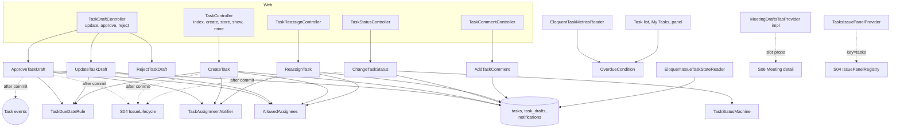
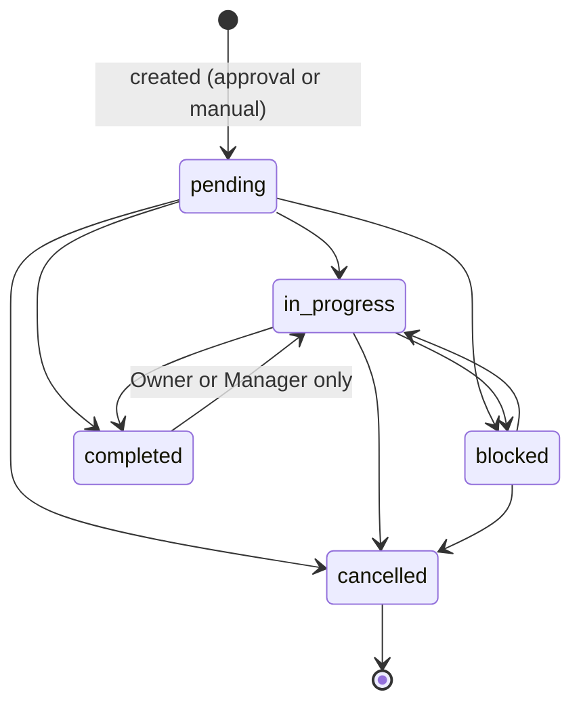

# Design Document

## Overview

S07 turns the Task_Drafts that S06 produced into accountable Tasks, and lets the assigned employee carry each Task to completion. AI is not involved anywhere in S07. A Task exists only because a person approved a draft or created it by hand.

The design rests on four mechanisms:

1. **One write path per fact.** `ApproveTaskDraft` is the only code that turns a draft into a Task. `TaskStatusMachine` is the only code that writes `tasks.status`. `AllowedAssignees` and `TaskDueDateRule` are the only definitions of who can be assigned and which dates are valid, and every action (edit, approve, manual create, reassign) calls them.
2. **Row lock plus unique constraints for idempotency.** Approval locks the draft row with `SELECT ... FOR UPDATE`, re-reads the status under the lock, and relies on `tasks.task_draft_id` and `task_drafts.task_id` unique constraints as a backstop. A second approval returns the existing Task and causes no side effects.
3. **Compare-and-set for status changes.** Every transition is `UPDATE tasks SET status = :to ... WHERE id = :id AND status = :from`, so two racing requests cannot both win.
4. **Side effects after commit.** Events use `ShouldDispatchAfterCommit`. The `IssueLifecycle` call runs after the transaction commits, and a failure there never undoes a Task.

This is a planning pass. The document describes the design; nothing is implemented. No automated test suite is part of S07 (A17), so there is no Correctness Properties section. Verification is by static checks, the demo fixture, an authorization matrix and manual concurrency scenarios.

### Design decisions that resolve gaps in the requirements

| # | Gap or tension | Decision |
|---|---|---|
| D1 | The request for this design asks for the notification "after commit", but Req 6.1 says the Assignment_Notification is written "in the same transaction" and Req 4.9 says a failed transaction sends none. | The notification row is inserted inside the transaction, as the last step before commit. It is therefore invisible to every other connection until commit and is rolled back with the Task if anything fails. A post-commit insert could be lost on a process crash between commit and insert, and the draft would then be `approved` with no way to resend. Events (`TaskDraftApproved`, `TaskAssigned`) and the `IssueLifecycle` call are the true post-commit steps. If the intended meaning is a post-commit insert, Req 6.1 must be changed first. |
| D2 | Req 12.3 says the Assignee may request a transition to `pending`, but the Req 12.1 table has no transition into `pending` and says "no others". | The table wins. A request for `pending` fails with 422 from the machine. Requirement 12.3 should drop "pending". |
| D3 | S06 always stores `task_drafts.issue_id = null` (S06 Req 13.3), but Req 22.5 expects the first approval to move the Issue to `action_in_progress`. | The Draft_Review_Tab pre-fills the Issue field with the Meeting's Issue when the Meeting has exactly one linked Issue and the draft has none. The value is a visible form default that the Reviewer submits explicitly; the server never fills it in on its own (Req 4.14, 5.4). With two or more Issues the Reviewer must choose. |
| D4 | Req 9.8 sorts "by due date ascending with Tasks without an overdue state after overdue ones". | Interpreted as `ORDER BY is_overdue DESC, due_date ASC, id DESC`. Overdue Tasks come first, then the rest by due date. |
| D5 | Req 21.9 says S07 shows no revenue, but Req 11.5 shows an evidence snapshot. | The snapshot shows only the rule label and the primary metric name, baseline value and latest value from `IssueEvidence`. All three S04 primary metrics are percentages, so no currency amounts appear. `missingBranchDays`, import ids and `EvaluationSummary` details are not passed to the page. |
| D6 | Req 6.4 dedupes on `task_assigned:{task_id}:{assignee_id}`. Reassigning A to B to A produces the same key for A. | Accepted. A would not receive a second notification. This is a Stage 1 limitation; adding a reassignment counter to the key is a one-line change if it matters. |
| D7 | Req 8.14 asks for double-submit protection on manual create without naming a mechanism. | A transaction-scoped Postgres advisory lock on a hash of `(actor, title, assignee, due_date)`, then a lookup for a Task with `task_draft_id IS NULL` and the same four values created within 5 seconds. A hit returns the existing Task. This is race-safe and needs no cache store. |
| D8 | `EloquentTaskMetricsReader` returns `?int` per the S05 contract, but Req 16.8 forbids null. | The real reader always returns an `int`. The S05 contract is unchanged; the Dashboard already treats a non-null value as available. |

### Research notes

- The database is PostgreSQL (S04 and S06 use `jsonb`, partial indexes and `interval` arithmetic). `SELECT ... FOR UPDATE` blocks a second transaction on the same row until the first commits or rolls back, and under the default `READ COMMITTED` isolation the second transaction's next statement sees the committed result. This is what makes the re-read-under-lock pattern correct.
- A unique violation inside a PostgreSQL transaction aborts that transaction. The unique-constraint backstop therefore cannot be handled inside the same `DB::transaction`; the action catches `UniqueConstraintViolationException` outside the closure and re-reads by `task_draft_id`.
- Laravel's `DB::transaction` ends with a commit, and events that implement `ShouldDispatchAfterCommit` are held until the outermost transaction commits and are dropped on rollback. This is the same mechanism S06 uses for its events.
- Named rate limiters keyed by user id share one counter across every route that uses the same limiter name, which satisfies the "shared across those actions" rule in Req 18.7.

## Architecture



### Task status machine



### Module layout

```
app/
  Enums/{TaskStatus}.php                       (TaskDraftStatus, AssigneeResolution, DeadlineResolution come from S06)
  Models/{Task,TaskComment}.php                (TaskDraft is S06; S07 adds task(), rejection_reason)
  Policies/{TaskPolicy,TaskDraftPolicy}.php
  Actions/Tasks/{ApproveTaskDraft,RejectTaskDraft,UpdateTaskDraft,CreateTask,
                 ChangeTaskStatus,ReassignTask,AddTaskComment}.php
  Services/Tasks/
    TaskStatusMachine.php
    OverdueCondition.php
    AllowedAssignees.php
    TaskDueDateRule.php
    TaskAssignmentNotifier.php
    IssueLifecycleBridge.php                   (post-commit calls, swallows IssueTransitionNotAllowedException)
    TaskListQuery.php
  Services/Contracts/
    EloquentIssueTaskStateReader.php
    EloquentTaskMetricsReader.php
  Notifications/TaskAssignedNotification.php
  Events/Tasks/{TaskEvent,TaskDraftApproved,TaskDraftRejected,TaskAssigned,
                TaskStatusChanged,TaskCommentAdded,TaskCompleted}.php
  Panels/TasksIssuePanelProvider.php
  Meetings/TaskDraftsTabProvider.php           (implements S06 MeetingDraftsTabProvider)
  Providers/TaskServiceProvider.php            (bindings, panel registration, limiters, policies)
  Http/Controllers/{TaskController,TaskDraftController,TaskStatusController,
                    TaskReassignController,TaskCommentController}.php
  Http/Requests/{UpdateTaskDraftRequest,ApproveTaskDraftRequest,RejectTaskDraftRequest,
                 StoreTaskRequest,ChangeTaskStatusRequest,ReassignTaskRequest,
                 StoreTaskCommentRequest,TaskIndexRequest}.php
  Http/Resources/{TaskListItemResource,TaskDetailResource,TaskDraftReviewResource,TaskCommentResource}.php
database/migrations/…_create_tasks_table.php
                    …_create_task_comments_table.php
                    …_link_task_drafts_to_tasks.php
resources/js/
  pages/Tasks/{Index,Mine,Show,Create}.vue
  components/tasks/{TaskFilters,TaskRow,TaskStatusBadge,OverdueBadge,StatusActions,
                    CommentThread,ReassignDialog,TaskContextCard}.vue
  components/meetings/DraftReviewTab.vue       (+ DraftCard.vue, DraftEditForm.vue, RejectDialog.vue)
  issue-panels/TasksPanel.vue
  meetings/registerDraftReview.ts              (calls registerMeetingDraftsTab once)
```

## Components and Interfaces

### Shared rules

```php
final class AllowedAssignees
{
    /** Allowed_Assignee_List (A9): active staff and manager users of one department. */
    public static function query(int $departmentId): Builder
    {
        return User::query()
            ->where('department_id', $departmentId)
            ->where('is_active', true)
            ->whereIn('role', ['staff', 'manager']);
    }
    public static function contains(int $departmentId, int $userId): bool
    {
        return self::query($departmentId)->whereKey($userId)->exists();
    }
}

final class TaskDueDateRule
{
    /** A5: due date >= max(meeting date, business today). Returns the earliest valid date. */
    public static function minimum(?CarbonInterface $meetingDate): CarbonImmutable
    {
        $today = BusinessClock::today()->toImmutable();
        return $meetingDate && $meetingDate->gt($today) ? $meetingDate->toImmutable() : $today;
    }
    /** @return array<string,string> field => message, empty when valid */
    public static function check(CarbonInterface $due, ?CarbonInterface $meetingDate): array
    {
        if ($meetingDate && $due->lt($meetingDate)) {
            return ['due_date' => 'The deadline cannot be before the meeting date.'];       // Req 3.7
        }
        if ($due->lt(BusinessClock::today())) {
            return ['due_date' => 'The deadline cannot be in the past.'];                    // Req 3.8
        }
        return [];                                                                           // equal to today is valid (Req 3.12)
    }
}
```

`BusinessClock::today()` is the S01 date in the company timezone and honors `DEMO_FIXED_DATE`. Dates are compared as plain dates, so there is no time-of-day edge.

### ApproveTaskDraft

Signature: `handle(TaskDraft $routeDraft, User $actor, array $edits = []): ApprovalResult`, where `ApprovalResult` holds `Task $task` and `bool $created`. The draft comes from the route binding. Only the id is used to re-fetch the row under lock; nothing from the request body selects a record (Req 4.14).

Order of operations:

| Step | Where | What | Req |
|---|---|---|---|
| 0 | Controller | Route binding (scope, Staff 403 or foreign 404), `TaskDraftPolicy::approve`, throttle `task-review`. | 4.10 to 4.12, 18 |
| 1 | Inside transaction | `TaskDraft::whereKey($id)->lockForUpdate()->firstOrFail()`. The status is read only from this locked row. | 4.4 |
| 2 | Inside transaction | If `status = approved`: load `Task` by `task_id`, return `created = false`. Edits in the body are ignored. No write, no event, no notification. | 4.6, 4.7 |
| 3 | Inside transaction | If `status` is `rejected` or `superseded`: throw 422 (`draft_not_pending`). | 4.8 |
| 4 | Inside transaction | Apply `$edits` to the locked draft through `DraftEditor::apply` (the same code `UpdateTaskDraft` uses), in memory first. | 3.11 |
| 5 | Inside transaction | Validate the post-edit values (table below). On failure throw `ValidationException`; the transaction rolls back and the response is 422 naming the field. | 3.1 to 3.10 |
| 6 | Inside transaction | `Task::create([...])` with `status = TaskStatusMachine::INITIAL`, `assigned_by = actor`, `department_id = meeting.department_id`, `task_draft_id = draft.id`. | 4.1, 4.2 |
| 7 | Inside transaction | Update the draft: the edited fields, `status = approved`, `task_id`, `reviewed_by`, `reviewed_at = now()`, and `issue_id` (same value as the Task, Req 5.5). | 4.3, 5.5 |
| 8 | Inside transaction | If assignee is not the Actor: `TaskAssignmentNotifier::send(task, assignee, actor)`, which dedupes and inserts one `notifications` row. | 6.1 to 6.5, D1 |
| 9 | Inside transaction | Queue events: `TaskDraftApproved`, `TaskAssigned`. They implement `ShouldDispatchAfterCommit` and are held until commit. | 19.1, 19.3, 19.5 |
| 10 | After commit | If `created` and `task.issue_id` is set: `IssueLifecycleBridge::actionStarted($issue)`, which calls `IssueLifecycle::markActionInProgress` inside a try/catch for `IssueTransitionNotAllowedException`. A failure is logged and ignored. | 5.1 to 5.4 |
| 11 | Controller | Redirect to the Draft_Review_Tab with the toast "Task created and assigned to {Assignee name}". For a repeat call the same toast is used, since the Task exists. | 4.15 |

Validation at step 5, in this order. The first failure is reported; all failures are collected into one `ValidationException` so the form can mark every field.

| Check | Field | Rule |
|---|---|---|
| Title | `title` | not empty after trim, at most 150 characters |
| Assignee present | `assignee_id` | not null (Req 3.4) |
| Assignee allowed | `assignee_id` | `AllowedAssignees::contains(meeting.department_id, id)` at approval time (Req 3.6) |
| Due date present | `due_date` | not null (Req 3.5) |
| Due date valid | `due_date` | `TaskDueDateRule::check(due, meeting.meeting_date)` (Req 3.7, 3.8, 3.12) |
| Issue | `issue_id` | when set, must be in `meeting_issues` for this meeting (Req 3.9) |

Pseudocode:

```php
public function handle(TaskDraft $routeDraft, User $actor, array $edits = []): ApprovalResult
{
    try {
        $result = DB::transaction(function () use ($routeDraft, $actor, $edits) {
            $draft = TaskDraft::whereKey($routeDraft->getKey())->lockForUpdate()->firstOrFail();

            if ($draft->status === TaskDraftStatus::Approved) {
                return new ApprovalResult(Task::findOrFail($draft->task_id), created: false);
            }
            if ($draft->status !== TaskDraftStatus::Pending) {
                throw ValidationException::withMessages(['status' => 'This draft can no longer be approved.']);
            }

            $meeting = Meeting::findOrFail($draft->meeting_id);
            $values  = $this->editor->apply($draft, $meeting, $edits);          // returns the edited, unsaved values
            $this->validator->assertApprovable($values, $meeting);               // throws ValidationException

            $task = Task::create([
                'department_id' => $meeting->department_id, 'task_draft_id' => $draft->id,
                'meeting_id' => $meeting->id, 'issue_id' => $values->issueId,
                'title' => $values->title, 'description' => $values->description,
                'assignee_id' => $values->assigneeId, 'assigned_by' => $actor->id,
                'due_date' => $values->dueDate, 'status' => TaskStatusMachine::INITIAL,
            ]);
            $draft->forceFill($values->draftColumns() + [
                'status' => TaskDraftStatus::Approved, 'task_id' => $task->id,
                'reviewed_by' => $actor->id, 'reviewed_at' => now(),
            ])->save();

            $this->notifier->send($task, $actor);                                // no-op when assignee == actor or deduped
            event(new TaskDraftApproved(...));                                   // held until commit
            event(new TaskAssigned(...));
            return new ApprovalResult($task, created: true);
        });
    } catch (UniqueConstraintViolationException) {
        // Backstop only: the lock should make this unreachable. Re-read outside the aborted transaction.
        $task = Task::where('task_draft_id', $routeDraft->getKey())->firstOrFail();
        return new ApprovalResult($task, created: false);
    }

    if ($result->created && $result->task->issue_id) {
        $this->issues->actionStarted($result->task->issue_id);                   // after commit, errors swallowed
    }
    return $result;
}
```

Why both the lock and the unique constraints:

| Scenario | What happens |
|---|---|
| Request B arrives while A is inside its transaction | B blocks at step 1. After A commits, B's `SELECT ... FOR UPDATE` returns the committed row with `status = approved`. B takes step 2 and returns A's Task. One Task, one notification, one set of events. |
| A and B both pass step 1 because the lock was somehow bypassed (for example a future code path that forgets the lock) | The second `INSERT INTO tasks` violates `tasks_task_draft_id_unique`. The transaction aborts, nothing is stored, and the catch block returns the existing Task. |
| A manual SQL update sets two drafts to the same `task_id` | `task_drafts_task_id_unique` rejects it. |
| Transaction fails after step 6 (for example the notification insert throws) | Everything rolls back: no Task, draft still `pending`, no notification, and, because events are after-commit, no event (Req 4.9). |
| `IssueLifecycle` throws after commit | The Task and draft stay committed. The bridge logs the Issue id and exception class only. |

A repeated approval therefore is not an error and does not show a warning; the Reviewer sees the same success toast and the Task id in the redirect is the same (Req 22.7).

### UpdateTaskDraft and DraftEditor

`UpdateTaskDraft` locks the draft row the same way, so an edit and an approval on one draft are serialized. It rejects non-`pending` drafts with 422 (Req 2.14). `DraftEditor::apply` is the single implementation of the field rules, used by both edit and approve:

| Input | Effect |
|---|---|
| `title` (1 to 150 after trim) | `suggested_title` |
| `description` (0 to 2,000) | `suggested_description` |
| `assignee_id` set | must pass `AllowedAssignees::contains`; sets `assignee_id`, `assignee_resolution = resolved` (A10) |
| `assignee_id` null | `assignee_id = null`, `assignee_resolution = none` |
| `due_date` set | sets `due_date`, `deadline_resolution = resolved` |
| `due_date` null | `due_date = null`, `deadline_resolution = none` |
| `issue_id` | null, or an id in this meeting's `meeting_issues` |

The columns `suggested_assignee_name`, `suggested_due_date_text`, `suggested_due_date`, `transcript_excerpt`, `status`, `reviewed_*`, `task_id` and `extraction_run` are never written by edit (Req 2.10, 2.15). The Form Request exposes only the editable keys through `validated()`, so `meeting_id` or `task_id` in the body is dropped (Req 2.16). Edit does not check the due date against the minimum date, because an incomplete draft is allowed to hold a date that approval later rejects; approval is the gate.

A key present with value `null` means "clear". A key that is absent means "leave unchanged". The Form Request uses `array_key_exists` through `$this->safe()->all()` plus `$this->has()` to keep the two cases apart.

### RejectTaskDraft

Lock the draft row; if `rejected`, return success with no change and no event (Req 7.4); if `approved` or `superseded`, 422; otherwise set `status = rejected`, `reviewed_by`, `reviewed_at`, and `rejection_reason = trim(reason) ?: null`. Dispatch `TaskDraftRejected` with `hasReason`. No Task, no notification, no `IssueLifecycle` call. The row is kept (Req 7.8).

### TaskStatusMachine and ChangeTaskStatus

```php
final class TaskStatusMachine
{
    public const INITIAL = TaskStatus::Pending;

    private const ALLOWED = [
        'pending'     => ['in_progress', 'blocked', 'completed', 'cancelled'],
        'in_progress' => ['blocked', 'completed', 'cancelled'],
        'blocked'     => ['in_progress', 'cancelled'],
        'completed'   => ['in_progress'],
        'cancelled'   => [],
    ];

    public static function allows(TaskStatus $from, TaskStatus $to): bool { /* ALLOWED lookup */ }
    public static function targetsFrom(TaskStatus $from): array { /* for UI controls */ }

    /** @return bool true when exactly one row moved */
    public function apply(Task $task, TaskStatus $from, TaskStatus $to): bool
    {
        return Task::whereKey($task->id)->where('status', $from->value)->update([
            'status'       => $to->value,
            'completed_at' => $to === TaskStatus::Completed ? now() : null,   // satisfies the CHECK in one statement
            'updated_at'   => now(),
        ]) === 1;
    }
}
```

`Task::$fillable` omits `status` and `completed_at`; `Task::create` in approval and manual creation sets `status` through `TaskStatusMachine::INITIAL` with `forceFill`, and no other code does. This is the practical meaning of "only code that writes `tasks.status`" (Req 12.2).

`ChangeTaskStatus::handle(Task $task, TaskStatus $to, User $actor)`:

```text
1. Read current status from the bound Task (route-scoped).
2. if to == current: return success, no write, no event.                          # Req 12.13
3. if not allows(current, to): 422 "A task that is {current} cannot become {to}."  # Req 12.8, D2
4. Policy check (see matrix below): Staff cancel -> 403, Staff reopen -> 403.      # Req 12.5, 12.6
5. DB::transaction:
     moved = machine.apply(task, current, to)
     if not moved:
        fresh = current status of the row
        if fresh == to: return success without events (a duplicate won the race)   # idempotent
        else: 422 with the fresh status                                            # Req 12.12
     event TaskStatusChanged(from, to); if to == completed: event TaskCompleted.
6. After commit: if task.issue_id and to in (completed, cancelled):
     IssueLifecycleBridge::tasksSettled(issue)                                      # Req 13.1
   Reopen (completed -> in_progress) never calls IssueLifecycle.                    # Req 13.9
```

Order matters at steps 3 and 4: the 422 check comes before the policy check only for transitions that are invalid for everybody, so a Staff user asking for a non-existent transition gets a 422 that explains the state, while a Staff user asking for a valid but forbidden transition gets 403.

Transition table and who may perform it:

| From | To | Assignee (Staff or Manager) | Owner / Manager of department | Issue call after commit |
|---|---|---|---|---|
| pending | in_progress | yes | yes | no |
| pending | blocked | yes | yes | no |
| pending | completed | yes | yes | `markMonitoringIfTasksComplete` |
| pending | cancelled | no (403) | yes | `markMonitoringIfTasksComplete` |
| in_progress | blocked | yes | yes | no |
| in_progress | completed | yes | yes | `markMonitoringIfTasksComplete` |
| in_progress | cancelled | no (403) | yes | `markMonitoringIfTasksComplete` |
| blocked | in_progress | yes | yes | no |
| blocked | cancelled | no (403) | yes | `markMonitoringIfTasksComplete` |
| completed | in_progress | no (403) | yes | no |
| any | any other | 422 | 422 | no |
| X | X (same) | 200 no-op | 200 no-op | no |

A Manager who is also the Assignee uses the Manager column. Setting `blocked` needs no comment (A6); the UI shows a hint under the button.

### CreateTask (manual)

Owner or Manager only (`TaskPolicy::create`). The Form Request resolves the department: a Manager's department is forced from the Actor, and an Owner must send `department_id` that belongs to the Owner's company. Then:

```text
validate title (1..150), description (0..2000), assignee in AllowedAssignees(department), due_date present
issue_id: Issue of the same department within the Actor's scope (visibleTo)
meeting_id: Meeting of the same department within scope
if both: issue must be in meeting_issues of that meeting                                 # Req 8.10
due date: TaskDueDateRule::check(due, meeting?->meeting_date)                            # Req 8.7
transaction:
   pg_advisory_xact_lock(hashtext(actor|title|assignee|due_date))                        # D7
   existing = Task where task_draft_id is null and same actor/title/assignee/due and created_at >= now()-5s
   if existing: return it
   create Task; notifier.send; events TaskAssigned
after commit: if issue_id: IssueLifecycleBridge::actionStarted                           # Req 8.11
```

A manually created Task dispatches `TaskAssigned` but not `TaskDraftApproved`. The create form pre-selects `issue` and `meeting` from the query string only when they are in the Actor's scope (Req 8.13).

### ReassignTask

Owner or Manager of the department. In one transaction: lock the Task row, reject `completed` and `cancelled` with 422, return success without events when the new Assignee equals the current one, check `AllowedAssignees` for the Task's department, update `assignee_id` and `assigned_by`, send the notification (deduped), and queue `TaskAssigned` with `previousAssigneeId`. Status, due date and comments are untouched.

### AddTaskComment

Anyone who can view the Task (Assignee, department Manager, Owner) may comment in any status. `user_id` and `task_id` come from the Actor and the route. Body is trimmed, 1 to 2,000 characters, stored as plain text. Event `TaskCommentAdded` carries ids only. A comment on a Task does not touch `updated_at` of the Task.

### OverdueCondition (SQL, computed at read time)

```php
final class OverdueCondition
{
    public const OPEN = ['pending', 'in_progress', 'blocked'];

    /** Overdue: due_date < business today AND status not completed or cancelled. Nothing is stored. */
    public static function apply(Builder $q, ?CarbonInterface $today = null): Builder
    {
        $today ??= BusinessClock::today();
        return $q->whereIn('tasks.status', self::OPEN)->where('tasks.due_date', '<', $today->toDateString());
    }

    /** Raw boolean expression for SELECT and ORDER BY, with the date bound as a parameter. */
    public static function sql(): string
    {
        return "(tasks.status IN ('pending','in_progress','blocked') AND tasks.due_date < ?::date)";
    }

    public static function daysOverdue(Task $t, CarbonInterface $today): ?int { /* diffInDays when overdue, else null */ }
}
```

One class supplies the list filter, the badge value, the My Tasks grouping and the metrics reader (Req 16.2). `BusinessClock::today()` is evaluated once per request and the same date string is bound everywhere, so a single page never mixes two "todays". A Task due on Business_Today is not overdue because the comparison is strict `<` (Req 16.10). `due_date` is a `date` column, so there is no timezone conversion in SQL; the company timezone only decides which date "today" is.

List sort (D4):

```sql
SELECT tasks.*, (tasks.status IN ('pending','in_progress','blocked') AND tasks.due_date < :today) AS is_overdue
FROM tasks ...
ORDER BY is_overdue DESC, tasks.due_date ASC, tasks.id DESC
LIMIT 15
```

### Contract bindings

```php
// TaskServiceProvider::register()
$this->app->bind(IssueTaskStateReader::class, EloquentIssueTaskStateReader::class);   // replaces NullIssueTaskStateReader
$this->app->bind(TaskMetricsReader::class,     EloquentTaskMetricsReader::class);      // replaces NullTaskMetricsReader
$this->app->bind(MeetingDraftsTabProvider::class, TaskDraftsTabProvider::class);
```

The bindings live in `TaskServiceProvider`, registered after the S04 and S05 providers in `bootstrap/providers.php`, so the later binding wins. S04 and S05 code is not modified.

```php
final class EloquentIssueTaskStateReader implements IssueTaskStateReader
{
    public function readyForMonitoring(Issue $issue): bool
    {
        // One query. Cancelled tasks are ignored. No user scope: the caller is the system.
        $row = DB::table('tasks')->where('issue_id', $issue->id)
            ->selectRaw("COUNT(*) FILTER (WHERE status = 'completed') AS done,
                         COUNT(*) FILTER (WHERE status IN ('pending','in_progress','blocked')) AS open")
            ->first();
        return $row->done >= 1 && $row->open === 0;       // all-cancelled gives done = 0, so false (Req 13.7)
    }
}

final class EloquentTaskMetricsReader implements TaskMetricsReader
{
    public function openCount(TaskScope $scope): int
    {
        return (int) $this->scoped($scope)->whereIn('status', OverdueCondition::OPEN)->count();
    }
    public function overdueCount(TaskScope $scope): int
    {
        return (int) OverdueCondition::apply($this->scoped($scope))->count();
    }
    private function scoped(TaskScope $s): Builder
    {
        $q = DB::table('tasks');                        // aggregate only, never loads rows (Req 16.9)
        return $s->type === 'department' ? $q->where('department_id', $s->id) : $q->where('assignee_id', $s->id);
    }
}
```

Each call is a single `SELECT COUNT(*)` that uses the `(department_id, status)` or `(assignee_id, status)` index. The return type narrows `?int` to `int`, which is compatible with the S05 interface (covariant return). `COUNT(*)` returns 0 for no match, so there is never a null (Req 16.8). The Task list's footer counts and the My Tasks summary row call the same reader, so the numbers match by construction (Req 10.8, 22.9).

### TaskAssignedNotification and dedupe

```php
final class TaskAssignedNotification extends Notification      // not ShouldQueue: written synchronously inside the transaction
{
    public function __construct(private Task $task, private string $assignedByName, private string $departmentName) {}
    public function via($notifiable): array { return ['database']; }                 // no mail, no broadcast (Req 6.7)
    public function toDatabase($notifiable): array
    {
        return [
            'dedupe_key'       => "task_assigned:{$this->task->id}:{$notifiable->id}",
            'task_id'          => $this->task->id,
            'title'            => $this->task->title,
            'due_date'         => $this->task->due_date->toDateString(),
            'assigned_by_name' => $this->assignedByName,
            'department_name'  => $this->departmentName,
            'url'              => route('tasks.show', $this->task, absolute: false),
        ];                                                                           // no transcript, evidence or Provider data (Req 6.8)
    }
}
```

```php
final class TaskAssignmentNotifier
{
    public function send(Task $task, User $actor): void
    {
        $assignee = $task->assignee;
        if ($assignee->id === $actor->id) { return; }                                // A13, Req 6.5
        $key = "task_assigned:{$task->id}:{$assignee->id}";
        $exists = $assignee->notifications()->where('data->dedupe_key', $key)->exists();   // same pattern as S04 UrgentIssueNotifier
        if ($exists) { return; }
        $assignee->notify(new TaskAssignedNotification($task, $actor->name, $task->department->name));
    }
}
```

The dedupe lookup is safe under concurrency for the approval path because the draft row lock serializes callers. For manual create and reassign the advisory lock and the Task row lock do the same. The notification appears in the S04 bell feed without S04 changes, because the feed reads the `notifications` table and renders `title`, `url` and the key set above; the implementation step must confirm the S04 feed's expected keys and add `title` and `url` handling only if S04's renderer needs a type switch.

### Draft_Review_Tab (slot filling)

S06 provides the host and slot; S07 fills it without editing S06 files.

Server side: `TaskDraftsTabProvider implements MeetingDraftsTabProvider::props(Meeting $meeting, User $user): array`. It returns, for Owner and Manager only:

```php
[
  'pending'  => TaskDraftReviewResource::collection(drafts pending, order id),
  'history'  => TaskDraftReviewResource::collection(drafts approved or rejected, order reviewed_at desc),
  'supersededCount' => int,
  'assigneeOptions' => AllowedAssignees::query(meeting.department_id)->get(['id','name']),
  'issueOptions'    => meeting issues as [{id, title}],
  'defaultIssueId'  => count(issueOptions) === 1 ? issueOptions[0].id : null,     // D3
  'minDueDate'      => TaskDueDateRule::minimum(meeting.meeting_date)->toDateString(),
  'emptyReason'     => 'approved' | 'rejected' | 'never_extracted' | null,         // Req 1.9
]
```

Each draft resource carries: `id`, `status`, `title`, `description`, `assigneeId`, `assigneeResolution`, `suggestedAssigneeName`, `dueDate`, `deadlineResolution`, `suggestedDueDateText`, `issueId`, `transcriptExcerpt`, `rejectionReason` (history only), `taskId` and `taskUrl` (approved only), `blockers` (computed: `['assignee_id', 'due_date', 'title']` for missing fields), and `can: { approve, reject, edit }`. The transcript excerpt is the draft's own short quote, never the full transcript, which respects S06's rule that provider props contain no transcript text.

Client side: `resources/js/meetings/registerDraftReview.ts` calls `registerMeetingDraftsTab(DraftReviewTab)` once from `app.ts`. The component receives S06's slot props (`meetingId`, `departmentId`, `meetingStatus`, `counts`, `canReview`, `extra`) and reads everything else from `extra`. The "AI generated, review before use" label is already rendered by the S06 host, and `DraftCard` repeats it per pending draft (Req 1.8). The Staff route check for the tab is S06's 403 on Meeting routes plus `TaskDraftPolicy` on every S07 draft route.

Actions inside the tab call the draft routes with Inertia `router.patch` and `router.post`, `preserveScroll: true`, and `only: ['meeting', 'draftsTab']` so the transcript is not reloaded.

### TasksIssuePanelProvider

```php
final class TasksIssuePanelProvider implements IssuePanelProvider
{
    public function key(): string { return 'tasks'; }

    public function panelFor(Issue $issue, User $user): ?array
    {
        if ($user->role === Role::Staff) { return null; }                             // Req 17.6
        $base = Task::where('issue_id', $issue->id);                                  // Issue is already scoped by S04's controller
        $counts = (clone $base)->selectRaw('status, COUNT(*) c')->groupBy('status')->pluck('c', 'status');
        if ($counts->sum() === 0) { return null; }                                    // S04 shows its placeholder (Req 17.5)

        $today = BusinessClock::today();
        $tasks = (clone $base)->with('assignee:id,name')->orderBy('due_date')->limit(20)->get();
        return [
            'counts'  => array_merge(array_fill_keys(TaskStatus::values(), 0), $counts->all()),
            'tasks'   => $tasks->map(fn ($t) => [
                'id' => $t->id, 'title' => $t->title, 'assigneeName' => $t->assignee->name,
                'dueDate' => $t->due_date->toDateString(), 'status' => $t->status->value,
                'isOverdue' => OverdueCondition::isOverdue($t, $today), 'url' => route('tasks.show', $t),
            ])->all(),                                                                // no description, comments or excerpt (Req 17.8)
            'createUrl' => route('tasks.create', ['issue' => $issue->id]),
        ];
    }
}
```

Because the provider returns `null` for an Issue with no Tasks, the "Create task" link would not be shown by the panel itself. The Issue page's placeholder cannot carry a link, so the Tasks list empty state ("Create task") and the Task creation route with `?issue=` are the entry points in that case. This follows S06's identical situation and keeps S04 unchanged. The Vue component is `resources/js/issue-panels/TasksPanel.vue`. Registration is by tagging the provider in `TaskServiceProvider::boot()`.

### Events contract

All events live in `App\Events\Tasks`, extend `TaskEvent`, and implement `ShouldDispatchAfterCommit`. S07 registers no listener and writes no `activity_logs` row (Req 19.10); S08 subscribes.

| Event | Dispatched by | Extra fields | Not dispatched when |
|---|---|---|---|
| `TaskDraftApproved` | `ApproveTaskDraft` | `taskDraftId`, `taskId`, `assigneeId` | repeat approval |
| `TaskDraftRejected` | `RejectTaskDraft` | `taskDraftId`, `hasReason` (bool) | repeat rejection |
| `TaskAssigned` | approve, `CreateTask`, `ReassignTask` | `assigneeId`, `previousAssigneeId` (null on creation) | same-assignee reassignment, repeat approval |
| `TaskStatusChanged` | `ChangeTaskStatus` | `from`, `to` | same-status request, lost race with same target |
| `TaskCompleted` | `ChangeTaskStatus` | `assigneeId`, `completedAt` | any non-`completed` target |
| `TaskCommentAdded` | `AddTaskComment` | `commentId`, `authorUserId` | never skipped |

Common payload from `TaskEvent`: `taskId` (null for `TaskDraftRejected`), `departmentId`, `companyId`, `actorUserId`, `issueId` (nullable), `meetingId` (nullable), `occurredAt` (UTC `CarbonImmutable`). No event carries comment text, descriptions, rejection reasons, transcript text or file paths (Req 19.9). On approval, `TaskDraftApproved` is queued before `TaskAssigned`; both fire together at commit.

### Authorization

#### Route binding and policies

`Task::resolveRouteBinding()` applies the visibility scope before any policy runs, so a foreign or missing id returns the same 404 (Req 18.3, 18.4, 18.9):

| Role | Task binding scope |
|---|---|
| Owner | tasks whose department belongs to the Owner's company |
| Manager | tasks of the Manager's department |
| Staff | tasks where `assignee_id` is the Staff user |

`TaskDraft::resolveRouteBinding()` follows S06's pattern (G7): Staff get 403 first; then Owner (company) or Manager (department) scope through the draft's meeting; anything else is 404.

`TaskPolicy` abilities: `viewAny` (Owner, Manager), `create` (Owner, Manager), `view` (in scope), `changeStatus(Task, TaskStatus $to)` (see transition table), `reassign` (Owner, Manager), `comment` (in scope). `TaskDraftPolicy`: `view`, `update`, `approve`, `reject` (Owner, Manager; Staff always false). Every controller action calls `authorize`.

#### Route table

| Method and path | Name | Throttle |
|---|---|---|
| GET `/tasks` | `tasks.index` | |
| GET `/tasks/create` | `tasks.create` | |
| POST `/tasks` | `tasks.store` | |
| GET `/my-tasks` | `tasks.mine` | |
| GET `/tasks/{task}` | `tasks.show` | |
| POST `/tasks/{task}/status` | `tasks.status` | `task-status` (60/min) |
| POST `/tasks/{task}/reassign` | `tasks.reassign` | `task-review` (20/min, shared) |
| POST `/tasks/{task}/comments` | `tasks.comments.store` | `task-comment` (30/min) |
| PATCH `/task-drafts/{taskDraft}` | `task-drafts.update` | `task-review` |
| POST `/task-drafts/{taskDraft}/approve` | `task-drafts.approve` | `task-review` |
| POST `/task-drafts/{taskDraft}/reject` | `task-drafts.reject` | `task-review` |

All routes are in the `auth` group with CSRF. Limiters are defined in `TaskServiceProvider::boot()` with `RateLimiter::for(name, fn ($r) => Limit::perMinute(n)->by($r->user()->id))`. Because the key is the same for approve, reject, edit and reassign, one counter is shared (Req 18.7). Exceeding returns 429 with `Retry-After`.

#### Matrix

Cells show the expected result. "Own dept" means the Manager's department; "foreign" means another department or company.

| Action | Owner | Manager (own dept) | Manager (foreign) | Staff (own Task) | Staff (other's Task) |
|---|---|---|---|---|---|
| Task list, create form, store | 200 | 200 | n/a (dept forced) | 403 | 403 |
| My Tasks | 200 | 200 | 200 | 200 | 200 |
| Task show | 200 | 200 | 404 | 200 | 404 |
| Status change, allowed for assignee | 200 | 200 | 404 | 200 | 404 |
| Cancel, or reopen completed | 200 | 200 | 404 | 403 | 404 |
| Reassign | 200 | 200 | 404 | 403 | 404 |
| Comment | 200 | 200 | 404 | 200 | 404 |
| Draft edit, approve, reject | 200 | 200 | 404 | 403 | 403 |
| Draft tab (Meeting detail) | 200 | 200 | 404 | 403 | 403 |
| Issue `tasks` panel | data | data | n/a | null | null |

Staff get 403 on draft routes (not 404) because draft binding aborts Staff first, as in S06. Staff get 404 on another user's Task because the Task binding hides it.

## Data Models

### `tasks`

| Column | Type | Notes |
|---|---|---|
| id | bigint PK | |
| department_id | FK departments, restrict | |
| task_draft_id | FK task_drafts null, restrict, **unique** | null for manual Tasks |
| meeting_id | FK meetings null, restrict | |
| issue_id | FK issues null, restrict | |
| title | varchar(150) | |
| description | text, default `''` | max 2,000 enforced by the Form Request |
| assignee_id | FK users, restrict | |
| assigned_by | FK users, restrict | updated on reassignment |
| due_date | date | |
| status | varchar(20), default `pending` | |
| completed_at | timestamp null | |
| created_at, updated_at | timestamps | |

### `task_comments`

| Column | Type | Notes |
|---|---|---|
| id | bigint PK | |
| task_id | FK tasks, cascade | |
| user_id | FK users, restrict | |
| body | text | 1 to 2,000, enforced by the Form Request |
| created_at, updated_at | timestamps | no edit or delete in Stage 1 (A14) |

### Changes to `task_drafts`

| Change | Detail |
|---|---|
| FK on `task_id` | `task_drafts.task_id` references `tasks.id`, restrict on delete. The column and its unique index already exist from S06. |
| New column `rejection_reason` | `varchar(500)` null (A4) |

### Migrations

Three files, in this order, after the S06 migrations.

```php
// 1. …_create_tasks_table.php
Schema::create('tasks', function (Blueprint $t) {
    $t->id();
    $t->foreignId('department_id')->constrained()->restrictOnDelete();
    $t->foreignId('task_draft_id')->nullable()->unique()->constrained('task_drafts')->restrictOnDelete();
    $t->foreignId('meeting_id')->nullable()->constrained()->restrictOnDelete();
    $t->foreignId('issue_id')->nullable()->constrained()->restrictOnDelete();
    $t->string('title', 150);
    $t->text('description')->default('');
    $t->foreignId('assignee_id')->constrained('users')->restrictOnDelete();
    $t->foreignId('assigned_by')->constrained('users')->restrictOnDelete();
    $t->date('due_date');
    $t->string('status', 20)->default('pending');
    $t->timestamp('completed_at')->nullable();
    $t->timestamps();
    $t->index(['assignee_id', 'status']);
    $t->index('issue_id');
    $t->index('due_date');
    $t->index(['department_id', 'status']);
});
DB::statement("ALTER TABLE tasks ADD CONSTRAINT tasks_status_check
    CHECK (status IN ('pending','in_progress','blocked','completed','cancelled'))");
DB::statement("ALTER TABLE tasks ADD CONSTRAINT tasks_completed_at_check
    CHECK ((status = 'completed') = (completed_at IS NOT NULL))");
// down(): Schema::dropIfExists('tasks') — see migration 3 for the order caveat

// 2. …_create_task_comments_table.php
Schema::create('task_comments', function (Blueprint $t) {
    $t->id();
    $t->foreignId('task_id')->constrained()->cascadeOnDelete();
    $t->foreignId('user_id')->constrained()->restrictOnDelete();
    $t->text('body');
    $t->timestamps();
    $t->index(['task_id', 'created_at']);
});
// down(): Schema::dropIfExists('task_comments')

// 3. …_link_task_drafts_to_tasks.php
Schema::table('task_drafts', function (Blueprint $t) {
    $t->string('rejection_reason', 500)->nullable();
    $t->foreign('task_id')->references('id')->on('tasks')->restrictOnDelete();
});
// down():
Schema::table('task_drafts', function (Blueprint $t) {
    $t->dropForeign(['task_id']);          // must precede dropping tasks
    $t->dropColumn('rejection_reason');
});
```

Because migration 1 creates a foreign key from `tasks` to `task_drafts` and migration 3 adds the reverse key, the two tables reference each other. Rollback runs 3, then 2, then 1, so the `task_drafts.task_id` foreign key is gone before `tasks` is dropped (Req 20.9).

Constraint rationale:

| Constraint | Purpose |
|---|---|
| `tasks_task_draft_id_unique` | one Task per draft; backstop for double approval (Req 4.5) |
| `task_drafts_task_id_unique` (S06) | one draft per Task |
| `tasks_status_check` | closed status set |
| `tasks_completed_at_check` | `completed_at` is set exactly when status is `completed`; forces the machine to write both in one statement |
| restrict FKs on `meeting_id`, `issue_id`, `task_draft_id` | a Meeting or Issue with Tasks cannot be deleted, which also blocks S06's cascade from `meetings` to `task_drafts` for approved drafts |
| `(assignee_id, status)` | My Tasks, per-user metrics, `EloquentTaskMetricsReader` |
| `(department_id, status)` | Task list, per-department metrics |
| `issue_id` | Issue panel, `EloquentIssueTaskStateReader` |
| `due_date` | list ordering and overdue comparison |

Application-level rules the schema cannot express: the assignee belongs to the Task's department, the Issue and Meeting belong to the Task's department, and the Issue is in the Meeting's `meeting_issues`. These are enforced by `AllowedAssignees` and the Form Requests.

### Documentation follow-ups (Req 20.10)

On implementation, update `docs/data-model.md` (`rejection_reason`, the two Task constraints, the indexes, the reciprocal foreign keys) and `docs/architecture.md` (the two contract bindings, the `tasks` panel provider, the draft-tab binding, the event list and the notification type).

### Inertia props

`Tasks/Index` (Owner, Manager)

```ts
{
  tasks: Paginated<{
    id: number; title: string; assignee: { id: number; name: string };
    department: { id: number; name: string }; dueDate: string;
    status: TaskStatus; isOverdue: boolean; daysOverdue: number | null;
    issue: { id: number; title: string } | null; url: string;
  }>;                                     // 15 per page, sort per D4
  filters: { status: TaskStatus | null; assignee: number | null; issue: number | null;
             department: number | null; overdue: boolean };   // echoed from query string, out-of-scope values dropped
  options: { assignees: {id,name}[]; issues: {id,title}[]; departments: {id,name}[] | null /* null for Manager */ };
  summary: { open: number; overdue: number };       // from TaskMetricsReader for the same scope
  businessToday: string;
  can: { create: boolean };
}
```

`Tasks/Mine` (every active user)

```ts
{
  sections: { overdue: TaskRow[]; open: TaskRow[]; completed: TaskRow[]; cancelled: TaskRow[] | null };
  filters: { status: TaskStatus | null; showCancelled: boolean };
  summary: { open: number; overdue: number };       // EloquentTaskMetricsReader, TaskScope::user
  businessToday: string;
}
// TaskRow adds: allowedTransitions: TaskStatus[]   // machine targets filtered by what this Actor may do
```

`Tasks/Show`

```ts
{
  task: {
    id; title; description; status; dueDate; isOverdue; daysOverdue;
    assignee: {id,name}; assignedBy: {id,name}; department: {id,name};
    createdAt; updatedAt; completedAt: string | null;
  };
  meeting: { id; title; meetingDate; url: string | null } | null;     // url null for Staff
  excerpt: string | null;                                              // the draft's transcript_excerpt
  decisions: { summary: string; excerpt: string }[] | null;            // Owner and Manager only
  issue: { id; title; severity; status; url: string | null;
           evidence: { metricName: string; baseline: string; latest: string } | null } | null;
  comments: { id; body; author: {name; role}; createdAt }[];
  can: { changeStatus: TaskStatus[]; reassign: boolean; comment: true };
  reassignOptions: {id,name}[] | null;                                 // only when can.reassign
  businessToday: string;
}
```

`Tasks/Create`: `{ departments: {id,name}[] | null, defaultDepartmentId, assigneeOptionsByDepartment: Record<number, {id,name}[]>, issueOptions: {id,title,departmentId}[], meetingOptions: {id,title,meetingDate,departmentId,issueIds}[], prefill: { issueId, meetingId }, minDueDate }`.

No page receives `sales_records`, full transcripts, `recording_path` or raw rejection reasons of other users. Task text is rendered with Vue interpolation, and `v-html` is not used anywhere (Req 11.10).

### Vue pages and behavior

- `Tasks/Index.vue`: `PageHeader` with "Create task"; `TaskFilters` bound to the query string via `router.get(..., { preserveState: true })`; rows as a table at 768 px and above and stacked cards below; `OverdueBadge` with text ("3 days overdue") in addition to color; `EmptyState` with "Create task"; skeleton rows while loading; `ErrorState` with retry.
- `Tasks/Mine.vue`: summary row, status filter, grouped sections, "Show cancelled" toggle, and one-step buttons from `allowedTransitions`. Empty state "No tasks assigned to you". Staff land here after sign-in (Req 10.2) through the S02 post-login redirect resolution; the implementation step locates that single redirect point and adds the Staff branch there.
- `Tasks/Show.vue`: `StatusActions` (buttons for `can.changeStatus`; Cancel opens a confirmation dialog), `ReassignDialog` (confirmation), `CommentThread` (chronological, author and role, company-timezone time, line breaks preserved with CSS `white-space: pre-wrap`, no editing), and `TaskContextCard` showing the Meeting and Issue summaries as links for Owner and Manager and as read-only text for Staff.
- `DraftReviewTab.vue`: one `DraftCard` per pending draft with inline edit fields; Approve is disabled with a visible reason while a title, employee or deadline is missing; Approve has no confirmation; Reject opens a dialog with an optional reason (0 to 500); both buttons disable while the request is in flight (Req 21.6).
- Shared: single column below 768 px, no horizontal scroll at 360 px, visible focus style, 422 field errors beside the field, other errors as a toast, the term "employee" for the Assignee.

## Error Handling

| Situation | Response | State change |
|---|---|---|
| Approve with missing assignee, missing due date, or assignee outside the list | 422 `ValidationException` naming `assignee_id` or `due_date` | none (rolled back) |
| Due date before meeting date or before business today | 422 naming `due_date` | none |
| Draft Issue not in the Meeting's issue set | 422 naming `issue_id` | none |
| Approve on `rejected` or `superseded` draft | 422 | none |
| Approve on `approved` draft (repeat or concurrent) | 200 with the existing Task | none, no events, no notification |
| Unique violation on `tasks.task_draft_id` | caught outside the transaction; existing Task returned | none |
| Any exception after Task insert, before commit | transaction rolls back; 500 with generic message; error logged with draft id and exception class only | none; no notification, no events |
| `IssueLifecycle` throws after commit | Task kept; logged; the Actor sees the normal success | Issue unchanged |
| Edit on non-`pending` draft | 422 | none |
| Reject on `approved` or `superseded` draft | 422 | none |
| Reject on `rejected` draft | 200, no change | none |
| Invalid status transition | 422 stating current status | none |
| Status CAS matched no row | re-read; 422 with fresh status, or 200 if the row already has the requested status | none |
| Staff cancel or reopen | 403 | none |
| Reassign of `completed` or `cancelled` Task | 422 | none |
| Comment empty or over 2,000 characters | 422 field error | none |
| Out-of-scope or missing record | 404 (same response for both) | none |
| Staff on Task list, create, draft routes | 403 | none |
| Throttle exceeded | 429 with `Retry-After` | none |
| Notification dedupe hit | silent skip | none |
| Metrics or panel query failure | page-level `ErrorState` with retry; the S05 Dashboard already shows its own section error | none |

Logging records ids, the action name, and the exception class. It never records comment bodies, descriptions, rejection reasons or transcript text.

## Testing Strategy

Property-based testing does not apply. S07 is mostly CRUD, state transitions guarded by locks and constraints, and framework side effects, and the project excludes automated suites for Stage 1 (A17, `.kiro/steering/verification.md`). This design therefore has no Correctness Properties section and no prework analysis. `TaskStatusMachine`, `OverdueCondition` and `TaskDueDateRule` are pure and would suit property tests if that policy changes. Results are reported as observed; passing them does not make the application production-ready.

### Static and build checks

`php -l` on changed files, `composer validate`, Pint, `npm run type-check`, ESLint, Prettier, `npm run build`, `php artisan migrate:fresh --seed` on a scratch database, and `php artisan migrate:rollback --step=3` followed by `migrate` again to prove the reciprocal foreign keys drop and recreate cleanly.

### Fixture verification (Req 22.3 to 22.7, 22.10)

Preconditions: `demo:reset --force`, `DEMO_MODE=true`, `demo:set-date 2026-09-28`, the S06 demo meeting in `ready_for_review` with the four drafts of `docs/demo-scenario.md` section 5, linked Issue "Weekly revenue decline" in a status from which S04 allows `markActionInProgress`. Sign in as Owner Lim Wei Han (an Owner may review; the Manager path is repeated in the matrix).

| Step | Action | Expected |
|---|---|---|
| 1 | Open Meeting detail, Task drafts tab | Four pending drafts, each labelled "AI generated, review before use". Issue field pre-filled with "Weekly revenue decline" (D3). Drafts 3 and 4 show Approve disabled with reasons. Draft 3 message "Several employees match this name. Choose one." with the text "Daniel". |
| 2 | Approve draft 1 | Toast "Task created and assigned to Priya Nair". `tasks` has one row: assignee Priya Nair, due `2026-10-02`, `status = pending`, `assigned_by` = Owner, `issue_id` set. Draft 1: `approved`, `task_id` set, `reviewed_by`, `reviewed_at`. Issue status is now `action_in_progress`. One `notifications` row for Priya with key `task_assigned:{id}:{priyaId}`. |
| 3 | Approve draft 2 | Task for Farid Ismail due `2026-10-07`. Issue status unchanged (already `action_in_progress`). One notification for Farid. |
| 4 | Draft 3: try Approve while blocked, then POST approve directly without an assignee | Button disabled. A direct request returns 422 naming `assignee_id`. No Task row. |
| 5 | Draft 3: choose Daniel Tan, leave deadline empty, POST approve | 422 naming `due_date`. Choose deadline `2026-10-03`, approve. Draft's `assignee_resolution` and `deadline_resolution` are now `resolved`. Task for Daniel Tan created. `suggested_assignee_name` still "Daniel" and `suggested_due_date_text` unchanged. |
| 6 | Draft 3 date check | A deadline of `2026-09-27` returns 422 (before meeting date and before today). A deadline of `2026-09-28` (today) is accepted when tried on a fresh draft copy. |
| 7 | Reject draft 4 with reason "Not an agreed action" | Draft 4 `rejected`, `rejection_reason` stored, no Task. It appears in the history section. Repeat the request: 200, no change. Approve it afterwards: 422. |
| 8 | Check injection line | No Task has the Owner as assignee. |
| 9 | Repeat approval of draft 1 (resubmit the same request) | Same Task id, no second row, no second notification (count by key = 1), no second `TaskAssigned` event. |
| 10 | Sign in as Priya (Staff) | Landing page is My Tasks; one Task under Open. Summary shows open 1, overdue 0, and the same numbers as `EloquentTaskMetricsReader`. Task detail shows the transcript excerpt and read-only Issue summary, no links, no decisions list. The bell shows the assignment notification linking to the Task. |
| 11 | Priya moves her Task `pending` to `in_progress` to `completed` | `completed_at` set. Issue still `action_in_progress` (two Tasks open). Priya cannot Cancel (403) or reopen (403). |
| 12 | Sign in as Farid, complete his Task | Issue still `action_in_progress` (Daniel's Task open). |
| 13 | Sign in as Daniel Tan, set `blocked` (no comment needed), then `in_progress`, then `completed` | After the last transition the Issue status is `monitoring`, not `resolved`. `IssueTaskStateReader::readyForMonitoring` is true; with Daniel's Task `in_progress` it was false. |
| 14 | Owner reopens Daniel's Task | Task `in_progress`, `completed_at` null. Issue stays `monitoring` (A16). |

### Concurrency checks (Req 22.6)

| Check | Method | Expected |
|---|---|---|
| Lock is taken | In `psql` session A: `BEGIN; SELECT * FROM task_drafts WHERE id = {X} FOR UPDATE;` then send the approve request from the app on a fresh pending draft X. | The request waits. After `ROLLBACK` in A it completes normally. Confirms the action locks the row. |
| Simultaneous approval | Copy the approve request as cURL from the browser dev tools (cookie and CSRF header included) and run it twice in parallel on a fresh pending draft (`curl … & curl … & wait`). | Both return success with the same Task id. `SELECT count(*) FROM tasks WHERE task_draft_id = X` is 1. One notification. Event counts (logged by a temporary listener) show one `TaskDraftApproved`. |
| Backstop | In `tinker`, insert a second Task with an existing `task_draft_id` | `UniqueConstraintViolationException`. |
| Status race | Run the same pair of parallel cURL calls against `tasks.status` with different targets (`blocked` and `completed` from `pending`) | One wins; the other returns 422 with the fresh status. Row never has `completed_at` out of step with status (the CHECK would reject it). |
| Manual create double submit | Two parallel `POST /tasks` with identical fields | One Task. |

### Overdue and metrics checks (Req 22.9, 22.10)

With `DEMO_FIXED_DATE` 2026-09-28, create a manual Task due `2026-09-28`: not overdue. Run `demo:set-date 2026-09-29`: the same Task shows "1 day overdue" in list, My Tasks Overdue section and Task detail, and the Overdue filter lists it. Complete it: it leaves the overdue count. Compare `openCount` and `overdueCount` from `tinker` (`TaskScope::department` and `TaskScope::user`) with the counts on the Task list and My Tasks. Open the S05 Dashboard: task counts show numbers, not "Not available yet". Run `DB::enableQueryLog()` around each reader call and confirm one aggregate query and no Task rows loaded.

### Authorization matrix (Req 22.8)

Run each cell of the matrix above against every S07 route with Owner, Manager (own department), a foreign id by direct URL (a second department fixture or a nonexistent id for the "foreign" column), Staff on their own Task, and Staff on another user's Task. Confirm status codes, and for 404 cases confirm the body matches that of a nonexistent id. Confirm that a request body carrying `task_id`, `status`, `assigned_by`, `reviewed_by`, `department_id` or `user_id` has no effect. Confirm the 21st review action in a minute returns 429 with `Retry-After`, counting approve, reject, edit and reassign together.

### Manual UI checks

Task list, My Tasks, Task detail and the Draft_Review_Tab at 360, 768 and 1280 px: no horizontal scroll at 360 px; keyboard-only operation of filters, status buttons, dialogs (focus trapped and returned) and the tab; status shown by text as well as color; confirmation dialogs on Reject, Cancel and Reassign and none on Approve; buttons disabled while requests are in flight.

### Migration checks

`migrate:fresh --seed`, then `migrate:rollback --step=3`, then `migrate` on a scratch database. Inspect with `\d tasks` and `\d task_drafts`: both CHECK constraints, the unique constraint on `task_draft_id`, the four indexes, the foreign key on `task_drafts.task_id`, and the `rejection_reason` column. Try `INSERT` of a `completed` row with null `completed_at` and a `pending` row with a `completed_at` value; both must fail.
