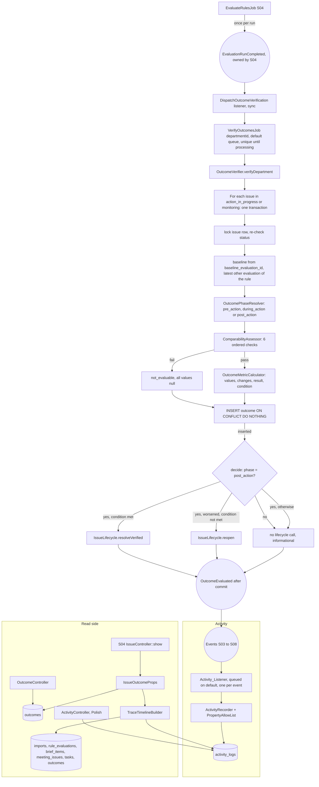
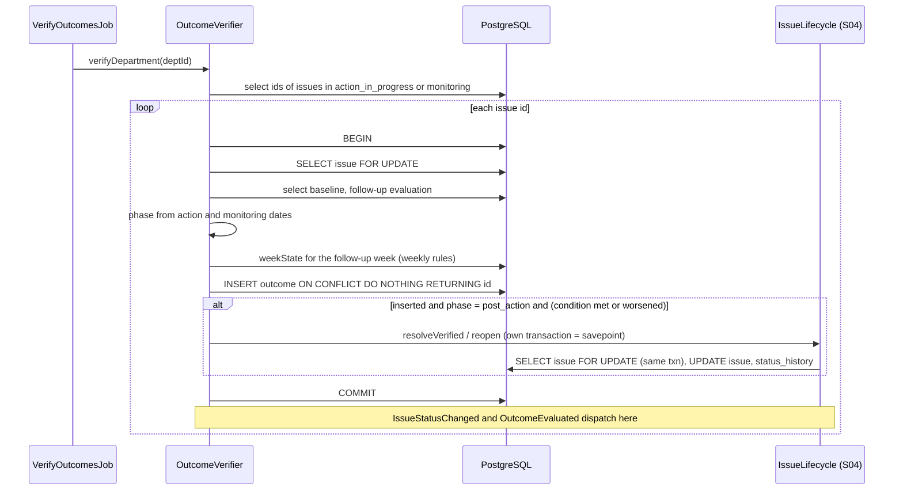

# Design Document

## Overview

S08 closes the lifecycle Detect, Understand, Decide, Execute, Verify. It has five parts:

1. `OutcomeVerifier`: a deterministic comparison of the preserved baseline evaluation of an Issue against the latest follow-up evaluation of the same rule. It classifies the follow-up week by phase (`pre_action`, `during_action`, `post_action`), measures it with a metric that fits the rule, writes an immutable `outcomes` row, and asks S04's `IssueLifecycle` to resolve or reopen the Issue only when the phase is `post_action`.
2. Outcome persistence: preserved evidence, useful / not useful feedback, and (PoV Polish) one replaceable manual note.
3. Outcome pages: `Outcomes/Index` (list) and `Outcomes/Show` (comparison view with chart).
4. `activity_logs`: a single append-only trace table. `ActivityRecorder` is the only writer, fed by queued listeners for the events of S03 to S08. A feed page `Activity/Index` reads it (PoV Polish).
5. Issue-detail additions: the props `outcomes`, `feedback` and `trace` appended to S04's `IssueController::show`, and the Vue panels `OutcomePanel`, `FeedbackPanel` and `TracePanel` added to `Issues/Show.vue` (`stage-1-refinements.md` R7: no panel registry and no provider interface).

`activity_logs` is a trace and audit record. No Application state is derived from it. Every lifecycle state is read from its own table. S08 reports observed change after actions and never claims causation.

### Priority tiers (R1)

| Tier | Contents |
|---|---|
| [PoV Core] | `OutcomeVerifier`, `OutcomePhaseResolver`, `OutcomeMetricCalculator`, `ComparabilityAssessor`, `VerifyOutcomesJob`, `outcomes` / `feedback` / `activity_logs` migrations, models, enums, policies for Outcomes and Feedback, `SubmitFeedback`, Outcomes list and comparison view, `IssueOutcomeProps` with the `outcomes` / `feedback` / `trace` props and panels, `TraceTimelineBuilder`, `ActivityRecorder` with the per-action key allow-list, the 15 Core activity listeners, `OutcomeEvaluated` and `FeedbackSubmitted`, focused feature tests |
| [PoV Polish] | Activity feed page, `ActivityController`, `ActivityLogPolicy`, "Activity" navigation entry, `SaveOutcomeNote` with its route, form, `OutcomeNoteSaved` and the manual-note UI, the typed `PropertySchema` upgrade of the allow-list, and the 17 activity listeners of non-Core events (including the listener of `FeedbackSubmitted` and `OutcomeNoteSaved`) |

Core activity events are exactly those listed in R7: `ImportCompleted`, `ImportFailed`, `IssueCreated`, `IssueStatusChanged`, `UrgentIssueNotified`, `BriefGenerated`, `BriefFailed`, `TranscriptReady`, `ExtractionCompleted`, `MeetingProcessingFailed`, `TaskDraftApproved`, `TaskAssigned`, `TaskStatusChanged`, `TaskCompleted`, `OutcomeEvaluated`. The mapping rows of all other events stay documented and tagged [PoV Polish].

### Design decisions

| # | Decision | Reason |
|---|---|---|
| D1 | S04 owns `EvaluationRunCompleted`. S08 verifies it exists and consumes it. | `RuleEvaluated` is not dispatched for reused evaluations, so it cannot signal "run finished". S04 now dispatches `EvaluationRunCompleted` itself (S04 design, `EvaluateRulesJob`). |
| D2 | `VerifyOutcomesJob` implements `ShouldBeUniqueUntilProcessing`, runs on the `default` queue, `$timeout` 120, `$tries` 3, `backoff()` `[10, 30, 60]`, dispatched after commit (R6). | With plain `ShouldBeUnique` the lock is held until the job ends. A run that completes while verification is running would be dropped. Releasing the lock when processing starts closes that gap. Correctness does not depend on uniqueness (row locks and the unique constraint on `outcomes`). |
| D3 | A `not_evaluable` Outcome has every value column null (`docs/data-model.md`). The figures stay available in `evidence`. | Requirement 4.11 forbids comparing partial or changed data, and the comparison view must never show a change figure for `not_evaluable`. |
| D4 | The Outcome metric is chosen per rule (R3): weekly revenue (MYR) for the decline rule, achievement % for the target rule, coverage % for the missing data rule. The week-over-week change of the decline rule is evidence only. | A week that grows after a decline is not a recovery. The fixture W9 (138,000, +11.29% against W8) is still 89.03% of the pre-decline week and is `during_action`. The level against the pre-decline reference decides. |
| D5 | The resolution condition uses the threshold stored in the Baseline_Evaluation evidence (`thresholdUsed`), not the current rule threshold. | The follow-up is judged against the situation recorded when the problem was found, so a later threshold change cannot move the goalposts. |
| D6 | Phase is decided first, and one function (`decide`) is the only place that can call `IssueLifecycle`. It returns `none` for every phase except `post_action`. | The rule "only post_action outcomes may resolve or reopen" is then enforced in one place and covered by one test. |
| D7 | Every `Verifiable_Issue` (`action_in_progress` or `monitoring`) is evaluated. Issues in `open` or `acknowledged` are not. | R3: the workflow selects `action_in_progress` or `monitoring`. An `action_in_progress` Issue can have only `pre_action` or `during_action` Outcomes because `monitoring_started_at` is null. These informational Outcomes let the Owner see interim weeks (the W9 demo step). |
| D8 | When `resolution_condition_met` is true the Issue is resolved. The reopen branch is reached only when the condition is not met. | The condition is level-based (for example 150,000 ≥ 131,750). A level that satisfies the condition cannot be a worsening against the baseline unless a threshold was changed, and then resolution is the stated rule. |
| D9 | Outcome immutability is enforced by an `Outcome::updating` model guard that rejects changes to every column except `manual_note`, `manual_note_by`, `manual_note_at` and `updated_at`. No PostgreSQL trigger. | One writer path (the verifier, plus the PoV Polish `SaveOutcomeNote`). A trigger adds migration weight for no extra protection against our own code. |
| D10 | Activity listeners are queued on `default` with `$tries` 3 and `backoff()` `[10, 30, 60]`. | R6 uses one retry layer per job and the queue `default` for activity. |
| D11 | Core uses a simple allow-list of property keys per action with scalar-only values. The typed `PropertySchema` (type, pattern, `oldNew`) is a PoV Polish upgrade of the same class. | R1: the Core slice needs safe storage. The typed filter adds protection for the Polish events (for example `business_rule.updated`) that carry structured values. No new interface is introduced. |
| D12 | For the `missing_sales_data` rule the check "follow-up week closed and complete" is not applicable. The coverage metric itself expresses completeness. | The evaluated period of that rule is a rolling window of due days. Requiring a complete week would make `not_evaluable` every follow-up below 100.00 and hide partial improvement. |
| D13 | No panel registry. `IssueController::show` gets three props from `IssueOutcomeProps`, and `Issues/Show.vue` gets three panel components. | R7 removed `IssuePanelProvider` and `IssuePanelRegistry`. |
| D14 | The verifier never reacts to `IssueStatusChanged`, Task events or Task reopen. | A task reopen only changes the Issue timestamps through S04. Verification stays a pure function of the evaluations and the Issue timestamps at the time of the next completed run (assumption A2). Earlier Outcomes are never rewritten. |

### Research notes

- Laravel `ShouldDispatchAfterCommit` events dispatched inside `DB::transaction()` are deferred until the outermost transaction commits, including inside nested transactions (savepoints). This lets the verifier call `IssueLifecycle` (which opens its own transaction) inside the verifier's transaction and still have `IssueStatusChanged` fire only after the outer commit. See [Laravel events, dispatching after database transactions](https://laravel.com/docs/events#dispatching-events-after-database-transactions).
- `ShouldBeUniqueUntilProcessing` releases the unique lock when the job starts processing. See [Laravel queues, unique jobs](https://laravel.com/docs/queues#unique-jobs).
- With the `sync` queue driver, an exception in a queued listener propagates to the caller. A test that shows listener failure isolation therefore uses the `database` queue connection. See [Laravel queues, connections](https://laravel.com/docs/queues#connections-vs-queues).
- PostgreSQL `INSERT ... ON CONFLICT (cols) DO NOTHING RETURNING id` returns no row on conflict, which gives a race-free "inserted or not" signal. `INSERT ... ON CONFLICT ... DO UPDATE ... RETURNING (xmax = 0) AS inserted` tells an insert from an update in one statement. See [PostgreSQL INSERT](https://www.postgresql.org/docs/current/sql-insert.html).
- `SELECT DISTINCT ON (issue_id) ... ORDER BY issue_id, evaluated_at DESC, id DESC` returns the latest Outcome per Issue in one pass, served by the index on (`issue_id`, `evaluated_at`). See [PostgreSQL SELECT, DISTINCT](https://www.postgresql.org/docs/current/sql-select.html#SQL-DISTINCT).
- bcmath functions operate on decimal strings with an explicit scale and do not use floats. See [PHP BC Math](https://www.php.net/manual/en/book.bc.php).

Content was rephrased for compliance with licensing restrictions.

## Architecture





### Module layout

```
app/
  Models/{Outcome,Feedback,ActivityLog}.php
  Enums/{OutcomeResult,OutcomePhase,OutcomeMetric,NotEvaluableReason,ComparabilityCheck,ActivitySubjectType,ActivityAction,ActivityStage}.php
  Policies/{OutcomePolicy,FeedbackPolicy}.php                                  [PoV Core]
  Policies/ActivityLogPolicy.php                                               [PoV Polish]
  Services/Outcomes/                                                           [PoV Core]
    OutcomeVerifier.php
    OutcomePhaseResolver.php            (pure: Issue timestamps + period dates + timezone -> OutcomePhase)
    OutcomeMetricCalculator.php         (pure: metric, two evaluations -> OutcomeFigures, result, condition)
    ComparabilityAssessor.php           (checks 1 to 6, builds the check list)
    OutcomeEvidenceBuilder.php
    OutcomeWording.php                  (labels, phase labels, reason texts, standing sentence, number formatters)
    IssueOutcomeProps.php               (outcomes, feedback and trace props for IssueController::show)
  Services/Activity/
    ActivityRecorder.php                (only writer of activity_logs)                  [PoV Core]
    ActivityEntry.php                   (value object)                                  [PoV Core]
    PropertyAllowList.php               (Core: key allow-list, scalar values; Polish: typed schema)
    SubjectDepartmentResolver.php                                                       [PoV Core]
    TraceTimelineBuilder.php                                                            [PoV Core]
    ActivityPresenter.php               (label, subject link, user name)                [PoV Core]
  Actions/Outcomes/SubmitFeedback.php                                          [PoV Core]
  Actions/Outcomes/SaveOutcomeNote.php                                         [PoV Polish]
  Jobs/VerifyOutcomesJob.php
  Events/Outcomes/{OutcomeEvaluated,FeedbackSubmitted}.php                     [PoV Core]
  Events/Outcomes/OutcomeNoteSaved.php                                         [PoV Polish]
  Listeners/Outcomes/DispatchOutcomeVerification.php
  Listeners/Activity/RecordsActivity.php   (abstract) + one concrete class per event (15 Core, 17 Polish)
  Providers/OutcomesServiceProvider.php    (listener map, rate limiter, policies)
  Http/Controllers/{OutcomeController,FeedbackController}.php                  [PoV Core]
  Http/Controllers/{OutcomeNoteController,ActivityController}.php              [PoV Polish]
  Http/Requests/{OutcomeIndexRequest,SubmitFeedbackRequest}.php                [PoV Core]
  Http/Requests/{SaveOutcomeNoteRequest,ActivityIndexRequest}.php              [PoV Polish]
lang/en/activity.php
resources/js/pages/Outcomes/{Index,Show}.vue                                   [PoV Core]
resources/js/pages/Activity/Index.vue                                          [PoV Polish]
resources/js/components/outcomes/{OutcomeResultBadge,PhaseBadge,ChangeFigures,OutcomeComparisonChart,ComparabilityChecks,FeedbackControl,OutcomeNotice}.vue   [PoV Core]
resources/js/components/outcomes/OutcomeNoteForm.vue                           [PoV Polish]
resources/js/components/activity/TraceTimeline.vue                             [PoV Core]
resources/js/components/activity/ActivityList.vue                              [PoV Polish]
resources/js/pages/Issues/Show.vue         (S04 file, three panels added)
resources/js/pages/Issues/panels/{OutcomePanel,FeedbackPanel,TracePanel}.vue   [PoV Core]
tests/Feature/Outcomes/                                                        [PoV Core]
```

## S04 dependency and the S04 files S08 touches

`EvaluationRunCompleted` is part of S04 (`App\Events\Intelligence\EvaluationRunCompleted`, properties `departmentId`, `importId`, `actorUserId`, `evaluationIds`, `occurredAt`). S08 only consumes it. A verification task checks that the class exists and that `EvaluateRulesJob` dispatches it once per run after the rule loop. S08 patches no S04 spec document.

S08 edits two S04 files, as R7 prescribes for later specs:

| S04 file | S08 change |
|---|---|
| `IssueController::show` | Appends the props `outcomes`, `feedback` and `trace` built by `IssueOutcomeProps`. The three props are lazy or deferred closures, so an Issue page without an Outcome pays no query for them beyond the first. |
| `resources/js/pages/Issues/Show.vue` | Renders `OutcomePanel`, `FeedbackPanel` and `TracePanel` below the S07 tasks panel. |

## Components and Interfaces

### Outcome verification trigger

```php
final class DispatchOutcomeVerification            // listener of EvaluationRunCompleted, synchronous, not queued
{
    public function handle(EvaluationRunCompleted $e): void
    {
        VerifyOutcomesJob::dispatch($e->departmentId)->afterCommit();   // one INSERT into jobs; no other work
    }
}

final class VerifyOutcomesJob implements ShouldQueue, ShouldBeUniqueUntilProcessing
{
    use Queueable;

    public int $timeout = 120;                     // R6 (no HTTP call, database work only)
    public int $tries = 3;
    public int $uniqueFor = 900;                   // exceeds the whole retry window (R6)

    public function __construct(public readonly int $departmentId)
    {
        $this->onQueue('default');
    }

    public function backoff(): array { return [10, 30, 60]; }
    public function uniqueId(): string { return (string) $this->departmentId; }

    public function handle(OutcomeVerifier $verifier): void
    {
        $verifier->verifyDepartment($this->departmentId);   // throws VerificationIncomplete when any issue failed
    }

    public function failed(Throwable $e): void
    {
        Log::warning('verify_outcomes_failed', ['department_id' => $this->departmentId, 'exception' => $e::class]);
    }
}
```

`verifyDepartment` verifies every Verifiable_Issue, isolating failures per Issue, then throws `VerificationIncomplete` (carrying only a count) if at least one Issue failed so that the job retries. A retry is safe because every step is idempotent (Requirement 7.1).

### OutcomePhaseResolver

Pure, no I/O. Dates are company-timezone dates (`Y-m-d`). The stored timestamps are converted to the company timezone before the date is taken.

```php
enum OutcomePhase: string { case PreAction = 'pre_action'; case DuringAction = 'during_action'; case PostAction = 'post_action'; }

final class OutcomePhaseResolver
{
    public function resolve(?CarbonImmutable $actionStartedAt, ?CarbonImmutable $monitoringStartedAt,
                            CarbonImmutable $periodStart, CarbonImmutable $periodEnd, string $tz): OutcomePhase
    {
        $action     = $actionStartedAt?->setTimezone($tz)->startOfDay();
        $monitoring = $monitoringStartedAt?->setTimezone($tz)->startOfDay();

        if ($action === null || $periodEnd->startOfDay()->lt($action))        return OutcomePhase::PreAction;     // W.end < Action_Date, or no action yet
        if ($monitoring !== null && $periodStart->startOfDay()->gt($monitoring)) return OutcomePhase::PostAction;  // W.start strictly after the day monitoring began
        return OutcomePhase::DuringAction;                                                                       // overlaps action .. monitoring, or monitoring not started
    }
}
```

Demo values (action 2026-09-28, monitoring 2026-09-30): W9 2026-09-28..2026-10-03 is `during_action` (start 09-28 is not after 09-30). W10 2026-10-05..2026-10-10 is `post_action`. A week that starts on the monitoring day (2026-09-30 is a Wednesday, so no real week does) would be `during_action`, which matches R3 "strictly after the day monitoring began".

### OutcomeVerifier algorithm

Constants (assumption A4): `BAND = '2.00'` (relative percent for revenue and points for percentage metrics).

```
function verifyDepartment(departmentId):
    ids = Issue::where(department_id = departmentId)->whereIn(status, ['action_in_progress','monitoring'])->pluck('id')
    if ids is empty: return                                   // requirement 2.5: no rows written
    failures = 0
    foreach id in ids:
        try:  verifyIssue(id)
        catch Throwable e:
            failures++
            Log::warning('verify_issue_failed', {issue_id: id, exception: class(e)})   // ids and class only
    if failures > 0: throw VerificationIncomplete(failures)

function verifyIssue(issueId): ?OutcomeEvaluated
    return DB::transaction(function () use (issueId):
        issue = Issue::lockForUpdate()->find(issueId)
        if issue == null or issue.status not in [action_in_progress, monitoring]: return null    // 3.7

        baseline = RuleEvaluation::find(issue.baseline_evaluation_id)            // never latest_evaluation_id (3.2)
        followup = RuleEvaluation::where(business_rule_id = issue.business_rule_id,
                                         department_id    = issue.department_id)
                       ->where(id != baseline.id)
                       ->orderByDesc(period_start)->orderByDesc(id)->first()      // 3.3
        if followup == null: return null                                          // 3.4

        // cheap pre-check: skips coverage queries when this pair was already recorded.
        // The unique constraint below is the actual guard.
        if Outcome::where(issue_id = issue.id, followup_evaluation_id = followup.id)->exists(): return null

        rule     = BusinessRule::find(issue.business_rule_id)
        metric   = OutcomeMetric::forRuleKey(rule.key)                            // 3.5
        tz       = issue.department.company.timezone
        phase    = OutcomePhaseResolver.resolve(issue.action_started_at, issue.monitoring_started_at,
                                                followup.period_start, followup.period_end, tz)     // before the checks (3.10)
        assessed = ComparabilityAssessor.assess(issue.department, metric, baseline, followup)

        if assessed.failedCheck == null:
            fig = OutcomeMetricCalculator.compute(metric, baseline, followup)     // values, changes, result, recoveredShare
            conditionHolds = OutcomeMetricCalculator.conditionHolds(metric, baseline, followup, fig)
            resolutionMet  = (phase == post_action) and conditionHolds            // 6.1
            comparable = true; result = fig.result; reason = null
        else:
            fig = OutcomeFigures::empty()                                         // all value columns null (D3)
            resolutionMet = false; comparable = false
            result = not_evaluable; reason = assessed.failedCheck.reason

        evidence  = OutcomeEvidenceBuilder.build(rule, issue, baseline, followup, phase, assessed, metric, fig, resolutionMet)
        outcomeId = insertOutcome(...)                                            // ON CONFLICT DO NOTHING RETURNING id
        if outcomeId == null: return null                                         // conflict: nothing else happens (7.1)

        action = decide(phase, comparable, result, resolutionMet, issue.status)
        lifecycleAction = 'none'
        if action == 'resolve':
            lifecycleAction = callLifecycle(fn => IssueLifecycle::resolveVerified(issue, outcomeId), 'resolved', issue.id)
        elif action == 'reopen':
            lifecycleAction = callLifecycle(fn => IssueLifecycle::reopen(issue, "Outcome {outcomeId} showed the metric worsened"), 'reopened', issue.id)

        OutcomeEvaluated::dispatch(outcomeId, issue.id, departmentId, companyId, null, now(),
                                   result, phase, comparable, resolutionMet, lifecycleAction)    // deferred to commit
        return that event
    )

function decide(phase, comparable, result, resolutionMet, issueStatus): 'resolve' | 'reopen' | 'none'
    if phase != post_action or issueStatus != monitoring:       return 'none'     // D6: the only gate to the lifecycle
    if resolutionMet:                                           return 'resolve'   // D8
    if comparable and result == worsened:                       return 'reopen'    // condition not met by construction
    return 'none'

function callLifecycle(call, okLabel, issueId): string
    try:
        DB::transaction(call)          // nested = savepoint; an exception rolls back only the lifecycle part
        return okLabel
    catch IssueTransitionNotAllowedException e:            // 6.7
        Log::warning('outcome_lifecycle_rejected', {issue_id: issueId, exception: class(e)})
        return 'none'                                      // Outcome row stays, no retry
```

Notes:

- **Timestamps.** `outcomes.evaluated_at` is `BusinessClock::now()`. The verifier does not use the current time to decide a phase. It reads the stored Issue timestamps.
- **No floats.** `difference_pct`, `current_value` and `comparison_value` are read as strings (model casts `string` or `decimal:2`/`decimal:4`, never float). All arithmetic is `bcsub`, `bcmul`, `bcdiv` and `bccomp`.
- **Reading values.** The verifier reads `rule_evaluations` and never `sales_records` (requirements 3.6, 5.9).
- **Reopen with a stale follow-up.** After a reopen the Issue is `open` and is not selected again. S04 clears `action_started_at` and `monitoring_started_at`. A later action cycle sets new dates, and earlier weeks are `pre_action`.
- **Locking.** The Issue row lock is taken once by the verifier. `IssueLifecycle` takes `lockForUpdate` on the same row inside the same database transaction, which PostgreSQL grants immediately.
- **`action_in_progress` Issues.** `decide` returns `none` for them, because their phase cannot be `post_action` and the status is not `monitoring`.

### OutcomeMetricCalculator

Pure. Uses S04's `MetricCalculator` (`pct`, `weeklyChangePct`, `display2`) so the rounding is identical to the evaluations.

| Metric | `baseline_value` | `followup_value` | `reference_value` | `absolute_change` | `relative_change_pct` | `point_change` | Classified change |
|---|---|---|---|---|---|---|---|
| `weekly_revenue` | baseline `current_value` | follow-up `current_value` | baseline `comparison_value` | `bcsub(f, b, 2)` | `display2(weeklyChangePct(f, b))` | null | `relative_change_pct` |
| `target_achievement` | `display2(baseline.difference_pct)` | `display2(followup.difference_pct)` | null | null | null | `bcsub(f, b, 2)` | `point_change` |
| `coverage` | `display2(baseline.difference_pct)` | `display2(followup.difference_pct)` | null | null | null | `bcsub(f, b, 2)` | `point_change` |

```
function classify(change2): OutcomeResult                    // change2 is a 2 dp string, negative zero normalised to '0.00'
    if bccomp(change2, '2.00', 2)  >= 0: return improved     // >= +2.00
    if bccomp(change2, '-2.00', 2) <= 0: return worsened     // <= -2.00
    return unchanged

function recoveredShare(f, reference): display2(pct(f, reference))        // weekly_revenue only, stored in evidence

function conditionHolds(metric, baselineEval, followupEval, fig): bool
    T = baselineEval.evidence.thresholdUsed                                // D5
    weekly_revenue:       limit = bcdiv(bcmul(fig.reference_value, bcsub('100', T, 2), 6), '100', 4)   // reference x (1 - T/100)
                          return bccomp(fig.followup_value, limit, 4) >= 0
    target_achievement:   return bccomp(followupEval.difference_pct, T, 4) >= 0
    coverage:             return bccomp(followupEval.difference_pct, '100', 4) == 0
```

Worked examples (decline Issue, baseline W8 124,000.00, reference W7 155,000.00, T 15.00):

| Follow-up week | Phase | `followup_value` | `absolute_change` | `relative_change_pct` | Recovered share | Condition (limit 131,750.00) | Effect |
|---|---|---|---|---|---|---|---|
| W9 | `during_action` | 138,000.00 | +14,000.00 | +11.29 (14,000 / 124,000 = 11.2903) | 89.03 | not evaluated for the Issue (phase) | informational, Issue stays in `monitoring` |
| W10 | `post_action` | 150,000.00 | +26,000.00 | +20.97 (20.9677) | 96.77 | met | resolved, `system_verified` |

The week-over-week change of W10 against W9 is +8.70% (12,000 / 138,000 = 8.6957). It appears only in `evidence.weeklyChangeEvidence`. The baseline Weekly_Change_Evidence is −20.00% (W8 against W7).

Target shortfall example: baseline 79.4872 gives 79.49, follow-up 96.1538 gives 96.15, `point_change` = `bcsub('96.15','79.49',2)` = `+16.66`. A delta of the 4 decimal place values would be 16.6666 and display as 16.67, which does not match `docs/demo-scenario.md`.

### Growth versus level

The decline rule evaluates week-over-week change. After a decline, any rebound is positive growth (W9: +11.29%). That is not a recovery of the revenue level. S08 therefore:

1. never uses the week-over-week change as `baseline_value`, `followup_value` or as the classified change;
2. stores it in `evidence.weeklyChangeEvidence` and shows it on the comparison view labelled "Week-over-week change (rule evidence)";
3. decides resolution only by the level condition (`followup revenue ≥ pre-decline revenue × (1 − T/100)`) in a `post_action` week.

A week with revenue 128,000 after an interim week of 120,000 has week-over-week growth +6.67% and is not breached, but its level is below 131,750.00, so the condition is not met and the Issue stays in `monitoring`.

### Comparability checks

`ComparabilityAssessor::assess(department, metric, baseline, followup)` runs six checks in this order and stops at the first failure (Requirement 4.1). Checks after the failing one are recorded as `skipped`.

| # | Check name (stored) | Passes when | Failure reason (`not_evaluable_reason`) | Plain-language text |
|---|---|---|---|---|
| 1 | `baseline_sufficient` | `baseline.result != 'insufficient_data'` | `baseline_insufficient_data` | The baseline week did not have enough data to compare. |
| 2 | `followup_after_baseline` | `followup.period_start > baseline.period_end` | `followup_not_after_baseline` | The latest evaluation is not for a later period than the baseline. |
| 3 | `followup_sufficient` | `followup.result != 'insufficient_data'` | `followup_insufficient_data` | The follow-up week did not have enough data to compare. |
| 4 | `followup_week_complete` | `weekly_revenue` and `target_achievement`: `ReportingCoverage::weekState(department, followup.period_start->startOfIsoWeek())` has `status = closed` and `completeness = complete`. `coverage`: state `not_applicable` (D12). | `followup_period_partial` | The follow-up week is not complete yet, so it was not compared. |
| 5 | `same_branches` | set of `evidence.coverage.expectedBranches` is equal in both evaluations (compared as sorted sets) | `branches_changed` | The branches reported in the follow-up week differ from the baseline week. |
| 6 | `baseline_value_nonzero` | `weekly_revenue`: baseline `current_value` is greater than 0. Other metrics: state `not_applicable`. | `zero_baseline_value` | The baseline revenue was zero, so a relative change cannot be calculated. |

The assessment result:

```
Assessment { checks: [{name, state: 'passed'|'failed'|'skipped'|'not_applicable'}], failedCheck: ?Check,
             week: ?{weekStart, weekEnd, status, completeness, expectedBranchDays, presentBranchDays} }
```

`week` holds the numbers returned by `weekState` (filled when check 4 ran). No zero is substituted for a missing value and a partial week is never compared (Requirement 4.11).

### Outcome evidence snapshot (`outcomes.evidence`, JSONB)

Built once at insertion and never changed. Paths on the S04 evaluation evidence follow the S04 design (`coverage.expectedBranches`, `contributingImportIds`, `thresholdUsed`, `paramsUsed`, `periods.comparison`).

```json
{
  "schemaVersion": 2,
  "ruleKey": "weekly_revenue_decline",
  "outcomeMetric": "weekly_revenue",
  "phase": {
    "value": "post_action",
    "actionStartedAt": "2026-09-28T09:00:00+08:00", "monitoringStartedAt": "2026-09-30T09:00:00+08:00",
    "actionDate": "2026-09-28", "monitoringDate": "2026-09-30",
    "followupPeriodStart": "2026-10-05", "followupPeriodEnd": "2026-10-10"
  },
  "baseline": {
    "evaluationId": 41, "periodStart": "2026-09-21", "periodEnd": "2026-09-27",
    "result": "breached", "severity": "high", "currentValue": "124000.00", "comparisonValue": "155000.00",
    "differencePct4": "-20.0000", "thresholdUsed": "15.00", "paramsUsed": {"high_drop_pct": "15"},
    "referencePeriod": {"start": "2026-09-14", "end": "2026-09-20"},
    "expectedBranches": ["JB","KL","PG"], "contributingImportIds": [7]
  },
  "followup": {
    "evaluationId": 58, "periodStart": "2026-10-05", "periodEnd": "2026-10-10",
    "result": "not_breached", "severity": null, "currentValue": "150000.00", "comparisonValue": "138000.00",
    "differencePct4": "8.6957", "thresholdUsed": "15.00", "paramsUsed": {"high_drop_pct": "15"},
    "expectedBranches": ["JB","KL","PG"], "contributingImportIds": [9]
  },
  "weeklyChangeEvidence": {"baselinePct4": "-20.0000", "followupPct4": "8.6957", "note": "rule evidence only, not an outcome metric"},
  "checks": [
    {"name": "baseline_sufficient",     "state": "passed"},
    {"name": "followup_after_baseline", "state": "passed"},
    {"name": "followup_sufficient",     "state": "passed"},
    {"name": "followup_week_complete",  "state": "passed"},
    {"name": "same_branches",           "state": "passed"},
    {"name": "baseline_value_nonzero",  "state": "passed"}
  ],
  "week": {"weekStart": "2026-10-05", "weekEnd": "2026-10-11", "status": "closed", "completeness": "complete",
           "expectedBranchDays": 18, "presentBranchDays": 18},
  "band": "2.00",
  "condition": {"type": "minimum_revenue", "thresholdUsed": "15.00", "limit4": "131750.0000", "met": true},
  "recoveredSharePct": "96.77",
  "values": {"baseline": "124000.00", "followup": "150000.00", "reference": "155000.00",
             "absoluteChange": "26000.00", "relativeChangePct": "20.97", "pointChange": null}
}
```

For `target_achievement` and `coverage`, `weeklyChangeEvidence` and `recoveredSharePct` are absent and `condition.type` is `minimum_percentage` (limit = threshold) or `full_coverage` (limit `100.0000`). `values` is null for `not_evaluable`. Dates above are illustrative. All decimals are strings.

### Idempotency

| Case | Mechanism | Result |
|---|---|---|
| Verify job runs again, same Issue and same follow-up | Pre-check `exists()`, then `INSERT ... ON CONFLICT (issue_id, followup_evaluation_id) DO NOTHING RETURNING id` returns no row | Return before any lifecycle call or event. 7.1 |
| Two verify jobs for one department overlap (D2) | Per-Issue row lock serialises them. The second sees either a changed status or a conflict | One Outcome. |
| Corrected import gives a new evaluation (new `run_key`) for a Verifiable_Issue | New `followup_evaluation_id` | An additional Outcome. The earlier one is untouched. 7.2 |
| Corrected import gives a new evaluation of the baseline week while no later week exists | It is selected as follow-up and fails check 2 | One `not_evaluable` Outcome (`followup_not_after_baseline`). `baseline_evaluation_id` unchanged. 7.7 |
| Re-upload of an unchanged file | S04 reuses the `run_key`, no new evaluation, so the follow-up pair is unchanged | No Outcome, no `outcome.evaluated` row. 21.15 |
| Sales data corrected after an Outcome exists | Pages render from `outcomes` and `evidence` only | Stored values unchanged. 7.4, 7.6 |
| Task reopened, Issue returns to `action_in_progress`, later to `monitoring` | The verifier reads the new Issue timestamps at the next run. Old rows are not touched | New rows get phases relative to the new `monitoring_started_at`. Requirement 8 |

The insert statement:

```sql
INSERT INTO outcomes (issue_id, baseline_evaluation_id, followup_evaluation_id, phase, outcome_metric,
                      baseline_value, followup_value, reference_value, absolute_change, relative_change_pct, point_change,
                      result, not_evaluable_reason, comparable, resolution_condition_met, evidence, evaluated_at,
                      created_at, updated_at)
VALUES (:issue, :baseline, :followup, :phase, :metric,
        :bv, :fv, :ref, :abs, :rel, :pts,
        :result, :reason, :comparable, :met, :evidence::jsonb, :now, now(), now())
ON CONFLICT (issue_id, followup_evaluation_id) DO NOTHING
RETURNING id;
```

### Task reopen and return to action (R4)

S07's `IssueLifecycleBridge` calls S04 `returnToAction` when a linked Task is reopened or a new linked Task is approved while the Issue is `monitoring`. S04 clears `monitoring_started_at` and keeps `action_started_at`. S08 does nothing at that moment (D14), and the three guarantees follow from the design:

1. Outcomes and `baseline_evaluation_id` are never written by the S07 or S04 transition and never by S08. Outcome rows are insert-only and the model guard blocks updates (D9).
2. While the Issue is `action_in_progress`, `monitoring_started_at` is null, so `OutcomePhaseResolver` can return only `pre_action` or `during_action`. New Outcomes are informational.
3. When the Issue re-enters `monitoring`, S04 sets a new `monitoring_started_at`. The next run classifies each new follow-up week against the new Monitoring_Date. Older weeks that start on or before the new date are `during_action`. Their Outcomes already exist (unique key), so nothing is re-evaluated.

When the Issue is `resolved`, S07 makes no lifecycle call. S08 does not select resolved Issues. Their Outcomes and the Issue stay unchanged.

### Transaction and failure behavior

- One database transaction per Issue holds the row lock, the Outcome insert and the lifecycle call (Requirement 6.6). Lifecycle events (`IssueStatusChanged`) and `OutcomeEvaluated` are dispatched after that transaction commits.
- The lifecycle call runs in a nested `DB::transaction` (savepoint). `IssueTransitionNotAllowedException` rolls back only the savepoint, the Outcome stays, and the verifier logs the Issue id and the exception class (Requirement 6.7).
- Any other exception rolls back the whole Issue transaction (no Outcome, no status change) and is counted as a failure for that Issue. The other Issues are still verified, and the job retries.
- The verifier never writes `issues.baseline_evaluation_id`, `rule_evaluations`, `business_rules` or tasks (Requirement 6.8).

### Feedback and the manual note

`SubmitFeedback::handle(User $actor, Issue|Outcome $target, bool $useful, ?string $note)` [PoV Core] runs one upsert statement:

```sql
-- Outcome target
INSERT INTO feedback (user_id, outcome_id, issue_id, useful, note, created_at, updated_at)
VALUES (:user, :outcome, NULL, :useful, :note, now(), now())
ON CONFLICT (user_id, outcome_id) DO UPDATE SET useful = EXCLUDED.useful, note = EXCLUDED.note, updated_at = now()
RETURNING id, (xmax = 0) AS inserted;

-- Issue target
INSERT INTO feedback (user_id, outcome_id, issue_id, useful, note, created_at, updated_at)
VALUES (:user, NULL, :issue, :useful, :note, now(), now())
ON CONFLICT (user_id, issue_id) WHERE outcome_id IS NULL DO UPDATE SET useful = EXCLUDED.useful, note = EXCLUDED.note, updated_at = now()
RETURNING id, (xmax = 0) AS inserted;
```

`isUpdate = !inserted`. `FeedbackSubmitted` is dispatched after commit with `targetType`, `useful`, `hasNote = note !== null && note !== ''` and `isUpdate`. Feedback never changes a rule (Requirement 12.7).

`SaveOutcomeNote::handle(Outcome $outcome, User $actor, string $note)` [PoV Polish]:

```
DB::transaction:
    Outcome::whereKey(outcome.id)->update(manual_note = note, manual_note_by = actor.id, manual_note_at = now())   // replaces (A13)
    OutcomeNoteSaved::dispatch(outcome.id, issueId, departmentId, companyId, actor.id, now())    // after commit, no text
```

The columns `manual_note`, `manual_note_by` and `manual_note_at` exist in the Core migration, because the table is created once. Only the action, route, form and event are Polish.

### Events (`App\Events\Outcomes`)

All implement `ShouldDispatchAfterCommit`. Common properties: `?int $outcomeId` (null for Feedback on an Issue), `int $issueId`, `int $departmentId`, `int $companyId`, `?int $actorUserId` (null when the verifier acts), `CarbonImmutable $occurredAt`.

| Event | Tier | Extra properties | Dispatched when |
|---|---|---|---|
| `OutcomeEvaluated` | Core | `string $result`, `string $phase`, `bool $comparable`, `bool $resolutionConditionMet`, `string $lifecycleAction` (`resolved`, `reopened`, `none`) | A new Outcome row was inserted (including informational and `not_evaluable` rows). Not on a conflicting insert. |
| `FeedbackSubmitted` | Core class, Polish listener | `string $targetType` (`issue`, `outcome`), `bool $useful`, `bool $hasNote`, `bool $isUpdate` | A vote was stored. |
| `OutcomeNoteSaved` | Polish | none | A note was stored. |

No event carries note text, evidence or figures (Requirement 18.6).

### ActivityRecorder and the property filter

`ActivityRecorder::record(ActivityEntry $entry): void` is the only code that runs `INSERT INTO activity_logs`. An `ActivityEntry` holds: `companyId`, `departmentId?`, `userId?`, `action` (`ActivityAction`), `subjectType` (`ActivitySubjectType`), `subjectId`, `issueId?`, `properties` (raw array), `createdAt`.

**Core (`PropertyAllowList`).** A map from action to the list of allowed key names (the table below). For every raw property the filter keeps only keys named for the action, and keeps only values that are `int`, `bool`, `null`, or a string of at most 100 characters. Any other value (array, object, longer string) is dropped. The row is still written.

**Polish (typed `PropertySchema` in the same class).** The map entries gain a type, and the filter validates the value against it:

| Schema type | Accepts | Notes |
|---|---|---|
| `int` | integer | `null` allowed where marked nullable |
| `bool` | boolean | |
| `date` | string matching `^\d{4}-\d{2}-\d{2}$` | |
| `code` | string, at most 100 characters, pattern `^[A-Za-z0-9_.:/+-]+$` | Spaces and `@` are rejected, so free text and email addresses cannot pass (Requirement 16.3). Used for enum codes such as `status`, `severity`, `mime`, `errorCode`. |
| `oldNew` | map of attribute name to `{old, new}` | Used only by `business_rule.updated` (Polish event). Attribute names are limited to `threshold`, `severity`, `is_active` and `params.<key>` for the known param keys. Each old and new value is a scalar. |

The recorder never writes to the application log (Requirement 16.5). A dropped property is silent.

### Activity listeners and failure isolation

```php
abstract class RecordsActivity implements ShouldQueue
{
    public string $queue = 'default';           // R6
    public int $tries = 3;                      // D10
    public function backoff(): array { return [10, 30, 60]; }

    abstract protected function spec(): ActivitySpec;     // declarative description of the mapping

    public function handle(object $event): void
    {
        $spec = $this->spec();
        $companyId  = $spec->companyId($event) ?? Department::findOrFail($spec->departmentId($event))->company_id;
        $deptId     = $spec->departmentId($event) ?? SubjectDepartmentResolver::resolve($spec->subjectType, $spec->subjectId($event));
        foreach ($spec->issueIds($event) ?: [null] as $issueId) {                 // meeting events: n rows or 1 row with null
            ActivityRecorder::record(new ActivityEntry(
                companyId: $companyId, departmentId: $deptId, userId: $event->actorUserId ?? null,
                action: $spec->action, subjectType: $spec->subjectType, subjectId: $spec->subjectId($event),
                issueId: $issueId, properties: $spec->properties($event),
                createdAt: $event->occurredAt,
            ));
        }
    }

    public function failed(object $event, Throwable $e): void
    {
        Log::warning('activity_listener_failed', ['listener' => static::class, 'exception' => $e::class]);
    }
}
```

Each concrete listener only supplies `spec()`. Two examples:

```php
final class RecordImportCompleted extends RecordsActivity                    // [PoV Core]
{
    protected function spec(): ActivitySpec
    {
        return ActivitySpec::for(ImportCompleted::class, ActivityAction::ImportCompleted, ActivitySubjectType::Import)
            ->subjectId(fn ($e) => $e->importId)
            ->properties(fn ($e) => [
                'status' => $e->status, 'insertedRows' => $e->insertedRows, 'correctedRows' => $e->correctedRows,
                'unchangedRows' => $e->unchangedRows, 'invalidRows' => $e->invalidRows,
                'minDate' => $e->minDate, 'maxDate' => $e->maxDate,
            ]);
    }
}

final class RecordExtractionCompleted extends RecordsActivity                // [PoV Core]
{
    protected function spec(): ActivitySpec
    {
        return ActivitySpec::for(ExtractionCompleted::class, ActivityAction::MeetingExtractionCompleted, ActivitySubjectType::Meeting)
            ->subjectId(fn ($e) => $e->meetingId)
            ->issueIds(fn ($e) => $e->issueIds)                  // one row per Issue id (A10)
            ->properties(fn ($e) => ['extractionRun' => $e->extractionRun, 'decisionCount' => $e->decisionCount, 'taskDraftCount' => $e->taskDraftCount]);
    }
}
```

Registration is an explicit event-to-listener array in `OutcomesServiceProvider` (no discovery) with two arrays, `CORE_LISTENERS` (15) and `POLISH_LISTENERS` (17). The Polish array is registered in the same provider once the Polish tasks are done, so the list matches the mapping table and can be checked by reading one file.

Failure isolation:

1. Listeners are queued on the database queue (`default`), so the dispatching action never waits for the insert and an insert error cannot reach it (Requirement 15.8).
2. Events from S03 to S08 are dispatched after commit, so the producing action has committed before any listener is pushed.
3. A failed listener is attempted up to 3 times (10 and 30 seconds of backoff apply between attempts, the 60 seconds entry covers a raised `$tries`). After that it lands in `failed_jobs`, and `failed()` logs the listener class and the exception class only.
4. Each listener performs one `INSERT` per row, so a retry after a failed attempt creates no duplicate. A duplicate is possible only when the insert committed and the queue acknowledgement was lost (A9, accepted).
5. Residual risk: pushing the queued listener uses the same database as the request. If the database is down, the push fails together with the action itself. This is the same failure domain and is accepted.
6. `EvaluationRunCompleted` has only the synchronous `DispatchOutcomeVerification` listener and no activity listener (Requirement 15.12).
7. In a test with the `sync` queue driver an exception would reach the caller, so the isolation test uses the `database` queue connection (see the testing strategy).

### Event to activity mapping

Common to every row: `company_id` comes from the event's `companyId`, or from the department of the event's `departmentId`. `user_id` is the event's `actorUserId`. `created_at` is the event's `occurredAt`.

`department_id` resolution order: the event's `departmentId`, then `SubjectDepartmentResolver` (below), then null. Cross-review must confirm that the S03 and S05 to S07 event classes expose the property names used here.

`SubjectDepartmentResolver`: Import → `imports.department_id`; RuleEvaluation → `rule_evaluations.department_id`; BusinessRule → `business_rules.department_id`; Issue → `issues.department_id`; Brief → `briefs.department_id` if the column exists, else null; Meeting → `meetings.department_id`; TaskDraft and Task → `tasks.department_id` or the department of the linked Issue; Outcome → department of the Outcome's Issue.

| Event | Tier | Action | Subject type, subject id | `issue_id` source | `department_id` source | Allowed `properties` (key: type) |
|---|---|---|---|---|---|---|
| `ImportValidated` | Polish | `import.validated` | Import, `importId` | null | event `departmentId`, else Import | none |
| `ImportConfirmed` | Polish | `import.confirmed` | Import, `importId` | null | same | none |
| `ImportCancelled` | Polish | `import.cancelled` | Import, `importId` | null | same | none |
| `ImportCompleted` | Core | `import.completed` | Import, `importId` | null | same | `status`: code; `insertedRows`, `correctedRows`, `unchangedRows`, `invalidRows`: int; `minDate`, `maxDate`: date |
| `ImportFailed` | Core | `import.failed` | Import, `importId` | null | same | none |
| `ImportFileDownloaded` | Polish | `import.file_downloaded` | Import, `importId` | null | same | none |
| `RuleEvaluated` | Polish | `rule_evaluation.evaluated` | RuleEvaluation, `evaluationId` | null | event `departmentId` | `ruleKey`: code; `result`: code; `severity`: code, nullable; `importId`: int, nullable |
| `IssueCreated` | Core | `issue.created` | Issue, `issueId` | `issueId` | event `departmentId` | `severity`: code; `recurrenceOfIssueId`: int, nullable |
| `IssueRedetected` | Polish | `issue.redetected` | Issue, `issueId` | `issueId` | event `departmentId` | `detectionCount`: int; `previousSeverity`: code; `newSeverity`: code |
| `IssueStatusChanged` | Core | `issue.status_changed` | Issue, `issueId` | `issueId` | event `departmentId` | `from`: code, nullable; `to`: code; `hasReason`: bool (derived from `reason !== null`) |
| `UrgentIssueNotified` | Core | `issue.urgent_notified` | Issue, `issueId` | `issueId` | event `departmentId` | `severity`: code; `recipientCount`: int (count of `recipientUserIds`) |
| `BusinessRuleUpdated` | Polish | `business_rule.updated` | BusinessRule, `businessRuleId` | null | event `departmentId` | `changedAttributes`: oldNew |
| `BriefRequested` | Polish | `brief.requested` | Brief, `briefId` | null | event `departmentId` if present, else Brief, else null | none |
| `BriefGenerated` | Core | `brief.generated` | Brief, `briefId` | null | same | `source`: code; `itemCount`: int |
| `BriefFailed` | Core | `brief.failed` | Brief, `briefId` | null | same | `errorCode`: code |
| `BriefAudioGenerated` | Polish | `brief.audio_generated` | Brief, `briefId` | null | same | none |
| `MeetingCreated` | Polish | `meeting.created` | Meeting, `meetingId` | one row per `issueIds` entry, or one row with null | event `departmentId`, else Meeting | none |
| `RecordingUploaded` | Polish | `meeting.recording_uploaded` | Meeting, `meetingId` | same | same | `sizeBytes`: int; `mime`: code |
| `TranscriptReady` | Core | `meeting.transcript_ready` | Meeting, `meetingId` | same | same | `transcriptSource`: code |
| `TranscriptEdited` | Polish | `meeting.transcript_edited` | Meeting, `meetingId` | same | same | none |
| `ExtractionCompleted` | Core | `meeting.extraction_completed` | Meeting, `meetingId` | same | same | `extractionRun`: int; `decisionCount`: int; `taskDraftCount`: int |
| `MeetingProcessingFailed` | Core | `meeting.processing_failed` | Meeting, `meetingId` | same | same | `stage`: code; `errorCode`: code |
| `RecordingDeleted` | Polish | `meeting.recording_deleted` | Meeting, `meetingId` | same | same | `reason`: code |
| `TaskDraftApproved` | Core | `task_draft.approved` | Task, `taskId` | `issueId` | event `departmentId`, else Task | `taskDraftId`: int; `assigneeId`: int, nullable |
| `TaskDraftRejected` | Polish | `task_draft.rejected` | TaskDraft, `taskDraftId` | `issueId` | same | `hasReason`: bool |
| `TaskAssigned` | Core | `task.assigned` | Task, `taskId` | `issueId` | same | `assigneeId`: int; `previousAssigneeId`: int, nullable |
| `TaskStatusChanged` | Core | `task.status_changed` | Task, `taskId` | `issueId` | same | `from`: code; `to`: code |
| `TaskCompleted` | Core | `task.completed` | Task, `taskId` | `issueId` | same | `assigneeId`: int, nullable |
| `TaskCommentAdded` | Polish | `task.comment_added` | Task, `taskId` | `issueId` | same | `commentId`: int |
| `OutcomeEvaluated` | Core | `outcome.evaluated` | Outcome, `outcomeId` | `issueId` | event `departmentId` | `result`: code; `phase`: code; `comparable`: bool; `resolutionConditionMet`: bool; `lifecycleAction`: code |
| `OutcomeNoteSaved` | Polish | `outcome.note_saved` | Outcome, `outcomeId` | `issueId` | event `departmentId` | none |
| `FeedbackSubmitted` | Polish | `feedback.submitted` | Outcome if `targetType = outcome`, else Issue; id is `outcomeId` or `issueId` | `issueId` | event `departmentId` | `targetType`: code; `useful`: bool; `hasNote`: bool; `isUpdate`: bool |

`EvaluationRunCompleted`: no row (Requirement 15.12).

### Action labels and timeline stages

Labels live in `lang/en/activity.php`, keyed by action. Placeholders such as `:from` and `:to` are filled from the stored properties only, with enum codes translated through the same lang file. The stage column is the mapping of Requirement 14.4. The tier of the label follows the tier of the listener.

| Action | Stage | Label template |
|---|---|---|
| `import.validated` | Business data | Import checked |
| `import.confirmed` | Business data | Import confirmed |
| `import.completed` | Business data | Import completed: :insertedRows new, :correctedRows corrected rows |
| `import.failed` | Business data | Import failed |
| `import.cancelled` | Business data | Import cancelled |
| `import.file_downloaded` | not in timeline | Import file downloaded |
| `rule_evaluation.evaluated` | Rule evaluation | Rule evaluated: :result |
| `business_rule.updated` | Rule evaluation | Rule settings changed |
| `issue.created` | Issue | Issue created (:severity) |
| `issue.redetected` | Issue | Issue detected again (detection :detectionCount) |
| `issue.status_changed` | Issue | Status changed from :from to :to |
| `issue.urgent_notified` | Issue | Urgent alert sent to :recipientCount people |
| `brief.requested` | Brief | Brief requested |
| `brief.generated` | Brief | Brief generated (:itemCount items) |
| `brief.failed` | Brief | Brief failed |
| `brief.audio_generated` | Brief | Brief audio generated |
| `meeting.created` | Meeting | Meeting created |
| `meeting.recording_uploaded` | Meeting | Recording uploaded |
| `meeting.transcript_ready` | Meeting | Transcript ready |
| `meeting.transcript_edited` | Meeting | Transcript edited |
| `meeting.extraction_completed` | Meeting | Decisions and task drafts extracted (:decisionCount decisions, :taskDraftCount drafts) |
| `meeting.processing_failed` | Meeting | Meeting processing failed at :stage |
| `meeting.recording_deleted` | Meeting | Recording deleted |
| `task_draft.approved` | Task | Task draft approved |
| `task_draft.rejected` | Task | Task draft rejected |
| `task.assigned` | Task | Task assigned |
| `task.status_changed` | Task | Task status changed from :from to :to |
| `task.completed` | Task | Task completed |
| `task.comment_added` | Task | Comment added to task |
| `outcome.evaluated` | Outcome | Observed change recorded: :result (:phase) |
| `outcome.note_saved` | Outcome | Outcome note saved |
| `feedback.submitted` | Outcome | Feedback recorded |

`business_rule.updated` has a stage for completeness, but Requirement 14.5 does not select BusinessRule rows for an Issue, so it appears in the feed and not in a timeline. This is flagged under "Open points for cross-review".

### TraceTimelineBuilder

Input: `Issue $issue`, `User $actor`. Output: `TraceTimeline` with seven stages, in order Business data, Rule evaluation, Issue, Brief, Meeting, Task, Outcome. Returns null for Staff.

Steps:

```
1. outcomes      = Outcome::where(issue_id = issue.id)->get(id, followup_evaluation_id, phase, result, evaluated_at,
                                                           evidence->baseline.contributingImportIds, evidence->followup.contributingImportIds)
   baselineEval  = RuleEvaluation::find(issue.baseline_evaluation_id)             // evidence.contributingImportIds
   evaluationIds = [issue.baseline_evaluation_id] + outcomes.followup_evaluation_id
   importIds     = unique( baselineEval.evidence.contributingImportIds + every outcome.evidence baseline and follow-up contributingImportIds )
2. briefIds      = BriefItem::where(issue_id = issue.id)->pluck('brief_id')       // S05
   meetingIds    = MeetingIssue::where(issue_id = issue.id)->pluck('meeting_id')  // S06
   tasks         = Task::where(issue_id = issue.id)->get(id, title, status, created_at, ...)   // S07
3. activity = ActivityLog::query()
       ->where('company_id', actor.company_id)
       ->whereNotIn('action', ['import.file_downloaded'])                            // 14.14
       ->where(fn($q) => $q
           ->where('issue_id', issue.id)
           ->orWhere(fn($q) => $q->where('subject_type', 'Import')->whereIn('subject_id', importIds))
           ->orWhere(fn($q) => $q->where('subject_type', 'RuleEvaluation')->whereIn('subject_id', evaluationIds))
           ->orWhere(fn($q) => $q->where('subject_type', 'Brief')->whereIn('subject_id', briefIds)))   // 14.5
       ->orderBy('created_at')->orderBy('id')->limit(500)->get()
4. visibility: for Brief, Meeting, Task, TaskDraft subjects, drop the entry when Gate::forUser(actor)->denies('view', record).
   Records are loaded in one query per type and checked in memory (no per-row queries).
5. details: batch-load titles and names for the remaining subjects (imports, briefs, meetings, tasks, outcomes) and user names by id.
6. record entries (14.6): for each linked Import, RuleEvaluation, Brief, Meeting, Task and Outcome that has no activity row with the
   same (subject_type, subject_id) in the result, add a record entry (kind = 'record'):
   Import: created_at "Import uploaded"; RuleEvaluation: evaluated_at "Rule evaluated"; Brief: created_at "Brief created";
   Meeting: created_at "Meeting created"; Task: created_at "Task created"; Outcome: evaluated_at "Observed change recorded".
   This keeps every stage populated when only the Core listeners are active (the Rule evaluation stage comes from these entries,
   because the RuleEvaluated listener is Polish).
7. map each action to a stage with ActivityStage::forAction(); group by stage;
   sort entries inside a stage by (time ASC, id ASC), record entries by their time then a stable key.
8. empty stage -> { entries: [], empty: true } (rendered "No activity yet", neutral style).
```

Rules applied:

- Entries use the label template with stored properties only. Titles, names and statuses are read from the linked records at read time and never from `properties` free text (Requirement 14.10). If the linked record no longer exists, the entry is kept without a link (14.11).
- Outcome entries (activity and record) carry the Phase label read from the `outcomes` row.
- Entries of other Issues are excluded because every branch of step 3 is tied to this Issue's ids.
- Times are formatted server side in the company timezone (`companies.timezone`) as an ISO 8601 string with offset plus a display string. User name is `System` when `user_id` is null.
- Links: Import → imports page, Brief → brief page, Meeting → meeting page, Task → task page, Outcome → `/outcomes/{id}`, Issue → none. A link is included only when `Gate::allows('view', record)`.
- The query is bounded (limit 500). When the limit is reached the payload sets `truncated = true` and the panel shows "Showing the first 500 entries".

### IssueOutcomeProps and the Issue-detail panels

`IssueOutcomeProps` is called by `IssueController::show` after S04 has authorized the Issue. It returns null for Staff for each prop.

```php
// appended to IssueController::show (S04 file)
'outcomes' => fn () => $issueOutcomeProps->outcomes($issue, $user),            // OutcomesPanelData|null
'feedback' => fn () => $issueOutcomeProps->feedback($issue, $user),            // FeedbackPanelData|null
'trace'    => Inertia::defer(fn () => $issueOutcomeProps->trace($issue, $user)), // TraceTimeline|null
```

| Prop | Vue panel | Payload (JSON-serialisable) |
|---|---|---|
| `outcomes` | `OutcomePanel.vue` | `null` when the Issue has no Outcome. Otherwise `{ heading, standingSentence, latest: OutcomeSummary, earlier: OutcomeLink[] (max 4, newest first) }` |
| `feedback` | `FeedbackPanel.vue` | `{ mine: boolean \| null, counts: { useful, notUseful }, submitUrl }` for the Issue target |
| `trace` | `TracePanel.vue` | `{ stages: TimelineStage[], truncated: boolean }` from `TraceTimelineBuilder` |

```ts
interface OutcomeSummary {
  id: number; result: 'improved'|'unchanged'|'worsened'|'not_evaluable'; resultLabel: string;
  phase: 'pre_action'|'during_action'|'post_action'; phaseLabel: string; usedForVerification: boolean;
  outcomeMetricLabel: string;
  baselineLabel: string|null; followupLabel: string|null;          // "MYR 124,000.00" or "79.49%"
  changeLabels: string[];                                          // ["+MYR 14,000.00", "+11.29%"] or ["+16.66 pts"]; [] when not_evaluable
  evaluatedAt: string; evaluatedAtLabel: string;
  resolutionConditionMet: boolean; notEvaluableText: string|null;
  manualNote: string|null; url: string;
}
interface OutcomeLink { id: number; resultLabel: string; phaseLabel: string; evaluatedAtLabel: string; url: string }
interface TimelineEntry {
  key: string; kind: 'activity'|'record'; at: string; atLabel: string; label: string;
  userName: string;               // "System" when null
  phaseLabel: string|null;        // Outcome entries only
  subject: { type: string; id: number; title: string|null; url: string|null };
}
interface TimelineStage { stage: 'business_data'|'rule_evaluation'|'issue'|'brief'|'meeting'|'task'|'outcome';
                          stageLabel: string; empty: boolean; entries: TimelineEntry[] }
```

The props never contain transcript text, CSV content or secrets (Requirement 13.8). The `OutcomePanel` and the comparison page show the heading "Observed change after actions" and the standing sentence "This shows what changed after actions were taken. It does not show that the actions caused the change."

## Data Models

All three tables are new. Each migration has a working `down()`.

### Migration 1: `outcomes`

```php
Schema::create('outcomes', function (Blueprint $t) {
    $t->id();
    $t->foreignId('issue_id')->constrained()->restrictOnDelete();
    $t->foreignId('baseline_evaluation_id')->constrained('rule_evaluations')->restrictOnDelete();
    $t->foreignId('followup_evaluation_id')->constrained('rule_evaluations')->restrictOnDelete();
    $t->string('phase');
    $t->string('outcome_metric');
    $t->decimal('baseline_value', 14, 2)->nullable();      // MYR for weekly_revenue, percent for the other metrics
    $t->decimal('followup_value', 14, 2)->nullable();
    $t->decimal('reference_value', 14, 2)->nullable();     // pre-decline week revenue (decline rule only)
    $t->decimal('absolute_change', 14, 2)->nullable();     // MYR (decline rule only)
    $t->decimal('relative_change_pct', 8, 2)->nullable();  // decline rule only
    $t->decimal('point_change', 8, 2)->nullable();         // target and coverage only
    $t->string('result');
    $t->string('not_evaluable_reason')->nullable();
    $t->boolean('comparable');
    $t->boolean('resolution_condition_met');
    $t->jsonb('evidence');
    $t->text('manual_note')->nullable();
    $t->foreignId('manual_note_by')->nullable()->constrained('users')->restrictOnDelete();
    $t->timestamp('manual_note_at')->nullable();
    $t->timestamp('evaluated_at');                         // BusinessClock::now()
    $t->timestamps();
    $t->unique(['issue_id', 'followup_evaluation_id']);
    $t->index(['issue_id', 'evaluated_at']);
    $t->index('followup_evaluation_id');
});
DB::unprepared(<<<'SQL'
ALTER TABLE outcomes
  ADD CONSTRAINT outcomes_phase_check  CHECK (phase IN ('pre_action','during_action','post_action')),
  ADD CONSTRAINT outcomes_metric_check CHECK (outcome_metric IN ('weekly_revenue','target_achievement','coverage')),
  ADD CONSTRAINT outcomes_result_check CHECK (result IN ('improved','unchanged','worsened','not_evaluable')),
  ADD CONSTRAINT outcomes_reason_values_check CHECK (not_evaluable_reason IS NULL OR not_evaluable_reason IN
      ('followup_not_after_baseline','followup_period_partial','branches_changed','baseline_insufficient_data','followup_insufficient_data','zero_baseline_value')),
  ADD CONSTRAINT outcomes_reason_presence_check CHECK ((result = 'not_evaluable') = (not_evaluable_reason IS NOT NULL)),
  ADD CONSTRAINT outcomes_comparable_check CHECK (comparable = (result <> 'not_evaluable')),
  ADD CONSTRAINT outcomes_resolution_check CHECK (NOT resolution_condition_met OR (comparable AND phase = 'post_action')),
  ADD CONSTRAINT outcomes_values_check CHECK (
      (result = 'not_evaluable'
        AND baseline_value IS NULL AND followup_value IS NULL AND reference_value IS NULL
        AND absolute_change IS NULL AND relative_change_pct IS NULL AND point_change IS NULL)
      OR
      (result <> 'not_evaluable' AND baseline_value IS NOT NULL AND followup_value IS NOT NULL AND (
          (outcome_metric = 'weekly_revenue' AND reference_value IS NOT NULL AND absolute_change IS NOT NULL
             AND relative_change_pct IS NOT NULL AND point_change IS NULL)
          OR
          (outcome_metric <> 'weekly_revenue' AND point_change IS NOT NULL AND reference_value IS NULL
             AND absolute_change IS NULL AND relative_change_pct IS NULL)))),
  ADD CONSTRAINT outcomes_note_check CHECK (manual_note IS NULL OR char_length(manual_note) BETWEEN 1 AND 1000)
SQL);
```

`outcomes_resolution_check` makes "only a Comparable `post_action` Outcome can meet the resolution condition" a database rule. `down()`: `Schema::dropIfExists('outcomes')` (constraints and indexes drop with the table).

### Migration 2: `feedback`

```php
Schema::create('feedback', function (Blueprint $t) {
    $t->id();
    $t->foreignId('user_id')->constrained()->restrictOnDelete();
    $t->foreignId('issue_id')->nullable()->constrained()->restrictOnDelete();
    $t->foreignId('outcome_id')->nullable()->constrained()->restrictOnDelete();
    $t->boolean('useful');
    $t->string('note', 500)->nullable();
    $t->timestamps();
    $t->unique(['user_id', 'outcome_id']);          // NULL outcome_id values are distinct in PostgreSQL, so issue rows do not collide
    $t->index('issue_id');
});
DB::unprepared(<<<'SQL'
ALTER TABLE feedback
  ADD CONSTRAINT feedback_one_target_check CHECK ((issue_id IS NOT NULL) <> (outcome_id IS NOT NULL));
CREATE UNIQUE INDEX feedback_user_issue_unique ON feedback (user_id, issue_id) WHERE outcome_id IS NULL;
SQL);
```

`<>` between the two booleans is true exactly when one and only one target is set. Feedback on an Outcome stores `issue_id = NULL`. The Issue of an Outcome is found through `outcomes.issue_id`. `down()` drops `feedback_user_issue_unique` explicitly and then the table.

### Migration 3: `activity_logs`

```php
Schema::create('activity_logs', function (Blueprint $t) {
    $t->id();
    $t->foreignId('company_id')->constrained()->restrictOnDelete();
    $t->foreignId('department_id')->nullable()->constrained()->restrictOnDelete();
    $t->foreignId('user_id')->nullable()->constrained()->restrictOnDelete();   // null = System
    $t->string('action');
    $t->string('subject_type');
    $t->unsignedBigInteger('subject_id');
    $t->foreignId('issue_id')->nullable()->constrained()->restrictOnDelete();
    $t->jsonb('properties')->default('{}');
    $t->timestamp('created_at');                       // no updated_at (requirement 15.1)
    $t->index(['issue_id', 'created_at']);
    $t->index(['subject_type', 'subject_id']);
    $t->index(['company_id', 'department_id', 'created_at']);   // also serves company-wide reads and the Manager feed scope
});
DB::statement("ALTER TABLE activity_logs ADD CONSTRAINT activity_logs_subject_type_check
  CHECK (subject_type IN ('Import','RuleEvaluation','BusinessRule','Issue','Brief','Meeting','TaskDraft','Task','Outcome'))");
```

There is no database check on `action`, so later specs can add actions without a migration. `ActivityAction` is an enum in code and the recorder rejects values outside it. `ActivityLog` has `public $timestamps = false`, and its model defines no update or delete path. The guarded `demo:reset` of S09 is the only code that deletes rows.

### Model notes

- `Outcome` casts: `evidence` as array, `comparable` and `resolution_condition_met` as boolean, every value column as `string` (never float), `phase` and `result` as enums. `static::updating` throws `LogicException` when a changed attribute is outside the note columns (D9).
- `RuleEvaluation::difference_pct`, `current_value` and `comparison_value` must be cast as strings for the verifier. The cross-review for S04 should confirm these casts.
- `Outcome::scopeVisibleTo(User $u)`: `whereIn('issue_id', Issue::visibleTo($u)->select('id'))`, using S04's scoped query, so Owner sees the company and Manager sees the department.
- `ActivityLog::scopeVisibleTo(User $u)` [PoV Polish, feed]: Owner `where company_id`; Manager `where company_id and (department_id = ? or subject_type = 'Brief')` (Requirement 19.2); Staff `whereRaw('false')`.

## Pages, routes and Inertia props

### Routes

All routes are inside the `auth` group with CSRF. Write routes carry `throttle:s08-writes` (20 per minute per user, defined with `RateLimiter::for` in `OutcomesServiceProvider`, keyed by user id).

| Method and path | Name | Controller action | Authorization | Tier |
|---|---|---|---|---|
| GET `/outcomes` | `outcomes.index` | `OutcomeController@index` | `OutcomePolicy::viewAny` | Core |
| GET `/outcomes/{outcome}` | `outcomes.show` | `OutcomeController@show` | `viewAny`, then scoped lookup | Core |
| POST `/outcomes/{outcome}/feedback` | `outcomes.feedback.store` | `FeedbackController@storeForOutcome` | `FeedbackPolicy::create` | Core |
| POST `/issues/{issue}/feedback` | `issues.feedback.store` | `FeedbackController@storeForIssue` | `FeedbackPolicy::create` | Core |
| PUT `/outcomes/{outcome}/note` | `outcomes.note.update` | `OutcomeNoteController@update` | `OutcomePolicy::saveNote` | Polish |
| GET `/activity` | `activity.index` | `ActivityController@index` | `ActivityLogPolicy::viewAny` | Polish |

Route parameters are not bound implicitly. Each controller authorizes `viewAny` first (Staff gets 403), then resolves the record with `Outcome::visibleTo($user)->find($id)` (or `Issue::visibleTo`) and aborts 404 when null. An id that does not exist and an id outside the scope take the same code path and give the same 404 response (Requirement 19.4).

### `Outcomes/Index`

Props:

```ts
interface OutcomesIndexProps {
  outcomes: Paginated<OutcomeRow>;        // deferred prop so the page can show skeleton rows while it loads
  filters: { result: OutcomeResultCode|null; status: IssueStatusCode|null };
  options: { results: Option[]; statuses: Option[] };
}
interface OutcomeRow {
  id: number; issueId: number; issueTitle: string; ruleName: string; departmentName: string;
  issueStatus: IssueStatusCode; issueStatusLabel: string;
  phase: PhaseCode; phaseLabel: string; usedForVerification: boolean;
  outcomeMetricLabel: string;
  result: OutcomeResultCode; resultLabel: string; notEvaluableText: string|null;
  baselineLabel: string|null; followupLabel: string|null;        // formatted with unit
  changeLabels: string[];                                        // ["+MYR 26,000.00","+20.97%"] or ["+16.66 pts"]
  evaluatedAt: string; evaluatedAtLabel: string; url: string;
}
```

Query:

```sql
SELECT o.* FROM outcomes o
WHERE o.id IN (SELECT DISTINCT ON (issue_id) id FROM outcomes ORDER BY issue_id, evaluated_at DESC, id DESC)
  AND o.issue_id IN (:visibleIssueIds)
  [AND o.result = :result] [AND issue.status = :status]
ORDER BY o.evaluated_at DESC, o.id DESC
LIMIT 15
```

Eager loading is `issue.businessRule` and `issue.department`. The page follows the S01 loading convention (skeleton rows, `ErrorState` with retry via `router.reload()`), uses `EmptyState` with the text from Requirement 9.7, and styles `not_evaluable` rows in the neutral colour with the reason text. Informational rows show their Phase label and "not used for verification". Invalid filter values are ignored (`OutcomeIndexRequest` returns only allowed values). Filters live in the query string and the paginator keeps them.

### `Outcomes/Show`

Props:

```ts
interface OutcomesShowProps {
  outcome: {
    id: number; heading: 'Observed change after actions'; standingSentence: string;
    issue: { id: number; title: string; status: IssueStatusCode; statusLabel: string; url: string };
    ruleName: string; departmentName: string;
    outcomeMetric: 'weekly_revenue'|'target_achievement'|'coverage'; outcomeMetricLabel: string;
    baselinePeriod: { start: string; end: string }; followupPeriod: { start: string; end: string };
    referencePeriod: { start: string; end: string }|null;                 // weekly_revenue only
    phase: { code: PhaseCode; label: string; usedForVerification: boolean; actionDate: string|null; monitoringDate: string|null };
    values: {
      baseline: string|null; followup: string|null; reference: string|null;          // plain decimal strings
      absoluteChange: string|null; relativeChangePct: string|null; pointChange: string|null;
      recoveredSharePct: string|null;                                                 // "Recovered to 96.77% of the pre-decline week"
      unit: 'MYR'|'%';
    };
    result: OutcomeResultCode; resultLabel: string; notEvaluableText: string|null;
    comparable: boolean;
    condition: { met: boolean; text: 'Condition for resolution met'|'Condition for resolution not met'; limitLabel: string|null };
    weeklyChangeEvidence: { baselinePct: string; followupPct: string }|null;          // decline rule only, label "Week-over-week change (rule evidence)"
    evaluatedAtLabel: string;
    checks: { name: string; label: string; state: 'passed'|'failed'|'skipped'|'not_applicable' }[];
    evidence: { thresholdUsed: string; coverage: { status: string; expectedBranchDays: number; presentBranchDays: number }|null; band: '2.00' };
    manualNote: { text: string; byName: string; atLabel: string }|null;              // [PoV Polish] rendering; the field exists in Core
  };
  chart: { categories: string[]; values: string[]; unit: 'MYR'|'%'; metricLabel: string }|null;   // null when not comparable
  otherOutcomes: OutcomeLink[];                                    // same Issue, newest first
  tasks: { id: number; title: string; assigneeName: string|null; dueDate: string|null; statusLabel: string; url: string|null }[];
  statusHistory: { at: string; atLabel: string; from: string|null; to: string; byName: string; reason: string|null }[]; // trigger outcome_verified or outcome_worsened only
  feedback: { mine: boolean|null; counts: { useful: number; notUseful: number };
              votes: { userName: string; useful: boolean; note: string|null; atLabel: string }[]|null };
  urls: { saveNote: string|null; submitFeedback: string; index: string };         // saveNote is null until the Polish note is built
}
```

The controller builds all of it from the `outcomes` row, its `evidence`, and the linked Issue, tasks and `status_history`. It does not query `sales_records` or `ReportingCoverage` (Requirement 7.4). `OutcomeComparisonChart.vue` wraps the S01 `EChart` as a bar chart with dated category labels, for example `Pre-decline 14 to 20 Sep`, `Baseline 21 to 27 Sep`, `Follow-up 5 to 11 Oct` for revenue (three bars), and `Baseline` and `Follow-up` for percentage metrics, and passes the same data to the wrapper's text-table alternative. Values are shown as strings. The component converts them to numbers only to position the bars. When `chart` is null a neutral `OutcomeNotice` shows `notEvaluableText` and no change figure. `PhaseBadge` shows the phase label, with "not used for verification" in a neutral style for `pre_action` and `during_action`. The submit buttons are disabled while the request is in flight (Inertia `processing`).

### `Activity/Index` [PoV Polish]

```ts
interface ActivityIndexProps {
  entries: Paginated<ActivityRow>;                      // 25 per page, deferred
  filters: { subjectType: SubjectTypeCode|null; issue: number|null };
  options: { subjectTypes: Option[]; issues: { id: number; title: string }[] };   // latest 100 Issues in scope
}
interface ActivityRow {
  id: number; at: string; atLabel: string; label: string; userName: string;      // "System" when null
  subjectType: SubjectTypeCode; subjectTypeLabel: string;
  subject: { id: number; title: string|null; url: string|null };
}
```

Order is `created_at DESC, id DESC`. `ActivityIndexRequest::filters()` returns only values that are in the allowed set, and for `issue` only ids in `Issue::visibleTo($user)`. Anything else is dropped and the unfiltered list shows (Requirement 17.6). Filters stay in the query string. Subject links are built in batches: the presenter loads each subject type in one query, applies the policy `view`, and sets `url` to null when the record is missing or not viewable.

### Authorization

| Policy | Method | Rule |
|---|---|---|
| `OutcomePolicy` | `viewAny` | Owner or Manager. Staff denied (403). |
| | `view(User, Outcome)` | `viewAny` and the Outcome is in `visibleTo` (company for Owner, own department for Manager). |
| | `saveNote(User, Outcome)` [Polish] | Reviewer: Owner, or Manager of the Issue's department. |
| `FeedbackPolicy` | `create(User, Issue\|Outcome)` | Reviewer of the target's Issue. |
| | `viewVotes` | Owner or Manager in scope (list of voters). |
| `ActivityLogPolicy` [Polish] | `viewAny` | Owner or Manager. |

Other rules:

- Role and scope are checked in the policy and again by the scoped query (`visibleTo`), so an out-of-scope id is a 404 and a Staff request a 403.
- `Issue id`, `Outcome id` and `user id` come from the route and the session. Form Requests declare only `note` and `useful`, so body fields with other names are ignored (Requirement 19.6).
- Form Requests: `SubmitFeedbackRequest` (`useful` required boolean, `note` nullable string max 500), `OutcomeIndexRequest` (permissive, sanitising). Polish: `SaveOutcomeNoteRequest` (`note` required, string, trimmed, max 1000), `ActivityIndexRequest`.
- Navigation: the "Outcomes" entry is added to the S01 navigation configuration with `roles: [owner, manager]`. The "Activity" entry is added with the Polish feed.
- Staff gets null from all three Issue-detail props. In practice S04's `IssuePolicy` already denies Staff the Issue page. `outcomes.evidence`, `activity_logs.properties` and contributing import ids are never sent to Staff.
- The Inertia props above are view models. The raw `evidence` JSON and raw `properties` are never passed to the browser.

### Privacy of activity properties

1. Allow-list per action (the table above). The Core filter drops any key not named for the action and any value that is not an int, bool, null or a string of at most 100 characters. The Polish typed schema additionally enforces type and pattern.
2. The mapping uses booleans such as `hasReason`, `hasNote` and counts in place of text. Transcript text, decision text, task descriptions, comments, reasons, resolution and outcome notes, feedback notes, CSV cells, file names and paths, emails and secrets have no allowed key, so they cannot be stored.
3. Event classes are not trusted to be clean. The listener builds `properties` by reading named event fields only, and never passes the event or a generic array through.
4. Activity properties are never written to the application log. Logs from S08 jobs and listeners contain ids, the listener class and the exception class only.
5. Rendering: labels come from the lang file with values from the filtered properties. Record titles come from the linked records at read time and are subject to the Actor's policy. Vue default interpolation escapes everything, and no S08 file uses `v-html`.

## Error Handling

| Layer | Failure | Handling |
|---|---|---|
| `DispatchOutcomeVerification` | queue push fails | The exception is caught by S04's announce wrapper, which logs the department id and exception class. The evaluation stays committed. The next completed run verifies the Issue. |
| `VerifyOutcomesJob` | One Issue throws | Per-Issue isolation. The other Issues are verified. After the loop `VerificationIncomplete` is thrown and the job retries (3 tries, backoff 10, 30, 60 s). Retries are idempotent. |
| `VerifyOutcomesJob` | all attempts fail | `failed()` logs department id and exception class. Outcomes and Issues stay as committed before. |
| `OutcomeVerifier` | `IssueTransitionNotAllowedException` | Savepoint rolls back the lifecycle call only. The Outcome stays. The Issue id and class are logged. No retry of the transition. |
| `OutcomeVerifier` | follow-up missing | No Outcome. |
| `OutcomeVerifier` | baseline row missing | Impossible under the restrict foreign key. Treated as an exception for that Issue. |
| `OutcomeVerifier` | phase is not `post_action` | Outcome stored as informational, no lifecycle call. |
| `OutcomeMetricCalculator` | negative zero from `bcsub` | Normalised to `0.00`. |
| `OutcomeMetricCalculator` | zero baseline revenue | `not_evaluable` with `zero_baseline_value`. |
| Activity listener | any exception | Queue retry (3 attempts, backoff 10, 30, 60 s), then `failed_jobs` and a log of listener and exception class. The dispatching action is unaffected. |
| `ActivityRecorder` | a property fails the filter | The property is dropped. The row is still written. |
| `ActivityRecorder` | unknown action or subject type | Exception, so the listener fails visibly. The database check on `subject_type` is the second guard. |
| Activity listener | event lacks a property the spec reads | Exception in the queued job. Only that activity row is lost. Caught by the activity feature tests and the manual check. |
| `SubmitFeedback` | invalid vote | 422 field error. |
| `SaveOutcomeNote` [Polish] | empty or over 1,000 characters | Form Request returns 422 with a field error. The stored note is unchanged. |
| Write routes | throttle exceeded | 429 with `Retry-After`. |
| Pages | Staff | 403. |
| Pages | outside scope or missing id | 404, same response. |
| Pages | load failure | Inertia error response, `ErrorState` with a retry button that calls `router.reload()`. |
| `TraceTimelineBuilder` | linked record deleted | Entry kept without a link. |
| `TraceTimelineBuilder` | over 500 rows | `truncated = true`, notice shown. |
| Outcome update outside the note columns | Application code attempts it | `LogicException` from the model guard. |

## Testing Strategy

### Approach (R5)

S08 ships a small set of focused PoV Core Laravel feature tests in `tests/Feature/Outcomes`, using the framework chosen in S01 (Pest if shipped, otherwise PHPUnit), `RefreshDatabase` on the PostgreSQL database `businesspulse_testing`, and the S01 harness. They use no SQLite, no browser automation, no property-based framework, no database mocking and no external call. The Business_Clock is fixed per test. Data comes from the S03 fixtures imported through the real import path (the S04 test helper wraps `CreateImportFromUpload` and `ConfirmImport` with the queue set to `sync`), so evaluation and verification run through the same `EvaluateRulesJob` and `VerifyOutcomesJob` as production. Issue timestamps are produced by calling S04 `IssueLifecycle::startAction` and `startMonitoring` with the Business_Clock set to the demo dates, so `action_started_at` is 2026-09-28 and `monitoring_started_at` is 2026-09-30. A test-only helper asks the S03 `FixtureGenerator` for a one-week CSV with a stated weekly total (for example W10 = 120,000), so the scratch weeks are generated and no scratch totals are stored as fixtures. Passing tests do not make the product production-ready. Manual acceptance, static checks and demo rehearsals remain required.

There is no Correctness Properties section because no property-based framework is used.

### Test files

| Test file | Covers | Requirements |
|---|---|---|
| `OutcomePhaseTest` | `OutcomePhaseResolver` over the date rules (week ends before the Action_Date, no action, week starts on or before the Monitoring_Date, week starts after it). `during_action` never resolves or reopens: W9 138,000 stores `during_action`, `improved`, `resolution_condition_met` false, Issue stays `monitoring`, and a scratch W9 of 120,000 (`worsened`) leaves the Issue in `monitoring`. `post_action` improved resolves: W10 150,000 resolves with `resolution_type` `system_verified` and history trigger `outcome_verified`. `post_action` worsened reopens: a scratch W10 of 120,000 reopens to `open`, trigger `outcome_worsened`, `baseline_evaluation_id` unchanged. An `action_in_progress` Issue gets informational Outcomes only. The resolution boundary: W10 131,750 resolves, 131,749 stays in `monitoring` | 3.8, 3.11, 6.1 to 6.5, 21.1 to 21.4, 21.9 to 21.11 |
| `OutcomeMetricsTest` | Stored values of the W9 and W10 Outcomes (`reference_value` 155,000.00, `absolute_change`, `relative_change_pct`, `recoveredSharePct` in evidence). The target example 79.49 to 96.15 gives `point_change` +16.66 and `relative_change_pct` null. The coverage example 94.44 to 100.00 gives +5.56. Boundary table below, as a pure classifier test. Growth versus level: with W9 120,000 and a post-action W10 128,000 the week-over-week change is +6.67% and the evaluation is not breached, but the Issue stays in `monitoring` and `resolution_condition_met` is false. The week-over-week change appears only in `evidence.weeklyChangeEvidence` | 5.1 to 5.8, 6.1, 21.1, 21.3, 21.5, 21.6, 21.8, 21.12, 21.14 |
| `OutcomeComparabilityTest` | A W10 file missing the JB Saturday row gives `not_evaluable`, `followup_insufficient_data`, every value column null and no lifecycle call. A changed expected branch list gives `branches_changed`. A baseline evaluation of `insufficient_data` gives `baseline_insufficient_data`. A zero baseline revenue gives `zero_baseline_value`. A follow-up evaluation of the baseline period gives `followup_not_after_baseline`. The coverage metric does not fail check 4 for a coverage below 100.00 | 4.1 to 4.11, 21.13 |
| `OutcomeEvidencePreservationTest` | After `week8-correction.csv` is imported, `baseline_evaluation_id`, the earlier Outcome rows and their `evidence` are unchanged. Re-uploading `week10-recovery.csv` creates no second Outcome and no second `outcome.evaluated` activity row. A second `VerifyOutcomesJob` for the same department inserts nothing. An update of a value column on an existing Outcome throws | 7.1 to 7.7, 21.15, 21.16 |
| `FeedbackTest` | One row per user and Issue, one row per user and Outcome, a second vote updates `useful` and `note` instead of inserting, the exactly-one-target check rejects a row with both or neither, Feedback is accepted on a `resolved` Issue, Feedback changes no `business_rules` row | 12.1 to 12.7 |
| `OutcomeAccessTest` | Owner 200. Manager of the Issue's department 200. Manager of another department 404 with the same response as a missing id. A user of another company 404. Staff 403 on `/outcomes`, `/outcomes/{id}`, and the feedback routes. The three Issue-detail props are null for a Staff user. A request body that carries `issue_id` or `user_id` does not change the target. When the Activity feed is built (Polish), Staff 403 and a Manager sees only the department and Brief rows | 19.1 to 19.6 |
| `TaskReopenOutcomeTest` | With the decline Issue in `monitoring` and a W9 Outcome stored, reopening a completed linked Task through the S07 action returns the Issue to `action_in_progress` with `monitoring_started_at` null, `action_started_at` and `baseline_evaluation_id` unchanged, and the W9 Outcome row byte-identical. A new W10 evaluation then creates an informational Outcome (phase `during_action`) and does not resolve. When the Issue re-enters `monitoring` on a later date, a week that starts on or before the new date is `during_action`, and a later week is `post_action`. Reopening a Task of a `resolved` Issue leaves the Issue and the Outcomes unchanged | 8.1 to 8.6 |
| `ActivityRecordingTest` | A listener that throws does not fail the originating action: the test sets the queue connection to `database`, performs a Core action (for example `IssueLifecycle::acknowledge`, which dispatches `IssueStatusChanged`), asserts the action succeeded and one job is in `jobs`, runs `queue:work --stop-when-empty` with a throwing `ActivityRecorder` bound, and asserts one row in `failed_jobs` and the Issue state unchanged. The recorder drops a key outside the allow-list (for example a `reason` key) and a string value over 100 characters but still writes the row. `ExtractionCompleted` with 0, 1 and 3 `issueIds` writes 1, 1 and 3 rows. `EvaluationRunCompleted` writes no row | 15.6, 15.8, 15.10, 15.12, 16.1, 16.2 |

Boundary table (`OutcomeMetricCalculator::classify` and `OutcomeMetricsTest`; relative values for `weekly_revenue`, points for the other metrics):

| Case | Input | Change (2 dp) | Result |
|---|---|---|---|
| Revenue, +2.00 | baseline 100,000.00, follow-up 102,000.00 | +2.00 | improved |
| Revenue, just inside | follow-up 101,994.00 (1.9940, rounds to 1.99) | +1.99 | unchanged |
| Revenue, just inside | follow-up 98,010.00 | −1.99 | unchanged |
| Revenue, −2.00 | follow-up 98,000.00 | −2.00 | worsened |
| Revenue, half-up lifts to the band | follow-up 101,995.00 (1.9950, rounds to 2.00) | +2.00 | improved |
| Revenue, no change | follow-up 100,000.00 | 0.00 (not −0.00) | unchanged |
| Points, +2.00 | baseline 79.4872, follow-up 81.4872 | +2.00 | improved |
| Points, just inside | baseline 79.4872, follow-up 81.4800 (81.48) | +1.99 | unchanged |
| Points, just inside | follow-up 77.4960 (77.50) | −1.99 | unchanged |
| Points, −2.00 | follow-up 77.4872 (77.49) | −2.00 | worsened |
| Rounding before the delta | baseline 79.4872, follow-up 96.1538 | +16.66 | improved (a 4 dp delta would give 16.67) |

Resolution condition cases: decline limit 131,750.00 (T 15.00, reference 155,000.00). Follow-up 131,750.00 meets it, 131,749.00 does not. Target: follow-up 4 dp value 80.0000 meets T 80.00, 79.9999 does not. Coverage: 100.0000 meets it, 99.9999 does not.

### Fixture scenarios

Preconditions follow `docs/demo-scenario.md` sections 2 and 7. Each expected value is read from the `outcomes` row and the Issue row. These are the values of Requirement 21.

| # | Setup | Expected |
|---|---|---|
| F1 | Clock 2026-10-05, decline Issue in `monitoring` (`action_started_at` 09-28, `monitoring_started_at` 09-30), `week9-interim.csv` imported and evaluated | Outcome `during_action`, `weekly_revenue`, baseline 124,000.00, follow-up 138,000.00, reference 155,000.00, `absolute_change` +14,000.00, `relative_change_pct` +11.29, `improved`, condition not met, recovered share 89.03. Issue stays `monitoring`. No lifecycle call. |
| F2 | Clock 2026-10-12, `week10-recovery.csv` imported and evaluated | Outcome `post_action`, follow-up 150,000.00, `absolute_change` +26,000.00, `relative_change_pct` +20.97, recovered share 96.77, `improved`, condition met (150,000 ≥ 131,750). Issue `resolved`, `system_verified`, trigger `outcome_verified`. |
| F3 | Target shortfall Issue brought to `monitoring` only via `action_in_progress` (a linked Task approved, then `startMonitoring` called manually by the Owner or Manager with a reason, R4) on or before 2026-10-04, F2 | Outcome `target_achievement`, `post_action`, 79.49, 96.15, `point_change` +16.66, `improved`, condition met. Issue resolved `system_verified`. |
| F4 | Target shortfall Issue still `open` or `acknowledged` (demo default) | No Outcome, status unchanged. |
| F5 | Missing data Issue (coverage 94.44) in `monitoring`, a complete post-action window follows | `coverage`, 94.44, 100.00, `point_change` +5.56, `improved`, condition met. |
| F6 | Scratch W9 = 120,000 | `during_action`, `worsened` (−3.23), condition not met, Issue stays `monitoring`. |
| F7 | W9 138,000, scratch W10 = 120,000 | `post_action`, `worsened` (−3.23), condition not met. Issue reopens to `open`, `baseline_evaluation_id` unchanged, trigger `outcome_worsened`. |
| F8 | Scratch W10 = 131,750 and = 131,749 | 131,750: condition met, resolved. 131,749: `improved` (+6.25), condition not met, Issue stays `monitoring`. |
| F9 | W9 = 120,000, scratch W10 = 128,000 (week-over-week +6.67%, not breached) | `improved` (+3.23), condition not met, Issue stays `monitoring`. Growth alone does not resolve. |
| F10 | W10 file without the JB Saturday row | `not_evaluable`, `followup_insufficient_data`, all values null, Issue stays `monitoring`. |
| F11 | Re-upload `week10-recovery.csv` after F2 | No second Outcome, no second `outcome.evaluated` row. |
| F12 | Import `week8-correction.csv` while the Issue is `action_in_progress` or `monitoring` | `baseline_evaluation_id` unchanged. Earlier Outcomes unchanged. A `not_evaluable` row (`followup_not_after_baseline`) appears only when the corrected W8 evaluation is the latest. |
| F13 | After F2, open the decline Issue detail | The `trace` prop has entries in all seven stages in order: the W8 import, baseline evaluation, `issue.created`, the Brief that cites the Issue, the Meeting, approved Tasks, the W9 and W10 Outcomes and the `issue.status_changed` to `resolved`. |

### Manual checks (still required)

1. Static and structural: `php -l`, Pint, `npm run type-check`, ESLint, Prettier, `npm run build`. Migrations apply, roll back and re-apply on a scratch database, and `psql` `\d outcomes`, `\d feedback`, `\d activity_logs` show every constraint and index of this design. A grep over `resources/js` and `app` for `v-html`, and over S08 wording files for "caused by", "due to", "because of", "impact of" and "effect of", returns nothing.
2. Activity privacy audit after a full demo run: no `activity_logs.properties` key outside the allow-list, no string over 100 characters, and no note text in the table.
3. Authorization matrix for every route and the three Issue-detail props: Owner, Manager (own department), Manager (foreign record), Staff, a user of another company. CSRF required (419). The 21st write request in a minute gives 429.
4. Interface: loading skeleton, empty, error with retry, neutral `not_evaluable` notice, neutral "No activity yet", phase labels on every Outcome, heading and standing sentence, number formats ("+MYR 26,000.00", "+20.97%", "+16.66 pts"), chart text table, layouts at 360, 768 and 1280 px without horizontal scrolling, keyboard-only use, submit buttons disabled while in flight.
5. Concurrency: two Verify jobs for one department dispatched back to back produce one Outcome per Issue. An Issue resolved manually between the Outcome insert and the lifecycle call (simulated with a sleep in a scratch branch) keeps the Outcome, shows no error to the user, and logs the Issue id and exception class.

### Documentation updates (Requirement 22.6 to 22.8, applied at implementation time)

- `docs/data-model.md`: align with the implemented check constraints, the exactly-one-target check of `feedback` and the indexes above.
- `docs/architecture.md`: `VerifyOutcomesJob`, phase rules, `ActivityRecorder`, the list of Activity_Listeners with tiers, and the statements that `EvaluationRunCompleted` is owned by S04 and that S08 extends `IssueController::show` directly.
- S03 `expected.json` (verify only, no patch): confirm its outcomes and evaluation expectations match `docs/demo-scenario.md` section 6 and Requirement 21.1 to 21.4 (decline: +26,000 absolute, +20.97% relative, 96.77% of the pre-decline week; W9 informational +14,000 and +11.29%).

## Open points for cross-review

1. **Event property names.** The mapping table assumes the S03 and S05 to S07 events expose `departmentId` (where listed), `actorUserId`, `occurredAt` and the identifiers named in Requirement 15.11. These need to be confirmed against their designs. If an event lacks `departmentId`, `SubjectDepartmentResolver` covers it. For Brief events without a department the row has a null `department_id` and is visible to Managers through the Brief clause of Requirement 19.2.
2. **S04 lifecycle signatures.** The design calls `IssueLifecycle::resolveVerified(Issue $issue, int $outcomeId)` and `IssueLifecycle::reopen(Issue $issue, string $reason)`. S04's table shows `resolveVerified(issue, outcomeRef)` and `reopen(issue, reason)`. The type of `outcomeRef` should be confirmed as an integer Outcome id. S04 sets the trigger values `outcome_verified` and `outcome_worsened`.
3. **Evaluation column casts.** S04's model must expose `difference_pct`, `current_value` and `comparison_value` as strings.
4. **`business_rule.updated` in the timeline.** Requirement 14.4 gives it a stage but 14.5 selects no BusinessRule rows for an Issue. This design follows 14.5. If a rule change should appear in the timeline, 14.5 needs a branch for `subject_type = 'BusinessRule'` and `subject_id = issue.business_rule_id`. The event is PoV Polish.
5. **Threshold source.** The resolution condition uses `thresholdUsed` of the Baseline_Evaluation (D5). If the client prefers the current rule threshold, change `conditionHolds` and the evidence field.
6. **Coverage metric and "complete week".** For `missing_sales_data` the check "follow-up week closed and complete" is not applicable (D12, A18). Confirm with the client. The alternative is to require `coverage = 100.00` for any Comparable Outcome, which hides partial improvement.
7. **`zero_baseline_value`.** This reason is added to the set listed in `docs/data-model.md` (which does not enumerate reasons). `docs/data-model.md` should list the six reasons.
8. **Target shortfall in the demo.** A target Issue reaches `monitoring` only through `action_in_progress` (S04 transition table), which sets `action_started_at`. `docs/demo-scenario.md` section 6 says the owner "moves it manually, with a reason". Per `docs/stage-1-refinements.md` R4 that manual move is allowed only from `action_in_progress`: a linked Task must first be approved, and then `startMonitoring` is called manually with a reason. Phase rules assume both timestamps are set.
9. **Scratch weeks in tests.** The tests need the S03 `FixtureGenerator` to expose a method that creates a one-week CSV for a given weekly total and week start. If it does not, add a small test helper in S08 that calls the same split rule (PG = floor(D×8/26), JB = floor(D×6/26), KL the rest).
10. **S03 `expected.json` verification.** S09 has been rewritten, so S08 patches nothing there. S08 task 11.3 only verifies that the S03 `expected.json` outcomes and evaluation expectations match `docs/demo-scenario.md` section 6 (decline: +26,000 absolute, +20.97% relative, 96.77% of the pre-decline week; W9 informational +14,000 and +11.29%) and reports any mismatch (Requirement 22.8).
11. **S04 reopen clears timestamps.** S04 `reopen` clears `action_started_at` and `monitoring_started_at`. After a reopen to `open` the next action cycle sets new dates, and earlier weeks are `pre_action`. This is intended and covered by the phase rules.
12. **Unique-until-processing.** D2 uses `ShouldBeUniqueUntilProcessing` (a subtype of `ShouldBeUnique`) as in S04's `EvaluateRulesJob`.
