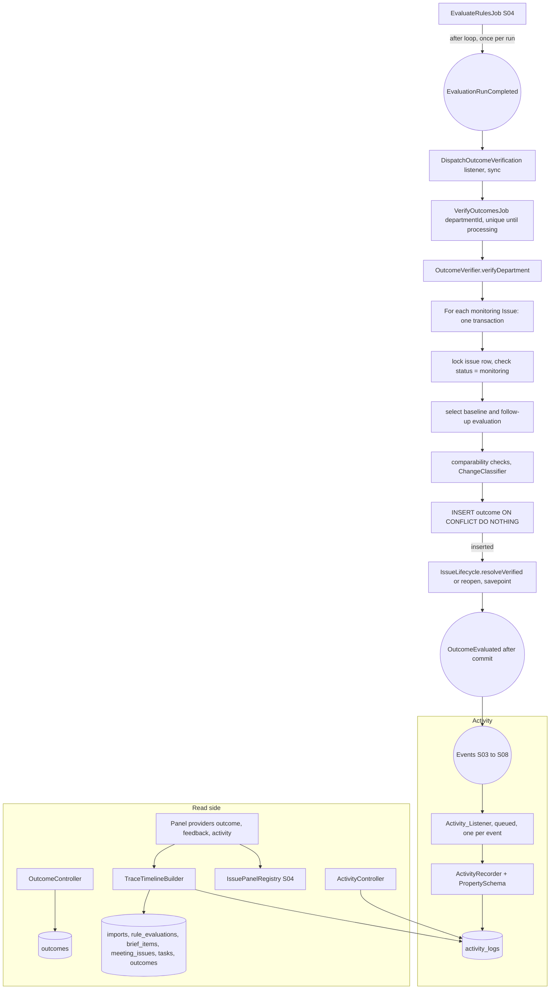
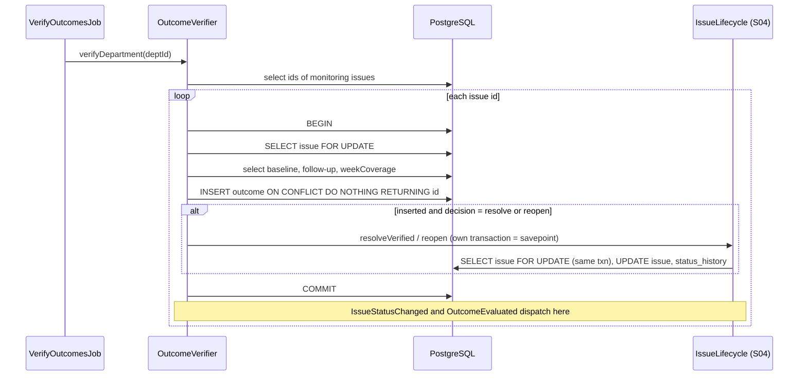

# Design Document

## Overview

S08 closes the lifecycle Detect, Understand, Decide, Execute, Verify. It has five parts:

1. `OutcomeVerifier`: a deterministic comparison of the preserved baseline evaluation of an Issue against the latest follow-up evaluation of the same rule. It writes an immutable `outcomes` row and asks S04's `IssueLifecycle` to resolve or reopen the Issue.
2. Outcome persistence: preserved evidence, one replaceable manual note, and useful / not useful feedback.
3. Outcome pages: `Outcomes/Index` (list) and `Outcomes/Show` (comparison view with chart).
4. `activity_logs`: a single append-only trace table. `ActivityRecorder` is the only writer, fed by one queued listener per event of S03 to S08. A feed page `Activity/Index` reads it.
5. Issue-detail panels registered into S04's `IssuePanelRegistry`: the slot keys `outcome`, `feedback` and `activity`. The `activity` slot carries the Trace_Timeline.

`activity_logs` is a trace and audit record. No Application state is derived from it. Every lifecycle state is read from its own table.

### Design decisions

| # | Decision | Reason |
|---|---|---|
| D1 | `EvaluationRunCompleted` is a new S04 event (approved). Its payload contract is in "Cross-spec change to S04". | `RuleEvaluated` is not dispatched for reused evaluations, so it cannot signal "run finished". |
| D2 | `VerifyOutcomesJob` implements `ShouldBeUniqueUntilProcessing` (a subtype of `ShouldBeUnique`). | With plain `ShouldBeUnique` the lock is held until the job ends. A run that completes while verification is running would be dropped, and an Issue that just entered `monitoring` would wait for the next run. Releasing the lock when processing starts closes that gap. Correctness does not depend on uniqueness (row locks and the unique constraint on `outcomes`). |
| D3 | For a `not_evaluable` Outcome, `change_value` is always null, `followup_value` is null, and `baseline_value` is set only when the baseline evaluation is not `insufficient_data`. For any other result all three are set. This is enforced by check constraints. | Requirement 4.9 forbids comparing partial or changed data, and requirement 9.5 forbids showing Change_Points for `not_evaluable`. The figures stay available in `evidence`. Requirement 1.7 is satisfied. |
| D4 | Decision precedence in `OutcomeVerifier`: resolve (requirement 6.1, 6.2) first, then reopen (6.3), otherwise no action (6.4). Requirement 6.4 lists `unchanged` as "no action", but an `unchanged` Outcome with a `not_breached` follow-up satisfies 6.1 and resolves. | 6.1 is stated as "if and only if", so it wins. This can happen when an Owner raised the threshold after the baseline. |
| D5 | All listeners use `tries = 4` (first attempt plus 3 retries) with backoff `[10, 30, 60]`. | "Retry up to 3 times with backoff of 10, 30 and 60 seconds". |
| D6 | The activity property filter is schema-driven (key, type, pattern, length) and drops invalid properties without dropping the row. | One mechanism enforces requirements 15.1 to 15.4 for all 31 event types. |
| D7 | Outcome immutability (requirement 7.5) is enforced by an `Outcome::updating` model guard that rejects changes to every column except `manual_note`, `manual_note_by`, `manual_note_at`, `updated_at`. No PostgreSQL trigger. | One writer path (the verifier plus `SaveOutcomeNote`). A trigger adds migration weight for no extra protection against our own code. |
| D8 | Slot keys. The S04 registry has fixed keys. The three S08 panels are `outcome` (Outcomes panel), `feedback` and `activity` (Trace panel). | Matches requirements 12 and 13 and the S04 `IssuePanelRegistry` constructor. |

### Research notes

- Laravel `ShouldDispatchAfterCommit` events dispatched inside `DB::transaction()` are deferred until the outermost transaction commits, including inside nested transactions (savepoints). This is what lets the verifier call `IssueLifecycle` (which opens its own transaction) inside the verifier's transaction and still have `IssueStatusChanged` fire only after the outer commit. See [Laravel events, dispatching after database transactions](https://laravel.com/docs/events#dispatching-events-after-database-transactions).
- `ShouldBeUniqueUntilProcessing` releases the unique lock when the job starts processing. See [Laravel queues, unique jobs](https://laravel.com/docs/queues#unique-jobs).
- PostgreSQL `INSERT ... ON CONFLICT (cols) DO NOTHING RETURNING id` returns no row on conflict, which gives a race-free "inserted or not" signal. `INSERT ... ON CONFLICT ... DO UPDATE ... RETURNING (xmax = 0) AS inserted` tells an insert from an update in one statement. See [PostgreSQL INSERT](https://www.postgresql.org/docs/current/sql-insert.html).
- `SELECT DISTINCT ON (issue_id) ... ORDER BY issue_id, evaluated_at DESC, id DESC` returns the latest Outcome per Issue in one pass, served by the index on (`issue_id`, `evaluated_at`). See [PostgreSQL SELECT, DISTINCT](https://www.postgresql.org/docs/current/sql-select.html#SQL-DISTINCT).
- bcmath functions operate on decimal strings with an explicit scale and do not use floats. See [PHP BC Math](https://www.php.net/manual/en/book.bc.php).

Content was rephrased for compliance with licensing restrictions.

## Architecture





### Module layout

```
app/
  Models/{Outcome,Feedback,ActivityLog}.php
  Enums/{OutcomeResult,OutcomePrimaryMetric,NotEvaluableReason,ComparabilityCheck,ActivitySubjectType,ActivityAction,ActivityStage}.php
  Policies/{OutcomePolicy,FeedbackPolicy,ActivityLogPolicy}.php
  Services/Outcomes/
    OutcomeVerifier.php
    ChangeClassifier.php                (pure: two Dec4 strings -> values + result)
    ComparabilityAssessor.php           (checks 1 to 5, builds evidence)
    OutcomeEvidenceBuilder.php
    OutcomeWording.php                  (labels, reason texts, standing sentence)
  Services/Activity/
    ActivityRecorder.php                (only writer of activity_logs)
    ActivityEntry.php                   (value object)
    PropertySchema.php                  (allowlist and filter)
    SubjectDepartmentResolver.php
    ActivityPresenter.php               (label, subject link, user name)
    TraceTimelineBuilder.php
  Actions/Outcomes/{SaveOutcomeNote,SubmitFeedback}.php
  Jobs/VerifyOutcomesJob.php
  Events/Outcomes/{OutcomeEvaluated,OutcomeNoteSaved,FeedbackSubmitted}.php
  Listeners/Outcomes/DispatchOutcomeVerification.php
  Listeners/Activity/RecordsActivity.php   (abstract) + one concrete class per event
  Panels/Outcomes/{OutcomePanelProvider,FeedbackPanelProvider,ActivityPanelProvider}.php
  Providers/OutcomesServiceProvider.php    (panel tags, listener map, rate limiter)
  Http/Controllers/{OutcomeController,OutcomeNoteController,FeedbackController,ActivityController}.php
  Http/Requests/{OutcomeIndexRequest,SaveOutcomeNoteRequest,SubmitFeedbackRequest,ActivityIndexRequest}.php
lang/en/activity.php                       (labels per action)
resources/js/pages/Outcomes/{Index,Show}.vue
resources/js/pages/Activity/Index.vue
resources/js/components/outcomes/{OutcomeResultBadge,ChangePointsText,OutcomeComparisonChart,ComparabilityChecks,OutcomeNoteForm,FeedbackControl,OutcomeNotice}.vue
resources/js/components/activity/{ActivityList,TraceTimeline}.vue
resources/js/issue-panels/s08.ts          (registers OutcomePanel, FeedbackPanel, TracePanel with S04's registerIssuePanel)
resources/js/issue-panels/{OutcomePanel,FeedbackPanel,TracePanel}.vue
```

## Cross-spec change to S04: `EvaluationRunCompleted` (approved)

This is the only change S08 makes to an earlier spec. S04 requirements, design and tasks are patched in cross-review. The patch is specified here so that it can be applied mechanically.

### Payload contract

```php
namespace App\Events\Intelligence;

final class EvaluationRunCompleted implements ShouldDispatchAfterCommit
{
    /** @param list<int> $evaluationIds */
    public function __construct(
        public readonly int $departmentId,
        public readonly ?int $importId,          // trigger import, null for manual Re-evaluate
        public readonly ?int $actorUserId,       // null = system (import-triggered)
        public readonly array $evaluationIds,    // see invariants
        public readonly CarbonImmutable $occurredAt,
    ) {}
}
```

| Property | Type | Contract |
|---|---|---|
| `departmentId` | int | The department the job evaluated. |
| `importId` | int or null | Same value the job received. Null for a manual Re-evaluate. |
| `actorUserId` | int or null | Same value the job received. Null for an import-triggered run. |
| `evaluationIds` | list of int | Ids of `rule_evaluations` rows of this department that the run processed, newly inserted and reused alike. Sorted ascending, no duplicates, never empty. A rule that was inactive, or whose evaluation threw, is not included. |
| `occurredAt` | CarbonImmutable | `now()` when the job finished the rule loop. |

Dispatch rules:

1. `EvaluateRulesJob` dispatches the event once per job run, after the rule loop and after the `last_evaluated_at` update, when at least one rule was processed without error (so `evaluationIds` is non-empty).
2. No dispatch when the lock was not acquired (job released), when every rule threw, or when the job fails.
3. At that point no transaction is open (each rule has its own committed transaction), so the event dispatches immediately. `ShouldDispatchAfterCommit` keeps it safe if a caller wraps the job in a transaction.
4. The event carries no figures, no text and no `companyId`. S08 derives the company from the department.
5. The dispatch is wrapped in `try { ... } catch (Throwable $e) { Log::warning('evaluation_run_completed_dispatch_failed', ['department_id' => ..., 'exception' => $e::class]); }`. A failure to announce must not fail an evaluation that already committed.
6. S08 does not select Issues from `evaluationIds` (assumption A2: all Monitoring_Issues of the department are checked). The ids are informational and allow a log line with a count.
7. S08 does not write an `activity_logs` row for this event (A15).

### Patch list for S04 (apply in cross-review)

| S04 document | Change |
|---|---|
| `requirements.md` | Add an acceptance criterion to the evaluation job requirement (Req 4): "WHEN `EvaluateRulesJob` has processed all active rules of a department and at least one rule was processed without error, THE job SHALL dispatch `EvaluationRunCompleted` once with the properties `departmentId`, `importId`, `actorUserId`, `evaluationIds` and `occurredAt`." Add the event to the event list of Req 16 with "not dispatched when the lock is not acquired or all rules fail". State in Req 16.7 that S04 still writes no `activity_logs` rows. |
| `design.md` | In "Events contract" add a row for `EvaluationRunCompleted` (extra properties `evaluationIds`; dispatched when the loop finishes with at least one successful rule; not dispatched on lock contention or total failure). In the `EvaluateRulesJob` snippet, make `evaluateOneRule` return the evaluation id (inserted or reused), collect the ids in `$evaluationIds`, and after the `jsonb_set` update add the guarded dispatch (rule 5 above). Add the event to the module layout under `Events/Intelligence`. Update the architecture flowchart node "DONE" to show the event. |
| `tasks.md` | Add one task: "Create `EvaluationRunCompleted`, collect evaluation ids in `EvaluateRulesJob`, dispatch after the loop. Verify by fixture: one dispatch per run, none when every rule fails, none on lock contention." Add the event to the manual fixture checks of the S04 verification section (step 5 re-upload: event still dispatches, `evaluationIds` contain the reused ids). |
| `docs/architecture.md` | Listed in S08 requirement 21.6. |

Diff sketch for the S04 job (illustrative, not an implementation):

```php
$evaluationIds = [];
foreach ($rules as $rule) {
    try {
-       $this->evaluateOneRule($rule, $ctx, $evidence, $issues, $notifier);
+       $evaluationIds[] = $this->evaluateOneRule($rule, $ctx, $evidence, $issues, $notifier); // int, inserted or reused
        $anyWritten = true;
    } catch (Throwable $e) { /* unchanged */ }
}
if ($anyWritten) {
    /* unchanged jsonb_set update of last_evaluated_at */
+   $this->announceRunCompleted($department->id, array_values(array_unique($evaluationIds)));
}
```

## Components and Interfaces

### Outcome verification trigger

```php
final class DispatchOutcomeVerification            // listener of EvaluationRunCompleted, synchronous, not queued
{
    public function handle(EvaluationRunCompleted $e): void
    {
        VerifyOutcomesJob::dispatch($e->departmentId);   // one INSERT into jobs; no other work
    }
}

final class VerifyOutcomesJob implements ShouldQueue, ShouldBeUniqueUntilProcessing
{
    public int $tries = 4;                         // D5
    public array $backoff = [10, 30, 60];
    public function __construct(public readonly int $departmentId) {}
    public function uniqueId(): string { return (string) $this->departmentId; }

    public function handle(OutcomeVerifier $verifier): void
    {
        $verifier->verifyDepartment($this->departmentId);   // throws VerificationIncomplete when any issue failed
    }

    public function failed(Throwable $e): void
    {
        Log::warning('verify_outcomes_failed', ['department_id' => $this->departmentId, 'exception' => $e::class]); // requirement 2.5
    }
}
```

`verifyDepartment` verifies every Issue, isolating failures per Issue, then throws `VerificationIncomplete` (carrying only a count) if at least one Issue failed so that the job retries. A retry is safe because every step is idempotent (requirement 7.1).

### OutcomeVerifier algorithm

Constants (assumption A4): `CHANGE_THRESHOLD = '2.00'`, `RESOLUTION_WEEKS = 1`.

```
function verifyDepartment(departmentId):
    ids = Issue::where(department_id = departmentId, status = 'monitoring')->pluck('id')
    if ids is empty: return                                   // requirement 2.7: no rows written
    failures = 0
    foreach id in ids:
        try:  result = verifyIssue(id)
        catch Throwable e:
            failures++
            Log::warning('verify_issue_failed', {issue_id: id, exception: class(e)})   // ids and class only
    if failures > 0: throw VerificationIncomplete(failures)

function verifyIssue(issueId): ?OutcomeEvaluated
    return DB::transaction(function () use (issueId):
        issue = Issue::lockForUpdate()->find(issueId)
        if issue == null or issue.status != 'monitoring': return null            // 3.7, 6.8

        baseline = RuleEvaluation::find(issue.baseline_evaluation_id)            // never latest_evaluation_id (3.2)
        followup = RuleEvaluation::where(business_rule_id = issue.business_rule_id,
                                         department_id    = issue.department_id)
                       ->where(id != baseline.id)
                       ->orderByDesc(period_start)->orderByDesc(id)->first()      // 3.3
        if followup == null: return null                                          // 3.4

        // cheap pre-check: skips coverage queries when this pair was already recorded.
        // The unique constraint below is the actual guard.
        if Outcome::where(issue_id = issue.id, followup_evaluation_id = followup.id)->exists(): return null

        rule      = BusinessRule::find(issue.business_rule_id)
        metric    = primaryMetricFor(rule.key)                                    // enum map, 3.5
        assessed  = ComparabilityAssessor.assess(issue.department, baseline, followup)   // below
        comparable = assessed.failedCheck == null

        if comparable:
            baselineValue = MetricCalculator::display2(baseline.difference_pct)   // round FIRST, 2 dp, half up
            followupValue = MetricCalculator::display2(followup.difference_pct)
            changeValue   = bcsub(followupValue, baselineValue, 2)                // delta of the ROUNDED values (A6)
            result        = ChangeClassifier::classify(changeValue)
            reason        = null
        else:
            baselineValue = (baseline.result != 'insufficient_data') ? display2(baseline.difference_pct) : null   // D3
            followupValue = null; changeValue = null
            result = 'not_evaluable'; reason = assessed.failedCheck.reason

        resolutionMet = comparable and followup.result == 'not_breached'          // 6.1
        evidence = OutcomeEvidenceBuilder.build(rule, baseline, followup, assessed, metric, baselineValue, followupValue, changeValue)

        outcomeId = insertOutcome(...)                                            // ON CONFLICT DO NOTHING RETURNING id
        if outcomeId == null: return null                                         // conflict: nothing else happens (7.1)

        action = decide(comparable, resolutionMet, result, followup.result)       // D4
        lifecycleAction = 'none'
        if action == 'resolve':
            lifecycleAction = callLifecycle(fn => IssueLifecycle::resolveVerified(issue, outcomeId), 'resolved', issue.id)
        elif action == 'reopen':
            lifecycleAction = callLifecycle(fn => IssueLifecycle::reopen(issue, "Outcome {outcomeId} showed the metric worsened"), 'reopened', issue.id)

        OutcomeEvaluated::dispatch(outcomeId, issue.id, departmentId, companyId, null, now(),
                                   result, comparable, resolutionMet, lifecycleAction)    // deferred to commit
        return that event
    )

function decide(comparable, resolutionMet, result, followupResult): 'resolve' | 'reopen' | 'none'
    if resolutionMet:                                              return 'resolve'
    if comparable and result == 'worsened' and followupResult == 'breached': return 'reopen'
    return 'none'

function callLifecycle(call, okLabel, issueId): string
    try:
        DB::transaction(call)          // nested = savepoint; an exception rolls back only the lifecycle part
        return okLabel
    catch IssueTransitionNotAllowedException e:            // 6.6
        Log::warning('outcome_lifecycle_rejected', {issue_id: issueId, exception: class(e)})
        return 'none'                                      // Outcome row stays, no retry
```

Notes:

- **Rounding before delta.** `difference_pct` is stored by S04 at 4 dp. The verifier rounds each value to 2 dp half up (`MetricCalculator::display2`, which rounds the absolute value and re-applies the sign, and never returns `-0.00`), and only then subtracts. Worked example for the target shortfall demo: 79.4872 becomes 79.49, 96.1538 becomes 96.15, change `bcsub('96.15','79.49',2)` = `16.66`. A delta of the 4 dp values would be 16.6666 and display as 16.67, which does not match `docs/demo-scenario.md`.
- **No floats.** `difference_pct` is read from the `numeric(8,4)` column as a string (model cast `string`, never `float`/`decimal` cast to number). All arithmetic is `bcsub` and `bccomp` at scale 2.
- **Reading values.** The verifier reads `rule_evaluations.difference_pct`, never `sales_records` (requirements 3.6, 5.7).
- **Reopen with a stale follow-up.** After a reopen the Issue can return to `monitoring` with the same latest evaluation. The existing Outcome for that pair makes the pre-check and the unique constraint skip it, so the Issue is not reopened in a loop. A new Outcome appears only after a new evaluation exists.
- **Worsened but not breached.** `worsened` with a `not_breached` follow-up is possible only after a threshold change. Then `resolutionMet` is true and the Issue resolves (D4).
- **Locking.** The Issue row lock is taken once by the verifier. `IssueLifecycle::transition` takes `lockForUpdate` on the same row inside the same database transaction, which PostgreSQL grants immediately.

### ChangeClassifier

Pure, no I/O. Takes the already rounded 2 dp values.

```php
final class ChangeClassifier
{
    public const THRESHOLD = '2.00';

    /** @return array{baseline:string, followup:string, change:string, result:OutcomeResult} */
    public static function fromDec4(string $baselineDec4, string $followupDec4): array
    {
        $b = MetricCalculator::display2($baselineDec4);      // round before delta
        $f = MetricCalculator::display2($followupDec4);
        $c = bcsub($f, $b, 2);
        return ['baseline' => $b, 'followup' => $f, 'change' => $c, 'result' => self::classify($c)];
    }

    public static function classify(string $change): OutcomeResult
    {
        if (bccomp($change, self::THRESHOLD, 2) >= 0)              return OutcomeResult::Improved;   // >= +2.00
        if (bccomp($change, '-' . self::THRESHOLD, 2) <= 0)        return OutcomeResult::Worsened;   // <= -2.00
        return OutcomeResult::Unchanged;
    }
}
```

`bcsub` output with scale 2 can yield `-0.00` for equal inputs in some PHP versions. The classifier normalises that string to `0.00` before storing (`$c = bccomp($c, '0', 2) === 0 ? '0.00' : $c`).

### Comparability checks

`ComparabilityAssessor::assess(department, baseline, followup)` runs five checks in this order and stops at the first failure (requirement 4.1). Checks after the failing one are recorded as `skipped`.

| # | Check name (stored) | Passes when | Failure reason (`not_evaluable_reason`) | Plain-language text |
|---|---|---|---|---|
| 1 | `baseline_sufficient` | `baseline.result != 'insufficient_data'` | `baseline_insufficient_data` | The baseline week did not have enough data to compare. |
| 2 | `followup_after_baseline` | `followup.period_start > baseline.period_end` | `followup_not_after_baseline` | The latest evaluation is not for a later period than the baseline. |
| 3 | `followup_sufficient` | `followup.result != 'insufficient_data'` | `followup_insufficient_data` | The follow-up week did not have enough data to compare. |
| 4 | `followup_week_complete` | `ReportingCoverage::weekCoverage(department, followup.period_start->startOfIsoWeek())->status == 'complete'` | `followup_period_partial` | The follow-up week is not complete yet, so it was not compared. |
| 5 | `same_branches` | set of `evidence.coverage.expectedBranches` is equal in both evaluations (compared as sorted sets) | `branches_changed` | The branches reported in the follow-up week differ from the baseline week. |

The assessment result:

```
Assessment { checks: [{name, state: 'passed'|'failed'|'skipped'}], failedCheck: ?Check, coverage: ?{weekStart, weekEnd, status, expectedBranchDays, presentBranchDays} }
```

`coverage` holds the numbers returned by `weekCoverage` (only filled when check 4 ran). No zero is substituted for a missing value and a partial week is never compared (requirement 4.9).

### Outcome evidence snapshot (`outcomes.evidence`, JSONB)

Built once at insertion and never changed. Paths on the S04 evaluation evidence follow the S04 design (`coverage.expectedBranches`, `contributingImportIds`, `thresholdUsed`, `paramsUsed`).

```json
{
  "schemaVersion": 1,
  "ruleKey": "weekly_revenue_decline",
  "primaryMetric": "weekly_change_pct",
  "baseline": {
    "evaluationId": 41, "periodStart": "2026-09-14", "periodEnd": "2026-09-20",
    "result": "breached", "severity": "high", "differencePct4": "-20.0000",
    "thresholdUsed": "15.00", "paramsUsed": {"high_drop_pct": "25"},
    "expectedBranches": ["JB","KL","PG"], "contributingImportIds": [7]
  },
  "followup": {
    "evaluationId": 58, "periodStart": "2026-09-21", "periodEnd": "2026-09-27",
    "result": "not_breached", "severity": null, "differencePct4": "20.9677",
    "thresholdUsed": "15.00", "paramsUsed": {"high_drop_pct": "25"},
    "expectedBranches": ["JB","KL","PG"], "contributingImportIds": [9]
  },
  "checks": [
    {"name": "baseline_sufficient",    "state": "passed"},
    {"name": "followup_after_baseline","state": "passed"},
    {"name": "followup_sufficient",    "state": "passed"},
    {"name": "followup_week_complete", "state": "passed"},
    {"name": "same_branches",          "state": "passed"}
  ],
  "coverage": {"weekStart": "2026-09-21", "weekEnd": "2026-09-27", "status": "complete",
               "expectedBranchDays": 21, "presentBranchDays": 21},
  "thresholds": {"changePoints": "2.00", "resolutionWeeks": 1},
  "values": {"baseline": "-20.00", "followup": "20.97", "change": "40.97"}
}
```

`values` is null for `not_evaluable`. Dates above are illustrative. All decimals are strings.

### Idempotency

| Case | Mechanism | Result |
|---|---|---|
| Verify job runs again, same Issue and same follow-up | Pre-check `exists()`, then `INSERT ... ON CONFLICT (issue_id, followup_evaluation_id) DO NOTHING RETURNING id` returns no row | Return before any lifecycle call or event. 7.1 |
| Two verify jobs for one department overlap (D2) | Per-Issue row lock serialises them. The second sees either a changed status or a conflict | One Outcome. |
| Corrected import gives a new evaluation (new `run_key`) for a Monitoring_Issue | New `followup_evaluation_id` | An additional Outcome. The earlier one is untouched. 7.2 |
| Re-upload of an unchanged file | S04 reuses the `run_key`, no new evaluation, so the follow-up pair is unchanged | No Outcome, no `outcome.evaluated` row. 20.9 |
| Sales data corrected after an Outcome exists | Pages render from `outcomes` and `evidence` only | Stored values unchanged. 7.4, 7.6 |

The insert statement:

```sql
INSERT INTO outcomes (issue_id, baseline_evaluation_id, followup_evaluation_id, primary_metric,
                      baseline_value, followup_value, change_value, result, not_evaluable_reason,
                      comparable, resolution_condition_met, evidence, evaluated_at, created_at, updated_at)
VALUES (:issue, :baseline, :followup, :metric, :bv, :fv, :cv, :result, :reason,
        :comparable, :met, :evidence::jsonb, :now, :now, :now)
ON CONFLICT (issue_id, followup_evaluation_id) DO NOTHING
RETURNING id;
```

### Transaction and failure behavior

- One database transaction per Issue holds the row lock, the Outcome insert and the lifecycle call (requirement 6.5). Lifecycle events (`IssueStatusChanged`) and `OutcomeEvaluated` are dispatched after that transaction commits.
- The lifecycle call runs in a nested `DB::transaction` (savepoint). `IssueTransitionNotAllowedException` rolls back only the savepoint, the Outcome stays, and the verifier logs the Issue id and the exception class (requirement 6.6).
- Any other exception rolls back the whole Issue transaction (no Outcome, no status change) and is counted as a failure for that Issue. The other Issues are still verified, and the job retries.
- The verifier never writes `issues.baseline_evaluation_id`, `rule_evaluations`, `business_rules` or tasks (requirement 6.7).

### Outcome notes and feedback actions

`SaveOutcomeNote::handle(Outcome $outcome, User $actor, string $note)`:

```
DB::transaction:
    Outcome::whereKey(outcome.id)->update(manual_note = note, manual_note_by = actor.id, manual_note_at = now())   // replaces (A13)
    OutcomeNoteSaved::dispatch(outcome.id, issueId, departmentId, companyId, actor.id, now())    // after commit, no text
```

`SubmitFeedback::handle(User $actor, Issue|Outcome $target, bool $useful, ?string $note)` runs one upsert statement:

```sql
-- Outcome target
INSERT INTO feedback (user_id, outcome_id, issue_id, useful, note, created_at, updated_at)
VALUES (:user, :outcome, NULL, :useful, :note, now(), now())
ON CONFLICT (user_id, outcome_id) DO UPDATE SET useful = EXCLUDED.useful, note = EXCLUDED.note, updated_at = now()
RETURNING id, (xmax = 0) AS inserted;

-- Issue target
INSERT INTO feedback (user_id, outcome_id, issue_id, useful, note, created_at, updated_at)
VALUES (:user, NULL, :issue, :useful, :note, now(), now())
ON CONFLICT (user_id, issue_id) WHERE outcome_id IS NULL DO UPDATE SET useful = EXCLUDED.useful, note = EXCLUDED.note, updated_at = now()
RETURNING id, (xmax = 0) AS inserted;
```

`isUpdate = !inserted`. `FeedbackSubmitted` is dispatched after commit with `targetType`, `useful`, `hasNote = note !== null && note !== ''` and `isUpdate`. Feedback never changes a rule (requirement 11.7).

### Events (`App\Events\Outcomes`)

All three implement `ShouldDispatchAfterCommit`. Common properties: `?int $outcomeId` (null for Feedback on an Issue), `int $issueId`, `int $departmentId`, `int $companyId`, `?int $actorUserId` (null when the verifier acts), `CarbonImmutable $occurredAt`.

| Event | Extra properties | Dispatched when |
|---|---|---|
| `OutcomeEvaluated` | `string $result`, `bool $comparable`, `bool $resolutionConditionMet`, `string $lifecycleAction` (`resolved`, `reopened`, `none`) | A new Outcome row was inserted. Not on a conflicting insert. |
| `OutcomeNoteSaved` | none | A note was stored. |
| `FeedbackSubmitted` | `string $targetType` (`issue`, `outcome`), `bool $useful`, `bool $hasNote`, `bool $isUpdate` | A vote was stored. |

No event carries note text, evidence or figures (requirement 17.6).

### ActivityRecorder and PropertySchema

`ActivityRecorder::record(ActivityEntry $entry): void` is the only code that runs `INSERT INTO activity_logs`. An `ActivityEntry` holds: `companyId`, `departmentId?`, `userId?`, `action` (`ActivityAction`), `subjectType` (`ActivitySubjectType`), `subjectId`, `issueId?`, `properties` (raw array), `createdAt`.

`PropertySchema` is declared per action. For every raw property it keeps only keys named in the schema, validates the value against the declared type, and drops the property on any mismatch:

| Schema type | Accepts | Notes |
|---|---|---|
| `int` | integer | `null` allowed where marked nullable |
| `bool` | boolean | |
| `date` | string matching `^\d{4}-\d{2}-\d{2}$` | |
| `code` | string, at most 100 characters, pattern `^[A-Za-z0-9_.:/+-]+$` | Spaces and `@` are rejected, so free text and email addresses cannot pass (requirement 15.3, 15.4). Used for enum codes such as `status`, `severity`, `mime`, `errorCode`. |
| `oldNew` | map of attribute name to `{old, new}` | Used only by `business_rule.updated`. Attribute names are limited to `threshold`, `severity`, `is_active` and `params.<key>` for the known param keys. Each old and new value is a scalar `code`-type string, number or boolean. |

The recorder never writes to the application log (requirement 15.5). A dropped property is silent.

### Activity listeners and failure isolation

```php
abstract class RecordsActivity implements ShouldQueue
{
    public int $tries = 4;                      // D5
    public array $backoff = [10, 30, 60];

    abstract protected function spec(): ActivitySpec;     // declarative description of the mapping

    public function handle(object $event): void
    {
        $spec = $this->spec();
        $companyId  = $spec->companyId($event) ?? Department::findOrFail($spec->departmentId($event))->company_id;
        $deptId     = $spec->departmentId($event) ?? SubjectDepartmentResolver::resolve($spec->subjectType, $spec->subjectId($event));
        foreach ($spec->issueIds($event) ?: [null] as $issueId) {                 // meeting events: n rows or 1 row with null
            ActivityRecorder::record(new ActivityEntry(
                companyId: $companyId, departmentId: $deptId, userId: $event->actorUserId ?? null,
                action: $spec->action, subjectType: $spec->subjectType, subjectId: $spec->subjectId($event),
                issueId: $issueId, properties: $spec->properties($event),
                createdAt: $event->occurredAt,
            ));
        }
    }

    public function failed(object $event, Throwable $e): void
    {
        Log::warning('activity_listener_failed', ['listener' => static::class, 'exception' => $e::class]);
    }
}
```

Each concrete listener only supplies `spec()`. Two examples:

```php
final class RecordImportCompleted extends RecordsActivity
{
    protected function spec(): ActivitySpec
    {
        return ActivitySpec::for(ImportCompleted::class, ActivityAction::ImportCompleted, ActivitySubjectType::Import)
            ->subjectId(fn ($e) => $e->importId)
            ->properties(fn ($e) => [
                'status' => $e->status, 'insertedRows' => $e->insertedRows, 'correctedRows' => $e->correctedRows,
                'unchangedRows' => $e->unchangedRows, 'invalidRows' => $e->invalidRows,
                'minDate' => $e->minDate, 'maxDate' => $e->maxDate,
            ]);
    }
}

final class RecordExtractionCompleted extends RecordsActivity
{
    protected function spec(): ActivitySpec
    {
        return ActivitySpec::for(ExtractionCompleted::class, ActivityAction::MeetingExtractionCompleted, ActivitySubjectType::Meeting)
            ->subjectId(fn ($e) => $e->meetingId)
            ->issueIds(fn ($e) => $e->issueIds)                  // one row per Issue id (A10)
            ->properties(fn ($e) => ['extractionRun' => $e->extractionRun, 'decisionCount' => $e->decisionCount, 'taskDraftCount' => $e->taskDraftCount]);
    }
}
```

Registration is an explicit event-to-listener array in `OutcomesServiceProvider` (no discovery), so the list matches the mapping table and can be checked by reading one file.

Failure isolation:

1. Listeners are queued on the database queue, so the dispatching action never waits for the insert and an insert error cannot reach it (requirement 14.7).
2. Events from S03 to S08 are dispatched after commit, so the producing action has committed before any listener is pushed.
3. A failed listener retries 3 times with 10, 30 and 60 seconds. After that it lands in `failed_jobs`, and `failed()` logs the listener class and the exception class only.
4. Each listener performs one `INSERT` per row, so a retry after a failed attempt creates no duplicate. A duplicate is possible only when the insert committed and the queue acknowledgement was lost (A9, accepted). A dedupe key column was rejected for Stage 1 because of that accepted residual risk.
5. Residual risk: pushing the queued listener uses the same database as the request. If the database is down, the push fails together with the action itself. This is the same failure domain and is accepted.
6. `EvaluationRunCompleted` has only the synchronous `DispatchOutcomeVerification` listener and no activity listener (A15).

### Event to activity mapping

Common to every row: `company_id` comes from the event's `companyId`, or from the department of the event's `departmentId`. `user_id` is the event's `actorUserId`. `created_at` is the event's `occurredAt`.

`department_id` resolution order: the event's `departmentId`, then `SubjectDepartmentResolver` (below), then null. Cross-review must confirm that the S03 and S05 to S07 event classes expose the property names used here.

`SubjectDepartmentResolver`: Import → `imports.department_id`; RuleEvaluation → `rule_evaluations.department_id`; BusinessRule → `business_rules.department_id`; Issue → `issues.department_id`; Brief → `briefs.department_id` if the column exists, else null; Meeting → `meetings.department_id`; TaskDraft and Task → `tasks.department_id` or the department of the linked Issue; Outcome → department of the Outcome's Issue.

| Event | Action | Subject type, subject id | `issue_id` source | `department_id` source | Allowed `properties` (key: type) |
|---|---|---|---|---|---|
| `ImportValidated` | `import.validated` | Import, `importId` | null | event `departmentId`, else Import | none |
| `ImportConfirmed` | `import.confirmed` | Import, `importId` | null | same | none |
| `ImportCancelled` | `import.cancelled` | Import, `importId` | null | same | none |
| `ImportCompleted` | `import.completed` | Import, `importId` | null | same | `status`: code; `insertedRows`, `correctedRows`, `unchangedRows`, `invalidRows`: int; `minDate`, `maxDate`: date |
| `ImportFailed` | `import.failed` | Import, `importId` | null | same | none |
| `ImportFileDownloaded` | `import.file_downloaded` | Import, `importId` | null | same | none |
| `RuleEvaluated` | `rule_evaluation.evaluated` | RuleEvaluation, `evaluationId` | null | event `departmentId` | `ruleKey`: code; `result`: code; `severity`: code, nullable; `importId`: int, nullable |
| `IssueCreated` | `issue.created` | Issue, `issueId` | `issueId` | event `departmentId` | `severity`: code; `recurrenceOfIssueId`: int, nullable |
| `IssueRedetected` | `issue.redetected` | Issue, `issueId` | `issueId` | event `departmentId` | `detectionCount`: int; `previousSeverity`: code; `newSeverity`: code |
| `IssueStatusChanged` | `issue.status_changed` | Issue, `issueId` | `issueId` | event `departmentId` | `from`: code, nullable; `to`: code; `hasReason`: bool (derived from `reason !== null`) |
| `UrgentIssueNotified` | `issue.urgent_notified` | Issue, `issueId` | `issueId` | event `departmentId` | `severity`: code; `recipientCount`: int (count of `recipientUserIds`) |
| `BusinessRuleUpdated` | `business_rule.updated` | BusinessRule, `businessRuleId` | null | event `departmentId` | `changedAttributes`: oldNew |
| `BriefRequested` | `brief.requested` | Brief, `briefId` | null | event `departmentId` if present, else Brief, else null | none |
| `BriefGenerated` | `brief.generated` | Brief, `briefId` | null | same | `source`: code; `itemCount`: int |
| `BriefFailed` | `brief.failed` | Brief, `briefId` | null | same | `errorCode`: code |
| `BriefAudioGenerated` | `brief.audio_generated` | Brief, `briefId` | null | same | none |
| `MeetingCreated` | `meeting.created` | Meeting, `meetingId` | one row per `issueIds` entry, or one row with null | event `departmentId`, else Meeting | none |
| `RecordingUploaded` | `meeting.recording_uploaded` | Meeting, `meetingId` | same | same | `sizeBytes`: int; `mime`: code |
| `TranscriptReady` | `meeting.transcript_ready` | Meeting, `meetingId` | same | same | `transcriptSource`: code |
| `TranscriptEdited` | `meeting.transcript_edited` | Meeting, `meetingId` | same | same | none |
| `ExtractionCompleted` | `meeting.extraction_completed` | Meeting, `meetingId` | same | same | `extractionRun`: int; `decisionCount`: int; `taskDraftCount`: int |
| `MeetingProcessingFailed` | `meeting.processing_failed` | Meeting, `meetingId` | same | same | `stage`: code; `errorCode`: code |
| `RecordingDeleted` | `meeting.recording_deleted` | Meeting, `meetingId` | same | same | `reason`: code |
| `TaskDraftApproved` | `task_draft.approved` | Task, `taskId` | `issueId` | event `departmentId`, else Task | `taskDraftId`: int; `assigneeId`: int, nullable |
| `TaskDraftRejected` | `task_draft.rejected` | TaskDraft, `taskDraftId` | `issueId` | same | `hasReason`: bool |
| `TaskAssigned` | `task.assigned` | Task, `taskId` | `issueId` | same | `assigneeId`: int; `previousAssigneeId`: int, nullable |
| `TaskStatusChanged` | `task.status_changed` | Task, `taskId` | `issueId` | same | `from`: code; `to`: code |
| `TaskCompleted` | `task.completed` | Task, `taskId` | `issueId` | same | `assigneeId`: int, nullable |
| `TaskCommentAdded` | `task.comment_added` | Task, `taskId` | `issueId` | same | `commentId`: int |
| `OutcomeEvaluated` | `outcome.evaluated` | Outcome, `outcomeId` | `issueId` | event `departmentId` | `result`: code; `comparable`: bool; `resolutionConditionMet`: bool; `lifecycleAction`: code |
| `OutcomeNoteSaved` | `outcome.note_saved` | Outcome, `outcomeId` | `issueId` | event `departmentId` | none |
| `FeedbackSubmitted` | `feedback.submitted` | Outcome if `targetType = outcome`, else Issue; id is `outcomeId` or `issueId` | `issueId` | event `departmentId` | `targetType`: code; `useful`: bool; `hasNote`: bool; `isUpdate`: bool |

`EvaluationRunCompleted`: no row (requirement 14.11).

### Action labels and timeline stages

Labels live in `lang/en/activity.php`, keyed by action. Placeholders such as `:from` and `:to` are filled from the stored properties only, with enum codes translated through the same lang file. The stage column is the mapping of requirement 13.4.

| Action | Stage | Label template |
|---|---|---|
| `import.validated` | Business data | Import checked |
| `import.confirmed` | Business data | Import confirmed |
| `import.completed` | Business data | Import completed: :insertedRows new, :correctedRows corrected rows |
| `import.failed` | Business data | Import failed |
| `import.cancelled` | Business data | Import cancelled |
| `import.file_downloaded` | not in timeline | Import file downloaded |
| `rule_evaluation.evaluated` | Rule evaluation | Rule evaluated: :result |
| `business_rule.updated` | Rule evaluation | Rule settings changed |
| `issue.created` | Issue | Issue created (:severity) |
| `issue.redetected` | Issue | Issue detected again (detection :detectionCount) |
| `issue.status_changed` | Issue | Status changed from :from to :to |
| `issue.urgent_notified` | Issue | Urgent alert sent to :recipientCount people |
| `brief.requested` | Brief | Brief requested |
| `brief.generated` | Brief | Brief generated (:itemCount items) |
| `brief.failed` | Brief | Brief failed |
| `brief.audio_generated` | Brief | Brief audio generated |
| `meeting.created` | Meeting | Meeting created |
| `meeting.recording_uploaded` | Meeting | Recording uploaded |
| `meeting.transcript_ready` | Meeting | Transcript ready |
| `meeting.transcript_edited` | Meeting | Transcript edited |
| `meeting.extraction_completed` | Meeting | Decisions and task drafts extracted (:decisionCount decisions, :taskDraftCount drafts) |
| `meeting.processing_failed` | Meeting | Meeting processing failed at :stage |
| `meeting.recording_deleted` | Meeting | Recording deleted |
| `task_draft.approved` | Task | Task draft approved |
| `task_draft.rejected` | Task | Task draft rejected |
| `task.assigned` | Task | Task assigned |
| `task.status_changed` | Task | Task status changed from :from to :to |
| `task.completed` | Task | Task completed |
| `task.comment_added` | Task | Comment added to task |
| `outcome.evaluated` | Outcome | Outcome recorded: :result |
| `outcome.note_saved` | Outcome | Outcome note saved |
| `feedback.submitted` | Outcome | Feedback recorded |

`business_rule.updated` has a stage for completeness, but requirement 13.5 does not select BusinessRule rows for an Issue, so it appears in the feed and not in a timeline. This is flagged under "Open points for cross-review".

### TraceTimelineBuilder

Input: `Issue $issue`, `User $actor`. Output: `TraceTimeline` with seven stages, in order Business data, Rule evaluation, Issue, Brief, Meeting, Task, Outcome. Returns null for Staff.

Steps:

```
1. outcomes      = Outcome::where(issue_id = issue.id)->get(id, followup_evaluation_id, evidence->baseline.contributingImportIds,
                                                           evidence->followup.contributingImportIds, evaluated_at, result, manual_note_by)
   baselineEval  = RuleEvaluation::find(issue.baseline_evaluation_id)             // evidence.contributingImportIds
   evaluationIds = [issue.baseline_evaluation_id] + outcomes.followup_evaluation_id
   importIds     = unique( baselineEval.evidence.contributingImportIds + every outcome.evidence baseline and follow-up contributingImportIds )
2. briefIds      = BriefItem::where(issue_id = issue.id)->pluck('brief_id')       // S05
   meetingIds    = MeetingIssue::where(issue_id = issue.id)->pluck('meeting_id')  // S06
   tasks         = Task::where(issue_id = issue.id)->get(id, title, status, created_at, ...)   // S07
3. activity = ActivityLog::query()
       ->where('company_id', actor.company_id)
       ->whereNotIn('action', ['import.file_downloaded'])                            // 13.12
       ->where(fn($q) => $q
           ->where('issue_id', issue.id)
           ->orWhere(fn($q) => $q->where('subject_type', 'Import')->whereIn('subject_id', importIds))
           ->orWhere(fn($q) => $q->where('subject_type', 'RuleEvaluation')->whereIn('subject_id', evaluationIds))
           ->orWhere(fn($q) => $q->where('subject_type', 'Brief')->whereIn('subject_id', briefIds)))   // 13.5
       ->orderBy('created_at')->orderBy('id')->limit(500)->get()
4. visibility: for Brief, Meeting, Task, TaskDraft subjects, drop the entry when Gate::forUser(actor)->denies('view', record).
   Records are loaded in one query per type and checked in memory (no per-row queries).
5. details: batch-load titles and names for the remaining subjects (imports, briefs, meetings, tasks, outcomes) and user names by id.
6. synthetic entries: for each linked record with no activity row of its own subject in its stage, add a record entry
   (Import: created_at, label "Import uploaded"; Brief: created_at, "Brief created"; Meeting: created_at, "Meeting created";
   Task: created_at, "Task created"; Outcome: evaluated_at, "Outcome recorded"). Marked kind = 'record'.
7. map each action to a stage with ActivityStage::forAction(); group by stage;
   sort entries inside a stage by (created_at ASC, id ASC), synthetic entries by their time then a stable key.
8. empty stage -> { entries: [], empty: true } (rendered "No activity yet", neutral style).
```

Rules applied:

- Entries use the label template with stored properties only. Titles, names and statuses are read from the linked records at read time and never from `properties` free text (requirement 13.8). If the linked record no longer exists, the entry is kept without a link (13.9).
- Entries of other Issues are excluded because every branch of step 3 is tied to this Issue's ids. An Import or Brief shared with another Issue shows only its own activity rows (rows with that subject), which carry no other Issue's content.
- Times are formatted server side in the company timezone (`companies.timezone`) as an ISO 8601 string with offset plus a display string. User name is `System` when `user_id` is null.
- Links: Import → imports page, Brief → brief page, Meeting → meeting page, Task → task page, Outcome → `/outcomes/{id}`, Issue → none (the panel is already on it). A link is included only when `Gate::allows('view', record)`.
- The query is bounded (limit 500). When the limit is reached the payload sets `truncated = true` and the panel shows "Showing the first 500 entries".

### Panel providers

Registered by `OutcomesServiceProvider::boot()` with `$this->app->tag([OutcomePanelProvider::class, FeedbackPanelProvider::class, ActivityPanelProvider::class], IssuePanelRegistry::TAG)` and the matching frontend registration in `resources/js/issue-panels/s08.ts`. S04 code is not changed. Every provider returns null for Staff.

| Provider | `key()` | Payload (JSON-serialisable) |
|---|---|---|
| `OutcomePanelProvider` | `outcome` | `null` when the Issue has no Outcome. Otherwise `{ heading, standingSentence, latest: OutcomeSummary, earlier: OutcomeLink[] (max 4, newest first) }` |
| `FeedbackPanelProvider` | `feedback` | `{ mine: boolean \| null, counts: { useful, notUseful }, submitUrl }` for the Issue target |
| `ActivityPanelProvider` | `activity` | `{ stages: TimelineStage[], truncated: boolean }` from `TraceTimelineBuilder` |

```ts
interface OutcomeSummary {
  id: number; result: 'improved'|'unchanged'|'worsened'|'not_evaluable';
  resultLabel: string; primaryMetricLabel: string;
  baselineValue: string|null; followupValue: string|null; changePoints: string|null;   // "+40.97"
  evaluatedAt: string; evaluatedAtLabel: string;
  resolutionConditionMet: boolean; notEvaluableText: string|null;
  manualNote: string|null; url: string;
}
interface OutcomeLink { id: number; resultLabel: string; evaluatedAtLabel: string; url: string }
interface TimelineEntry {
  key: string; kind: 'activity'|'record'; at: string; atLabel: string; label: string;
  userName: string;               // "System" when null
  subject: { type: string; id: number; title: string|null; url: string|null };
}
interface TimelineStage { stage: 'business_data'|'rule_evaluation'|'issue'|'brief'|'meeting'|'task'|'outcome';
                          stageLabel: string; empty: boolean; entries: TimelineEntry[] }
```

The panels never contain transcript text, CSV content or secrets (requirement 12.7). The `OutcomePanel` and the comparison page show the heading "Observed change after actions" and the standing sentence "This shows what changed after actions were taken. It does not show that the actions caused the change."

## Data Models

All three tables are new. Percent values and `change_value` use `numeric(8,2)`. Each migration has a working `down()`.

### Migration 1: `outcomes`

```php
Schema::create('outcomes', function (Blueprint $t) {
    $t->id();
    $t->foreignId('issue_id')->constrained()->restrictOnDelete();
    $t->foreignId('baseline_evaluation_id')->constrained('rule_evaluations')->restrictOnDelete();
    $t->foreignId('followup_evaluation_id')->constrained('rule_evaluations')->restrictOnDelete();
    $t->string('primary_metric');
    $t->decimal('baseline_value', 8, 2)->nullable();
    $t->decimal('followup_value', 8, 2)->nullable();
    $t->decimal('change_value', 8, 2)->nullable();
    $t->string('result');
    $t->string('not_evaluable_reason')->nullable();
    $t->boolean('comparable');
    $t->boolean('resolution_condition_met');
    $t->jsonb('evidence');
    $t->timestamp('evaluated_at');
    $t->text('manual_note')->nullable();
    $t->foreignId('manual_note_by')->nullable()->constrained('users')->restrictOnDelete();
    $t->timestamp('manual_note_at')->nullable();
    $t->timestamps();
    $t->unique(['issue_id', 'followup_evaluation_id']);
    $t->index(['issue_id', 'evaluated_at']);
    $t->index('followup_evaluation_id');
});
DB::unprepared(<<<'SQL'
ALTER TABLE outcomes
  ADD CONSTRAINT outcomes_metric_check CHECK (primary_metric IN ('weekly_change_pct','target_achievement_pct','coverage_pct')),
  ADD CONSTRAINT outcomes_result_check CHECK (result IN ('improved','unchanged','worsened','not_evaluable')),
  ADD CONSTRAINT outcomes_reason_values_check CHECK (not_evaluable_reason IS NULL OR not_evaluable_reason IN
      ('followup_not_after_baseline','followup_period_partial','branches_changed','baseline_insufficient_data','followup_insufficient_data')),
  ADD CONSTRAINT outcomes_reason_presence_check CHECK ((result = 'not_evaluable') = (not_evaluable_reason IS NOT NULL)),
  ADD CONSTRAINT outcomes_comparable_check CHECK (comparable = (result <> 'not_evaluable')),
  ADD CONSTRAINT outcomes_resolution_check CHECK (comparable OR NOT resolution_condition_met),
  ADD CONSTRAINT outcomes_values_check CHECK (
      (result = 'not_evaluable' AND followup_value IS NULL AND change_value IS NULL)
      OR (result <> 'not_evaluable' AND baseline_value IS NOT NULL AND followup_value IS NOT NULL AND change_value IS NOT NULL)),
  ADD CONSTRAINT outcomes_note_check CHECK (manual_note IS NULL OR char_length(manual_note) BETWEEN 1 AND 1000)
SQL);
```

`outcomes_values_check` implements D3. The `not_evaluable` branch leaves `baseline_value` free, so it may be null or set. `down()`: `Schema::dropIfExists('outcomes')` (constraints and indexes drop with the table).

### Migration 2: `feedback`

```php
Schema::create('feedback', function (Blueprint $t) {
    $t->id();
    $t->foreignId('user_id')->constrained()->restrictOnDelete();
    $t->foreignId('issue_id')->nullable()->constrained()->restrictOnDelete();
    $t->foreignId('outcome_id')->nullable()->constrained()->restrictOnDelete();
    $t->boolean('useful');
    $t->string('note', 500)->nullable();
    $t->timestamps();
    $t->unique(['user_id', 'outcome_id']);          // NULL outcome_id values are distinct in PostgreSQL, so issue rows do not collide
    $t->index('issue_id');
});
DB::unprepared(<<<'SQL'
ALTER TABLE feedback
  ADD CONSTRAINT feedback_one_target_check CHECK ((issue_id IS NOT NULL) <> (outcome_id IS NOT NULL));
CREATE UNIQUE INDEX feedback_user_issue_unique ON feedback (user_id, issue_id) WHERE outcome_id IS NULL;
SQL);
```

`<>` between the two booleans is true exactly when one and only one target is set (exactly-one rule). Feedback on an Outcome stores `issue_id = NULL`. The Issue of an Outcome is found through `outcomes.issue_id`. `down()` drops `feedback_user_issue_unique` explicitly and then the table.

### Migration 3: `activity_logs`

```php
Schema::create('activity_logs', function (Blueprint $t) {
    $t->id();
    $t->foreignId('company_id')->constrained()->restrictOnDelete();
    $t->foreignId('department_id')->nullable()->constrained()->restrictOnDelete();
    $t->foreignId('user_id')->nullable()->constrained()->restrictOnDelete();   // null = System
    $t->string('action');
    $t->string('subject_type');
    $t->unsignedBigInteger('subject_id');
    $t->foreignId('issue_id')->nullable()->constrained()->restrictOnDelete();
    $t->jsonb('properties')->default('{}');
    $t->timestamp('created_at');                       // no updated_at (requirement 14.1)
    $t->index(['issue_id', 'created_at']);
    $t->index(['subject_type', 'subject_id']);
    $t->index(['company_id', 'created_at']);
    $t->index(['company_id', 'department_id', 'created_at']);   // Manager feed scope
});
DB::statement("ALTER TABLE activity_logs ADD CONSTRAINT activity_logs_subject_type_check
  CHECK (subject_type IN ('Import','RuleEvaluation','BusinessRule','Issue','Brief','Meeting','TaskDraft','Task','Outcome'))");
```

There is no database check on `action`, so later specs can add actions without a migration. `ActivityAction` is an enum in code and the recorder rejects values outside it. `ActivityLog` has `public $timestamps = false`, and its model defines no update or delete path. The guarded `demo:reset` of S09 is the only code that deletes rows.

### Model notes

- `Outcome` casts: `evidence` as array, `comparable` and `resolution_condition_met` as boolean, `baseline_value`, `followup_value`, `change_value` as `string` (never float). `static::updating` throws `LogicException` when a changed attribute is outside the note columns (D7).
- `RuleEvaluation::difference_pct` must be cast as `string` for the verifier. The cross-review for S04 should confirm this cast.
- `Outcome::scopeVisibleTo(User $u)`: `whereIn('issue_id', Issue::visibleTo($u)->select('id'))`, using S04's scoped query, so Owner sees the company and Manager sees the department.
- `ActivityLog::scopeVisibleTo(User $u)`: Owner `where company_id`; Manager `where company_id and (department_id = ? or subject_type = 'Brief')` (requirement 18.2); Staff `whereRaw('false')`.

## Pages, routes and Inertia props

### Routes

All routes are inside the `auth` group with CSRF. Write routes carry `throttle:s08-writes` (20 per minute per user, defined with `RateLimiter::for` in `OutcomesServiceProvider`, keyed by user id).

| Method and path | Name | Controller action | Authorization |
|---|---|---|---|
| GET `/outcomes` | `outcomes.index` | `OutcomeController@index` | `OutcomePolicy::viewAny` |
| GET `/outcomes/{outcome}` | `outcomes.show` | `OutcomeController@show` | `viewAny`, then scoped lookup |
| PUT `/outcomes/{outcome}/note` | `outcomes.note.update` | `OutcomeNoteController@update` | `OutcomePolicy::saveNote` |
| POST `/outcomes/{outcome}/feedback` | `outcomes.feedback.store` | `FeedbackController@storeForOutcome` | `FeedbackPolicy::create` |
| POST `/issues/{issue}/feedback` | `issues.feedback.store` | `FeedbackController@storeForIssue` | `FeedbackPolicy::create` |
| GET `/activity` | `activity.index` | `ActivityController@index` | `ActivityLogPolicy::viewAny` |

Route parameters are not bound implicitly. Each controller authorizes `viewAny` first (Staff gets 403), then resolves the record with `Outcome::visibleTo($user)->find($id)` (or `Issue::visibleTo`) and aborts 404 when null. An id that does not exist and an id outside the scope take the same code path and give the same 404 response (requirement 18.4).

### `Outcomes/Index`

Props:

```ts
interface OutcomesIndexProps {
  outcomes: Paginated<OutcomeRow>;        // deferred prop so the page can show skeleton rows while it loads
  filters: { result: OutcomeResultCode|null; status: IssueStatusCode|null };
  options: { results: Option[]; statuses: Option[] };
}
interface OutcomeRow {
  id: number; issueId: number; issueTitle: string; ruleName: string; departmentName: string;
  issueStatus: IssueStatusCode; issueStatusLabel: string;
  result: OutcomeResultCode; resultLabel: string; notEvaluableText: string|null;
  baselineValue: string|null; followupValue: string|null; changePoints: string|null;   // "+40.97" with explicit sign
  evaluatedAt: string; evaluatedAtLabel: string; url: string;
}
```

Query:

```sql
SELECT o.* FROM outcomes o
WHERE o.id IN (SELECT DISTINCT ON (issue_id) id FROM outcomes ORDER BY issue_id, evaluated_at DESC, id DESC)
  AND o.issue_id IN (:visibleIssueIds)
  [AND o.result = :result] [AND issue.status = :status]
ORDER BY o.evaluated_at DESC, o.id DESC
LIMIT 15
```

Eager loading is `issue.businessRule` and `issue.department`. The page follows the S01 loading convention (skeleton rows, `ErrorState` with retry via `router.reload()`), uses `EmptyState` with the text from requirement 8.7, and styles `not_evaluable` rows in the neutral colour with the reason text. Invalid filter values are ignored (`OutcomeIndexRequest` returns only allowed values). Filters live in the query string and the paginator keeps them.

### `Outcomes/Show`

Props:

```ts
interface OutcomesShowProps {
  outcome: {
    id: number; heading: 'Observed change after actions'; standingSentence: string;
    issue: { id: number; title: string; status: IssueStatusCode; statusLabel: string; url: string };
    ruleName: string; departmentName: string;
    primaryMetric: 'weekly_change_pct'|'target_achievement_pct'|'coverage_pct'; primaryMetricLabel: string;
    baselinePeriod: { start: string; end: string }; followupPeriod: { start: string; end: string };
    baselineValue: string|null; followupValue: string|null; changePoints: string|null;
    result: OutcomeResultCode; resultLabel: string; notEvaluableText: string|null;
    comparable: boolean; resolutionText: 'Condition for resolution met'|'Condition for resolution not met';
    evaluatedAtLabel: string;
    checks: { name: string; label: string; state: 'passed'|'failed'|'skipped' }[];
    evidence: { baselineDifferencePct4: string|null; followupDifferencePct4: string|null; thresholdUsed: string;
                coverage: { status: string; expectedBranchDays: number; presentBranchDays: number }|null;
                changeThresholdPoints: '2.00'; resolutionWeeks: 1 };
    manualNote: { text: string; byName: string; atLabel: string }|null;
  };
  chart: { categories: string[]; values: string[]; unit: '%'; metricLabel: string }|null;   // null when not comparable
  otherOutcomes: OutcomeLink[];                                    // same Issue, newest first
  tasks: { id: number; title: string; assigneeName: string|null; dueDate: string|null; statusLabel: string; url: string|null }[];
  statusHistory: { at: string; atLabel: string; from: string|null; to: string; byName: string; reason: string|null }[]; // trigger outcome_verified or outcome_worsened only
  feedback: { mine: boolean|null; counts: { useful: number; notUseful: number };
              votes: { userName: string; useful: boolean; note: string|null; atLabel: string }[]|null };
  urls: { saveNote: string; submitFeedback: string; index: string };
}
```

The controller builds all of it from the `outcomes` row, its `evidence`, and the linked Issue, tasks and `status_history`. It does not query `sales_records` or `ReportingCoverage` (requirement 7.4). `OutcomeComparisonChart.vue` wraps the S01 `EChart` as a two-bar chart (baseline and follow-up) with dated category labels, for example `Baseline 14 to 20 Sep`, and passes the same data to the wrapper's text-table alternative. Values are shown as strings. The component converts them to numbers only to position the bars. When `chart` is null a neutral `OutcomeNotice` shows `notEvaluableText` and no Change_Points. The submit buttons are disabled while the request is in flight (Inertia `processing`).

### `Activity/Index`

```ts
interface ActivityIndexProps {
  entries: Paginated<ActivityRow>;                      // 25 per page, deferred
  filters: { subjectType: SubjectTypeCode|null; issue: number|null };
  options: { subjectTypes: Option[]; issues: { id: number; title: string }[] };   // latest 100 Issues in scope
}
interface ActivityRow {
  id: number; at: string; atLabel: string; label: string; userName: string;      // "System" when null
  subjectType: SubjectTypeCode; subjectTypeLabel: string;
  subject: { id: number; title: string|null; url: string|null };
}
```

Order is `created_at DESC, id DESC`. `ActivityIndexRequest::filters()` returns only values that are in the allowed set, and for `issue` only ids in `Issue::visibleTo($user)`. Anything else is dropped and the unfiltered list shows (requirement 16.6). Filters stay in the query string. Subject links are built in batches: the presenter loads each subject type in one query, applies the policy `view`, and sets `url` to null when the record is missing or not viewable.

### Authorization

| Policy | Method | Rule |
|---|---|---|
| `OutcomePolicy` | `viewAny` | Owner or Manager. Staff denied (403). |
| | `view(User, Outcome)` | `viewAny` and the Outcome is in `visibleTo` (company for Owner, own department for Manager). |
| | `saveNote(User, Outcome)` | Reviewer: Owner, or Manager of the Issue's department. |
| `FeedbackPolicy` | `create(User, Issue\|Outcome)` | Reviewer of the target's Issue. |
| | `viewVotes` | Owner or Manager in scope (list of voters). |
| `ActivityLogPolicy` | `viewAny` | Owner or Manager. |

Other rules:

- Role and scope are checked in the policy and again by the scoped query (`visibleTo`), so an out-of-scope id is a 404 and a Staff request a 403.
- `Issue id`, `Outcome id` and `user id` come from the route and the session. Form Requests declare only `note` and `useful`, so body fields with other names are ignored (requirement 18.6).
- Form Requests: `SaveOutcomeNoteRequest` (`note` required, string, trimmed, max 1000), `SubmitFeedbackRequest` (`useful` required boolean, `note` nullable string max 500), `OutcomeIndexRequest` and `ActivityIndexRequest` (permissive, sanitising).
- Navigation: "Outcomes" and "Activity" entries are added to the S01 navigation configuration with `roles: [owner, manager]` (requirement 18.10).
- Staff gets null from all three panel providers. `outcomes.evidence`, `activity_logs.properties` and contributing import ids are never sent to Staff, because Staff cannot reach any S08 route or panel.
- The Inertia props above are view models. The raw `evidence` JSON and raw `properties` are never passed to the browser.

### Privacy of activity properties

1. Allowlist per action (the table above). `PropertySchema` drops any key not named, any value of the wrong type, and any string longer than 100 characters or outside the `code` pattern.
2. The mapping uses booleans such as `hasReason`, `hasNote` and counts in place of text. Transcript text, decision text, task descriptions, comments, reasons, resolution and outcome notes, feedback notes, CSV cells, file names and paths, emails and secrets have no schema key, so they cannot be stored.
3. Event classes are not trusted to be clean. The listener builds `properties` by reading named event fields only, and never passes the event or a generic array through.
4. Activity properties are never written to the application log. Logs from S08 jobs and listeners contain ids, the listener class and the exception class only.
5. Rendering: labels come from the lang file with values from the schema-checked properties. Record titles come from the linked records at read time and are subject to the Actor's policy. Vue default interpolation escapes everything, and no S08 file uses `v-html`.

## Error Handling

| Layer | Failure | Handling |
|---|---|---|
| `DispatchOutcomeVerification` | queue push fails | Exception reaches the S04 announce wrapper, which logs the department id and exception class. The evaluation stays committed. The next completed run verifies the Issue. |
| `VerifyOutcomesJob` | One Issue throws | Per-Issue isolation. The other Issues are verified. After the loop `VerificationIncomplete` is thrown and the job retries up to 3 times (10, 30, 60 s). Retries are idempotent. |
| `VerifyOutcomesJob` | all attempts fail | `failed()` logs department id and exception class. Outcomes and Issues stay as committed before. |
| `OutcomeVerifier` | `IssueTransitionNotAllowedException` | Savepoint rolls back the lifecycle call only. The Outcome stays. The Issue id and class are logged. No retry of the transition. |
| `OutcomeVerifier` | follow-up missing | No Outcome. |
| `OutcomeVerifier` | baseline row missing | Impossible under the restrict foreign key. Treated as an exception for that Issue. |
| `ChangeClassifier` | negative zero from `bcsub` | Normalised to `0.00`. |
| Activity listener | any exception | Queue retry (3 times, 10, 30, 60 s), then `failed_jobs` and a log of listener and exception class. The dispatching action is unaffected. |
| `ActivityRecorder` | a property fails the schema | The property is dropped. The row is still written. |
| `ActivityRecorder` | unknown action or subject type | Exception, so the listener fails visibly. The database check on `subject_type` is the second guard. |
| Activity listener | event lacks a property the spec reads | Exception in the queued job. Only that activity row is lost. Caught by the manual check in the verification section. |
| `SaveOutcomeNote` | empty or over 1,000 characters | Form Request returns 422 with a field error. The stored note is unchanged. |
| `SubmitFeedback` | invalid vote | 422 field error. |
| Write routes | throttle exceeded | 429 with `Retry-After`. |
| Pages | Staff | 403. |
| Pages | outside scope or missing id | 404, same response. |
| Pages | load failure | Inertia error response, `ErrorState` with a retry button that calls `router.reload()`. |
| `TraceTimelineBuilder` | linked record deleted | Entry kept without a link. |
| `TraceTimelineBuilder` | over 500 rows | `truncated = true`, notice shown. |
| Outcome update outside the note columns | Application code attempts it | `LogicException` from the model guard. |

## Testing Strategy

### Why there is no automated suite and no Correctness Properties section

Assumption A14 and requirement 21.1 exclude automated unit, property-based and end-to-end tests from S08 (`verification.md` steering). The Correctness Properties section is therefore omitted, and the prework step is not run. `ChangeClassifier` and `PropertySchema` are pure and would be good property-test targets (for example "for any two values, the classifier result matches the sign and magnitude of the 2 dp difference" and "for any raw properties, the output contains only schema keys"). If the project later adopts an automated suite, those two are the first candidates. Until then, correctness is checked by static checks, fixtures, the authorization matrix and manual scenarios.

### Static and structural checks

`php -l`, Pint, `npm run type-check`, ESLint, Prettier, `npm run build`. Migrations: apply, roll back and re-apply `outcomes`, `feedback` and `activity_logs` on a scratch database, and confirm in `psql` that every check constraint, unique constraint and index of this design exists (`\d outcomes`, `\d feedback`, `\d activity_logs`). A grep over `resources/js` and `app` for `v-html`, and over S08 wording files for "caused by", "due to", "because of", "impact of" and "effect of", must return nothing.

### Decimal and boundary checks (run in `php artisan tinker` against `ChangeClassifier::fromDec4`)

| Case | Baseline (4 dp) | Follow-up (4 dp) | Expected change and result |
|---|---|---|---|
| Rounding before delta (demo target) | 79.4872 | 96.1538 | 79.49, 96.15, `+16.66`, improved (a 4 dp delta would give 16.67) |
| Demo decline recovery | -20.0000 | 20.9677 | -20.00, 20.97, `+40.97`, improved |
| Coverage demo | 94.4444 | 100.0000 | 94.44, 100.00, `+5.56`, improved |
| Worsened boundary, exactly -2.00 | -20.0000 | -22.0000 | `-2.00`, worsened |
| Improved boundary, exactly +2.00 | -20.0000 | -18.0000 | `+2.00`, improved |
| Just inside, +1.99 | -20.0000 | -18.0100 | `+1.99`, unchanged |
| Just inside, -1.99 | -20.0000 | -21.9900 | `-1.99`, unchanged |
| Round half up lifts to the threshold | -20.0000 | -17.9950 | follow-up -18.00 (half up on the absolute value), `+2.00`, improved |
| Round half up falls under the threshold | -20.0000 | -18.0050 | follow-up -18.01, `+1.99`, unchanged |
| Rounding changes the class | -20.0000 | -18.0049 | follow-up -18.00, `+2.00`, improved (a 4 dp delta of 1.9951 would be unchanged) |
| No change | -20.0000 | -20.0000 | `0.00` (not `-0.00`), unchanged |

### Fixture scenarios (end to end, after the S03 and S04 fixtures)

Preconditions follow `docs/demo-scenario.md` section 7. Each expected value is read from the `outcomes` row and the Issue row.

| # | Setup | Expected |
|---|---|---|
| F1 | Demo reaches step 17: decline Issue in `monitoring`, `week9-recovery.csv` imported and evaluated | Outcome `weekly_change_pct`, baseline `-20.00`, follow-up `+20.97`, change `+40.97`, `improved`, comparable, resolution met. Issue `resolved` with `resolution_type = system_verified`, history trigger `outcome_verified`. (Req 20.1, 20.2) |
| F2 | Target shortfall Issue also in `monitoring` at that moment | Outcome `target_achievement_pct`, `79.49`, `96.15`, `+16.66`, `improved`. Issue resolved `system_verified`. (20.3) |
| F3 | Target shortfall Issue not in `monitoring` (demo default) | No Outcome for it, status unchanged. (20.4) |
| F4 | Scratch W9 total 96,720.00 after `week8-decline.csv`, decline Issue in `monitoring` | Baseline `-20.00`, follow-up `-22.00`, change `-2.00`, `worsened`, follow-up still `breached`. Issue reopens to `open`. `baseline_evaluation_id` unchanged. (20.5) |
| F5 | Scratch W9 total 101,680.00, same conditions | Follow-up `-18.00`, change `+2.00`, `improved`, resolution not met, Issue stays `monitoring`. (20.6) |
| F6 | W9 file missing the JB Saturday row | `not_evaluable`, `followup_insufficient_data`, null `followup_value` and `change_value`, Issue stays `monitoring`. (20.7) |
| F7 | `week8-with-errors.csv` Issue (coverage 94.44) in `monitoring`, complete W9 follows | `coverage_pct`, `94.44`, `100.00`, `+5.56`, `improved`. (20.8) |
| F8 | Re-upload `week9-recovery.csv` unchanged after F1 | No second Outcome, no second `outcome.evaluated` row. (20.9) |
| F9 | After F1, open the decline Issue detail | Trace panel shows entries in all seven stages in order, including the W8 import, baseline evaluation, `issue.created`, the Brief that cites it, the Meeting, approved Tasks, the Outcome and the `issue.status_changed` to `resolved`. (20.10) |
| F10 | Follow-up week partial (W9 file covers four days) | `not_evaluable`, `followup_period_partial`. A later complete import creates a second Outcome for the new evaluation and the first stays unchanged. |
| F11 | Branch list changed between baseline and follow-up (branch added in settings before W9) | `not_evaluable`, `branches_changed`. |
| F12 | Corrected re-import of the W8 file produces a new W8 evaluation while the Issue is in `monitoring` | `not_evaluable`, `followup_not_after_baseline`, one row for that evaluation only. |
| F13 | Correct W9 sales data after F1 | Outcome row, evidence and pages unchanged. (7.6) |
| F14 | Two Verify jobs for one department dispatched back to back | One Outcome per Issue, one lifecycle call, no error. |
| F15 | Manually resolve the Issue between the Outcome select and the lifecycle call (simulate with a sleep in a scratch branch) | Outcome stays, no exception visible to the user, log line with Issue id and exception class. (6.6) |

### Activity and privacy checks

1. Run the full demo scenario. Then run, in `psql`, a key audit against the allowlist in the mapping table. Zero rows must be returned:

```sql
SELECT DISTINCT action, k FROM activity_logs, LATERAL jsonb_object_keys(properties) AS k
WHERE (action, k) NOT IN (/* the (action, key) pairs of the mapping table */);
```

2. A second query checks that no property value is a string longer than 100 characters and that no string contains a space or `@`.
3. Force an exception in one listener (bind a throwing `ActivityRecorder` in tinker or a scratch service provider). Confirm that the originating action (for example approving a task draft) still succeeds, that the job retries with the set backoff, and that it ends in `failed_jobs` with one log line holding the listener class and exception class.
4. Dispatch `ExtractionCompleted` with 0, 1 and 3 `issueIds` and confirm 1, 1 and 3 rows respectively.
5. Confirm `EvaluationRunCompleted` produces no `activity_logs` row and that a reused evaluation produces no `rule_evaluation.evaluated` row.
6. Save an outcome note and a feedback note, then search `activity_logs` for the note text. It must not appear.

### Authorization matrix

For every S08 route and for the three panels, exercise: Owner, Manager (own department), Manager (record of another department), Staff, and a user of another company. Expected: Owner 200, Manager own department 200, Manager foreign record 404 (identical body to a non-existent id), Staff 403 (pages and routes) and null (panels), other company 404. Also confirm that a Manager's feed contains rows of their department and Brief rows of the company, and no other department rows. Confirm CSRF is required (a POST without a token gets 419) and that a request body containing `issue_id` or `user_id` does not change the target. Confirm 20 requests per minute returns 429 on the 21st.

### Interface checks

- States: loading skeleton, empty, error with retry, `not_evaluable` neutral notice, "No activity yet" neutral stage, on every page and panel.
- Wording: the heading and standing sentence on the comparison view and panels. Result labels "Improved", "Unchanged", "Worsened", "Not evaluable". Change shown as `+40.97 pts`.
- Chart text table is present and matches the chart.
- Layouts at 360, 768 and 1280 px without horizontal scrolling. Keyboard-only use of filters, note form and feedback buttons with a visible focus style. Submit buttons disabled while the request is in flight.

### Documentation updates (requirement 21.5 to 21.7, applied at implementation time)

- `docs/data-model.md`: `outcomes.manual_note_at`, `activity_logs.department_id`, the extended Subject_Type set, the check constraints, the unique constraints and the indexes above (including the extra `company_id, department_id, created_at` index), and the exactly-one-target check of `feedback`.
- `docs/architecture.md`: `EvaluationRunCompleted`, `VerifyOutcomesJob`, `ActivityRecorder` and the list of activity listeners.
- S04 documentation: record the `EvaluationRunCompleted` change as a cross-spec addition (patch list above).

## Open points for cross-review

1. **Event property names.** The mapping table assumes the S03 and S05 to S07 events expose `departmentId` (where listed), `actorUserId`, `occurredAt` and the identifiers named in requirement 14.10. These need to be confirmed against their designs. If an event lacks `departmentId`, `SubjectDepartmentResolver` covers it. For Brief events without a department the row has a null `department_id` and is visible to Managers through the Brief clause of requirement 18.2.
2. **S04 lifecycle signatures.** The design calls `IssueLifecycle::resolveVerified(Issue $issue, int $outcomeId)` and `IssueLifecycle::reopen(Issue $issue, string $reason)`. S04's table shows `resolveVerified(issue, outcomeRef)` and `reopen(issue, reason)`. The type of `outcomeRef` should be confirmed as an integer Outcome id. S04 sets the trigger values `outcome_verified` and `outcome_worsened`.
3. **`difference_pct` cast.** S04's model must expose `difference_pct` as a string.
4. **`business_rule.updated` in the timeline.** Requirement 13.4 gives it a stage but 13.5 selects no BusinessRule rows for an Issue. This design follows 13.5 and shows the action in the feed only. If a rule change should appear in the timeline, 13.5 needs a branch for `subject_type = 'BusinessRule'` and `subject_id = issue.business_rule_id`.
5. **Requirement 6.4 wording.** Decision precedence D4 (resolve beats "unchanged means no action") should be reflected in the requirement text.
6. **Requirement 1.7 and D3.** The extra constraint that `not_evaluable` rows have null `followup_value` and `change_value` narrows 1.7 slightly (1.7 only requires nulls for an insufficient follow-up). It is consistent with 4.9 and 9.5.
7. **Unique-until-processing.** D2 uses `ShouldBeUniqueUntilProcessing` instead of plain `ShouldBeUnique` as named in requirement 2.4.
