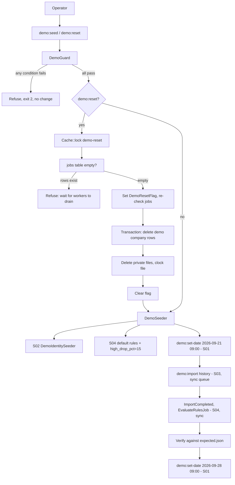

# Design Document

## Overview

S09 makes the finished Stage 1 application (S01 to S08) demonstrable, repeatable and deployable. It adds no product feature. It adds two Artisan commands (`demo:seed`, `demo:reset`), four small services, a small set of feature tests for those commands, and twelve documents. Fixtures, the fixture generator and checker, the demo clock, `demo:import`, the transcript and the expected evaluations and outcomes are owned by S01, S03, S04, S06 and S08 (R9) and are only reused here.

The design rests on five rules:

1. **Real path only.** Every business record in the demo is produced by S03 to S08 code (`demo:import` and the S03 Actions, `ProcessImportJob`, the S04 evaluation chain, the S05 to S08 Actions). S09 code never writes `sales_records`, `imports`, `import_errors`, `rule_evaluations`, `issues`, `outcomes` or `activity_logs`. The only S09 code that touches those tables is the resetter, and it only deletes (Requirements 3.11, 4.5).
2. **Fail closed.** One guard (`DemoGuard`) runs first in every Demo_Command. It checks all conditions and reports every failed one.
3. **One owner per asset.** S09 calls `demo:set-date` (S01) and `demo:import` (S03), runs `demo:check-fixtures` (S03) as a pre-flight, and takes expected figures from `docs/demo-scenario.md` and `expected.json`. It copies none of them (Requirement 5).
4. **Reset is serialized and quiet.** A cache lock, a jobs-table check and a reset flag make sure no queued work touches the demo company while its rows are deleted (R8).
5. **Honest verification (R5).** Verification is focused automated tests (`composer test`, PostgreSQL `businesspulse_testing`), manual steps in documents, static and build checks, and rehearsals. The acceptance checklist maps each of the 26 Definition of Done items to automated tests, manual steps, or both. Provider-dependent items and provider failure drills stay manual. Passing checks does not make the application production-ready.

### Priority tiers (R1)

| Tier | Items |
|---|---|
| PoV Core | `demo:seed`, `demo:reset`, `DemoGuard`, `DemoResetFlag`, `tests/Feature/Demo`, acceptance checklist (with build and demo-path responsive sections), walkthrough, rehearsal protocol, provider failure drills, recording instructions, local setup, deployment, retention, readiness fix log, environment review, existing-doc updates |
| PoV Polish | `docs/pdpa-considerations.md`, `docs/risks.md` (both required before real data), `docs/security-verification.md`, the full per-screen responsive appendix |

### Definition of Done source

The 26 items are in `docs/stage-1-scope.md` section 10. The checklist copies them verbatim and in order as DoD-01 to DoD-26. No provisional wording is used.

### Out of scope (Requirement 23)

No demo web screen, no scheduled reset, no Docker, Redis or CI file, no browser automation, no property-based framework, no monitoring service, no production-readiness claim.

## Architecture

### Approach



### Command and service map

| Command | Class | Owner | Calls |
|---|---|---|---|
| `demo:seed` | `App\Console\Commands\Demo\SeedDemo` | S09 | `DemoGuard`, `DemoSeeder` |
| `demo:reset` | `App\Console\Commands\Demo\ResetDemo` | S09 | `DemoGuard`, `DemoResetter` (which calls `DemoSeeder`) |
| `demo:set-date {date} [--time=09:00]` | S01 `DemoSetDate` | S01 | called by `DemoSeeder` and by the presenter |
| `demo:import {fixture}` | S03 | S03 | called by `DemoSeeder` and by the Operator |
| `demo:check-fixtures` | S03 | S03 | pre-flight and build verification only |

Both S09 commands are registered through Laravel's command discovery (`app/Console/Commands/Demo/*`), never in the schedule, so Requirement 2.9 holds by construction.

### Clock timeline (from `docs/demo-scenario.md` section 2)

| Clock (09:00) | Set by | Event |
|---|---|---|
| 2026-09-21 | `DemoSeeder` | Seed imports `history.csv`; last due day is Sat 09-19; W7 closed and complete; rules healthy |
| 2026-09-28 | `DemoSeeder` | Demo starts; W8 overdue (18 branch-days); no evaluation of W8 exists |
| 2026-09-30 | presenter | Staff complete tasks; `monitoring_started_at` is 09-30 |
| 2026-10-05 | presenter | Upload `week9-interim.csv` (W9, `during_action`) |
| 2026-10-12 | presenter | Upload `week10-recovery.csv` (W10, `post_action`) |

## Components and Interfaces

### `DemoGuard`

```php
final class DemoGuard
{
    /** @return GuardResult {ok: bool, failures: string[]} */
    public function check(GuardContext $context): GuardResult;
}
```

`GuardContext` carries the command name (`seed` or `reset`), whether `--force` was passed, whether an interactive terminal exists, and the typed confirmation text (if prompted).

Conditions, each evaluated independently so that the output names all failures (Requirement 2.8):

1. `config('demo.mode')` (from `DEMO_MODE`) is true, else "Demo commands run only when DEMO_MODE=true" (2.2).
2. If `APP_ENV` is `production`, `config('demo.allow_production')` (from `DEMO_ALLOW_PRODUCTION_DEMO`) is true (2.3).
3. No `Company` with `is_demo = false` exists (2.4).
4. `reset` only: exactly one `Company` exists and it has `is_demo = true` (2.5).
5. `reset` only, when `--force` is absent: a terminal is available and the typed text equals the Demo_Company `name` exactly (2.6, 2.7).

The command's `handle()` calls `check()` first. On failure it prints every message, changes nothing and returns exit code 2. For `seed`, zero companies is valid (fresh database); one company must be the demo company.

### `DemoResetFlag`

```php
final class DemoResetFlag
{
    public function set(): void;        // Cache::put('demo-reset-active', true, 15 minutes)
    public function clear(): void;      // Cache::forget(...)
    public function isActive(): bool;   // used by S03 to S08 jobs for the demo company
}
```

The flag lives in the `database` cache store, so queue workers see it. The 15-minute TTL guarantees expiry if the process is killed. The Reset_Lock is `Cache::lock('demo-reset', 600)`.

Cross-spec note (assumption A14): R8 requires demo-company jobs to exit without effect while the flag is set. S09 provides `isActive()`. Task 2.5 verifies each of `ProcessImportJob`, `EvaluateRulesJob`, `VerifyOutcomesJob`, the S05 brief and audio jobs, the S06 transcription and extraction jobs and the S08 activity listeners, and records a Readiness_Fix for any that does not check it. S09 does not edit those jobs. Because the `jobs` table is already empty before the flag is set, the flag is a second line of defence against a job dispatched during the window.

### `DemoSeeder`

```php
final class DemoSeeder
{
    public function seed(): SeedSummary;
}
```

Sequence (`seed()` body), with the queue connection overridden to `sync` for this process only (Requirement 3.7):

1. **Idempotency and conflict check.** If the Demo_Company exists, has the six users, the `high_drop_pct` override and a `completed` history import, and holds no other business data (no issue, brief, meeting, task, outcome or later import), print "nothing changed" and exit 0 (3.13). If it exists with other data, print "use demo:reset" and change nothing (3.14). Otherwise continue.
2. Validate `DEMO_PASSWORD` is at least 12 characters, else stop before creating any user (3.2).
3. Run the S02 `DemoIdentitySeeder`: Company (MYR, `Asia/Kuala_Lumpur`, Mon to Sat, cutoff 12:00, lag 1, `is_demo` true), Sales department with Expected_Branches `KL`, `PG`, `JB`, and six users (3.1).
4. Call the S04 default rule seeding, then set `params.high_drop_pct = 15` on the weekly decline `business_rules` row (3.4). This override is the only demo-specific rule change.
5. `Artisan::call('demo:set-date', ['date' => '2026-09-21', '--time' => '09:00'])` (3.5).
6. `Artisan::call('demo:import', ['fixture' => 'history'])`. S03 uploads as the Owner through `CreateImportFromUpload`, confirms through `ConfirmImport` and processes through `ProcessImportJob` inline. `ImportCompleted` dispatches the S04 evaluation, which runs inline on the `sync` connection (3.6, 3.7). A non-zero exit stops the seed with the sanitized message (3.12).
7. Verify the seeded state against `expected.json` and the S04 evaluations: decline W7 vs W6 `not_breached` at +0.65%, target W7 `not_breached` at 99.36%, missing data `not_breached`, 126 active records, no issue. Report each mismatch and exit non-zero (3.8).
8. `Artisan::call('demo:set-date', ['date' => '2026-09-28', '--time' => '09:00'])` (3.9).
9. **No refresh.** The seeder never calls "Refresh intelligence" or the evaluation job after step 8 (3.10). The demo starts with W8 overdue and unevaluated.
10. Restore the configured queue connection, signal `queue:restart` through the cache restart key, and print the secret-free summary (3.15, 22.7).

`SeedSummary` is a plain DTO (`usersCreated`, `ruleOverride`, `importCounters`, `clockDateTime`, `alreadySeeded`).

### `DemoResetter`

```php
final class DemoResetter
{
    public function reset(bool $force, ?string $typedName): ResetSummary;
}
```

Sequence:

1. Guard already passed. Acquire `Cache::lock('demo-reset', 600)`; if not acquired, print that another reset is running and exit non-zero (4.1). A `finally` block always clears the flag and releases the lock (4.12).
2. If `DB::table('jobs')->count() > 0` (pending or reserved), release the lock, print the count and "wait for the queue workers to drain the queue, then run again", and stop before any change (4.2).
3. `DemoResetFlag::set()`, then re-check `jobs`. If a row exists, clear the flag, release the lock and stop as in step 2 (4.3).
4. Resolve the Demo_Company id once. **Delete in one DB transaction**, selecting rows only through `company_id`, `department_id` or a parent FK that resolves to the Demo_Company (4.5). Order (children before parents, checked against `docs/data-model.md`):

   | Step | Table(s) | Selected by |
   |---|---|---|
   | 1 | `activity_logs` | `company_id` |
   | 2 | `notifications` | `notifiable_id` IN (Demo_Company user ids) |
   | 3 | `task_comments` | `task_id` IN (tasks of Demo_Company) |
   | 4 | `tasks` | `department_id` |
   | 5 | `task_drafts` | `meeting_id` IN (meetings of Demo_Company) |
   | 6 | meeting decisions and meeting-issue links | `meeting_id` IN (meetings of Demo_Company) |
   | 7 | `meetings` | `department_id` |
   | 8 | `feedback` | user, issue or outcome of the Demo_Company |
   | 9 | `outcomes` | `issue_id` IN (issues of Demo_Company) |
   | 10 | `brief_items` | `brief_id` IN (briefs of Demo_Company) |
   | 11 | `briefs` | `company_id` |
   | 12 | `issues` | `department_id` |
   | 13 | `rule_evaluations` | `department_id` |
   | 14 | `sales_records` | `department_id` |
   | 15 | `import_errors` | `import_id` IN (imports of Demo_Company) |
   | 16 | `imports` | `department_id` |
   | 17 | `business_rules` | `department_id` |
   | 18 | `users` | `company_id` |
   | 19 | `departments` | `company_id` |
   | 20 | `companies` | the Demo_Company row |

   `brief_items` and `briefs` precede `issues` because brief items reference issues. `issues.recurrence_of_issue_id` is a self reference removed by one `DELETE` statement. The real table and column names are confirmed against `docs/data-model.md` and the S01 to S08 migrations when the task is implemented. A foreign-key error rolls the whole transaction back, so a wrong order fails safe (4.9). The feature test of Requirement 6.7 runs the order after a seed plus the week 8 import and evaluation.

5. On failure inside the transaction: roll back, leave files untouched, clear the flag, release the lock, exit non-zero with a sanitized message (4.9).
6. After commit, **delete private files** under `imports/{company}`, `recordings/{company}` and brief audio paths scoped to the collected ids, plus the Demo_Clock_File (`demo/fixed-datetime`). Report any file that could not be deleted (4.7, 4.8, 4.10).
7. `DemoResetFlag::clear()`, then call `DemoSeeder::seed()` while still holding the lock (4.11). The flag must be clear first because the seed's jobs run in-process and would otherwise exit without effect.
8. Print rows and files deleted per group, the seed summary, the clock date-time, and the count of `failed_jobs` rows if any (4.13, 4.14).

Sessions, cache rows other than the lock and flag, migrations and `failed_jobs` rows are not touched (4.13). Because the guard requires exactly one company and step 4 deletes the full state before the seed runs its fresh-create branch, two consecutive `demo:reset --force` runs reach the same state (4.16).

### Reused commands

`demo:set-date`, `demo:import` and `demo:check-fixtures` are used as is (Requirement 5). `DemoSeeder` calls the first two through `Artisan::call` so that S01 and S03 validation and output rules apply unchanged. S09 never reads or writes the Demo_Clock_File directly except `DemoResetter` deleting it.

## Data Models

No new persisted business table (Requirement 1.1) and no migration. New artifacts:

### `config/demo.php` (additive key)

```php
// S01 owns: 'mode' => env('DEMO_MODE', false), 'clock_file' => 'demo/fixed-datetime'
'allow_production' => env('DEMO_ALLOW_PRODUCTION_DEMO', false),
```

`.env.example` gets `DEMO_ALLOW_PRODUCTION_DEMO=false` with a comment. There is no `DEMO_FIXED_DATE` (S01 A4). The seed clock values (`2026-09-21 09:00`, `2026-09-28 09:00`) are constants of `DemoSeeder`. A feature test asserts that the history clock equals the clock for `history` in `expected.json`.

### Cache keys

| Key | Purpose | TTL |
|---|---|---|
| lock `demo-reset` | one reset at a time | 600 s |
| `demo-reset-active` | makes demo-company jobs exit without effect | 15 minutes |

## Expected values used by the documents

All values come from `docs/demo-scenario.md`; the documents restate them identically (Requirement 5.4).

| Moment | Value |
|---|---|
| After seed (clock 09-21) | Decline W7 vs W6 +0.65% (155,000 vs 154,000), target W7 99.36%, missing data not breached |
| Demo start (clock 09-28) | W8 overdue, 18 branch-days not received, no W8 evaluation |
| After `week8-decline.csv` | Decline W8 vs W7 breached **high** −20.00% (124,000 vs 155,000, −31,000); target W8 breached medium 79.49%; missing data 18 of 18; one urgent notification (decline only); no outcome |
| After `week9-interim.csv` (clock 10-05) | W9 138,000, +14,000, +11.29%, 89.03% of W7; phase `during_action`; informational; issue stays monitoring; rules not breached (+11.29%, 88.46%) |
| After `week10-recovery.csv` (clock 10-12) | W10 150,000, +26,000 absolute, +20.97% relative, 96.77% of W7; phase `post_action`; improved; condition met (150,000 ≥ 131,750); resolved `system_verified`; W10 vs W9 +8.70% is evidence only; target 96.15% |
| Target issue outcome | Only if the Owner moves it to monitoring with a reason; 96.15%, +16.66 pp, improved |
| Validation segment (fresh reset) | `week8-with-errors.csv`: 17 valid, 3 invalid (`invalid_date`, `negative_value`, `invalid_number`); missing data breached medium 17 of 18 (94.44%); decline and target `insufficient_data` (`incomplete_period`) |
| Correction segment (fresh reset) | `week8-correction.csv` after `week8-decline.csv`: 16 unchanged, 2 corrected, W8 total 126,000 |
| Trailing-missing segment (fresh reset) | Refresh at 09-28 before upload: missing data breached medium 0 of 18; decline and target `insufficient_data` (`period_absent`) |
| Meeting | 4 drafts: Priya (2026-10-02), Farid (2026-10-07), ambiguous Daniel with no deadline, unassigned with no deadline; no task assigned to the Owner |

## Correctness Properties

The project uses no property-based framework (R5). Each property below is verified by a focused feature test with a few fixed examples in `tests/Feature/Demo` and by the manual checks of the Checklist, not by generated inputs.

### Property 1: Guard completeness

*For any* combination of failed guard conditions, the Demo_Guard reports every failed condition, exits with code 2 and changes no row and no file.

**Validates: Requirements 2.2, 2.3, 2.4, 2.5, 2.6, 2.7, 2.8**

### Property 2: Seed idempotence

*For any* seeded Demo_Company with no other business data, running `demo:seed` again creates no user, rule, import or sales record and exits with code zero.

**Validates: Requirements 3.13**

### Property 3: Reset idempotence

*For any* state of the Demo_Company, two consecutive `demo:reset --force` runs reach the same counts of users, rules, active sales records and the same revenue sum.

**Validates: Requirements 4.16**

### Property 4: Reset serialization

*For any* exit path of `demo:reset` (success, refusal, failure), the Reset_Lock is released and the Reset_Flag is cleared, and no row is deleted when the `jobs` table holds a row.

**Validates: Requirements 4.2, 4.3, 4.9, 4.12**

### Property 5: Real path only

*For any* completed seed or reset, every `sales_records`, `rule_evaluations` and `activity_logs` row of the Demo_Company was created by S03 to S08 code, shown by the import records and the event chain.

**Validates: Requirements 3.11, 4.18**

## Error Handling

| Situation | Handling |
|---|---|
| `DEMO_MODE` false | Guard stops before any write; exit 2; fixed message (2.2) |
| Production without `DEMO_ALLOW_PRODUCTION_DEMO` | Guard stops; exit 2 (2.3) |
| Company with `is_demo` false present | Guard stops; exit 2; no data or file change (2.4) |
| `demo:reset` with zero or several companies | Guard stops; exit 2 (2.5) |
| `demo:reset` typed name mismatch, or no terminal without `--force` | Guard stops; exit 2 (2.6, 2.7) |
| Reset lock held | Stop; message that another reset runs; non-zero (4.1) |
| `jobs` table not empty (before or after setting the flag) | Release lock, clear flag, stop before any change; print row count; tell Operator to wait for workers to drain (4.2, 4.3) |
| `DEMO_PASSWORD` empty or under 12 characters | Seeder stops before creating any user (3.2) |
| `demo:import` exits non-zero or the import is not `completed` | Seeder stops; sanitized import message (3.12) |
| Seeded state differs from `expected.json` | Seeder reports each mismatch; non-zero (3.8) |
| Demo_Company has extra data | Seeder stops; tells the Operator to run `demo:reset`; no change (3.14) |
| Reset transaction fails | Full rollback; files untouched; flag cleared; lock released; non-zero (4.9) |
| File deletion partially fails after commit | Reported per file; database state is correct (4.10) |
| Process killed during reset | Lock expires after 600 s, flag after 15 minutes; Operator reruns `demo:reset --force` |
| Any Demo_Command exception | Stack trace suppressed unless `-v`; no secret printed with or without `-v` (22.2, 22.3) |

## Testing Strategy

Per R5 and `.kiro/steering/verification.md`, verification has four parts.

**1. Automated, S09 (`composer test`).** Feature tests in `tests/Feature/Demo`, `RefreshDatabase` on `businesspulse_testing`, S03 fixtures through `demo:import`, no external provider call, `Http::preventStrayRequests()`:

| Test file | Cases (expected result) |
|---|---|
| `DemoGuardTest` | `DEMO_MODE` false; production without flag; real company present; each exits 2 with no change and a message naming every failed condition. `reset` with zero or two companies, with a wrong typed name and with no terminal exits 2 |
| `DemoSeedTest` | Seed creates company, six users, `high_drop_pct` 15, 126 active records, W7 evaluations `not_breached` (+0.65%, 99.36%), no issue, clock 2026-09-28 09:00; second run changes nothing; extra data stops with "use demo:reset"; history clock matches `expected.json` |
| `DemoResetTest` | Refuses when a `jobs` row exists and clears lock and flag; after seed and `week8-decline` import plus evaluation, reset deletes all demo rows with no FK error, deletes the demo files only, and returns the same counts as the first seed; two resets give equal counts and revenue sum; the lock is released after failure (forced exception) |

**2. Automated, S02 to S08.** The checklist maps the existing tests of these folders to DoD items: `tests/Feature/Identity`, `tests/Feature/Imports`, `tests/Feature/Intelligence`, `tests/Feature/ExecutiveIntelligenceTest.php`, `tests/Feature/Meetings`, `tests/Feature/Tasks`, `tests/Feature/Outcomes`. The build section requires `composer test` to pass as a whole.

**3. Manual.** Numbered steps with expected result in the documents: the checklist, the walkthrough, the rehearsal protocol, the drills (provider failures are never automated), and the Polish write-ups.

**4. Static and build checks.** `composer validate --strict`, `composer pint-test`, `php -l`, `npm run type-check`, `npm run lint`, `npm run format:check`, `npm run build` (all chained in `npm run verify` with `composer test`), `demo:check-fixtures`, migrate and rollback on a scratch database, cache smoke check, audits.

Every manual check records an observed value, an expected value (traceable to `expected.json` or `docs/demo-scenario.md`) and PASS, FAIL or BLOCKED.

### Definition of Done mapping (basis of `docs/acceptance-checklist.md`)

Wording of each item is copied from `docs/stage-1-scope.md` section 10. At implementation time the automated column is refined from folder level to the actual test names in S02 to S08. "Provider" means the check needs a real AI provider.

| DoD | Item (short) | Automated | Manual (Walkthrough step or procedure) | Provider |
|---|---|---|---|---|
| 01 | Deployed without Docker | none | `docs/deployment.md` steps and smoke test | no |
| 02 | Login with roles | `tests/Feature/Identity` | Step 1; login as each demo role | no |
| 03 | Polished and responsive | none | Responsive section at 360, 768, 1280 px | no |
| 04 | Valid CSV imported | `tests/Feature/Imports` | Steps 3 to 5 | no |
| 05 | Invalid rows reported | `tests/Feature/Imports` | Validation segment with `week8-with-errors.csv` | no |
| 06 | Duplicates do not inflate | `tests/Feature/Imports` (duplicate import) | Re-upload `week8-decline.csv`; totals unchanged | no |
| 07 | Corrected imports | `tests/Feature/Imports` (16 unchanged, 2 corrected) | Correction segment | no |
| 08 | Calculations match | `tests/Feature/Imports`, `tests/Feature/Intelligence` (reads `expected.json`) | `demo:check-fixtures`; compare dashboard and evidence values | no |
| 09 | Rules detect conditions | `tests/Feature/Intelligence` | Steps 5 and 6 | no |
| 10 | No duplicate unresolved issues | `tests/Feature/Intelligence` (dedupe, recurrence) | Repeat Re-evaluate | no |
| 11 | Missing or incomplete data identified | `tests/Feature/Imports`, `tests/Feature/Intelligence` | Step 2 banner; validation and trailing-missing segments | no |
| 12 | Dashboard shows real data | `ExecutiveIntelligenceTest` (partial) | Step 2; compare figures | no |
| 13 | AI brief | `ExecutiveIntelligenceTest` (number check, fallback) | Step 8 | yes |
| 14 | Voice brief | `ExecutiveIntelligenceTest` (audio route access) | Step 9 | yes |
| 15 | Recording upload and transcription | `tests/Feature/Meetings` (consent, access) | Steps 10 and 11 | yes |
| 16 | Transcript to task drafts | `tests/Feature/Meetings` (resolvers, injection) | Step 12 | yes |
| 17 | No assignment without approval | `tests/Feature/Tasks` (approval rules, idempotency) | Step 13 | no |
| 18 | Staff update tasks | `tests/Feature/Tasks` (access, status) | Steps 14 and 15 | no |
| 19 | Unauthorized access denied | Identity, Imports, Meetings, Tasks, Outcomes access tests | Authorization steps (`docs/security-verification.md` when present) | no |
| 20 | Imports trigger outcomes | `tests/Feature/Outcomes` | Steps 16 to 19 | no |
| 21 | Completion vs resolution | `tests/Feature/Tasks` (lifecycle, reopen), `tests/Feature/Outcomes` | Steps 15 and 20 | no |
| 22 | Traceable history | `tests/Feature/Outcomes` (activity allow-list) | Step 22 | no |
| 23 | Provider failures recoverable | none | Five drills | yes |
| 24 | Demo repeatable | `tests/Feature/Demo` | Two Rehearsals; reset twice | yes |
| 25 | Manual verification and build checks | `composer test`, build section | Build verification section | no |
| 26 | Setup and deployment documented | none | Review of `docs/local-setup.md` and `docs/deployment.md`; follow both on a clean environment | no |

## Documentation set structure

| File | Tier | Owns | Key sections |
|---|---|---|---|
| `docs/readiness-fixes.md` | Core | Cross-spec fix log (starts empty) | rule for fixes; table of id, owning spec, observed, expected, found by, status |
| `docs/acceptance-checklist.md` | Core | DoD-01 to DoD-26 mapping, responsive section for the demo path, build verification, signed summary; Polish appendix with the full responsive record | disclaimer; 26 entries with automated tests and manual steps; responsive section; build section; summary block |
| `docs/demo-walkthrough.md` | Core | 22-step live script | setup; warning not to refresh; presenter commands; per step actor, action, expected values, talking point, fallback; optional segments; closing |
| `docs/rehearsal-protocol.md` | Core | Two consecutive rehearsals | pre-flight; per-step verification hooks into S04 and S08; timing table; pass, fail and restart rule |
| `docs/provider-failure-drills.md` | Core | Five manual drills | induce, expected, recover, verify; retry timing reference |
| `docs/demo-recording.md` | Core | Recording production | two methods; requirements; commit and `.gitignore` rule; SHA-256 |
| `docs/local-setup.md` | Core | Native dev setup, no Docker | prerequisites; steps; processes; demo setup; earlier demo commands; scratch databases; verification list; troubleshooting; variable table |
| `docs/deployment.md` | Core | Ubuntu VPS native deployment | architecture; server prep; Nginx; PHP; two Supervisor programs; cron; HTTPS; storage; `.env` table; backups; deploy; rollback; smoke test; logs; disclaimer |
| `docs/retention-and-deletion.md` | Core | Retention procedure | default; `recordings:purge`; early deletion; data classes; backup expiry; verification |
| `docs/security-verification.md` | Polish | Authorization matrix | route by actor table; CSRF; throttling; prop leak; log scan |
| `docs/pdpa-considerations.md` | Polish | Personal-data checklist | inventory; provider data flows; principle table; open decisions; controls; actions before real data |
| `docs/risks.md` | Polish | Risk register | table; Stage 1 limits |

### Nginx server block (sketch, full version in `docs/deployment.md`)

```nginx
server {
    listen 80;
    server_name demo.example.com;
    return 301 https://$host$request_uri;
}
server {
    listen 443 ssl http2;
    server_name demo.example.com;
    root /var/www/businesspulse/public;
    client_max_body_size 25m;
    add_header X-Content-Type-Options nosniff;
    add_header X-Frame-Options DENY;
    add_header Referrer-Policy strict-origin-when-cross-origin;
    location ~ /\.(?!well-known) { deny all; }
    location / { try_files $uri $uri/ /index.php?$query_string; }
    location ~ ^/index\.php$ {
        fastcgi_pass unix:/run/php/php-fpm.sock;
        fastcgi_param SCRIPT_FILENAME $realpath_root$fastcgi_script_name;
        include fastcgi_params;
    }
}
```

### PHP-FPM / php.ini (sketch)

```ini
upload_max_filesize = 20M   ; recordings up to 20 MB; CSV files up to 5 MB
post_max_size = 25M
memory_limit = 256M
max_execution_time = 60
opcache.enable = 1
```

### Supervisor programs (sketch)

```ini
[program:bp-default]
command=php artisan queue:work database --queue=default --tries=3 --timeout=180 --max-time=3600
directory=/var/www/businesspulse
user=deploy
autorestart=true
stopwaitsecs=200
stopasgroup=true
killasgroup=true
stdout_logfile=/var/log/businesspulse/bp-default.log
stderr_logfile=/var/log/businesspulse/bp-default-error.log

[program:bp-ai]
command=php artisan queue:work database --queue=ai --tries=3 --timeout=180 --max-time=3600
directory=/var/www/businesspulse
user=deploy
autorestart=true
stopwaitsecs=200
stopasgroup=true
killasgroup=true
stdout_logfile=/var/log/businesspulse/bp-ai.log
stderr_logfile=/var/log/businesspulse/bp-ai-error.log
```

Timing rule stated in `docs/deployment.md` (R6): `config/queue.php` database connection `retry_after` is 300, greater than the longest job `$timeout` (150 seconds for transcription) plus margin. Worker `--timeout=180` is a ceiling above every job `$timeout`. `retry_after` is re-checked if any job timeout rises above 150 seconds. Workers use `--max-time=3600` and restart on deploy with `queue:restart`. A running job is therefore never released onto the queue and processed twice.

### Cron line (sketch)

```
* * * * * cd /var/www/businesspulse && php artisan schedule:run >> /dev/null 2>&1
```

The scheduler runs the S06 `recordings:purge` command daily. No demo command is scheduled (Requirement 2.9).

## Known cross-spec readiness fixes (initial register)

`docs/readiness-fixes.md` starts empty. The `BusinessClock` demo clock and its command are delivered by S01, and the Definition of Done is present in `docs/stage-1-scope.md` section 10, so neither is a fix item.

Entries are added during S09 verification, for example when an earlier job does not honor the Reset_Flag (Requirement 4.15), when `.env.example` misses a variable (Requirement 15.1), when `recordings:purge` cannot be verified without a direct edit (Requirement 17.8), or when an expected value of `expected.json` disagrees with `docs/demo-scenario.md`. Each entry has an identifier, the owning spec, the observed behavior, the expected behavior, the verification step that found it, and status `open` or `fixed`. A fix is never applied by editing S09 commands or documents to mask the behavior (Requirement 1.5). It is applied as a separate, labelled change to the owning spec's code.
