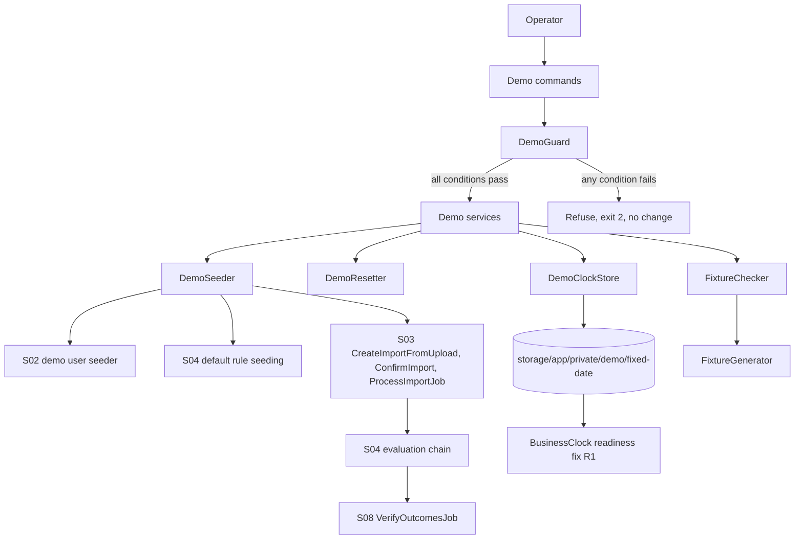

# Design Document

## Overview

S09 makes the finished Stage 1 application (S01 to S08) demonstrable, repeatable and deployable. It adds no product feature. It adds four Artisan commands, six supporting services, a deterministic fixture set with a generator, one small change to `BusinessClock` (readiness fix R1), and eleven documents.

The design rests on four rules:

1. **Real path only.** Every business record in the demo is produced by S03 to S08 code (`CreateImportFromUpload`, `ConfirmImport`, `ProcessImportJob`, the S04 evaluation chain, the S05 to S08 Actions). S09 code never writes `sales_records`, `imports`, `import_errors`, `rule_evaluations`, `issues`, `outcomes` or `activity_logs`. The only S09 code that touches those tables is the resetter, and it only deletes (Requirement 3.8, 4.1).
2. **Fail closed.** One guard (`DemoGuard`) runs first in every destructive command. It checks all conditions and reports every failed one.
3. **Fixtures are data, generated by one rule.** The committed CSV files are authoritative. A pure generator reproduces them byte for byte, and a checker proves it.
4. **Honest verification.** Verification is manual and scripted in documents plus `demo:check-fixtures`. There is no PHPUnit, Pest or end-to-end suite (`.kiro/steering/verification.md`, Requirement 1.7, 25.4).

### Source documents and a gap to resolve first

The brief states that the 26-item Definition of Done is now in `docs/stage-1-scope.md` section 10. At the time this design was written, that file ends at section 9, and section 5 still points to "product brief section 20". Section 10 could not be read, so this design does not copy any DoD wording.

Handling:

- The checklist (see "Acceptance checklist structure") is built as 26 entries `DoD-01` to `DoD-26`. The entry titles in this design are **provisional**, derived from the capability areas of Requirement 10.3 and the scope table.
- Implementation task 1 for the checklist is: open `docs/stage-1-scope.md` section 10, copy the 26 items in order, and re-map each to the checks below. If section 10 is still absent, record readiness fix R-DoD (Requirement A8), keep the provisional titles, and state the gap in the checklist introduction.
- `docs/stage-1-scope.md` section 5 should be edited to point to section 10 once it exists.

### Out of scope (Requirement 25)

No demo web screen, no scheduled reset, no Docker, Redis or CI file, no automated test suite, no monitoring service, no production-readiness claim.

## Architecture

### Approach



### Command and service map

| Command | Class | Guard scope | Calls |
|---|---|---|---|
| `demo:seed` | `App\Console\Commands\Demo\SeedDemo` | full guard, excludes the typed-name confirmation | `DemoSeeder` |
| `demo:reset` | `App\Console\Commands\Demo\ResetDemo` | full guard, includes typed-name confirmation unless `--force` | `DemoResetter` (which calls `DemoSeeder`) |
| `demo:set-date {date}` | `App\Console\Commands\Demo\SetDemoDate` | Demo_Mode check only (Requirement 5 has no production/company checks) | `DemoClockStore` |
| `demo:check-fixtures` | `App\Console\Commands\Demo\CheckFixtures` | none for file checks; guard + Scratch_Database check for `--evaluate` | `FixtureChecker`, `FixtureGenerator` |

All four commands are registered under the `demo` namespace through Laravel's standard command discovery (`app/Console/Commands/Demo/*`), not in `routes/console.php`'s schedule section, so Requirement 2.9 (never scheduled) holds by construction.

### Why a file for the clock (assumption A5, readiness fix R1)

`BusinessClock::today()` (S01) currently returns `DEMO_FIXED_DATE` or the real date. The queue worker is a long-running PHP process; it does not reread `.env` or config cache between jobs. A config-based date would need `config:clear` and a worker restart for every `demo:set-date` call, which breaks the walkthrough's 25-minute budget (Requirement 15.12) and risks a stale date mid-import. Stage 1 has no settings table (A5). A single text file under private storage is the smallest mechanism that both processes (web and queue worker) can observe on their next call without a restart.

Alternatives considered:

| Option | Rejected because |
|---|---|
| Config cache value | Requires `config:clear` + worker restart per date change; not safe mid-rehearsal |
| Database `settings` table | Out of scope for Stage 1 (no such table in S01 to S08); would be a product change, not a readiness fix |
| Redis key | Adds infrastructure Requirement 25.3 explicitly excludes |
| Env var rewrite | Mutating `.env` at runtime is fragile and risks corrupting other keys; violates Requirement 5.9 |

## Components and Interfaces

### `DemoGuard`

```php
final class DemoGuard
{
    /** @return GuardResult {ok: bool, failures: string[]} */
    public function check(GuardContext $context): GuardResult;
}
```

`GuardContext` carries: the command name, whether `--force` was passed, the typed confirmation text (if prompted), and whether the command is destructive (`seed`, `reset`) vs. non-destructive (`set-date`, `check-fixtures`).

Conditions evaluated, each independently (Requirement 2.8 — "evaluate all conditions"):

1. `config('demo.enabled')` (from `DEMO_MODE`) is true → else failure `"Demo commands run only when DEMO_MODE=true"` (2.2).
2. For `seed`/`reset`: if `APP_ENV === 'production'` and `DEMO_ALLOW_PRODUCTION_DEMO` is not true → failure (2.3).
3. For `seed`/`reset`: no `Company` exists with `is_demo = false` → else failure naming that real company data exists (2.4).
4. For `reset` only: a `Company` with `is_demo = true` exists → else failure (2.5).
5. For `reset` only, when `--force` is not given: an interactive TTY is available and the Operator's typed text equals the Demo_Company's `name` exactly → else failure (2.6, 2.7).

The command's `handle()` calls `DemoGuard::check()` as its first statement. On any failure, the command prints every failure message, touches no row and no file, and returns a non-zero exit code (2). No partial guard state is cached between invocations.

### `DemoSeeder`

```php
final class DemoSeeder
{
    public function seed(): SeedSummary;
}
```

Sequence (`seed()` body), all under the command process's `sync` queue connection override (Requirement 3.13):

1. **Idempotency / conflict check first.** Load the Demo_Company if one exists.
   - If it exists and already has the seeded users, rules, and a `completed` history import whose `file_hash` matches `history.csv`'s hash, AND has no other data (no issue, meeting, task, etc.) → print "nothing changed", exit 0 (3.11).
   - If it exists with data other than the clean seeded state → stop, print "use demo:reset", change nothing (3.12).
   - Otherwise continue (fresh create).
2. Validate `DEMO_PASSWORD` is non-empty → else stop, exit non-zero, create no user (3.3).
3. Create the Demo_Company: currency `MYR`, timezone `Asia/Kuala_Lumpur`, trading days Mon–Sat (`[1,2,3,4,5,6]`), `is_demo = true`, one `Sales` department (3.1).
4. Call the **S02 demo user seeder** (existing idempotent seeder) to create the six users of `docs/demo-scenario.md` §1 — Lim Wei Han (owner), Nurul Aisyah (manager), Daniel Tan, Daniel Lee, Priya Nair, Farid Ismail (staff) — hashing the password through Laravel's standard hasher, never logging it (3.2, 3.4).
5. Call the **S04 default rule seeding** for the department, then set `params.high_drop_pct = 15` on the weekly-decline `business_rules` row (so a 20.00% decline is `high`, per D25) (3.5).
6. If no Demo_Clock_Store file exists, write `config('demo.default_date')` (default `2026-09-28`) via `DemoClockStore` before any import (3.6).
7. Import `history.csv` as the Owner: `CreateImportFromUpload` → `ConfirmImport` → `ProcessImportJob`, run synchronously (3.7, A6).
8. If the import's final status is not `completed` → stop, non-zero exit, print the sanitized import error (3.9).
9. Verify Expected_Branches is exactly `{JB, KL, PG}` and that the W7 evaluation produced the "history import" row of `expected.json`; report (not silently fix) any mismatch (3.10).
10. Restore the application's configured queue connection (3.13).
11. Print a summary: users created, rule params, import counters, clock date — no secrets (3.14).

`SeedSummary` is a plain DTO (`usersCreated`, `ruleParams`, `importCounters`, `clockDate`, `alreadySeeded: bool`) that the command formats for stdout.

### `DemoResetter`

```php
final class DemoResetter
{
    public function reset(bool $force, ?string $typedName): ResetSummary;
}
```

Sequence:

1. Guard already ran (via the command). Resetter re-derives the Demo_Company id.
2. **Blocking job check (A7):** if `jobs` has any row whose payload references the Demo_Company (by company id embedded in the job payload, matched via the job's `queueable` morph data) or `failed_jobs` has such a row → stop before any delete, print the blocking count (4.6).
3. **Delete, in one DB transaction**, selecting rows only through `company_id`, `department_id`, or a parent FK that resolves to the Demo_Company (4.2). Deletion order (children before parents, respecting FKs from `docs/data-model.md` §2):

   | Step | Table(s) | Selected by |
   |---|---|---|
   | 1 | `activity_logs` | `company_id` |
   | 2 | `notifications` (Laravel polymorphic) | `notifiable_id` IN (Demo_Company user ids) |
   | 3 | `task_comments` | `task_id` IN (tasks of Demo_Company) |
   | 4 | `tasks` | `department_id` |
   | 5 | `task_drafts` | `meeting_id` IN (meetings of Demo_Company) |
   | 6 | `meeting_issues` | `meeting_id` IN (meetings of Demo_Company) |
   | 7 | `meetings` | `department_id` |
   | 8 | `feedback` | `user_id` IN (Demo_Company users) OR `issue_id`/`outcome_id` resolving to Demo_Company |
   | 9 | `outcomes` | `issue_id` IN (issues of Demo_Company) |
   | 10 | `issues` | `department_id` |
   | 11 | `rule_evaluations` | `department_id` |
   | 12 | `brief_items` | `brief_id` IN (briefs of Demo_Company) |
   | 13 | `briefs` | `company_id` |
   | 14 | `sales_records` | `department_id` |
   | 15 | `import_errors` | `import_id` IN (imports of Demo_Company) |
   | 16 | `imports` | `department_id` |
   | 17 | `business_rules` | `department_id` |
   | 18 | `users` | `company_id` |
   | 19 | `departments` | `company_id` |
   | 20 | `companies` | the Demo_Company row itself |

   This order matches Requirement 4.3's named groups and never violates a foreign key (every child group is deleted before the parent group it references). `task_drafts` is deleted before `meetings` because `task_drafts.meeting_id` cascades conceptually but S09 deletes explicitly rather than relying on DB cascade, so the order is still safe if cascade rules are absent or `restrict`.

4. On any failure inside the transaction → roll back, leave files untouched, exit non-zero, sanitized message (4.7).
5. After commit, **delete private files**: everything under `imports/{company}`, `recordings/{company}`, and brief audio paths scoped to ids collected in step 3, plus the Demo_Clock_Store file (4.4, 4.5). Report any file that could not be deleted (4.8).
6. Call `DemoSeeder::seed()` to reseed (4.1).
7. Print rows/files deleted per group, the seed summary, and the clock date (4.10).

Other companies' sessions, cache, migrations and tables are never touched because every delete is scoped by the Demo_Company id resolved once at the top (4.9). The idempotence property (4.11) holds because step 3 always removes the full prior state before `DemoSeeder::seed()` runs its fresh-create branch.

### `DemoClockStore`

```php
final class DemoClockStore
{
    public function read(): ?CarbonImmutable;     // null if file absent/invalid
    public function write(CarbonImmutable $date): void;  // atomic
    public function path(): string;               // storage/app/private/demo/fixed-date
}
```

- `write()` writes `YYYY-MM-DD` to a temp file in the same directory, then `rename()`s over the target — atomic on the same filesystem, so a concurrent reader never sees a partial value (5.6).
- `read()` returns `null` on missing file, unreadable file, or content that fails `Carbon::createFromFormat('Y-m-d', ...)` strict parsing; it never throws.

**Readiness fix R1** — `BusinessClock::today()` (owned by S01) changes to:

```php
public function today(): CarbonImmutable
{
    if (! config('demo.enabled')) {
        return CarbonImmutable::now($this->companyTimezone())->startOfDay();
    }
    if ($date = $this->clockStore->read()) {
        return $date;
    }
    if ($fixed = config('demo.fixed_date')) {
        return CarbonImmutable::createFromFormat('Y-m-d', $fixed);
    }
    return CarbonImmutable::now($this->companyTimezone())->startOfDay();
}
```

Precedence: file → `DEMO_FIXED_DATE` → real date (5.4), and the file is ignored entirely when `DEMO_MODE` is false (5.5). An invalid file value logs one line naming the file path only, not its content, and falls back to `DEMO_FIXED_DATE` (5.8). This is the one line item in `docs/readiness-fixes.md` that is pre-declared by Requirement 1.4; it is implemented as a small, separately labelled change to `app/Services/BusinessClock.php` referencing "R1" in the commit/PR description, never bundled with other S09 changes (1.5).

### `FixtureChecker` and `FixtureGenerator`

```php
final class FixtureGenerator
{
    /** Pure. No I/O except when asked to write. */
    public function generate(string $fixtureName): FixtureFile; // in-memory rows
    public function writeTo(string $directory): void;           // all fixtures, deterministic filenames
}

final class FixtureChecker
{
    public function checkFiles(): CheckReport;     // criteria 2-8, no DB
    public function checkEvaluations(): CheckReport; // criterion 9, needs --evaluate + Scratch_Database
}
```

`FixtureGenerator` is a pure function of the constants in "Data Models" below: given a fixture name, it deterministically produces the exact byte sequence of the committed file (header, line endings, decimals). `demo:check-fixtures --regenerate-to {dir}` calls `writeTo()` and never writes into `database/demo/` (8.13). `FixtureChecker::checkFiles()` calls the same generator internally and compares its output to the committed bytes — this is how criterion 14 (determinism) and most of criteria 2–8 are verified without hand-maintained expected values duplicated in PHP.

Design decision: the generator is **not** a one-off script that is run once and discarded. It is a committed, invokable class (`App\Services\Demo\FixtureGenerator`) plus a thin artisan entry point (`demo:check-fixtures --regenerate-to`), so that if a fixture ever needs to change (e.g., a new trading day range), the numbers are re-derived from the rule instead of hand-edited, and the checker can always re-verify byte-identity. This satisfies A2 ("independent regeneration produces byte-identical files") while keeping the generator a development aid rather than a runtime dependency (A2).

## Data Models

No new persisted business table (Requirement 1.1). New artifacts:

### `config/demo.php` (additive keys)

```php
return [
    'enabled' => env('DEMO_MODE', false),
    'allow_production_demo' => env('DEMO_ALLOW_PRODUCTION_DEMO', false),
    'company_name' => env('DEMO_COMPANY_NAME', 'Meridian Home Supplies Sdn Bhd'),
    'default_date' => env('DEMO_DEFAULT_DATE', '2026-09-28'),
    'fixed_date' => env('DEMO_FIXED_DATE'),
    'password' => env('DEMO_PASSWORD'),
    'clock_file' => storage_path('app/private/demo/fixed-date'),
];
```

### Fixture generation rule (A2, A3, Requirement 6.8, 6.9)

Given a week's total MYR revenue `T` over six trading days (Mon–Sat):

1. **Daily split:** `base = floor(T / 6)`, `remainder = T mod 6`. Day `i` (1 = Monday … 6 = Saturday) gets `base + 1` if `i <= remainder`, else `base`. (Whole-ringgit daily amounts; A3.)
2. **Branch split**, for a day with total `D`: `PG = floor(D * 8 / 26)`, `JB = floor(D * 6 / 26)`, `KL = D - PG - JB`. The three branches always sum exactly to `D`, and KL absorbs the rounding remainder (6.9).
3. **Target revenue** is constant per branch on every row: `KL = 12000.00`, `PG = 8000.00`, `JB = 6000.00` (6.5).
4. **Order count** is a deterministic whole number per row: `order_count = round(revenue / 150)` (a fixed, documented ticket-size constant), clamped to a minimum of 1. This is a deterministic function of revenue so regeneration is byte-identical; the exact constant is recorded in `database/demo/README.md`.

#### Worked numbers per week

| Week | Total (MYR) | base | remainder | Day amounts (Mon–Sat) |
|---|---|---|---|---|
| W1 | 150,000.00 | 25,000 | 0 | 25000, 25000, 25000, 25000, 25000, 25000 |
| W2 | 152,000.00 | 25,333 | 2 | 25334, 25334, 25333, 25333, 25333, 25333 |
| W3 | 149,000.00 | 24,833 | 2 | 24834, 24834, 24833, 24833, 24833, 24833 |
| W4 | 153,000.00 | 25,500 | 0 | 25500, 25500, 25500, 25500, 25500, 25500 |
| W5 | 151,000.00 | 25,166 | 4 | 25167, 25167, 25167, 25167, 25166, 25166 |
| W6 | 154,000.00 | 25,666 | 4 | 25667, 25667, 25667, 25667, 25666, 25666 |
| W7 | 155,000.00 | 25,833 | 2 | 25834, 25834, 25833, 25833, 25833, 25833 |
| W8 (decline) | 124,000.00 | 20,666 | 4 | 20667, 20667, 20667, 20667, 20666, 20666 |
| W9 (recovery) | 150,000.00 | 25,000 | 0 | 25000, 25000, 25000, 25000, 25000, 25000 |

(`remainder` ringgit go one each to the first `remainder` days starting Monday, per the rule above; e.g. W2: `152000 / 6 = 25333.33…` → base 25333, remainder 2 → Mon and Tue get 25334, Wed–Sat get 25333; `25334*2 + 25333*4 = 50668 + 101332 = 152000`, checks out.)

Branch split example for a Monday of W7 (`D = 25834`): `PG = floor(25834*8/26) = floor(7949.23) = 7949`; `JB = floor(25834*6/26) = floor(5961.69) = 5961`; `KL = 25834 - 7949 - 5961 = 13924`. Sum check: `7949 + 5961 + 13924 = 25834`. ✓.

`week8-correction.csv`: starts from the 18 rows of `week8-decline.csv`; changes exactly the KL and PG rows for Saturday 2026-09-26 so that the corrected W8 total is documented in `database/demo/README.md` (new total = old W8 total `124,000.00` plus the sum of the two deltas; the exact new total and the two new values are computed by the generator and written verbatim into the README — not duplicated by hand in this design to avoid drift). 16 rows stay `unchanged`, 2 rows import as `corrected` (6.11).

`week8-with-errors.csv`: the 17 valid rows are `week8-decline.csv`'s 18 rows minus JB on Saturday 2026-09-26, plus 3 invalid rows (A4):
- `KL, 2026-13-45, 1000.00, 12000.00, 10` → `invalid_date`
- `PG, 2026-09-27, -100.00, 8000.00, 5` → `negative_value` (date 09-27 is outside W8's Mon–Sat range, so it cannot collide with a valid row's identity)
- `JB, 2026-09-26, 500.00, abc, 3` → `invalid_number` (same identity as the *removed* valid JB/09-26 row, which is intentional: this row replaces the missing one in the file but is rejected, which is what produces the "17 valid, 1 missing branch-day" outcome)

### Fixture file catalogue

| File | Rows | Coverage | Trading days |
|---|---|---|---|
| `history.csv` | 126 | 2026-08-03 → 2026-09-19 (W1–W7) | Mon–Sat × 7 weeks × 3 branches |
| `week8-decline.csv` | 18 | 2026-09-21 → 2026-09-26 (W8) | Mon–Sat × 3 branches |
| `week8-with-errors.csv` | 20 (17 valid + 3 invalid) | W8 | see above |
| `week8-correction.csv` | 18 | W8, 2 rows changed | Mon–Sat × 3 branches |
| `week9-recovery.csv` | 18 | 2026-09-28 → 2026-10-03 (W9) | Mon–Sat × 3 branches |

All files: header `sales_date,branch_code,revenue,target_revenue,order_count`; comma-delimited; UTF-8 no BOM; LF line endings; `YYYY-MM-DD`; two-decimal money; upper-case branch codes (6.2).

### `expected.json` shape

```json
{
  "evaluations": {
    "after_history_import": { "weekly_decline": {...}, "target_shortfall": {...}, "missing_data": {...} },
    "after_week8_decline": {...},
    "after_week8_with_errors_fresh_reset": {...},
    "after_week9_recovery": {...}
  },
  "outcomes": {
    "weekly_revenue_decline": { "baseline_pct": -20.00, "followup_pct": 20.97, "change_pts": 40.97, "result": "improved", "resolution": "resolved", "resolution_type": "system_verified" },
    "sales_target_shortfall": { "baseline_pct": 79.49, "followup_pct": 96.15, "change_pts": 16.66, "evaluated_only_if_monitoring": true }
  },
  "notifications": { "weekly_revenue_decline": "urgent_created", "sales_target_shortfall": "none" },
  "meeting": { "task_draft_count": 4, "resolved_assignee_and_deadline": 2, "ambiguous_assignee": 1, "no_assignee_no_deadline": 1, "owner_assigned_count": 0 },
  "event_chain": ["ImportCompleted", "EvaluateRulesJob", "EvaluationRunCompleted", "VerifyOutcomesJob"]
}
```

Money values are decimal strings compared with round-half-up at two decimals; the checker never uses floating point for money (8.12, 9.9).

## Correctness Properties

This feature is demo tooling: Artisan commands, file generation, documentation, and database cleanup orchestration. It is explicitly excluded from the automated-test-suite requirement (`.kiro/steering/verification.md`, Requirement 1.7, 25.4) and Stage 1 uses no PHPUnit/Pest suite for S09. Two sub-components — the fixture generation rule and the `BusinessClock` fixed-date precedence — are pure functions with universal properties, but per the workflow's own guidance and the feature's governing constraint (no automated test suite), these are verified by the `demo:check-fixtures` command and documented manual procedures instead of an automated PBT suite:

- The fixture round-trip/determinism property ("regenerating produces byte-identical files", Requirement 6.14) is verified by `demo:check-fixtures`'s byte-comparison step, run manually by the Operator.
- The clock round-trip property (Requirement 5.11: write-then-read returns the same date) is verified manually per the rehearsal protocol's pre-flight check, by running `demo:set-date` and observing `BusinessClock::today()`.
- The idempotence properties of `demo:seed` (3.11) and `demo:reset` (4.11) are verified manually by running each command twice in sequence during rehearsal and comparing printed counts.

No Correctness Properties section with property-based tests is written, because PBT is not applicable to this feature (command orchestration, file generation checked by exact byte comparison, and documentation are not suited to generated-input property tests per the "When PBT Is NOT Appropriate" guidance — this is closest to "simple CRUD / side-effect orchestration" and "configuration validation").

## Error Handling

| Situation | Handling |
|---|---|
| `DEMO_MODE` false | Guard stops before any write; exit 2; fixed message (2.2) |
| Production without `DEMO_ALLOW_PRODUCTION_DEMO` | Guard stops; exit 2 (2.3) |
| Real (non-demo) company present | Guard stops; exit 2; no data/file change (2.4) |
| `demo:reset` with blocking jobs | Resetter stops before delete; prints blocking count (4.6) |
| `demo:reset` typed name mismatch | Guard stops; exit 2 (2.6) |
| `demo:reset` non-interactive without `--force` | Guard stops; exit 2 (2.7) |
| `DEMO_PASSWORD` empty during seed | Seeder stops before creating any user; exit non-zero (3.3) |
| History import ends non-`completed` | Seeder stops; exit non-zero; sanitized import error only (3.9) |
| Demo_Company has unexpected extra data | Seeder stops; tells Operator to run `demo:reset`; no change (3.12) |
| Reset transaction fails | Full rollback; files untouched; exit non-zero; sanitized message (4.7) |
| File deletion partially fails after commit | Reported per file; database state is already correct (4.8) |
| `demo:set-date` invalid format or impossible date | Exit non-zero; nothing written (5.2) |
| `demo:set-date` date before 2000-01-01 | Exit non-zero; nothing written (5.3) |
| Fixed-date file holds invalid content | `BusinessClock` falls back to `DEMO_FIXED_DATE`; one log line naming only the file path (5.8) |
| `demo:check-fixtures --evaluate` on a non-scratch database | Stops before any import; exit non-zero (8.10) |
| Any Demo_Command exception | Stack trace suppressed unless `-v`; no secret ever printed, with or without `-v` (24.2, 24.3) |

All five commands follow Requirement 24.1–24.8 uniformly: zero on success, non-zero on refusal/failure, plain-text messages, `--help` text with guard conditions and DESTRUCTIVE marking for `seed`/`reset`, registration via command discovery, multi-write operations inside one transaction (file deletion follows transaction commit), environment-guard-only authorization (no policy bypass when calling into S02–S08 Actions), and a `queue:restart` cache-key signal at the end of `seed`/`reset` so a running worker picks up the fresh state (24.7).

## Testing Strategy

No property-based tests and no automated unit/integration suite are written for S09 (Requirement 1.7, 25.4; `.kiro/steering/verification.md`). Verification is manual, using the fixture checker command and the documents below, consistent with assumption A11.

**`demo:check-fixtures` (automated, but not a test suite — a verification command):**
- File-level checks (criteria 2–8): run with no database; parses every CSV with the real S03 `CsvImportReader` rules, checks row counts, weekly totals, branch-sum-to-daily-total, one-row-per-branch-per-day, the 2-row diff between decline/correction files, and `expected.json` vs. `docs/demo-scenario.md` agreement.
- Evaluation checks (criterion 9, `--evaluate` only): requires a `_scratch`/`_demo`/`_test`-named database and Demo_Mode; runs the real import/evaluation chain and diffs against `expected.json`.
- Determinism check (criterion 14): `--regenerate-to {dir}` writes to a scratch directory and the Operator (or the checker itself) diffs byte-for-byte against `database/demo/`.

**Manual procedures (documents, each with a numbered-steps / expected-result format per Requirement 23.4):**
- `docs/acceptance-checklist.md` — one row per DoD item plus extra coverage rows, each with steps, expected result, evidence, PASS/FAIL/BLOCKED.
- `docs/security-verification.md` — the authorization matrix, one row per route × actor.
- `docs/rehearsal-protocol.md` — two consecutive full run-throughs with timing.
- `docs/provider-failure-drills.md` — one drill per failure mode.
- `docs/demo-walkthrough.md` — the 20-step script used during both rehearsal and the live demo.

Every manual check records an observed value, an expected value (traceable to `expected.json` or `docs/demo-scenario.md`), and a PASS/FAIL/BLOCKED verdict (Requirement 9.11, 10.2).

## Documentation set structure

| File | Owns | Key sections |
|---|---|---|
| `docs/local-setup.md` | Native dev setup, macOS/Ubuntu, no Docker | prerequisites; numbered install steps; three separate terminal processes (web, Vite, queue worker); demo configuration steps; Scratch_Database creation; verification command list (links to Requirement 13); troubleshooting table (missing PHP extensions, worker not running, stale cache, storage permissions, upload size) |
| `docs/deployment.md` | Ubuntu VPS native deployment | architecture summary; server prep package list; Nginx server block (below); PHP-FPM/php.ini snippet (below); Supervisor program (below); cron line (below); HTTPS via Certbot; private storage layout; production `.env` table; backup/restore procedure; ordered deploy steps; rollback procedure; post-deploy smoke test; log locations; explicit "not production-certified" statement |
| `docs/acceptance-checklist.md` | DoD-01..26 mapping, extra coverage areas | intro disclaimer; 26 numbered entries; responsive section (Requirement 12); build verification section (Requirement 13); signed summary block |
| `docs/security-verification.md` | Authorization matrix | route×actor table; CSRF/throttling checks; prop-leak check; second-department scratch setup; log-scan check |
| `docs/demo-walkthrough.md` | 20-step live script | setup commands; per-step actor/action/expected/talking-point/fallback; closing out-of-scope section |
| `docs/rehearsal-protocol.md` | Two consecutive rehearsals | pre-flight checklist; per-step verification hooks into S04/S08 event chain; timing table; pass/fail/restart rule |
| `docs/provider-failure-drills.md` | 5 drills | induce/expected/recover/verify per drill; retry timing reference; restore-and-smoke-check closing step |
| `docs/pdpa-considerations.md` | Personal-data checklist | data inventory; AI-provider data flows; principle/question/behavior/evidence/status table; open client decisions; existing controls; pre-real-data action list |
| `docs/retention-and-deletion.md` | Retention procedure | default period and command; schedule and manual run; Owner early deletion; stored-data-class table; backup retention note; verification procedure using `demo:set-date` on a Scratch_Database |
| `docs/risks.md` | Risk register | id/description/likelihood/impact/mitigation/owner/status table; Stage-1-limits statement |
| `docs/readiness-fixes.md` | Cross-spec fix log | R1 pre-populated; table of id/spec/observed/expected/found-by/status |

### Nginx server block (sketch, full version in `docs/deployment.md`)

```nginx
server {
    listen 80;
    server_name demo.example.com;
    return 301 https://$host$request_uri;
}
server {
    listen 443 ssl http2;
    server_name demo.example.com;
    root /var/www/businesspulse/public;
    client_max_body_size 25m;
    add_header X-Content-Type-Options nosniff;
    add_header X-Frame-Options DENY;
    add_header Referrer-Policy strict-origin-when-cross-origin;
    location ~ /\.(?!well-known) { deny all; }
    location / { try_files $uri $uri/ /index.php?$query_string; }
    location ~ \.php$ {
        fastcgi_pass unix:/run/php/php-fpm.sock;
        fastcgi_param SCRIPT_FILENAME $realpath_root$fastcgi_script_name;
        include fastcgi_params;
    }
}
```

### PHP-FPM / php.ini (sketch)

```ini
upload_max_filesize = 20M
post_max_size = 25M
memory_limit = 256M
max_execution_time = 60
opcache.enable = 1
```

### Supervisor program (sketch)

```ini
[program:businesspulse-worker]
command=php artisan queue:work --tries=3 --timeout=180
directory=/var/www/businesspulse
user=deploy
autorestart=true
stopwaitsecs=200
stdout_logfile=/var/log/businesspulse/worker.log
stderr_logfile=/var/log/businesspulse/worker-error.log
```

Timing rule stated in `docs/deployment.md`: worker `--timeout` (180s) > longest job timeout (transcription, 120s) > nothing; and `config/queue.php` `retry_after` ≥ 240s > worker `--timeout`, so a long-running job is never released back onto the queue and double-processed (Requirement 18.6).

### Cron line (sketch)

```
* * * * * cd /var/www/businesspulse && php artisan schedule:run >> /dev/null 2>&1
```

Scheduler runs only the S06 retention cleanup; no demo command is scheduled (Requirement 2.9, 18.7).

## Known cross-spec readiness fixes (initial register)

`docs/readiness-fixes.md` is seeded with the one fix already known at design time; others are added during S09 verification as they are found.

| Id | Owning spec | Observed / expected | Found by | Status |
|---|---|---|---|---|
| R1 | S01 (`BusinessClock`) | Observed: `BusinessClock::today()` has no file-based override, so the queue worker cannot see a demo date change without restart. Expected: file → `DEMO_FIXED_DATE` → real date precedence (A5). | Design review for Requirement 5 | open until the `BusinessClock` change lands |
| R-DoD (conditional) | S09 docs / product brief | Observed: the 26-item DoD may not yet be present in `docs/stage-1-scope.md` §10 at implementation time. Expected: §10 lists 26 numbered items the checklist can map 1:1. | Checklist authoring (Requirement 10.1, A8) | open until §10 is confirmed present; falls back to `docs/stage-1-scope.md` + `docs/roadmap.md` criteria otherwise |

Any further fix found during build/rehearsal verification (Requirements 13, 15) is appended here with the same five fields: identifier, owning spec, observed behavior, expected behavior, the verification step that found it, and status `open`/`fixed`. A fix is never applied by editing S09 commands or documents to mask the behavior (Requirement 1.5); it is applied as a separate, labelled change to the owning spec's code.
