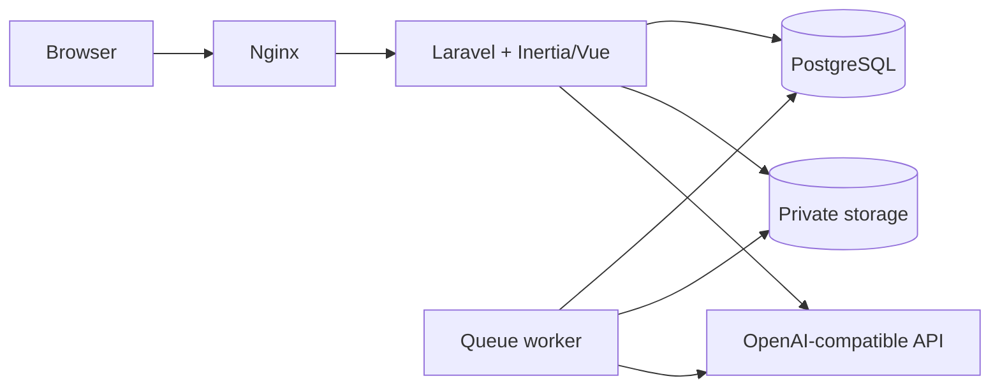
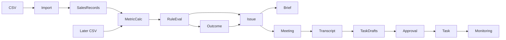

# Architecture

## 1. System
Pragmatic modular monolith: one Laravel 13 codebase, one PostgreSQL database, Vue 3 + Inertia.js UI served by the same app, database queue worker, cron scheduler when needed. No Docker, Redis, microservices, GraphQL, or separate frontend/backend deployments.



## 2. Technology and versions
Laravel 13, PHP version supported by Laravel 13 (verify in S01; expected 8.3+), Composer, Vue 3 Composition API, TypeScript, Inertia.js, Vite, Tailwind CSS, shadcn-vue, Lucide, Apache ECharts, PostgreSQL. Official Laravel Vue starter kit used where appropriate. **S01 records the verified compatible versions in this file (section 11).** Laravel session auth, database queue, database cache, notifications, private `local` disk.

## 3. Module boundaries
Modules are folders, not packages. Cross-module calls go through Actions/Services, never through another module's controllers. Later specs extend earlier pages (for example `IssueController::show`) instead of using plugin registries. Events are used for async work and Core activity logging only (`stage-1-refinements.md` R7).

| Module | Responsibility | Key locations |
|---|---|---|
| Identity | company, departments, users, roles, policies | Models, Policies, Actions/Identity |
| Imports | CSV parse, validate, preview, commit, completeness | Services/Imports, Actions/Imports, Jobs |
| Intelligence | metrics, rules, evaluations, issues, notifications | Services/Intelligence, Actions/Issues |
| Briefing | brief assembly, AI text, speech | Services/AI, Actions/Briefs |
| Meetings | meetings, transcription, extraction, drafts | Services/AI, Actions/Meetings |
| Tasks | approval, tasks, comments | Actions/Tasks |
| Outcomes | baseline, follow-up evaluation, feedback | Services/Intelligence, Actions/Outcomes |
| Activity | activity log writer | Actions/Activity |

## 4. Application structure
Backend: `app/Actions`, `Models`, `Enums`, `Services`, `Services/AI`, `Services/Imports`, `Services/Intelligence`, `Jobs`, `Policies`, `Events`, `Listeners`, `Notifications`, `Http/Controllers`, `Http/Requests`. Frontend: `resources/js/{components,layouts,composables,types,pages/*}`. Actions are single-purpose classes with one `handle()` method used for multi-step, transactional operations. No repository layer over Eloquent.

## 5. Data flow

Evaluation is triggered after every confirmed import (queued job `EvaluateRulesJob`). Outcome verification is invoked by the same job for issues in Monitoring.

## 6. AI integration architecture
Four small classes in `app/Services/AI`: `BriefGenerator`, `MeetingTaskExtractor`, `TranscriptionService`, `SpeechService`, sharing one thin `OpenAiClient` (Laravel `Http` facade, timeouts, no SDK framework). Model ids come from `config/ai.php` read from env: `AI_TEXT_MODEL`, `AI_TRANSCRIPTION_MODEL`, `AI_SPEECH_MODEL`, `AI_SPEECH_VOICE`, `AI_BASE_URL`, `OPENAI_API_KEY`. No model name is hardcoded.

- **Sent to provider:** brief — structured verified metrics and issue evidence (no user emails/passwords); transcription — the audio file; extraction — transcript text, meeting date, company timezone, list of staff display names and ids of the meeting's department; speech — brief text.
- **Stored locally:** requests status, provider response ids, sanitized errors, generated brief JSON, transcript, task drafts, audio files. API keys never stored or sent to the frontend.
- **Output contracts:** JSON schema structured outputs, validated server-side (Laravel Validator) before persistence. Invalid output is a failed attempt, not partially saved.
- **Authoritative figures:** brief items carry `evidence` copied from `rule_evaluations`; the UI renders numbers from structured fields, AI supplies only `title` and `explanation` text. Post-generation check rejects explanation text containing numbers not present in the evidence set (allow-list match); on rejection retry once, then fall back.
- **Failures:** HTTP timeouts 30 s text, 120 s transcription, 60 s speech, single attempt per call; the job retries recoverable errors (timeout, 429, 5xx) 3 times with backoff 10/30/60 s; then status `failed` with a user-visible Retry button. Brief falls back to the deterministic summary (`source = fallback`) and is labelled "AI unavailable". Transcription failure offers manual transcript entry.
- **Human approval:** AI never assigns tasks, changes rules, or sends notifications. Task drafts become tasks only through `ApproveTaskDraft`.
- **Prompt-injection:** transcripts are passed as delimited data; system prompt states they are untrusted; output is schema-constrained; assignee ids must belong to the allowed staff list.

## 7. Background processing
Database queue with ONE queue, `default`, and one worker (simplified by the user's instruction on 2026-11-26). All jobs run on it: `ProcessImportJob`, `EvaluateRulesJob`, `VerifyOutcomesJob`, `GenerateBriefJob`, `GenerateBriefAudioJob`, `TranscribeMeetingJob`, `ExtractMeetingTasksJob`. The AI jobs read their queue name from `config('ai.queue')` (`AI_QUEUE`, default `default`), so a separate `ai` queue and second worker can be switched on later without code changes. Retries live in the job only (3 tries, backoff 10/30/60 s); `OpenAiClient` makes a single attempt. `retry_after=300`, worker `--timeout=180`, Supervisor `stopwaitsecs=200`. Budget table and rules: `docs/stage-1-refinements.md` R6. Jobs are idempotent: status guards, `ShouldBeUnique` (`uniqueFor` 900 s), `failed()` handlers, `afterCommit` dispatch.

## 8. Security (summary; see steering/security.md)
Session auth, CSRF, Form Requests, Policies on every model, department scoping in query scopes, private storage with authorized streaming download, upload validation by extension and MIME and size, throttling on login/uploads/AI endpoints, secrets only in `.env`, log redaction, consent checkbox persisted per meeting, retention command.

## 9. Deployment architecture
Single Ubuntu VPS: Nginx → PHP-FPM, PostgreSQL local, one Supervisor program running `php artisan queue:work database --queue=default --tries=3 --timeout=180 --max-time=3600`, cron `* * * * * php artisan schedule:run` (retention cleanup), Let's Encrypt HTTPS, `storage/app/private` outside web root, nightly `pg_dump` and file rsync. Deploy by `git pull`, `composer install --no-dev`, `npm ci && npm run build`, `php artisan migrate --force`, cache config/routes/views, `queue:restart`.

## 10. Decisions and trade-offs
| Decision | Why | Trade-off |
|---|---|---|
| Modular monolith | Simple to run and debug | Discipline needed for boundaries |
| DB queue/cache | No Redis, enough for demo load | Lower throughput |
| Metrics computed from sales_records on demand, evidence snapshotted in `rule_evaluations` | No MetricSnapshot table, history is preserved by snapshots | Recompute cost trivial at demo scale |
| Corrected imports supersede rows, never delete | Auditability | Extra column and filter |
| Thin HTTP client, no AI SDK framework | Fewer dependencies | Manual schema handling |
| Actions only for multi-step operations | Avoid abstraction bloat | Mixed styles; rule: use Action when more than one write |
| Users have one role and one department | Fits fixed roles | Not extensible to multi-department |

## 11. Verified versions
Recorded by S01 on 2026-11-25 from the installed environment. Source column: command output or lock-file entry.

| Component | Version | Source |
|---|---|---|
| PHP | 8.5.2 | `php -v` |
| PHP required by Laravel 13 | `^8.3` (minimum 8.3) | `vendor/laravel/framework/composer.json` (`require.php`) |
| Composer | 2.9.5 | `composer --version` |
| Laravel | 13.44.1 | `composer.lock` (`laravel/framework` v13.44.1), `php artisan about` |
| Node.js | 24.13.0 | `node -v` |
| npm | 11.8.0 | `npm -v` |
| PostgreSQL | 17.12 | `psql --version` (server `select version()`) |
| Inertia (server) | inertia-laravel 3.8.0 | `composer.lock` |
| Inertia (client) | @inertiajs/vue3 3.11.0 | `package-lock.json` |
| Vue | 3.5.46 | `package-lock.json` |
| TypeScript / vue-tsc | 5.9.3 / 3.3.14 | `package-lock.json` |
| Tailwind CSS | 4.3.5 | `package-lock.json` |
| shadcn-vue | CLI 2.9.0 (style `new-york`; components copied into `resources/js/components/ui`, built on reka-ui 2.11.0) | `npx shadcn-vue --version`, `components.json`, `package-lock.json` |
| Lucide icons | @lucide/vue 1.80.0 | `package-lock.json` |
| Apache ECharts | 6.1.0 | `package-lock.json` |
| Vite toolchain | vite-plus 1.4.0 (Vite-compatible; shipped by the Laravel Vue starter kit) with laravel-vite-plugin 3.2.1 | `package-lock.json` |
| Laravel starter kit extras | laravel/fortify 1.44.0, laravel/wayfinder 0.1.23 | `composer.lock` |
| Test framework | Pest 5.3.7 on PHPUnit 13.4.7 | `composer.lock` |
| Code style | Laravel Pint 1.32.3; ESLint 10.15.0; Prettier 3.10.1 | `composer.lock`, `package-lock.json` |

Notes:
- The official Laravel Vue starter kit (`laravel/vue-starter-kit` 1.0.2, installed with `laravel new --vue --pest --database=pgsql`) ships Inertia 3, Wayfinder, Fortify and the Vite+ toolchain. Its Vite+ lint/format tools are not used; ESLint and Prettier are added as the specified checks.
- The framework merges its default connection list into `config/database.php`; only `pgsql` is configured and used.

## 12. Automated verification
Focused Laravel feature tests (Pest or PHPUnit as shipped by the starter kit) on a PostgreSQL test database for business-critical behavior; list and limits in `docs/stage-1-refinements.md` R5. No browser automation or property-based frameworks.

## 13. Access control conventions (S02)
Rules every later spec follows. Roles are the fixed `App\Enums\Role` values `owner`, `manager`, `staff` (docs/business-workflows.md D23). Wrong role: 403. Record outside the user's department: 404 (existence is never revealed).

- **One policy per model**, in `app/Policies`, auto-discovered by the `{Model}Policy` name. Default deny, and every method denies an inactive user. The trait `App\Policies\Concerns\AuthorizesByDepartment` provides `sameDepartment($user, $departmentId)`.
- **No blanket Owner `before()` hook.** Each policy method states who may act, so department-scoped Manager rules are never bypassed by a shortcut.
- **Controllers** authorize (`Gate::authorize`) then validate (Form Request) then call an Action or Service. Navigation visibility is display only and never authorization. `config/navigation.php` lists the roles per section, and the `section.access` middleware returns 403 for sections a role does not see.
- **Middleware order:** `auth`, `active` (ends the session of a deactivated user), `section.access` run before route model binding (`prependToPriorityList` in `bootstrap/app.php`), so a deactivated user or wrong role is rejected before any record is resolved.
- **Department scoping:** a model with `company_id` and `department_id` uses `App\Models\Concerns\ScopedToDepartment` and is always queried through `visibleTo($user)`. Owner: rows of the company. Manager and Staff: rows of their own department. Inactive user or no department: no rows. It is an explicit local scope, never a global scope. Staff are further restricted to their own assignments by the spec that owns the model.
- **Form Requests** validate every request body; secrets are never flashed or redisplayed.

Example for a later spec (S03 imports):

```php
// app/Models/Import.php
class Import extends Model { use ScopedToDepartment; }

// app/Providers/AppServiceProvider.php (boot): out-of-scope id => 404
Route::bind('import', fn (string $id) => Import::visibleTo(request()->user())->findOrFail($id));

// app/Http/Controllers/ImportController.php: in scope but wrong role => 403
public function show(Import $import) { Gate::authorize('view', $import); /* ... */ }

// Lists
Import::visibleTo($request->user())->latest()->get();
```

Settings tabs are listed in `App\Support\SettingsTabs`, filtered by policy. S03 (Import template) and S04 (Rules) add their tab there.

## 14. Sales import (S03)
**Flow.** Upload (synchronous: `CsvImportReader` file checks, then `CreateImportFromUpload` stores the file privately under `imports/{id}/{random}.csv`, validates and classifies every row through `ImportAnalyzer`, saves `import_errors` and counters, status `validated`) -> preview (`ImportPreviewBuilder` re-reads the stored file) -> `ConfirmImport` (row lock, status `processing`, dispatch) -> `ProcessImportJob` (queue `default`, unique per import, per-department `Cache::lock`, re-validates and re-classifies against the records as they are now, one transaction: supersede, insert, replace errors, counters, status; `ImportCompleted` after commit). A stale preview therefore cannot create a second active record, and the partial unique index `sales_records_active_identity_unique (department_id, branch_code, sales_date) WHERE is_active` is the final backstop. Money is held as decimal strings and compared with bcmath (`ext-bcmath` is required in `composer.json`); no float is used for money.

**Statuses.** `uploaded`, `validated`, `processing`, `completed`, `completed_with_errors`, `failed`, `cancelled`, with the transitions in `App\Enums\ImportStatus`. The uploaded file is kept in every status.

**`ReportingCalendar` and `ReportingCoverage` contract** (consumed by S04, S05, S08; facts only, no rule decisions, read-only, stateless):
- `ReportingCalendar::forCompany($company, $now)`: `isDue($date)` (trading day and `$now >= date + lag days at cutoff time` in the company timezone), `lastDueDate()`, `tradingDates($weekStart)`, `isWeekClosed($weekStart)`.
- `ReportingCoverage` (inject it): `calendar`, `expectedBranches`, `isDue`, `lastDueDate`, `tradingDates`, `weekState`, `weekStates` (one range query), `weekStateForRows` (database-free), `latestClosedWeek`, `missingDueBranchDays` (kinds `inside_period` and `after_latest`, never a not-yet-due date), `latestSalesDate`, `freshness`. Every time-dependent method takes an optional `$now` that defaults to `BusinessClock`, and an optional `PendingRows` overlay evaluated as if the rows were saved.
- Week rules: closed iff every trading day is due, else open (informational, completeness null). Closed: `absent` (nothing present or no expected branches), `incomplete` (an expected branch-day is missing), else `complete`. A zero revenue is present; a gap is never zero; `coveragePct` is 4-decimal round half up. Freshness: `current` iff the latest sales date is on or after the last due date, else `behind` with the overdue branch-day count. Calendar settings come from the company, expected branches only from `departments.settings.expected_branches`; nothing derives them from an upload.

**Events** (`App\Events\Imports`, dispatched after commit, no listener registered by S03): base payload `importId`, `departmentId`, `actorUserId` (null for system events), `occurredAt`. `ImportCompleted` adds `status`, `insertedRows`, `correctedRows`, `unchangedRows`, `invalidRows`, `minDate`, `maxDate`; S04 listens to start `EvaluateRulesJob`, S08 to log activity. `ImportFailed` (job failure, early failure, or failure after the row was created); S08 listens. Polish events `ImportValidated`, `ImportConfirmed`, `ImportCancelled`, `ImportFileDownloaded` are not built yet.

**Commands and fixtures.** `database/demo/{history,week8-decline,week8-with-errors,week8-correction,week9-interim,week10-recovery}.csv` are produced by `App\Services\Demo\FixtureGenerator` (integer arithmetic, byte-identical) and checked by `php artisan demo:check-fixtures` against the hand-written literals in `database/demo/expected.json` (no database access; `--write` rewrites only the CSVs). `php artisan demo:import {fixture}` (requires `DEMO_MODE=true`) uploads a fixture as the demo Owner through the real actions and runs `ProcessImportJob` inline (`queue.default` set to `sync` for that process); it inserts nothing directly and fails if the counters differ from `expected.json`. Run `demo:set-date` first; fixture dates after the business today are rejected as `future_date`. `expected.json` is extensible: S04 adds evaluation expectations.

**Upload limits.** 5 MB and 10,000 rows (`config/imports.php`, demonstration defaults). PHP and the web server must allow it: `upload_max_filesize=6M`, `post_max_size=8M`, Nginx `client_max_body_size 6m`. The PHP default of 2 MB rejects larger files before the application sees them.

## 15. Intelligence and issues (S04)
**Flow.** `ImportCompleted` (S03) -> `EvaluateAfterImportListener` -> `EvaluateRulesJob` (queue `default`, one pending job per department, per-department locks) -> per active rule: pure evaluator -> evaluation stored by insert-or-reuse on `run_key` -> for a new breached result `IssueEngine` creates (race-free `INSERT ... ON CONFLICT` on the partial unique index), re-detects or links a recurrence -> `UrgentIssueNotifier` (same transaction) -> events after commit. "Refresh intelligence" dispatches the same job with no import and is the recovery path when the listener could not queue the evaluation (the listener never throws into the import; the Issues pages show a stale-evaluation note computed from `evaluated_through_import_id`).

**Rules** (`MetricCalculator`, bcmath, 4-decimal round half up, `Indeterminate::ZeroDenominator` instead of a number): weekly decline (latest closed week vs the week before, both complete; breach = drop strictly greater than the threshold), target shortfall (latest closed week; breach = achievement strictly below the threshold), missing data (window = Monday of the ISO week before today's week through the last due date; denominator = expected branches x DUE trading days of the window, so a day before its cutoff is never expected). Open weeks are never evaluated; absent or incomplete weeks give `insufficient_data` (`period_absent`, `incomplete_period`), a zero denominator `zero_denominator`, no records `no_records`. Thresholds and severities are demonstration defaults (the demo uses `high_drop_pct` 15).

**Consistency.** A run reads everything first and accepts it only if a fingerprint of the department's sales records (count, active count, max id, last update) is the same before and after; otherwise it stores nothing and retries. It also waits for the import lock `import-processing:department:{id}`, so an import commit cannot land mid-evaluation. `ProcessImportJob` now dispatches `ImportCompleted` only after releasing that lock. Both jobs use `tries = 20` with `maxExceptions = 3`, so waiting on a lock never uses up the retries (a deviation from "3 tries" in R6, made for exactly this reason).

**`IssueLifecycle`** (pure transitions, transaction + row lock, append-only history, business clock, `IssueStatusChanged` after commit, double submit is a no-op): `acknowledge`, `startAction` (S07), `startMonitoring` (S07 automatic, or manual with a reason), `returnToAction` (S07), `resolveManual`, `resolveVerified` (S08), `reopen` (S08). S04 has no task reader; resolution by task completion never happens.

**Events** (`App\Events\Intelligence`, after commit, ids only): Core `IssueCreated`, `IssueStatusChanged`, `UrgentIssueNotified`, `EvaluationRunCompleted` (one per run when at least one rule was processed; sorted unique evaluation ids, new or reused; not on lock contention). Polish (not built): `RuleEvaluated`, `IssueRedetected`, `BusinessRuleUpdated`. S08 listens and writes the activity log; S04 writes none. `IssueEvidence::forIssue` is the read model for S05 and S08 (stored values only). S05 to S08 extend `IssueController::show` directly with their own props and Vue panels; there is no registry. Notifications use Laravel's database channel only (no email, SMS or push).


## 16. Executive dashboard, brief and voice (S05)
**Dashboard (Today).** `DashboardController` chooses the payload by role: Staff get only `audience: 'staff'` (no `data` prop at all); Owner and Manager get `DashboardMetrics::forOwnerOrManager`, which only assembles S03 `ReportingCoverage` and S04 `MetricCalculator` values for the latest closed week (the same week S04 evaluated; it never searches back for an older complete week, so an absent or incomplete week is `insufficient_data` with the reasons `period_absent`, `incomplete_period`, `comparison_week_incomplete`, `zero_denominator`, never zero). There are no task KPIs (S07 adds them). Open and high-priority issue counts come from `issues`. The freshness banner is computed live and creates no issue or notification.

**Brief flow.** `POST /briefs` (Owner or Manager, throttled, one in-progress brief per company under a company row lock; an in-progress brief older than 15 minutes no longer blocks) -> `GenerateBriefJob` (queue `ai`, unique per company) -> `BriefGenerator`: select up to five non-resolved issues (severity desc, `last_detected_at` desc, id asc; a Manager only their department) -> copy `IssueEvidence::forIssue` into each `brief_items.evidence` (a value copy, never rewritten by later evaluations) -> if the provider is configured and the latest evaluation run is healthy, ask for a title and explanation per finding only (JSON schema), validate with Laravel `Validator` and `NumberAllowListChecker` (every number must appear in that item's evidence), one corrective request inside the same attempt, otherwise the deterministic fallback (`BriefSummaryComposer` templates and the evidence figures sentence of `BriefPresenter`) -> persist in one transaction (idempotent: items are deleted and re-created). Zero findings never call the provider. Events `BriefGenerated` and `BriefFailed` (`App\Events\Briefing`, ids and a sanitized code only).

**Evaluation health (S04 correction).** `EvaluateRulesJob` records in `departments.settings.intelligence`: `last_run_status` (`success|partial|failed`), `last_run_failed_rules`, and, on a run that evaluated at least one rule, `last_evaluated_at`, `evaluated_fingerprint` (sales-record fingerprint) and `evaluated_last_due_date`. `EvaluationHealth` derives `never|current|partial|failed|stale`; stale means the fingerprint or the last due date moved on since the run (no longer "max completed import id" alone, and independent of the demo clock). When a run is partial or failed, the brief is never produced as a normal AI brief: it is a deterministic fallback with `error_message` `evaluation_partial|evaluation_failed`, `coverage_status = partial`, and a limitation sentence. The Issue detail page and the dashboard show the same status.

**Historical vs current.** An issue's `latest_evaluation_id` is the latest BREACH; `IssueEvidence::current` is the most recent evaluation of the rule whatever its result. Brief items keep the breach evidence and show a note ("The most recent evaluation (...) no longer shows this breach.") when the present condition differs; the provider is told `stillBreachedInLatestEvaluation`.

**Aggregation scope (S04 correction).** `MetricCalculator::weekTotals/totalsBetween` accept the company trading weekdays and the expected branches, and the evaluators and the dashboard pass them, so a record on a non-trading day or for a non-expected branch never counts towards revenue or target, exactly as it never counts towards coverage (R2). Calling without the filters (unit tests only) sums every active record.

**AI client and retry layering (R6).** `OpenAiClient` (Laravel `Http`, no SDK) makes ONE attempt per call (chat timeout 30 s, speech 60 s from `config/ai.php`; model, voice, base URL and key from env, none hardcoded), maps failures to `RecoverableProviderException` (timeout or connection, 429, 5xx) or `ProviderException` (4xx, unusable body) with fixed codes (`timeout|rate_limited|server_error|client_error|invalid_response`), and logs only request type, brief id, status and duration. Only the jobs retry: `GenerateBriefJob` (`tries` 3, backoff 10/30/60 s, timeout 60, queue `ai`) rethrows a recoverable error until the final attempt, then stores the fallback; `GenerateBriefAudioJob` (timeout 90) sets `audio_status = failed`. `retry_after` (300) exceeds every job timeout. One corrective request does not consume an attempt, so one user action causes at most 3 attempts.

**Data sent to the provider.** Per finding only: position, metric name, period label, the figures sentence built from the stored evidence, severity and whether the breach still holds, plus the coverage status. Fictional data only until the client authorizes otherwise. Nothing personal is sent or stored in `input_snapshot`.

**Voice.** `SpeechService` speaks `BriefPresenter::spokenText` (the same blocks as the page) and writes `storage/app/private/briefs/audio/{random}.mp3` on the local (private) disk. `GET /briefs/{brief}/audio` streams it as `audio/mpeg` only to an active Owner or Manager of the brief's company (Staff 403 through `section.access`, another company 404 through the scoped route binding), throttled, `Cache-Control: private, no-store`. No public URL exists. "Voice is not configured." is shown when the speech model or voice is empty.

**Coverage status.** `stale` when freshness is `behind`, there is no sales data, or the evaluation is stale or never ran; else `partial` when the latest closed week is incomplete or absent or the evaluation run was partial or failed; else `sufficient`.

**Polish not built:** weekly-change chart, resolved-in-30-days KPI, priority actions, regenerate audio and range-request verification, `BriefRequested`, `BriefAudioGenerated`, Issue detail brief links (task 6.1).

**S08 note (R3).** The outcome metric used by S08 to judge recovery must use actual revenue values read from the verified closed weeks (`weekTotals` with the same scope), never the issue's `difference_pct` or any brief text.

### S05 corrections (added with S06)
- **AI wording guard.** `NumberAllowListChecker` no longer allows numbers at all: a numeric allow-list cannot prove a sentence is true (valid numbers can sit in a wrong claim). AI title/explanation text must contain no digits or percentages and is rejected for increase or improvement wording, claims that revenue met a target, causes and predictions. Every figure (value, direction, unit, evaluated period) is rendered deterministically by `BriefPresenter` from the stored evidence. The period label of an item is the period of the evaluation shown (`evidence.latest`), not the issue's original period.
- **Brief scope.** `briefs.department_id` (null = company-wide Owner brief). `Brief::visibleTo`, the route binding (404), `BriefPolicy`, the list, generation, retry, audio request and audio stream all use the same scope; hiding links is not authorization.
- **Audio.** `SpeechResponse` must be an mp3 (ID3 tag or MPEG frame sync); `SpeechService` verifies that the private write succeeded with the exact size before `ready`; a ready brief whose file vanished is shown as `failed` with a retry.
- **Dashboard (R2).** When the latest closed week is incomplete or absent, the dashboard shows the latest closed COMPLETE week (within the 8-week window) with explicit dates and a prominent warning; the rule engine is unchanged (latest closed week, no fallback).

## 17. Meeting intelligence (S06)
**Flow.** Meeting (`draft`) -> recording upload (consent required, private disk, content-detected MIME) or pasted transcript -> `TranscribeMeetingJob` (queue `ai`) -> transcript stored (`transcript_source` audio|manual) -> `ExtractMeetingTasksJob` -> decisions and PENDING `task_drafts`. Status is written only by `MeetingStateMachine` (compare-and-set). S06 creates drafts only: never a task, assignment, approval, issue status change or notification (S07 owns approval).

**Run-time authorization (R8).** `MeetingRunGuard` re-checks when each job runs: meeting exists, department loads, consent recorded (always for transcription, for audio transcripts at extraction), recording not deleted and file present. A failed check fails the stage with a closed code and sends nothing to the provider. The allowed-staff list (active staff and managers of the meeting's department; the Owner is never in it) is built at run time.

**Untrusted transcript.** Nonce-delimited block plus a system rule, strict JSON schema, server validation that ignores unknown fields, every excerpt verified against the real transcript (normalized match, original text stored, 10 to 500 characters), at most 10 decisions and 20 drafts, and deterministic `AssigneeResolver` / `DeadlineResolver` that never read the model's ids or dates. Deadlines use the MEETING date and the company timezone only, never the system clock. Ambiguous names (two Daniels) and unclear or missing deadlines stay unresolved. A result is stored only if the transcript is unchanged since the run started (otherwise `transcript_changed`).

**Retry layering.** `OpenAiClient::transcribe` is one multipart attempt (120 s); extraction chat calls are 60 s with one corrective request inside an 80 s budget. Jobs: 3 tries, backoff 10/30/60 s, `ShouldBeUnique` (900 s), `afterCommit`; job timeouts 150 s (transcription) and 90 s (extraction); worker `--timeout 180`; `retry_after` 300 s (all above the longest job); unique locks (900 s) exceed wait plus run time (3 x 150 + 100 s of backoff = 550 s). Provider calls per user action: transcription at most 3; extraction at most 6 (2 per attempt); brief at most 6 (S05: job timeout 90 s, calls 30 s, corrective inside a 75 s budget); audio at most 3.

**Provider limits (verified 2026-11-26 against the OpenAI speech-to-text documentation).** Transcription accepts files up to 25 MB; formats flac, mp3, mp4, mpeg, mpga, m4a, ogg, wav, webm. S06 accepts mp3, m4a, wav, webm, mp4 up to 20 MB (headroom), intended about 15 minutes (not verified server-side). The request sends only `file` (named `recording.{ext}`), `model` and `response_format=json`: no language, no prompt. Language quality is not guaranteed beyond English. Local PHP needs `upload_max_filesize` of at least 25M and `post_max_size` of at least 26M (default 2M/8M rejects real recordings); the reverse proxy needs `client_max_body_size` of at least 25M.

**Sent to and kept from the provider.** Sent: the recording (transcription); transcript text, meeting date, company timezone and (id, name) pairs of the department's staff (extraction). Kept: transcript, decisions, drafts, recordings until retention. Fictional data only until the client authorizes real recordings; `recordings:purge` and Owner deletion (PoV Polish) must exist before real recordings are processed.

## 18. Task review and execution (S07)
**One write path per fact.** `ApproveTaskDraft` is the only code that turns a draft into a Task; `TaskStatusMachine` is the only writer of `tasks.status` (compare-and-set, `completed_at` in the same statement); `AllowedAssignees` (active staff and managers of the department, never the Owner) and `TaskDueDateRule` (not before the meeting date or the business date) are the only definitions of who and when. No AI is involved anywhere in S07.

**Approval.** One transaction: lock the draft row, read its status only from the locked row, return the existing task for an already approved draft (no writes, events or notifications), 422 for rejected or superseded, refuse a draft whose supporting quote is no longer in the CURRENT transcript (stale), apply edits through `DraftEditor`, re-check assignee eligibility, deadline and issue, create exactly one task, save approval metadata, write the in-app assignment notification (deduped on `task_assigned:{task}:{assignee}`, never to the assigner), queue events. Unique constraints on `tasks.task_draft_id` and `task_drafts.task_id` are the final safeguard (caught outside the aborted transaction). After commit `IssueLifecycleBridge` calls the S04 `IssueLifecycle`: `startAction` (issue open or acknowledged), `returnToAction` (monitoring); `tasksSettled` calls `startMonitoring` only when at least one linked task is completed and none is open (cancelled ignored); `taskReopened` returns monitoring to action. It never resolves an issue and never writes outcomes; a bridge failure never undoes a task.

**Execution.** Statuses pending, in progress, blocked, completed, cancelled; overdue is computed (`OverdueCondition`: open and due date strictly before the business date), never stored. Staff may progress their own tasks but not cancel them or reopen a completed one (403); an unlisted transition is 422. Comments are plain text, 1 to 2,000 characters, in every status.

**Visibility.** `Task::visibleTo`: Owner company, Manager department, Staff only their own assigned tasks (a foreign id is the same 404 as a missing one). Drafts: Staff 403, out of scope 404. Staff task pages carry no meeting link, decisions, evidence or issue link. Staff land on My Tasks (login redirect and `/today` redirect).

**Integration points** (no registry or slot): `DashboardMetrics`/`DashboardData.taskCounts` from `TaskCounts` (one aggregate query), `tasks` prop on `IssueController::show` (`TasksForIssue`), `draftReview` prop on `MeetingController@show` (`TaskDraftReviewProps`) extending `TaskDraftsTab.vue`. Events (`App\Events\Tasks`, after commit, ids only, no listener): `TaskDraftApproved`, `TaskAssigned`, `TaskStatusChanged`, `TaskCompleted`. Limiters `task-review` (20/min, shared by edit, approve, reject), `task-status` (60), `task-comment` (30) live in `AppServiceProvider`.

**S06 integration corrections made with S07.** (1) The extractor resolves an assignee or deadline only when its own words appear in the supporting quote (whole words); otherwise `unmatched` / `ambiguous`. (2) Stale drafts: approval re-verifies the quote against the current transcript; a minimal Re-extract (`POST /meetings/{id}/re-extract`) supersedes pending drafts and keeps approved and rejected history. (3) `MeetingRunGuard` re-checks that the requesting user (job `actorUserId`) and the consent giver are still active and still authorized (Owner of the company or Manager of the department) before any provider call (`actor_unauthorized`). (4) Recording deletion and the retention purge (S06 8.4) are built: `RecordingDeleter` (shared service), `recordings:purge` (daily 02:00 through the scheduler) and Owner `DELETE /meetings/{meeting}/recording`, covered by `RecordingRetentionTest`; the manual scratch-database verification in `docs/retention-and-deletion.md` is still to be run before any real client recording is accepted.

## 19. Outcomes, feedback and activity history (S08)
**Outcome verification.** `EvaluationRunCompleted` (S04) -> `DispatchOutcomeVerification` (sync) -> `VerifyOutcomesJob` (queue `default`, unique until processing, 3 tries, backoff 10/30/60 s) -> `OutcomeVerifier` for every issue in `action_in_progress` or `monitoring`, one transaction per issue under the ISSUE row lock. It compares the immutable baseline evaluation (`baseline_evaluation_id`, never `latest_evaluation_id`) with the latest later evaluation of the same rule, classifies the period (`OutcomePhaseResolver`: before action, during action, or after action = the period starts strictly after the monitoring day), assesses six ordered comparability checks (`ComparabilityAssessor`: baseline sufficient, later period, follow-up sufficient, week closed and complete (not for coverage), same branches, non-zero baseline revenue), measures (`OutcomeMetricCalculator`) and inserts an immutable outcome (`ON CONFLICT (issue_id, followup_evaluation_id) DO NOTHING`). It reads stored evaluations only, never `sales_records`, so a later corrected import cannot change a stored outcome. No AI.

**Metrics (R3).** Decline rule: actual weekly revenue in MYR (baseline week, follow-up week, pre-decline reference week), absolute change and relative change of the follow-up against the BASELINE week; the rule's week-over-week change is evidence only. Target and coverage rules: percentage-point change of the 2-decimal display values (96.15 - 79.49 = +16.66). Bands are inclusive at +/-2.00. The resolution condition uses the threshold stored in the baseline evaluation: revenue >= pre-decline revenue x (1 - T/100) (150,000 >= 131,750), target >= T, coverage = 100.

**Lifecycle gate.** Only a comparable post-action period of a MONITORING issue can resolve (condition met, and, rechecked under the lock, at least one linked task completed and none open: `IssueTaskCompletion`) or reopen (worsened and condition not met) through `IssueLifecycle::resolveVerified` / `reopen`. Every other outcome is informational. A refused transition keeps the outcome and logs ids only. The verifier also runs `IssueLifecycleBridge::reconcile` first, the recovery path for any lifecycle update that failed after a task change.

**S07 corrections made with S08.** (1) `IssueLifecycleBridge` locks the issue row and decides from current task counts inside the lock (`reconcile`): monitoring with an open task returns to action, action with all tasks settled moves to monitoring, so concurrent approvals, completions, cancellations and reopens cannot leave monitoring with an open task. (2) Draft approval requires the draft's `transcript_revision` to equal the current transcript, refuses while a re-extraction is running, locks the meeting row (transcript edits lock the same row), and still verifies the quote. (3) Staff task pages carry no meeting, raw excerpt, decisions or issue context.

**Activity history.** `ActivityRecorder` (only writer) + `PropertyAllowList` (per-action keys, scalar values, strings up to 100 characters) + `RecordActivity`, one queued listener (queue `default`, 3 tries, backoff 10/30/60 s) driven by the declarative `ActivityMap` and registered per event in `OutcomesServiceProvider` (deviation from one class per event). Core events recorded: ImportCompleted, ImportFailed, IssueCreated, IssueStatusChanged, UrgentIssueNotified, BriefGenerated, BriefFailed, TranscriptReady, ExtractionCompleted, MeetingProcessingFailed, TaskDraftApproved, TaskAssigned, TaskStatusChanged, TaskCompleted, OutcomeEvaluated. `EvaluationRunCompleted` writes no row. A failing listener is a separate queue job: it cannot roll back or fail the action. PoV Polish (not built): the Activity feed page, manual outcome note, typed property schema, the other 17 listeners (incl. `FeedbackSubmitted`).

**Trace.** `TraceTimelineBuilder` builds seven stages (business data, rule evaluation, issue, brief, meeting, task, outcome) from linked records and activity rows only, adds record entries for linked rows without an activity row, applies policy visibility, never reads titles from activity properties and invents nothing for work done before recording existed. Staff get null. `IssueController::show` gets the `outcomes`, `feedback` and `trace` (deferred) props directly (no registry).

## 20. Demonstration tooling (S09)

- Commands: `demo:seed` (idempotent; real S02 seeder + `demo:set-date` + `demo:import history`, verified against the fixture expectations) and `demo:reset` (DESTRUCTIVE, `--force` or typed company name). Exit codes: 0 success, 1 seed/reset failure, 2 guard refusal. Neither is scheduled or reachable over HTTP.
- `DemoGuard` refuses unless `DEMO_MODE=true`, the environment is not production (unless `DEMO_ALLOW_PRODUCTION_DEMO=true`), no non-demo company exists, and (reset) exactly one demo company exists and confirmation matches.
- `DemoResetter` holds `Cache::lock('demo-reset', 600)`, refuses while the `jobs` table is non-empty, sets the `demo-reset-active` flag (15 min), deletes rows in one transaction in FK-safe order, deletes stored files after commit, re-seeds, and always clears flag and lock. Every job and listener returns without effect while the flag is active (RF-01, closed); the empty-queue precondition is a second safeguard.
- Clock file: `demo/fixed-datetime` on the private local disk, set by `demo:set-date`, honored only by `BusinessClock` in demo mode.
- Related documents: `docs/local-setup.md`, `docs/deployment.md`, `docs/retention-and-deletion.md`, `docs/demo-walkthrough.md`, `docs/acceptance-checklist.md`, `docs/rehearsal-protocol.md`, `docs/provider-failure-drills.md`, `docs/demo-recording.md`, `docs/readiness-fixes.md`.

## 21. Platform super admin and multiple companies (S10)

Scope change by explicit user instruction (2026-11-26): BusinessPulse is offered to many SMEs and the platform owner manages them from a panel. Spec: `.kiro/specs/10-platform-super-admin/`. Billing, plans, self-service sign-up, email invitations, impersonation, company deletion and a database per company remain out of scope.

- **Separate identity.** `platform_admins` table, `PlatformAdmin` model, auth guard `platform`, login at `/platform/login`. Not a fourth role: the Owner, Manager and Staff roles, policies and navigation are unchanged. The `platform` middleware (`EnsurePlatformAdmin`) scopes the admin to the request with `setUserResolver` and never changes the default guard.
- **Least privilege.** The panel (`/platform/companies`) shows company metadata only: name, time zone, trading days, branch codes, user and department counts, the Owner's name and email, and the platform audit trail. A platform admin cannot open any tenant page or file, and no tenant business data is loaded by the panel.
- **Actions** (`app/Actions/Platform`): `CreateCompany` (one transaction: company with `is_demo = false`, Sales department with branch codes, three default rules, first Owner), `SetCompanySuspension`, `ResetOwnerPassword` (also ends the Owner's database sessions), `PlatformAudit`. Every action writes `platform_audit_logs` without secrets.
- **Suspension.** `companies.suspended_at`. Tenant sign-in is refused and `EnsureUserIsActive` ends a live session on the next request with "This company's account is suspended." Queued jobs of a suspended company still run (known limit).
- **Isolation.** Unchanged mechanism: every user, department and record resolves to one `company_id`; policies and `visibleTo` scopes return 404 for another company's records. `CurrentCompany` now resolves the signed-in user's own company (it used to be "the first company"); CLI, queue jobs and demo tooling keep the oldest-company fallback, and company-specific code passes the company's time zone explicitly. There is no PostgreSQL row-level security (R-19).
- **First admin.** `php artisan platform:create-admin` (12-character minimum). In demo mode `DemoIdentitySeeder` also creates `admin@businesspulse.demo` with `DEMO_PASSWORD`.
- **Demo tooling.** `DemoGuard` and `DemoIdentitySeeder` still refuse to run when any non-demo company exists, so real SMEs belong in a separate (non-demo) database.
- **Known single-company leftovers:** the demo clock file is global (demo mode only); `IssueLifecycle` stamps status history with the default time zone offset (same instant); AI usage and cost are not tracked per company; recordings and files share one disk, separated by path only.

## 22. Platform AI settings and Claude support (S11)

Scope extension by explicit user instruction (2026-11-26); spec `.kiro/specs/11-platform-ai-settings/`. AI provider settings are edited by a platform admin at `/platform/ai` and apply to the whole site.

- **Storage and precedence.** Table `ai_settings` (one row). Keys use Laravel's `encrypted` cast (the application key), are hidden from serialization and are write-only in the panel. `AiSettings` resolves each capability from the saved value, then `config/ai.php` (`.env`). It reads on every call, so a change applies to the next request or job. Rotating `APP_KEY` makes saved keys unreadable; re-enter them.
- **Capabilities.** Text (brief wording, task extraction): `openai` (any OpenAI-compatible API) or `anthropic` (Claude). Transcription and Voice: OpenAI-compatible only (Claude has no audio endpoints). Each capability has its own address, key and model; an OpenAI key is never sent to Anthropic and the reverse.
- **Claude path.** `AnthropicTextClient`: `POST {base}/v1/messages`, headers `x-api-key` and `anthropic-version: 2026-10-21`, system prompt in `system`, structured answer through `output_config.format` (`json_schema`; keywords the feature rejects such as `minLength` are stripped, the server still validates), no sampling parameters, `max_tokens` 8000, one attempt per call. 429 and 5xx are recoverable (the queue retries), other 4xx are final, a `refusal` or `max_tokens` stop is an invalid response. Raw HTTP through Laravel's client, like the OpenAI-compatible path, so one thin HTTP layer and `Http::fake` tests are kept (no provider SDK dependency).
- **Safety.** Base URLs must be https, public and plain (`SafeProviderUrl`); the connection test returns fixed messages only and is throttled; the audit log lists changed field names, never values. Residual risk: a public host name that later resolves to a private address (R-22).
- **Adding another provider.** Implement `chat(ChatRequest, AiEndpoint): ChatResponse`, add one branch in `OpenAiClient::chat` and one allowed value in `UpdateAiSettingsRequest`.
- **Queue.** All jobs, including the AI jobs, run on one `default` queue (`AI_QUEUE`, default `default`).

## 23. Test suite reduction (owner decision, 2026-11-26)

By explicit instruction of the project owner the automated suite was cut from 589 to 330 tests (run time about 61 s to 36 s) to speed up development. This overrides the usual rule against deleting tests, and it lowers regression protection. What was kept: every area the project requires tests for (`docs/stage-1-refinements.md` R5: decline and target calculations, zero denominators, coverage and cutoff, duplicate and corrected imports, issue dedupe and recurrence, human-only and idempotent task approval, department and file access, outcome phases, task reopen), the demonstration timeline, the platform panel and AI settings core, and at least one test per spec area. What was removed: repeated dataset cases, variants of a rule that another test already covers, query-count and logging checks, many notification, throttling and cosmetic cases, and some secondary validation cases. Tests that were committed before this change can be recovered from git history (`git log -- tests`, `git show <commit>:<path>`). Treat the 330 as a floor: add a test with every bug fix.

## 24. Populated demo state

`demo:seed --populated` (also used by `DatabaseSeeder`, so `migrate:fresh --seed`, and `demo:reset --populated`) adds one step on top of the clean start: `demo:import week8-decline` at the clock 2026-09-28 09:00, through the real import job and evaluation, then a draft meeting "Sales recovery huddle" for the Sales Manager linked to the decline issue. Result: 144 active records, an open high decline issue (-20.00%, 79.49% target achievement issue alongside it), two urgent notifications (Owner and Sales Manager), 0 tasks, drafts, briefs and outcomes. No AI runs during seeding and no AI-looking row is written by the seeder; drafts, tasks and outcomes appear only through real extraction and verification. The seed is idempotent, upgrades a clean seed in place, and the plain `demo:seed` refuses a populated demo (use `demo:reset`).
