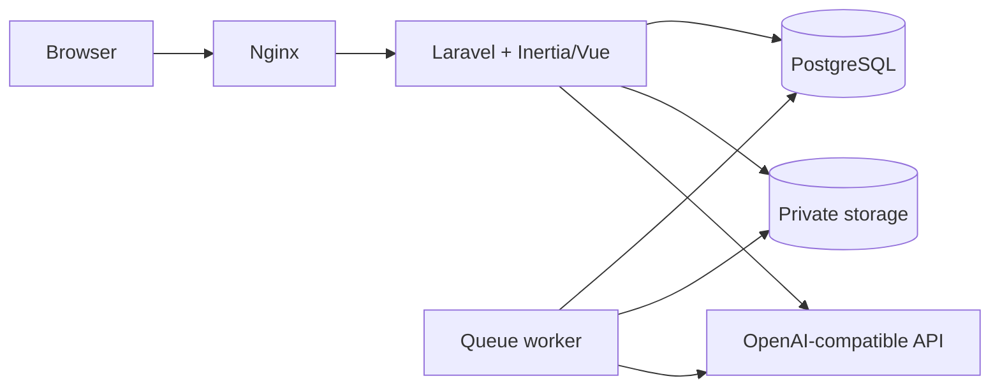
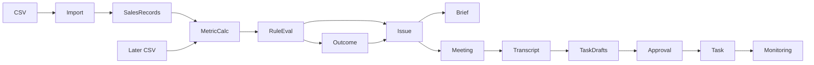

# Architecture

## 1. System
Pragmatic modular monolith: one Laravel 13 codebase, one PostgreSQL database, Vue 3 + Inertia.js UI served by the same app, database queue worker, cron scheduler when needed. No Docker, Redis, microservices, GraphQL, or separate frontend/backend deployments.

## 2. Technology and versions
Laravel 13, PHP version supported by Laravel 13 (verify in S01; expected 8.3+), Composer, Vue 3 Composition API, TypeScript, Inertia.js, Vite, Tailwind CSS, shadcn-vue, Lucide, Apache ECharts, PostgreSQL. Official Laravel Vue starter kit used where appropriate. **S01 records the verified compatible versions in this file (section 11).** Laravel session auth, database queue, database cache, notifications, private `local` disk.

## 3. Module boundaries
Modules are folders, not packages. Cross-module calls go through Actions/Services, never through another module's controllers.

| Module | Responsibility | Key locations |
|---|---|---|
| Identity | company, departments, users, roles, policies | Models, Policies, Actions/Identity |
| Imports | CSV parse, validate, preview, commit, completeness | Services/Imports, Actions/Imports, Jobs |
| Intelligence | metrics, rules, evaluations, issues, notifications | Services/Intelligence, Actions/Issues |
| Briefing | brief assembly, AI text, speech | Services/AI, Actions/Briefs |
| Meetings | meetings, transcription, extraction, drafts | Services/AI, Actions/Meetings |
| Tasks | approval, tasks, comments | Actions/Tasks |
| Outcomes | baseline, follow-up evaluation, feedback | Services/Intelligence, Actions/Outcomes |
| Activity | activity log writer | Actions/Activity |

## 4. Application structure
Backend: `app/Actions`, `Models`, `Enums`, `Services`, `Services/AI`, `Services/Imports`, `Services/Intelligence`, `Jobs`, `Policies`, `Events`, `Listeners`, `Notifications`, `Http/Controllers`, `Http/Requests`. Frontend: `resources/js/{components,layouts,composables,types,pages/*}`. Actions are single-purpose classes with one `handle()` method used for multi-step, transactional operations. No repository layer over Eloquent.

## 5. Data flow

Evaluation is triggered after every confirmed import (queued job `EvaluateRulesJob`). Outcome verification is invoked by the same job for issues in Monitoring.

## 6. AI integration architecture
Four small classes in `app/Services/AI`: `BriefGenerator`, `MeetingTaskExtractor`, `TranscriptionService`, `SpeechService`, sharing one thin `OpenAiClient` (Laravel `Http` facade, timeouts, no SDK framework). Model ids come from `config/ai.php` read from env: `AI_TEXT_MODEL`, `AI_TRANSCRIPTION_MODEL`, `AI_SPEECH_MODEL`, `AI_SPEECH_VOICE`, `AI_BASE_URL`, `OPENAI_API_KEY`. No model name is hardcoded.

- **Sent to provider:** brief — structured verified metrics and issue evidence (no user emails/passwords); transcription — the audio file; extraction — transcript text, meeting date, company timezone, list of staff display names and ids of the meeting's department; speech — brief text.
- **Stored locally:** requests status, provider response ids, sanitized errors, generated brief JSON, transcript, task drafts, audio files. API keys never stored or sent to the frontend.
- **Output contracts:** JSON schema structured outputs, validated server-side (Laravel Validator) before persistence. Invalid output is a failed attempt, not partially saved.
- **Authoritative figures:** brief items carry `evidence` copied from `rule_evaluations`; the UI renders numbers from structured fields, AI supplies only `title` and `explanation` text. Post-generation check rejects explanation text containing numbers not present in the evidence set (allow-list match); on rejection retry once, then fall back.
- **Failures:** timeouts 30s text, 120s transcription, 60s speech; 3 attempts with backoff 10/30/60s on 429/5xx/timeouts; then status `failed` with user-visible retry button. Brief falls back to the deterministic summary (`source = fallback`) and is labelled "AI unavailable". Transcription failure offers manual transcript entry.
- **Human approval:** AI never assigns tasks, changes rules, or sends notifications. Task drafts become tasks only through `ApproveTaskDraft`.
- **Prompt-injection:** transcripts are passed as delimited data; system prompt states they are untrusted; output is schema-constrained; assignee ids must belong to the allowed staff list.

## 7. Background processing
Database queue, one worker under Supervisor. Jobs: `ProcessImportJob`, `EvaluateRulesJob`, `GenerateBriefJob`, `GenerateBriefAudioJob`, `TranscribeMeetingJob`, `ExtractMeetingTasksJob`. All jobs are idempotent: they load the record, exit if the status is already terminal, use `ShouldBeUnique` keyed by record id, `tries=3`, `backoff`, and `failed()` handlers that set status and sanitized error.

## 8. Security (summary; see steering/security.md)
Session auth, CSRF, Form Requests, Policies on every model, department scoping in query scopes, private storage with authorized streaming download, upload validation by extension and MIME and size, throttling on login/uploads/AI endpoints, secrets only in `.env`, log redaction, consent checkbox persisted per meeting, retention command.

## 9. Deployment architecture
Single Ubuntu VPS: Nginx → PHP-FPM, PostgreSQL local, Supervisor running `php artisan queue:work --tries=3 --timeout=180`, cron `* * * * * php artisan schedule:run` (retention cleanup), Let's Encrypt HTTPS, `storage/app/private` outside web root, nightly `pg_dump` and file rsync. Deploy by `git pull`, `composer install --no-dev`, `npm ci && npm run build`, `php artisan migrate --force`, cache config/routes/views, `queue:restart`.

## 10. Decisions and trade-offs
| Decision | Why | Trade-off |
|---|---|---|
| Modular monolith | Simple to run and debug | Discipline needed for boundaries |
| DB queue/cache | No Redis, enough for demo load | Lower throughput |
| Metrics computed from sales_records on demand, evidence snapshotted in `rule_evaluations` | No MetricSnapshot table, history is preserved by snapshots | Recompute cost trivial at demo scale |
| Corrected imports supersede rows, never delete | Auditability | Extra column and filter |
| Thin HTTP client, no AI SDK framework | Fewer dependencies | Manual schema handling |
| Actions only for multi-step operations | Avoid abstraction bloat | Mixed styles; rule: use Action when more than one write |
| Users have one role and one department | Fits fixed roles | Not extensible to multi-department |

## 11. Verified versions (to be filled by S01)
PHP: TBD · Laravel: TBD · Node: TBD · PostgreSQL: TBD · Inertia: TBD · Vue: TBD · Tailwind: TBD · shadcn-vue: TBD · ECharts: TBD
