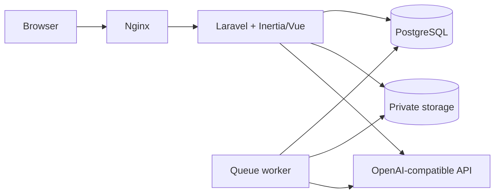
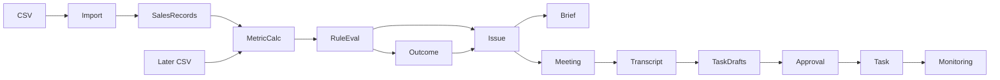

# Architecture

## 1. System
Pragmatic modular monolith: one Laravel 13 codebase, one PostgreSQL database, Vue 3 + Inertia.js UI served by the same app, database queue worker, cron scheduler when needed. No Docker, Redis, microservices, GraphQL, or separate frontend/backend deployments.



## 2. Technology and versions
Laravel 13, PHP version supported by Laravel 13 (verify in S01; expected 8.3+), Composer, Vue 3 Composition API, TypeScript, Inertia.js, Vite, Tailwind CSS, shadcn-vue, Lucide, Apache ECharts, PostgreSQL. Official Laravel Vue starter kit used where appropriate. **S01 records the verified compatible versions in this file (section 11).** Laravel session auth, database queue, database cache, notifications, private `local` disk.

## 3. Module boundaries
Modules are folders, not packages. Cross-module calls go through Actions/Services, never through another module's controllers. Later specs extend earlier pages (for example `IssueController::show`) instead of using plugin registries. Events are used for async work and Core activity logging only (`stage-1-refinements.md` R7).

| Module | Responsibility | Key locations |
|---|---|---|
| Identity | company, departments, users, roles, policies | Models, Policies, Actions/Identity |
| Imports | CSV parse, validate, preview, commit, completeness | Services/Imports, Actions/Imports, Jobs |
| Intelligence | metrics, rules, evaluations, issues, notifications | Services/Intelligence, Actions/Issues |
| Briefing | brief assembly, AI text, speech | Services/AI, Actions/Briefs |
| Meetings | meetings, transcription, extraction, drafts | Services/AI, Actions/Meetings |
| Tasks | approval, tasks, comments | Actions/Tasks |
| Outcomes | baseline, follow-up evaluation, feedback | Services/Intelligence, Actions/Outcomes |
| Activity | activity log writer | Actions/Activity |

## 4. Application structure
Backend: `app/Actions`, `Models`, `Enums`, `Services`, `Services/AI`, `Services/Imports`, `Services/Intelligence`, `Jobs`, `Policies`, `Events`, `Listeners`, `Notifications`, `Http/Controllers`, `Http/Requests`. Frontend: `resources/js/{components,layouts,composables,types,pages/*}`. Actions are single-purpose classes with one `handle()` method used for multi-step, transactional operations. No repository layer over Eloquent.

## 5. Data flow

Evaluation is triggered after every confirmed import (queued job `EvaluateRulesJob`). Outcome verification is invoked by the same job for issues in Monitoring.

## 6. AI integration architecture
Four small classes in `app/Services/AI`: `BriefGenerator`, `MeetingTaskExtractor`, `TranscriptionService`, `SpeechService`, sharing one thin `OpenAiClient` (Laravel `Http` facade, timeouts, no SDK framework). Model ids come from `config/ai.php` read from env: `AI_TEXT_MODEL`, `AI_TRANSCRIPTION_MODEL`, `AI_SPEECH_MODEL`, `AI_SPEECH_VOICE`, `AI_BASE_URL`, `OPENAI_API_KEY`. No model name is hardcoded.

- **Sent to provider:** brief — structured verified metrics and issue evidence (no user emails/passwords); transcription — the audio file; extraction — transcript text, meeting date, company timezone, list of staff display names and ids of the meeting's department; speech — brief text.
- **Stored locally:** requests status, provider response ids, sanitized errors, generated brief JSON, transcript, task drafts, audio files. API keys never stored or sent to the frontend.
- **Output contracts:** JSON schema structured outputs, validated server-side (Laravel Validator) before persistence. Invalid output is a failed attempt, not partially saved.
- **Authoritative figures:** brief items carry `evidence` copied from `rule_evaluations`; the UI renders numbers from structured fields, AI supplies only `title` and `explanation` text. Post-generation check rejects explanation text containing numbers not present in the evidence set (allow-list match); on rejection retry once, then fall back.
- **Failures:** HTTP timeouts 30 s text, 120 s transcription, 60 s speech, single attempt per call; the job retries recoverable errors (timeout, 429, 5xx) 3 times with backoff 10/30/60 s; then status `failed` with a user-visible Retry button. Brief falls back to the deterministic summary (`source = fallback`) and is labelled "AI unavailable". Transcription failure offers manual transcript entry.
- **Human approval:** AI never assigns tasks, changes rules, or sends notifications. Task drafts become tasks only through `ApproveTaskDraft`.
- **Prompt-injection:** transcripts are passed as delimited data; system prompt states they are untrusted; output is schema-constrained; assignee ids must belong to the allowed staff list.

## 7. Background processing
Database queue with two named queues, `default` and `ai`, and two Supervisor programs. Jobs: `ProcessImportJob`, `EvaluateRulesJob`, `VerifyOutcomesJob` (default); `GenerateBriefJob`, `GenerateBriefAudioJob`, `TranscribeMeetingJob`, `ExtractMeetingTasksJob` (ai). Retries live in the job only (3 tries, backoff 10/30/60 s); `OpenAiClient` makes a single attempt. `retry_after=300`, worker `--timeout=180`, Supervisor `stopwaitsecs=200`. Budget table and rules: `docs/stage-1-refinements.md` R6. Jobs are idempotent: status guards, `ShouldBeUnique` (`uniqueFor` 900 s), `failed()` handlers, `afterCommit` dispatch.

## 8. Security (summary; see steering/security.md)
Session auth, CSRF, Form Requests, Policies on every model, department scoping in query scopes, private storage with authorized streaming download, upload validation by extension and MIME and size, throttling on login/uploads/AI endpoints, secrets only in `.env`, log redaction, consent checkbox persisted per meeting, retention command.

## 9. Deployment architecture
Single Ubuntu VPS: Nginx → PHP-FPM, PostgreSQL local, two Supervisor programs running `php artisan queue:work database --queue=default|ai --timeout=180 --max-time=3600`, cron `* * * * * php artisan schedule:run` (retention cleanup), Let's Encrypt HTTPS, `storage/app/private` outside web root, nightly `pg_dump` and file rsync. Deploy by `git pull`, `composer install --no-dev`, `npm ci && npm run build`, `php artisan migrate --force`, cache config/routes/views, `queue:restart`.

## 10. Decisions and trade-offs
| Decision | Why | Trade-off |
|---|---|---|
| Modular monolith | Simple to run and debug | Discipline needed for boundaries |
| DB queue/cache | No Redis, enough for demo load | Lower throughput |
| Metrics computed from sales_records on demand, evidence snapshotted in `rule_evaluations` | No MetricSnapshot table, history is preserved by snapshots | Recompute cost trivial at demo scale |
| Corrected imports supersede rows, never delete | Auditability | Extra column and filter |
| Thin HTTP client, no AI SDK framework | Fewer dependencies | Manual schema handling |
| Actions only for multi-step operations | Avoid abstraction bloat | Mixed styles; rule: use Action when more than one write |
| Users have one role and one department | Fits fixed roles | Not extensible to multi-department |

## 11. Verified versions
Recorded by S01 on 2026-11-25 from the installed environment. Source column: command output or lock-file entry.

| Component | Version | Source |
|---|---|---|
| PHP | 8.5.2 | `php -v` |
| PHP required by Laravel 13 | `^8.3` (minimum 8.3) | `vendor/laravel/framework/composer.json` (`require.php`) |
| Composer | 2.9.5 | `composer --version` |
| Laravel | 13.44.1 | `composer.lock` (`laravel/framework` v13.44.1), `php artisan about` |
| Node.js | 24.13.0 | `node -v` |
| npm | 11.8.0 | `npm -v` |
| PostgreSQL | 17.12 | `psql --version` (server `select version()`) |
| Inertia (server) | inertia-laravel 3.8.0 | `composer.lock` |
| Inertia (client) | @inertiajs/vue3 3.11.0 | `package-lock.json` |
| Vue | 3.5.46 | `package-lock.json` |
| TypeScript / vue-tsc | 5.9.3 / 3.3.14 | `package-lock.json` |
| Tailwind CSS | 4.3.5 | `package-lock.json` |
| shadcn-vue | CLI 2.9.0 (style `new-york`; components copied into `resources/js/components/ui`, built on reka-ui 2.11.0) | `npx shadcn-vue --version`, `components.json`, `package-lock.json` |
| Lucide icons | @lucide/vue 1.80.0 | `package-lock.json` |
| Apache ECharts | 6.1.0 | `package-lock.json` |
| Vite toolchain | vite-plus 1.4.0 (Vite-compatible; shipped by the Laravel Vue starter kit) with laravel-vite-plugin 3.2.1 | `package-lock.json` |
| Laravel starter kit extras | laravel/fortify 1.44.0, laravel/wayfinder 0.1.23 | `composer.lock` |
| Test framework | Pest 5.3.7 on PHPUnit 13.4.7 | `composer.lock` |
| Code style | Laravel Pint 1.32.3; ESLint 10.15.0; Prettier 3.10.1 | `composer.lock`, `package-lock.json` |

Notes:
- The official Laravel Vue starter kit (`laravel/vue-starter-kit` 1.0.2, installed with `laravel new --vue --pest --database=pgsql`) ships Inertia 3, Wayfinder, Fortify and the Vite+ toolchain. Its Vite+ lint/format tools are not used; ESLint and Prettier are added as the specified checks.
- The framework merges its default connection list into `config/database.php`; only `pgsql` is configured and used.

## 12. Automated verification
Focused Laravel feature tests (Pest or PHPUnit as shipped by the starter kit) on a PostgreSQL test database for business-critical behavior; list and limits in `docs/stage-1-refinements.md` R5. No browser automation or property-based frameworks.

## 13. Access control conventions (S02)
Rules every later spec follows. Roles are the fixed `App\Enums\Role` values `owner`, `manager`, `staff` (docs/business-workflows.md D23). Wrong role: 403. Record outside the user's department: 404 (existence is never revealed).

- **One policy per model**, in `app/Policies`, auto-discovered by the `{Model}Policy` name. Default deny, and every method denies an inactive user. The trait `App\Policies\Concerns\AuthorizesByDepartment` provides `sameDepartment($user, $departmentId)`.
- **No blanket Owner `before()` hook.** Each policy method states who may act, so department-scoped Manager rules are never bypassed by a shortcut.
- **Controllers** authorize (`Gate::authorize`) then validate (Form Request) then call an Action or Service. Navigation visibility is display only and never authorization. `config/navigation.php` lists the roles per section, and the `section.access` middleware returns 403 for sections a role does not see.
- **Middleware order:** `auth`, `active` (ends the session of a deactivated user), `section.access` run before route model binding (`prependToPriorityList` in `bootstrap/app.php`), so a deactivated user or wrong role is rejected before any record is resolved.
- **Department scoping:** a model with `company_id` and `department_id` uses `App\Models\Concerns\ScopedToDepartment` and is always queried through `visibleTo($user)`. Owner: rows of the company. Manager and Staff: rows of their own department. Inactive user or no department: no rows. It is an explicit local scope, never a global scope. Staff are further restricted to their own assignments by the spec that owns the model.
- **Form Requests** validate every request body; secrets are never flashed or redisplayed.

Example for a later spec (S03 imports):

```php
// app/Models/Import.php
class Import extends Model { use ScopedToDepartment; }

// app/Providers/AppServiceProvider.php (boot): out-of-scope id => 404
Route::bind('import', fn (string $id) => Import::visibleTo(request()->user())->findOrFail($id));

// app/Http/Controllers/ImportController.php: in scope but wrong role => 403
public function show(Import $import) { Gate::authorize('view', $import); /* ... */ }

// Lists
Import::visibleTo($request->user())->latest()->get();
```

Settings tabs are listed in `App\Support\SettingsTabs`, filtered by policy. S03 (Import template) and S04 (Rules) add their tab there.
