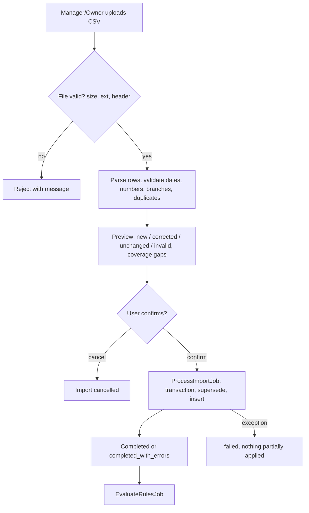
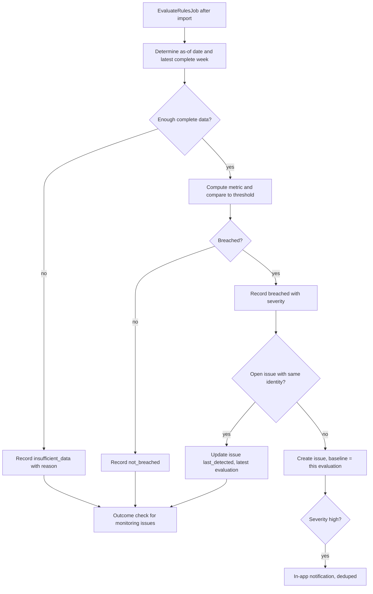
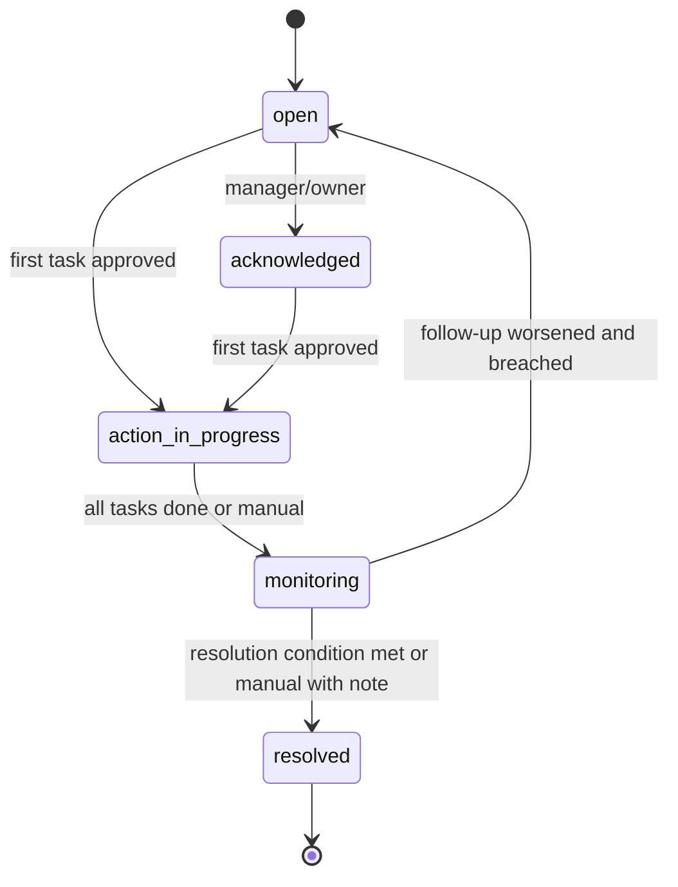
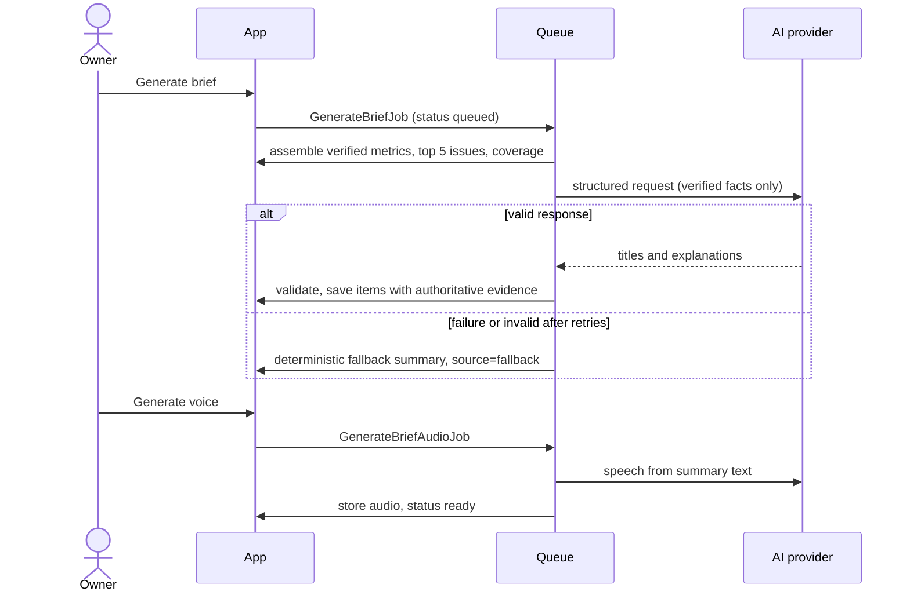
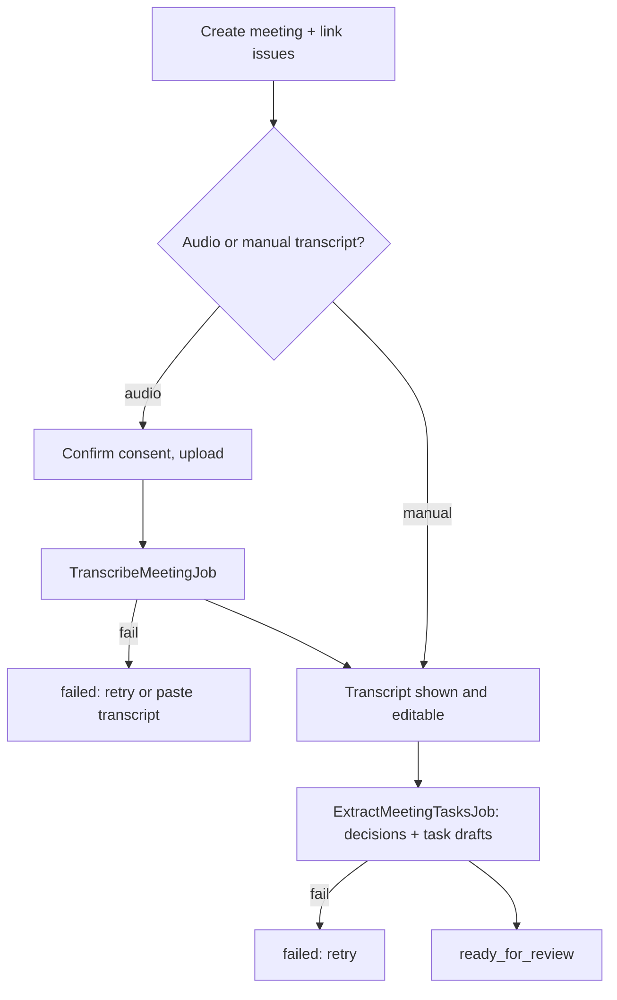
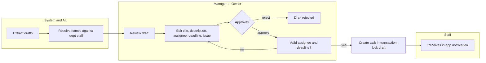
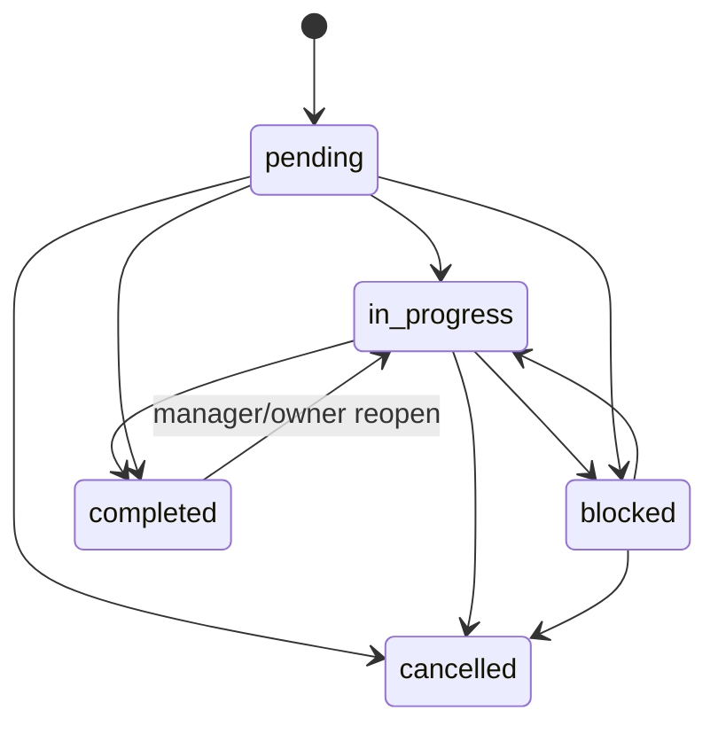
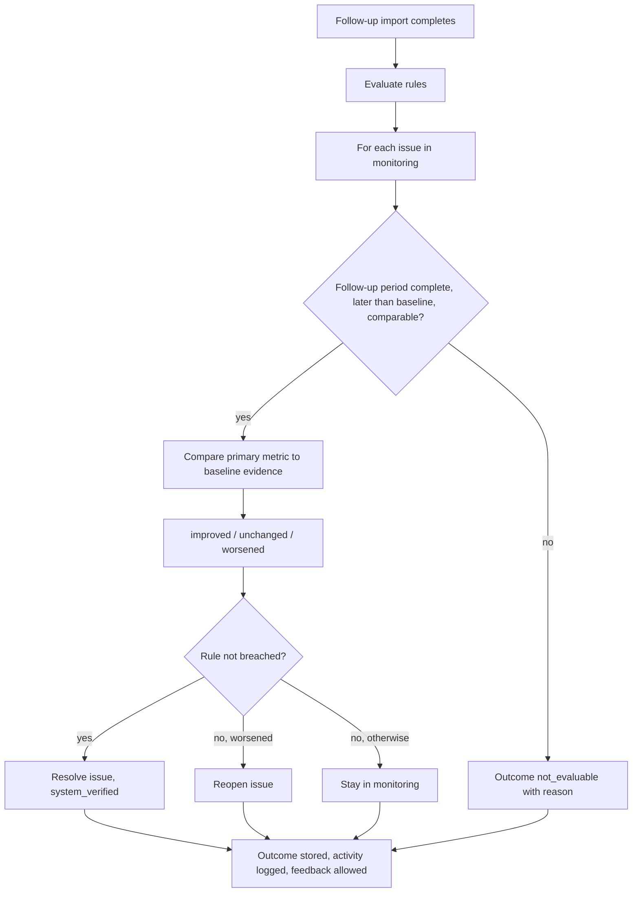

# Business Workflows and Decisions

Process diagrams only. The data model is in `data-model.md`. Values marked **(demo default)** are not confirmed client requirements.

## 0. Business logic decisions
| # | Topic | Decision |
|---|---|---|
| D1 | Data grain | One `sales_records` row per branch per calendar day: `branch_code, sales_date, revenue, target_revenue, order_count?`. |
| D2 | Reporting frequency | Daily rows, uploaded in files of any size (typically weekly). |
| D3 | Expected calendar | Each active branch must have a row for every trading day (Mon–Sat, **demo default**, `companies.trading_days`). Expected branches = distinct `branch_code` seen in the first confirmed import, editable in Settings. Public holidays: not modelled in Stage 1 (assumption, flagged). |
| D4 | Record identity | `(department_id, branch_code, sales_date)`. Only one active row per identity. |
| D5 | Corrected import | Re-uploaded identity with different revenue/target/order_count **supersedes** the active row: old row `is_active=false`, new active row inserted. Identical values are counted `unchanged` and ignored. Import preview shows counts new/corrected/unchanged/invalid. Corrections never delete history. Rows inside the same file with duplicate identity are invalid (error `duplicate_in_file`), both rows rejected. Same file hash re-uploaded: allowed but the preview flags "file already imported" and all rows are unchanged. |
| D6 | Complete vs incomplete period | A week (ISO Mon–Sun) is **complete** when every expected branch has an active row for every trading day. Otherwise **partial**. Partial weeks are never compared as if complete and never zero-filled. |
| D7 | Previous-period comparison | Rules evaluate the ISO week containing the as-of date (latest `sales_date`). That week must be complete, and for the decline rule the immediately preceding week must also be complete; otherwise `insufficient_data`. There is no fallback to an earlier complete week. (The dashboard in S05 separately displays the latest complete week, always with explicit dates.) |
| D8 | Currency/precision | MYR, 2 decimals, `numeric(14,2)`. Percentages computed with `bcmath`/decimal strings at 4 dp, stored and displayed at 2 dp, round half up. Negative revenue invalid. |
| D9 | Zero denominators | Previous-week revenue = 0, or target sum = 0 → `insufficient_data` with reason `zero_denominator`. Never 0% or infinity. |
| D10 | Missing-data behavior | Rule 3 evaluates the window from the Monday of the week containing the **as-of date** (latest `sales_date` in active records) through as-of date. Any expected branch-day missing → `breached` (issue "Missing sales data"). Data freshness (days between business today and as-of date) is shown separately and does not create an issue in Stage 1. If no records → `insufficient_data`. Missing data is never treated as zero. |
| D11 | Issue identity | `(business_rule_id, department_id, scope_key)`; Stage 1 `scope_key='department'`. At most one non-resolved issue per identity (partial unique index). |
| D12 | Recurrence | After `resolved`, a new breach creates a **new** issue with `recurrence_of_issue_id` pointing to the previous one. Resolved issues are immutable except notes/feedback. |
| D13 | Issue lifecycle | `open → acknowledged → action_in_progress → monitoring → resolved`. Allowed: open→acknowledged (manager/owner); open/acknowledged→action_in_progress (automatic when first task approved for the issue); action_in_progress→monitoring (automatic when ≥1 linked task completed and no linked task remains pending/in_progress/blocked, or manual by manager/owner); monitoring→resolved (automatic when outcome `resolution_condition_met`, or manual by manager/owner with required note, `resolution_type=manual`); monitoring→open (automatic if a follow-up evaluation is breached and result `worsened`; the issue is reopened, baseline unchanged). No other backward transitions exist. Task completion alone never resolves. |
| D14 | Re-detection | Breach with an existing non-resolved issue: update `last_detected_at`, `latest_evaluation_id`, `detection_count`, severity (may only increase automatically), title unchanged. `baseline_evaluation_id` never changes. |
| D15 | Task lifecycle | `pending → in_progress → completed`; `pending/in_progress ↔ blocked`; `pending/in_progress/blocked → cancelled` (manager/owner only); `completed` may be reopened to `in_progress` by manager/owner only. Staff may set pending/in_progress/blocked/completed on their own tasks. Overdue = `due_date < business today` and status not completed/cancelled (computed). |
| D16 | Multiple tasks per issue | Allowed. Issue moves to monitoring only when all non-cancelled linked tasks are completed (D13). |
| D17 | Outcome criteria | Each follow-up complete week evaluated for a monitoring issue. Primary metric per rule: decline → weekly change %; target → achievement %; missing data → coverage % (present branch-days / expected). Comparable means follow-up period starts after baseline period end, is a complete week, and uses same branches. Change = follow-up − baseline in percentage points. `improved` ≥ +2.0 pts, `worsened` ≤ −2.0 pts **(demo default)**, otherwise `unchanged`; not comparable → `not_evaluable`. Resolution condition met when the follow-up rule result is `not_breached` on 1 complete week **(demo default)**. |
| D18 | Causation | UI copy says "Observed change after actions", never "caused by". |
| D19 | Notification dedupe | Urgent (severity high/critical) in-app notification to Owner and department Manager when an issue is created, or when severity increases, or on recurrence. Dedupe key `issue_id:severity`; not re-sent on repeated detection. |
| D20 | AI retries | Automatic: 3 attempts, backoff 10/30/60s, only for timeouts, 429, 5xx. Validation failures: one corrective retry. Then `failed`; user presses Retry (new attempt, `tries` reset). Re-generation of audio is skipped if `audio_status=ready` unless user chooses Regenerate. |
| D21 | Job idempotency | See architecture §7; evaluations keyed by `run_key`, imports processed in transaction with status guard, task approval locked with `SELECT … FOR UPDATE` plus unique `task_drafts.task_id`. |
| D22 | Recording storage | Private disk `storage/app/private/recordings/{meeting_id}/`, random filename, served via authorized stream only; retention 30 days **(demo default)**. |
| D23 | Access control | Owner: company-wide. Manager: own department data (imports, issues, meetings, tasks, drafts). Staff: own tasks and comment on them, dashboard limited to own tasks; may view the issue and meeting decision linked to their task (read-only summary). |
| D24 | Demo reset | `demo:reset` only runs when `DEMO_MODE=true` and the target company has `is_demo=true`, requires `--force` or typed confirmation, deletes only rows belonging to that company and its files, then reseeds. |
| D25 | Severity | Stored in `business_rules.params`. Decline: `high_drop_pct` (default 25; **demo seed 15**), otherwise medium. Target shortfall: `high_below_pct` (default 70), otherwise medium. Missing data: medium. Critical is unused in Stage 1. Urgent means severity high. |
| D26 | Business "today" | `BusinessClock::today()` = today in company timezone, or `DEMO_FIXED_DATE` when `DEMO_MODE=true`. |

## 1. Data import workflow

Invalid rows never block valid rows (partial import with error report). Header or format failures reject the whole file.

## 2. Rule evaluation workflow

## 3. Issue lifecycle

## 4. Executive briefing workflow

No breached rules and sufficient coverage → normal-status brief. Partial/stale data is stated explicitly.

## 5. Meeting intelligence workflow

Editing the transcript after extraction allows "Re-extract", which supersedes only `pending` drafts (new `extraction_run`), never approved ones.

## 6. Task approval workflow (swimlanes)

## 7. Task execution workflow

## 8. Outcome verification workflow

## 9. Failure and exception paths
| Failure | Behavior |
|---|---|
| Bad CSV header | Whole file rejected, expected template shown. |
| Row errors | Reported with row number, column, code; valid rows importable. |
| Import job crash | Transaction rolled back, status `failed`, retry available. |
| Provider timeout/429/5xx | Auto retry ×3, then failed state with Retry button. |
| Invalid AI JSON | One corrective retry, then fail (brief → fallback). |
| Transcription failure | Meeting `failed` at stage `transcription`; paste transcript fallback. |
| Ambiguous assignee/deadline | Draft left unresolved; approval blocked until set. |
| Double-click approve | Second request returns existing task, no duplicate. |
| Corrected data after issue | Issue evidence unchanged; new evaluation reflects corrected data. |
| Forbidden access | 403 via policy; department scoping returns 404 for out-of-scope records. |
