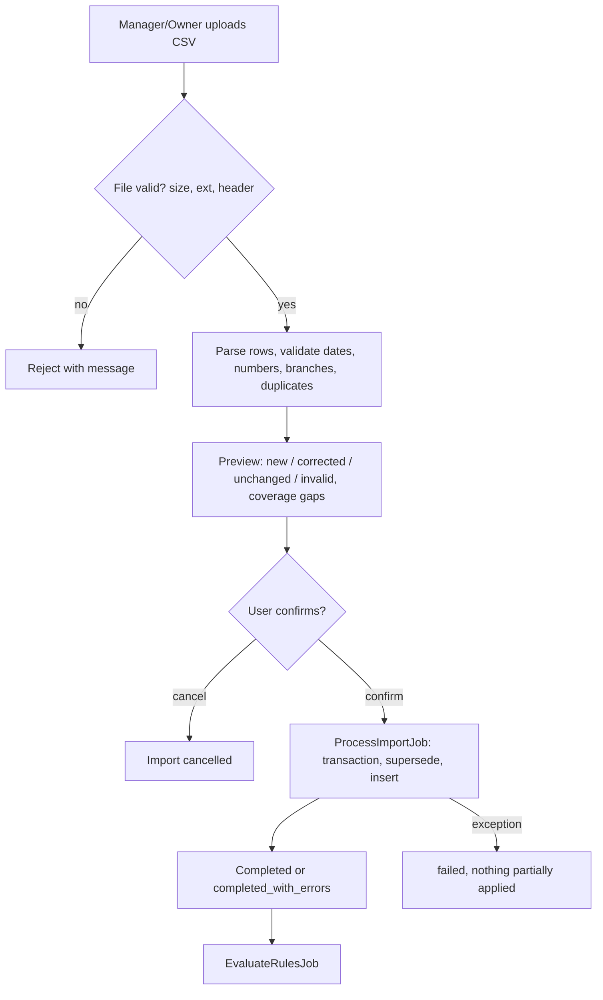
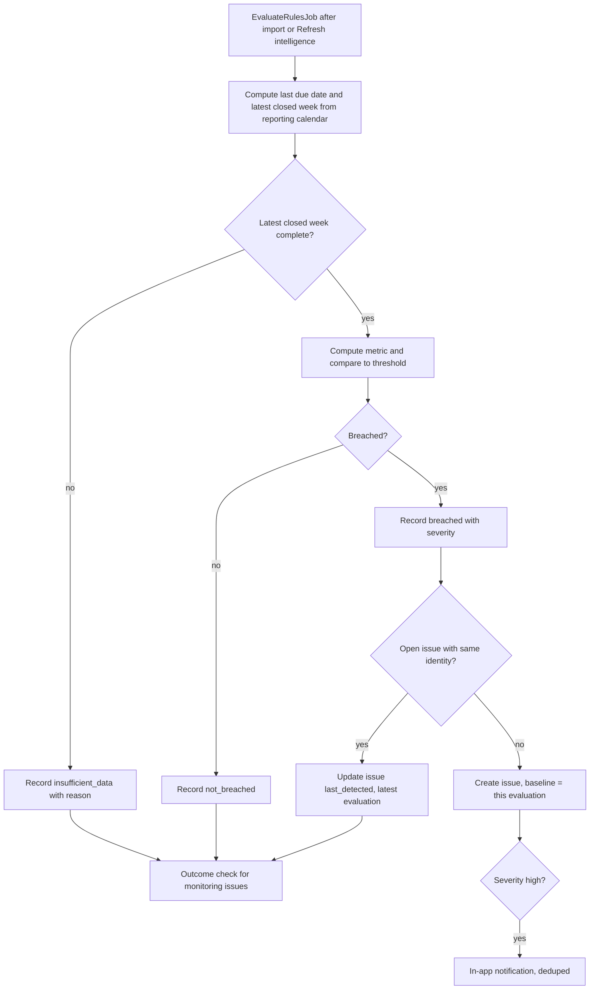
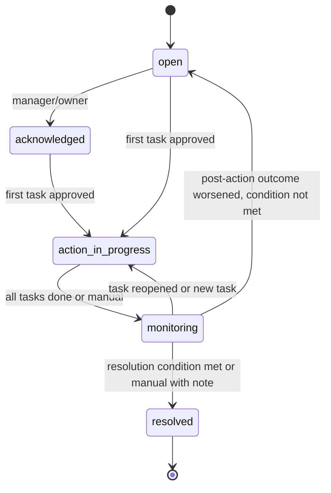
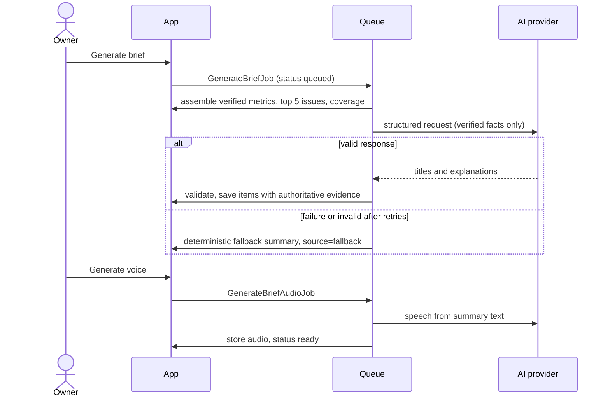
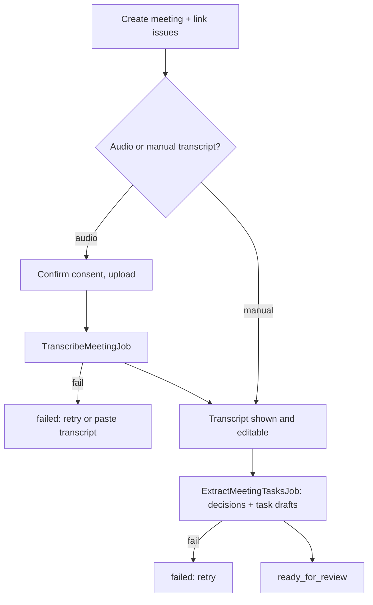
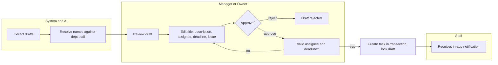
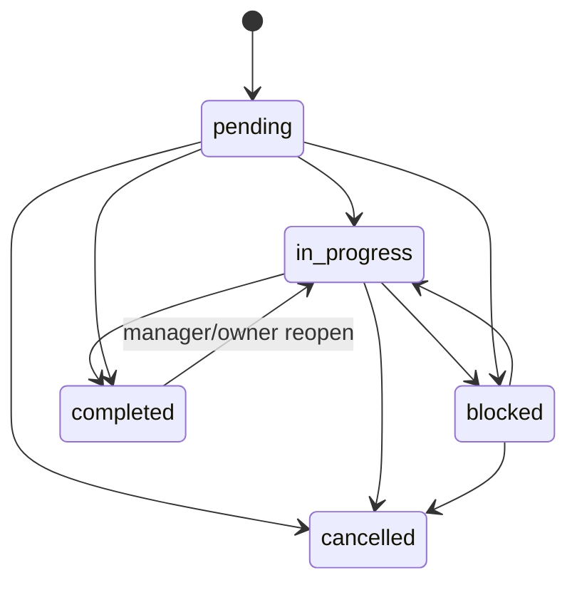
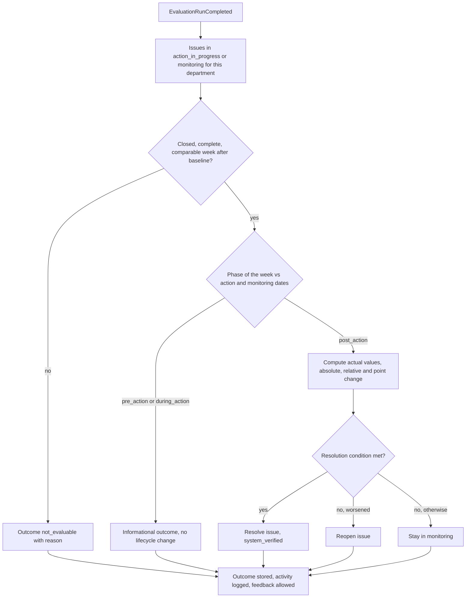

# Business Workflows and Decisions

Process diagrams only. The data model is in `data-model.md`. Values marked **(demo default)** are not confirmed client requirements.

## 0. Business logic decisions
Authoritative refinements: `docs/stage-1-refinements.md` (R2 calendar and freshness, R3 outcomes, R4 lifecycle, R6 queues). Values marked **(demo default)** are not confirmed client requirements.

| # | Topic | Decision |
|---|---|---|
| D1 | Data grain | One `sales_records` row per branch per calendar day: `branch_code, sales_date, revenue, target_revenue, order_count?`. |
| D2 | Reporting frequency | Daily rows, uploaded in files of any size (typically weekly). |
| D3 | Reporting calendar | Company `trading_days` (Mon–Sat), `reporting_cutoff_time` (12:00) and `reporting_cutoff_lag_days` (1) **(demo defaults)**. A trading day is due when `BusinessClock::now()` is at or after cutoff time on day + lag. Expected branches are explicit in `departments.settings.expected_branches` (demo: KL, PG, JB); no auto-fill from an import. Public holidays are not modelled in Stage 1. |
| D4 | Record identity | `(department_id, branch_code, sales_date)`. One active row per identity. |
| D5 | Corrected import | A re-uploaded identity with different values supersedes the active row (old row `is_active=false`, new row inserted). Identical values count as `unchanged`. Duplicate identity inside one file: both rows invalid (`duplicate_in_file`). Same file hash: allowed, flagged, all rows unchanged. History is never deleted. |
| D6 | Week states | ISO week is `closed` when every trading day is due, else `open`. A closed week is `complete` (all expected branch-days present), `incomplete`, or `absent`. Open weeks are informational and never evaluated by decline/target rules. Partial data is never zero-filled. |
| D7 | Comparison | Decline compares the latest closed week to the preceding week; both must be closed and complete, otherwise `insufficient_data`. No fallback to older weeks. |
| D8 | Currency/precision | MYR `numeric(14,2)`; percentages computed at 4 dp, displayed at 2 dp, round half up; decimal math, no floats. |
| D9 | Zero denominators | Zero previous-week revenue or zero target → `insufficient_data` (`zero_denominator`). |
| D10 | Missing and fresh data | Missing-data rule breaches when any due expected branch-day in the current and previous ISO week up to `last_due_date` has no row (rows missing inside the submitted period and due days after the latest sales date both count). Not-yet-due days never alert. Freshness (`current`/`behind`) is shown live and never creates an issue. Evaluation runs after an import completes and on explicit "Refresh intelligence"; there is no scheduler. |
| D11 | Issue identity | `(business_rule_id, department_id, scope_key)`, Stage 1 `scope_key='department'`; one non-resolved issue per identity (partial unique index). |
| D12 | Recurrence | After `resolved`, a new breach creates a new issue with `recurrence_of_issue_id`. Resolved issues are immutable except feedback. |
| D13 | Issue lifecycle | Transition table in `stage-1-refinements.md` R4 (includes `monitoring → action_in_progress` on task reopen or new task, manual reasons in `issues.resolution_note` / `status_history`). |
| D14 | Re-detection | Updates `last_detected_at`, `latest_evaluation_id`, `detection_count`; severity only increases automatically; `baseline_evaluation_id` never changes. |
| D15 | Task lifecycle | `pending → in_progress → completed`; `pending/in_progress ↔ blocked`; `pending/in_progress/blocked → cancelled` (Owner/Manager); `completed → in_progress` reopen (Owner/Manager). Staff set `in_progress/blocked/completed` on their own tasks. Overdue is computed: `due_date < BusinessClock::today()` and status not completed/cancelled. `completed_at` uses `BusinessClock::now()`. |
| D16 | Multiple tasks per issue | Allowed. Monitoring starts when all non-cancelled linked tasks are completed and at least one is completed. A new or reopened linked task returns a monitoring issue to `action_in_progress`. |
| D17 | Outcomes | Phases `pre_action`/`during_action`/`post_action`; only post_action outcomes on closed, complete, comparable weeks can resolve or reopen. Metrics per rule and classification bands: R3 (revenue relative ±2.0%, percentage metrics ±2.0 pp). Actual values, absolute change, relative change and point change are all stored and shown where relevant. |
| D18 | Causation | UI copy: "Observed change after actions". |
| D19 | Notification dedupe | Urgent (severity high) in-app notification to Owner and department Manager on issue creation, severity increase, or recurrence; key `issue_id:severity`. |
| D20 | AI retries | One retry layer: the queue job (3 tries, backoff 10/30/60 s) for recoverable provider errors only. `OpenAiClient` does not retry. One corrective re-request on schema or number-check failure inside the same attempt. After final failure: `failed` with manual Retry. See R6. |
| D21 | Idempotency | Evaluations keyed by `run_key` (rule config, periods, as-of/cutoff context, expected branches, trading days, active record ids). Imports run in a transaction with a status guard. Task approval uses a row lock plus unique `task_drafts.task_id` and `tasks.task_draft_id`. |
| D22 | Recording storage | Private disk `recordings/{meeting_id}/` with random filename, authorized streaming only, retention 30 days **(demo default)**. |
| D23 | Access control | Owner company-wide; Manager own department; Staff own tasks (read-only decision excerpt and issue summary for their tasks). Out-of-scope records return 404; wrong role 403. |
| D24 | Demo reset | Guarded, locked, and refused while any job row exists (R8). Never scheduled. |
| D25 | Severity | In `business_rules.params`: decline `high_drop_pct` (default 25, **demo seed 15**); target `high_below_pct` (default 70); missing data medium. Urgent = high. |
| D26 | Business clock | `BusinessClock::now()/today()` use company timezone, or the demo fixed date-time (default time 09:00) when `DEMO_MODE=true`. Business timestamps (task completion, monitoring start, outcome evaluation) use it. |
| D27 | AI authorization | Meeting audio and transcripts are processed only when consent is recorded, the recording is not deleted, and the actor/department are authorized; jobs re-check at run time. |

## 1. Data import workflow

Invalid rows never block valid rows (partial import with error report). Header or format failures reject the whole file.

## 2. Rule evaluation workflow

## 3. Issue lifecycle

## 4. Executive briefing workflow

No breached rules and sufficient coverage → normal-status brief. Partial/stale data is stated explicitly.

## 5. Meeting intelligence workflow

Editing the transcript after extraction allows "Re-extract", which supersedes only `pending` drafts (new `extraction_run`), never approved ones.

## 6. Task approval workflow (swimlanes)

## 7. Task execution workflow

## 8. Outcome verification workflow

## 9. Failure and exception paths
| Failure | Behavior |
|---|---|
| Bad CSV header | Whole file rejected, expected template shown. |
| Row errors | Reported with row number, column, code; valid rows importable. |
| Import job crash | Transaction rolled back, status `failed`, retry available. |
| Provider timeout/429/5xx | Auto retry ×3, then failed state with Retry button. |
| Invalid AI JSON | One corrective retry, then fail (brief → fallback). |
| Transcription failure | Meeting `failed` at stage `transcription`; paste transcript fallback. |
| Ambiguous assignee/deadline | Draft left unresolved; approval blocked until set. |
| Double-click approve | Second request returns existing task, no duplicate. |
| Corrected data after issue | Issue evidence unchanged; new evaluation reflects corrected data. |
| Forbidden access | 403 via policy; department scoping returns 404 for out-of-scope records. |
