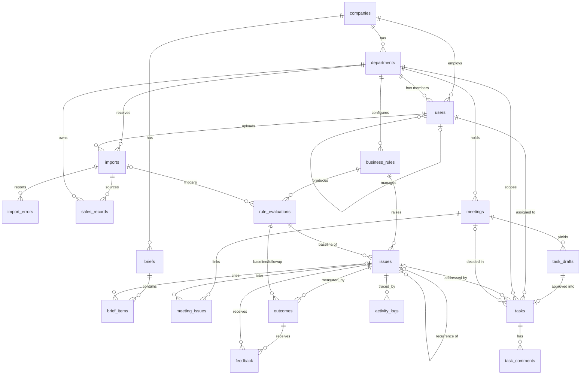

# Data Model

PostgreSQL. All tables have `id` (bigint) and timestamps unless stated. Enums stored as `string` with check constraints via PHP backed enums. Money is `numeric(14,2)`, percentages `numeric(8,2)`.

## 1. Entity review
Kept: companies, departments, users, imports, import_errors, sales_records, business_rules, rule_evaluations, issues, briefs, brief_items, meetings, meeting_issues, task_drafts, tasks, task_comments, outcomes, feedback, activity_logs, plus Laravel `notifications`, `jobs`, `failed_jobs`, `cache`, `sessions`.
Dropped: **MetricSnapshot** (metrics are computed from `sales_records`; evidence is snapshotted in `rule_evaluations.evidence`). **BusinessTarget** (target is a column on the daily row). **Notification** custom table (use Laravel database notifications). **Decision** table (decisions live in `meetings.decisions` JSONB).

## 2. Tables
**companies**: name, timezone (default Asia/Kuala_Lumpur), currency (MYR), trading_days (JSONB int[] ISO 1–7, default [1..6]), is_demo bool, recording_retention_days (default 30).
**departments**: company_id FK, name, slug. Unique(company_id, slug).
**users**: company_id FK, department_id FK null (Owner may be null), manager_id FK users null, name, email unique, password, role (owner|manager|staff), job_title, is_active.
**imports**: company_id, department_id, uploaded_by FK users, original_filename, stored_path, file_hash (sha256), status (uploaded|validated|processing|completed|completed_with_errors|failed|cancelled), total_rows, valid_rows, invalid_rows, inserted_rows, corrected_rows, unchanged_rows, min_date, max_date, confirmed_at, completed_at, error_message. Index(department_id, status), Index(file_hash).
**import_errors**: import_id FK cascade, row_number, column, code, message, raw_row JSONB. Index(import_id).
**sales_records**: department_id, import_id FK (source), branch_code, sales_date, revenue numeric(14,2) ≥0, target_revenue numeric(14,2) ≥0, order_count int null, is_active bool default true, superseded_by_import_id FK null, superseded_at null. **Partial unique** (department_id, branch_code, sales_date) WHERE is_active. Index(department_id, sales_date), Index(import_id).
**business_rules**: department_id, key (weekly_revenue_decline|sales_target_shortfall|missing_sales_data), name, threshold numeric(8,2), severity (low|medium|high|critical), is_active, params JSONB (e.g. comparison basis, grace days). Unique(department_id, key).
**rule_evaluations**: business_rule_id FK, department_id, import_id FK null (trigger), period_start, period_end, comparison_start null, comparison_end null, metric_name, current_value numeric null, comparison_value null, difference_value null, difference_pct null, result (breached|not_breached|insufficient_data), severity, insufficient_reason null, evidence JSONB (full snapshot: weekly totals, branch coverage, sales_record ids/import ids), evaluated_at, run_key string. **Unique(business_rule_id, period_start, period_end, run_key)** where run_key = hash of contributing import ids and active record version, giving idempotency. Index(department_id, evaluated_at).
**issues**: department_id, business_rule_id, scope_key (default 'department'), recurrence_of_issue_id FK null, title, severity, status (open|acknowledged|action_in_progress|monitoring|resolved), first_detected_at, last_detected_at, resolved_at null, resolved_by FK null, resolution_type (system_verified|manual) null, baseline_evaluation_id FK rule_evaluations (preserved at first detection), latest_evaluation_id FK, detection_count int, period_start, period_end. **Partial unique** (business_rule_id, department_id, scope_key) WHERE status <> 'resolved'.
**briefs**: company_id, requested_by FK, status (queued|generating|completed|failed), source (ai|fallback), as_of_date, period_start, period_end, coverage_status (sufficient|partial|stale), headline, summary_text, input_snapshot JSONB (verified metrics sent to AI), model, error_message, audio_status (none|queued|generating|ready|failed), audio_path, audio_model, audio_voice, generated_at. Index(created_at).
**brief_items**: brief_id FK cascade, position 1–5, issue_id FK null, rule_evaluation_id FK null, title, explanation, severity, period_label, evidence JSONB (authoritative figures), source_ref.
**meetings**: department_id, created_by, title, meeting_date, recording_path null, recording_original_name, recording_mime, recording_size, recording_consent_at null, recording_consent_by null, transcript text null, transcript_source (audio|manual) null, transcript_edited_at null, decisions JSONB null (array of {summary, excerpt}), status (draft|uploaded|transcribing|transcribed|extracting|ready_for_review|failed), failure_stage null, error_message, recording_deleted_at null.
**meeting_issues**: meeting_id FK, issue_id FK. Unique(meeting_id, issue_id).
**task_drafts**: meeting_id FK cascade, issue_id FK null (only when confirmed), suggested_title, suggested_description, suggested_assignee_name null, assignee_id FK users null (resolved or chosen), assignee_resolution (resolved|ambiguous|unmatched|none), suggested_due_date null, due_date null, deadline_resolution (resolved|ambiguous|none), transcript_excerpt, status (pending|approved|rejected), reviewed_by, reviewed_at, task_id FK null **unique**, extraction_run int. Index(meeting_id, status).
**tasks**: department_id, task_draft_id FK null **unique**, meeting_id null, issue_id null, title, description, assignee_id FK, assigned_by FK, due_date date, status (pending|in_progress|blocked|completed|cancelled), completed_at null. Index(assignee_id, status), Index(issue_id), Index(due_date).
**task_comments**: task_id FK cascade, user_id, body.
**outcomes**: issue_id FK, baseline_evaluation_id FK, followup_evaluation_id FK, primary_metric, baseline_value, followup_value, change_value, result (improved|unchanged|worsened|not_evaluable), not_evaluable_reason null, comparable bool, resolution_condition_met bool, evidence JSONB, evaluated_at. Unique(issue_id, followup_evaluation_id).
**feedback**: user_id, issue_id FK null, outcome_id FK null (exactly one of the two), useful bool, note text null. Unique(user_id, outcome_id), Unique(user_id, issue_id) where outcome_id is null. Also outcome manual notes: `outcome_notes` via feedback.note for useful feedback, and `outcomes.manual_note text null` with `manual_note_by`.
**activity_logs**: company_id, user_id null (system), action string, subject_type, subject_id (limited use: Import, Issue, Brief, Meeting, Task, Outcome only), issue_id FK null (denormalized trace key), properties JSONB, created_at. Index(issue_id, created_at), Index(subject_type, subject_id). Polymorphic only here and in Laravel notifications.

## 3. ERD

## 4. Ownership and evidence preservation
Imports own sales_records. A correction deactivates old rows (`is_active=false`, `superseded_by_import_id`) and inserts new rows. Rule evaluations snapshot their inputs (`evidence`), and issues point to a baseline evaluation, so historical issues never change when records are later corrected.

## 5. Lifecycle states
Import, Issue, Brief, Meeting, TaskDraft, Task, Outcome: see `docs/business-workflows.md` and enums above.

## 6. Retention
Recordings: deleted after `recording_retention_days` (scheduled command `recordings:purge`) or on Owner request; transcript retained. Brief audio retained until brief deletion. Uploaded CSVs retained for traceability. Demo reset only touches `is_demo` company data. Production retention periods to be confirmed with the client.

## 7. Addenda from specifications (authoritative until merged into sections above)
Specs add the following; each owning spec merges them into this file during implementation.
- `departments.settings` JSONB (S03): `expected_branches` list; S04 adds `intelligence.last_evaluated_at`.
- `imports` counters and six import events (S03); `ReportingCoverage` service contract (S03).
- `issues.status_history` JSONB, append-only (S04). `rule_evaluations.difference_pct` is `numeric(8,4)`; `severity` is null unless breached.
- `meetings`: `recording_uploaded_at`, `extraction_discarded_count`, `extracted_at`; `task_drafts.status` adds `superseded`; `task_drafts.suggested_due_date_text` (S06). `task_drafts.task_id` is a nullable unique column in S06; S07 adds the FK.
- `task_drafts.rejection_reason` (S07).
- `activity_logs.department_id`; subject types Import, RuleEvaluation, BusinessRule, Issue, Brief, Meeting, TaskDraft, Task, Outcome; only S08 listeners write it (S08). `outcomes.manual_note_at`.
- `departments` holds no other new columns. `briefs` has no `department_id` (Stage 1: company equals the Sales department).
- Event-driven activity: S03–S07 dispatch events and never write `activity_logs`.
