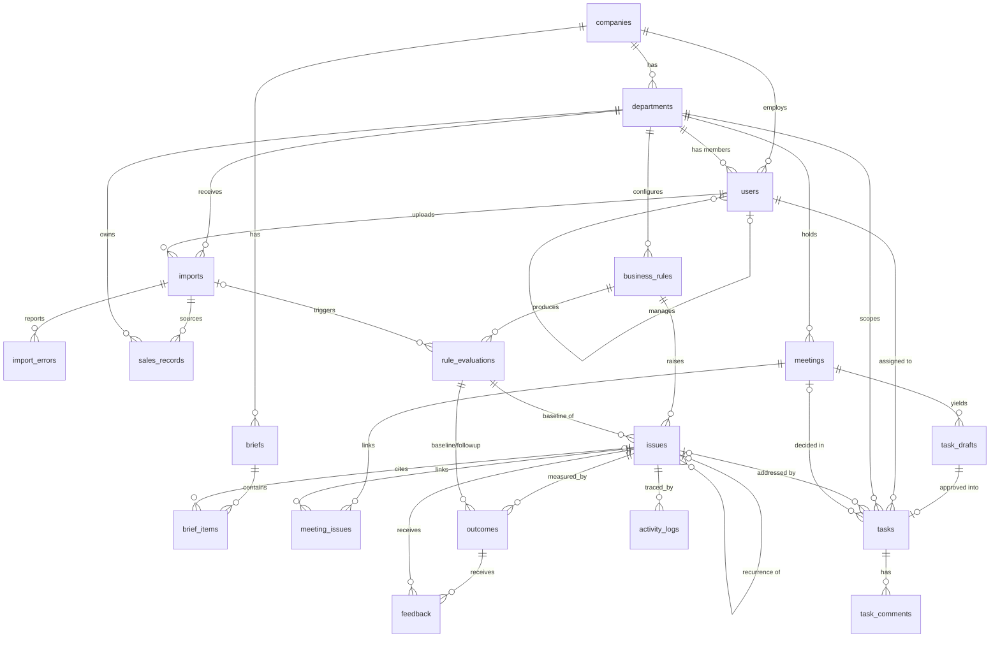

# Data Model

PostgreSQL. All tables have `id` (bigint) and timestamps unless stated. Enums are `string` columns with check constraints backed by PHP enums. Money is `numeric(14,2)`, percentages `numeric(8,2)` unless stated. This file includes the changes made by S01–S09 and `docs/stage-1-refinements.md` (no separate addenda).

## 1. Entity review
Kept: companies, departments, users, imports, import_errors, sales_records, business_rules, rule_evaluations, issues, briefs, brief_items, meetings, meeting_issues, task_drafts, tasks, task_comments, outcomes, feedback, activity_logs, plus Laravel `notifications`, `jobs`, `failed_jobs`, `cache`, `cache_locks`, `sessions`.
Dropped: MetricSnapshot (metrics are computed; evidence is snapshotted in `rule_evaluations.evidence`), BusinessTarget (target is a column on the daily row), custom Notification table, Decision table (decisions live in `meetings.decisions`).

## 2. Tables
**companies**: name, timezone (Asia/Kuala_Lumpur), currency (MYR), trading_days (JSONB int[] ISO 1–7, default [1..6]), reporting_cutoff_time (time, default 12:00), reporting_cutoff_lag_days (smallint, default 1), is_demo bool, recording_retention_days (default 30).
**departments**: company_id FK, name, slug, settings JSONB (`expected_branches` string[], `intelligence.last_evaluated_at`). Unique(company_id, slug).
**users**: company_id FK, department_id FK null (Owner may be null), manager_id FK users null, name, email unique, password, role (owner|manager|staff), job_title, is_active.
**imports**: company_id, department_id, uploaded_by, original_filename, stored_path, file_hash (sha256), status (uploaded|validated|processing|completed|completed_with_errors|failed|cancelled), total_rows, valid_rows, invalid_rows, inserted_rows, corrected_rows, unchanged_rows, min_date, max_date, confirmed_at, completed_at, error_message. Index(department_id, status), Index(file_hash).
**import_errors**: import_id FK cascade, row_number, column, code, message, raw_row JSONB. Index(import_id).
**sales_records**: department_id, import_id FK, branch_code, sales_date, revenue ≥0, target_revenue ≥0, order_count null, is_active default true, superseded_by_import_id null, superseded_at null. **Partial unique** (department_id, branch_code, sales_date) WHERE is_active. Index(department_id, sales_date), Index(import_id).
**Import counters (S03).** `imports.total_rows` counts data rows only (header and blank lines excluded). Invariants for imports in `validated`, `completed` and `completed_with_errors`: `total_rows = valid_rows + invalid_rows` and `valid_rows = inserted_rows + corrected_rows + unchanged_rows`, where `inserted_rows` is the number of `new` rows. On a `validated` import the counters are the plan; on a finished import they are what the processing job wrote. A `failed` or `cancelled` import changed no sales record, whatever its counters say. `imports.stored_path` is a private-disk path and is never sent to the frontend. `imports.file_hash` is nullable only until the file is stored.
**Scoping (S03).** `imports` has `company_id` and `department_id` and uses `ScopedToDepartment`. `sales_records` has only `department_id` (no `company_id`), so it must not use that trait: `SalesRecord::visibleTo()` resolves the Owner's scope through the departments of the user's company. `import_errors` has no scope of its own and is only reachable through its parent import.
**business_rules**: department_id, key (weekly_revenue_decline|sales_target_shortfall|missing_sales_data), name, threshold numeric(8,2), severity, is_active, params JSONB (`high_drop_pct`, `high_below_pct`). Unique(department_id, key).
**rule_evaluations**: business_rule_id FK, department_id, import_id null, period_start, period_end, comparison_start null, comparison_end null, metric_name, current_value null, comparison_value null, difference_value null, difference_pct numeric(8,4) null, result (breached|not_breached|insufficient_data), severity null unless breached, insufficient_reason null (`incomplete_period`, `period_absent`, `zero_denominator`, `no_records`), as_of_date, last_due_date, evidence JSONB (weekly totals, branch coverage, record and import ids, calendar context), evaluated_at, run_key (sha256 per `stage-1-refinements.md` R8). **Unique(business_rule_id, period_start, period_end, run_key)**. Index(department_id, evaluated_at).
**S04 notes.** `rule_evaluations.as_of_date` is null only when `insufficient_reason = no_records` (the department has no active record). Evaluations are immutable evidence: rows are only inserted, and a repeated run with the same inputs reuses the row through the `run_key` unique constraint. `severity` is set only for `breached` results and `insufficient_reason` only for `insufficient_data` (check constraints). `business_rules.params` values are decimal strings (for example `"15.00"`), `threshold` is null for `missing_sales_data`. `issues.status_history` is an append-only JSONB list of `{from, to, at, by_user_id, reason, trigger}` (`at` is ISO 8601 in the company timezone); business timestamps are stored as UTC instants of the business clock. None of `business_rules`, `rule_evaluations`, `issues` has a `company_id` column, so they are scoped through their department (`ScopedThroughDepartment`). `departments.settings.intelligence` holds `last_evaluated_at` and `evaluated_through_import_id`, written only by atomic `jsonb_set`.
**issues**: department_id, business_rule_id, scope_key ('department'), recurrence_of_issue_id null, title, severity, status (open|acknowledged|action_in_progress|monitoring|resolved), first_detected_at, last_detected_at, detection_count, period_start, period_end, baseline_evaluation_id FK (never changes), latest_evaluation_id FK, action_started_at null, monitoring_started_at null, status_history JSONB (append-only: from, to, at, by_user_id, reason, trigger), resolved_at null, resolved_by null, resolution_type (system_verified|manual) null, resolution_note text null (required when manual). **Partial unique** (business_rule_id, department_id, scope_key) WHERE status <> 'resolved'.
**briefs**: company_id, requested_by, status (queued|generating|completed|failed), source (ai|fallback), as_of_date, period_start, period_end, coverage_status (sufficient|partial|stale), headline, summary_text, input_snapshot JSONB, model, error_message (closed error code), audio_status (none|queued|generating|ready|failed), audio_path, audio_model, audio_voice, generated_at. No department_id (Stage 1 company = Sales department).
**brief_items**: brief_id FK cascade, position 1–5, issue_id null, rule_evaluation_id null, title, explanation, severity, period_label, evidence JSONB, source_ref.
S05 implementation: check constraints `briefs_status_check`, `briefs_source_check`, `briefs_coverage_check`, `briefs_audio_status_check`, `briefs_period_pair_check` (period_start and period_end both null or both set), `brief_items_position_check` (1–5), `brief_items_severity_check`; indexes `briefs(created_at)`, `briefs(company_id, status)`; unique `brief_items(brief_id, position)`; `title` varchar(120), `explanation` varchar(400); `source_ref` is `issue:{issueId}:evaluation:{evaluationId}`; `evidence` is a value copy of `IssueEvidence::toArray()` (includes `current`, the latest evaluation of the rule). `coverage_status`: stale = freshness behind, no sales data, or evaluation stale or never run; partial = latest closed week incomplete or absent, or last evaluation partial or failed; sufficient otherwise. `error_message` holds a closed code only (`timeout|rate_limited|server_error|client_error|invalid_response|evaluation_partial|evaluation_failed|generation_failed`). `departments.settings.intelligence` also holds `last_run_status`, `last_run_failed_rules`, `evaluated_fingerprint`, `evaluated_last_due_date` (S05).
**meetings**: department_id, created_by, title, meeting_date, recording_path null, recording_original_name, recording_mime, recording_size, recording_uploaded_at null, recording_consent_at null, recording_consent_by null, transcript text null, transcript_source (audio|manual) null, transcript_edited_at null, decisions JSONB null, status (draft|uploaded|transcribing|transcribed|extracting|ready_for_review|failed), failure_stage (transcription|extraction) null, error_message (closed error code), extraction_discarded_count default 0, extracted_at null, recording_deleted_at null.
**meeting_issues**: meeting_id FK, issue_id FK. Unique(meeting_id, issue_id).
**task_drafts**: meeting_id FK cascade, issue_id null (confirmed by reviewer), suggested_title, suggested_description, suggested_assignee_name null, assignee_id null, assignee_resolution (resolved|ambiguous|unmatched|none), suggested_due_date null, suggested_due_date_text null, due_date null, deadline_resolution (resolved|ambiguous|none), transcript_excerpt, status (pending|approved|rejected|superseded), rejection_reason null, reviewed_by, reviewed_at, task_id FK null **unique** (nullable column in S06; FK added by S07), extraction_run int.
**tasks**: department_id, task_draft_id null **unique**, meeting_id null, issue_id null, title, description, assignee_id, assigned_by, due_date, status (pending|in_progress|blocked|completed|cancelled), completed_at null (business clock). Index(assignee_id, status), Index(issue_id), Index(due_date).
**task_comments**: task_id FK cascade, user_id, body.
**outcomes**: issue_id FK, baseline_evaluation_id FK, followup_evaluation_id FK, phase (pre_action|during_action|post_action), outcome_metric (weekly_revenue|target_achievement|coverage), baseline_value, followup_value, reference_value null (pre-decline week revenue for decline rule), absolute_change null (MYR), relative_change_pct null, point_change null, result (improved|unchanged|worsened|not_evaluable), not_evaluable_reason null, comparable bool, resolution_condition_met bool, evidence JSONB, manual_note null, manual_note_by null, manual_note_at null, evaluated_at (business clock). Unique(issue_id, followup_evaluation_id). Values for `not_evaluable` rows are null (check constraint).
**feedback**: user_id, issue_id null, outcome_id null (exactly one set), useful bool, note null. Unique(user_id, outcome_id), Unique(user_id, issue_id) where outcome_id is null.
**activity_logs**: company_id, department_id null, user_id null, action, subject_type (Import|RuleEvaluation|BusinessRule|Issue|Brief|Meeting|TaskDraft|Task|Outcome), subject_id, issue_id null, properties JSONB (allow-listed keys only), created_at. Indexes: (issue_id, created_at), (subject_type, subject_id), (company_id, department_id, created_at). Written only by S08 listeners.

## 3. ERD

## 4. Ownership and evidence preservation
Imports own sales_records. A correction deactivates old rows and inserts new ones. Rule evaluations snapshot their inputs, and issues point to a baseline evaluation, so historical issues never change when records are corrected. Outcomes are append-only history.

## 5. Lifecycle states
Issue transitions: `stage-1-refinements.md` R4. Task transitions: `business-workflows.md` D15. Import, brief, meeting, draft, outcome states are the enums above.

## 6. Retention
Recordings: deleted after `recording_retention_days` (S06 `recordings:purge`, PoV Polish but required before real data) or by the Owner; transcript retained. Brief audio retained until brief deletion. Uploaded CSVs retained for traceability. Demo reset touches only `is_demo` company data. Production retention to be confirmed with the client.
